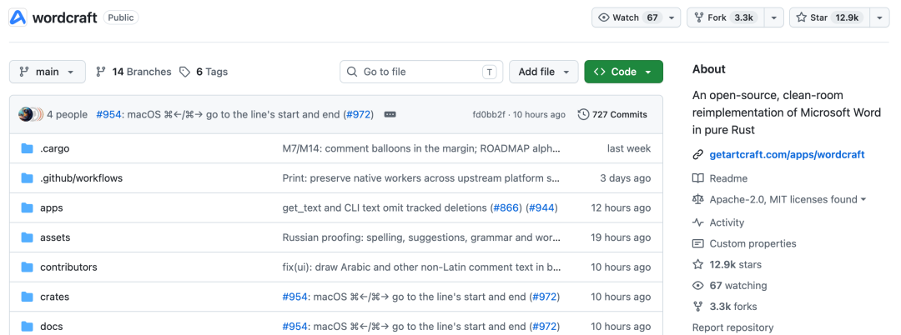
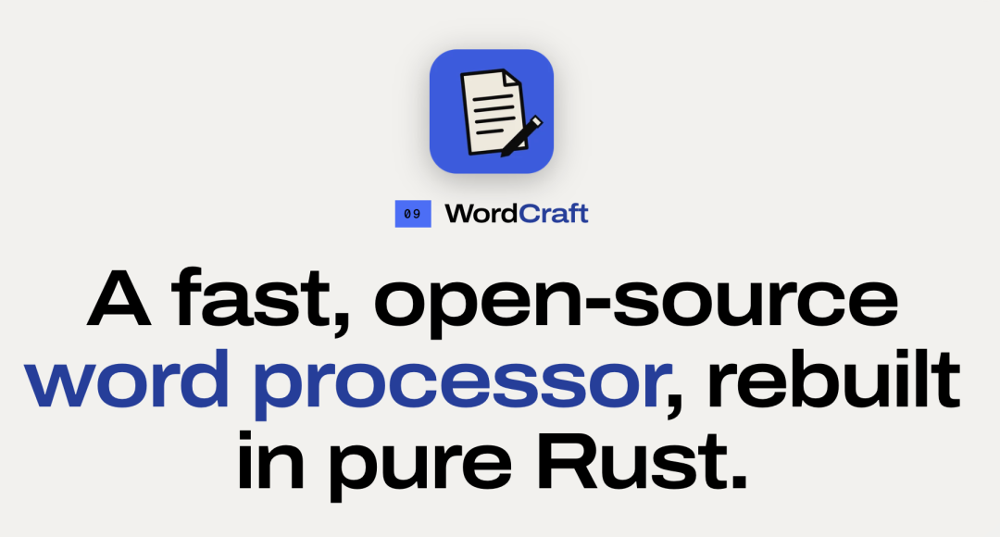
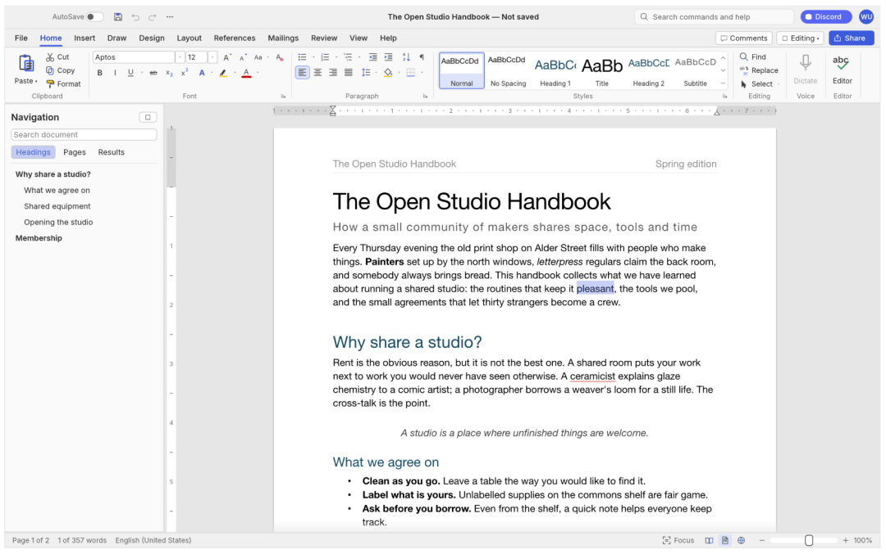

# 开源一周斩获 12.9K！用 Rust 重写 Word，还把 MCP 服务器内置了！
> 💡 备注属性未写入，可能是备注属性名称或者类型被修改了，建议将字段类型设置为 rich_text，可以在小程序-操作-修改文章数据库页面进行调整
> 💡 原文链接:[https://mp.weixin.qq.com/s?__biz=MzkwMjQ0NzI0OQ==&mid=2247507166&idx=1&sn=c4f572539808db228059612aa6c22d83&chksm=c1dd2446d4786f3a7d14f40b7e8827c7d70bb4b94ae8b69f8c32ffbaad8b748d1da20b3a1136#rd](https://mp.weixin.qq.com/s?__biz=MzkwMjQ0NzI0OQ%3D%3D&mid=2247507166&idx=1&sn=c4f572539808db228059612aa6c22d83&chksm=c1dd2446d4786f3a7d14f40b7e8827c7d70bb4b94ae8b69f8c32ffbaad8b748d1da20b3a1136#rd)
上周在 Hacker News 上刷到一个帖子，标题就一个词：**WordCraft**。点进去一看，好家伙——有人居然想用 Rust 从零重写 Microsoft Word。

Word 这套东西，从 90 年代 Word 1.0 走到今天，快三十多年了。那 Ribbon 工具栏背后堆着多少祖传的 C++ 代码？
开源替代不是没有，LibreOffice 就是，可那也是几十年的老代码库了，改起来跟在沼泽里踩泥似的。
但我耐着性子翻了翻 README，越翻越觉得不对劲——这不是个玩具项目。
它说自己是 **clean-room reimplementation**，意思是不看微软源码，全靠公开规范自己重写。读 .docx、写 .docx，表格、样式、修订追踪、引用、邮件合并，一个不落。
更狠的是，它说 188 页的文档重新排版只需要 **1.4 毫秒**。
最让我坐不住的是这一行：**Built for agents**。
它把每一个操作都做成了命令，422 个命令，同一个命令集同时服务于 Ribbon 按钮、键盘快捷键、命令行工具，还有一个 **MCP 服务器**。
📦 5 Parts + Conclusion
👉 滑动
**PART 01**
**WordCraft 到底是什么？**
**PART 02**
**为什么要用 Rust 重写 Word？**
**PART 03**
**它现在能干什么？**
**PART 04**
**那 MCP 到底怎么用？**
**PART ///**
**写在最后**
**01**
**PART**
### WordCraft 到底是什么？
简单说：**WordCraft 是一个用纯 Rust 写的开源 Word 替代品，内置 MCP 服务器给 AI 代理调用。**

开发它的是 **ArtCraft 团队**——一个做了一整套创意工具的团队，除了 WordCraft，还有 PhotoCraft（修图）、VectorCraft（矢量插画）、FilmCraft（视频剪辑）、LightCraft（照片库）、PdfCraft、EffectCraft、DesignCraft，全是 Rust 写的，全开源。
整个团队的路子很明确：**用 Rust 重写创意软件，把文档处理变成可编程的能力。**

**02**
**PART**
### 为什么要用 Rust 重写 Word？
这个问题得拆开说。
#### 先说 Rust
Rust 在系统级编程圈已经火好几年了，内存安全、无 GC、性能和 C/C++ 相当。但把它拿来写办公软件，这不是第一个。
WordCraft 不用 Electron，不用 Tauri，直接用 **egui** 做原生 GPU 加速界面。一份 Rust 代码，同时编译成：
macOS `.dmg`（Apple Silicon + Intel 通用版）
Windows `.msi` 安装包和便携版 `.zip`
Linux AppImage、Flatpak、deb、rpm、tarball，甚至 RISC-V 版本
FreeBSD tarball
**WebAssembly**，浏览器里直接跑
#### 然后是性能
README 里有个数字特别扎眼：**188 页文档重新排版约 1.4 毫秒**。
排版是文档处理里最耗 CPU 的环节——断行、分页、表格布局、点击命中测试，逐字符逐段落地算。
WordCraft 靠的是**排版缓存**：每次编辑后只重算受影响的部分，版本号没变就直接返回缓存结果。
**03**
**PART**
### 它现在能干什么？
项目目前是 **Alpha** 阶段。
官方说 Ribbon 功能覆盖了 Word 的 88%，但考虑到文件兼容性、稳定性和深度，完整替代 Word 大概 **60%**。日常 essentials 差不多 **63%**，专业用户每周工作约 **55%**。
说实话，Alpha 阶段有这个完成度已经很惊人了。让我拉几个重点：
#### 📝 写作
快速打字、IME 输入法、智能引号、自动更正、列表自动格式化、拖选、剪贴板带格式、撤销重做、正则查找替换。
#### 🎨 格式
字体字号、粗体斜体下划线、删除线、上下标、大写、高亮、颜色、字间距、格式刷、更改大小写、清除格式。
#### 📄 段落
对齐、缩进（标尺上可拖拽）、行间距、制表符前导符、边框底纹、段前段后控制、孤行控制。
#### 📋 样式
内置样式集、实时预览、样式窗格、创建/修改样式、主题切换。
#### 🔢 列表
项目符号、编号、多级列表、重新编号、自定义格式。
#### 📊 表格
网格插入、合并拆分、带条纹行的样式、边框底纹、页眉跨页重复、行跨页拆分、排序、公式、文本↔表格互转。
#### 📄 页面
边距、方向、纸张大小、分栏、分页符/分节符、页眉页脚（首页、奇偶页不同）、页码、水印、页面边框、行号、竖排对齐、首字下沉、自动断词。
#### 🖼️ 对象
图片（缩放、裁剪、调色、亮度对比度、透明度、背景移除）、形状、文本框、浮动定位（四周型、上下型、衬于文字下方/上方）。
#### 📚 引用
目录、脚注尾注、APA/MLA/Chicago/IEEE 四种引用格式、题注、图表目录、交叉引用、索引、权威目录。
#### ✅ 审阅
拼写语法检查（英文和波兰文，按运行时语言）、同义词库、字数统计、批注气泡/窗格、修订追踪、接受/拒绝修订、比较文档、限制编辑、可访问性检查、文档检查器。
#### 📧 邮件合并
从 CSV 导入数据、合并字段、地址块、称呼行、规则、预览、一键生成文档。
#### 👁️ 视图
打印布局、Web 布局、草稿、阅读模式、聚焦模式、缩放、单页/多页、页面宽度、导航窗格、标尺、网格线、深色模式。
界面语言：简体中文、繁體中文、日本語、English、Português (Brasil)、Español、Deutsch、Français、Русский、한국어……支持二十多种，跟随系统语言。
#### 📁 文件格式
**
读取** .docx (OOXML)、Word 97-2003 .doc、.odt、.rtf、.html、.md、.tex、.txt
**
写入** .docx（Word 能正常打开）、PDF（带可选文本、链接、书签）、.odt、.rtf、.html、.md、.tex、.txt、页面图片
**04**
**PART**
### 那 MCP 到底怎么用？
这部分是最有想象力的。WordCraft 在设计之初就把 AI 代理考虑进去了。
#### 直接连 Claude Code
`claude mcp add wordcraft -- wordcraft-cli mcp
`
一行命令，Claude Code 就能调用 WordCraft 的工具了。
或者跑一个后台实例，让代理连上去：
`wordcraft --control 7981 &
claude mcp add wordcraft-app -- wordcraft-cli mcp --connect 127.0.0.1:7981
`
#### 代理能用什么？
工具集包括：
| **工具** | **干什么** |
| `list_commands` | 列出所有 422 个可用命令 |
| `execute` | 执行单个命令 |
| `batch` | 批量执行多个命令 |
| `type_text` | 键入文本 |
| `select_text` | 选中文本 |
| `inspect_document` | 以 JSON 结构检查文档，不用截图 |
| `render_page` | 渲染页面图像 |
| `save_document` | 保存文档 |
| `screenshot` | 截图（有运行中的 app 时） |
| `click` | 点击（有运行中的 app 时） |
| `key` | 按键（有运行中的 app 时） |
举个例子，让 AI 生成一个标题加粗的文档：
`wordcraft-cli run --template sample \
 --cmd 'select.text={"text":"Membership"}' \
 --cmd format.bold \
 --save out.docx
`
还可以录制宏——`tools.recordMacro` 记录一串命令，`tools.macros` 回放。
#### 文件夹隔离
如果担心 AI 误操作，可以给它限定读写范围：
`wordcraft-cli mcp --automation-read-root /safe/read \
 --automation-write-root /safe/write
`
这样代理只能在指定目录里活动。
**///**
**LAST**
### 写在最后
WordCraft 最打动我的不是"Rust 重写 Word"这个概念，而是**他们把一件事想得很清楚——文档处理迟早要被 AI 接管**。
传统办公软件走的是"越来越复杂的界面"这条路，Word 的 Ribbon 从 Office 2007 堆到现在，我敢说绝大多数人只用过其中 5% 的按钮。
WordCraft 把每一个操作都暴露成命令，内置 MCP 服务器，这意味着 AI 可以像调用 API 一样操控文档。
你可以写一个脚本，让 AI 读一堆 .docx、批量改格式、生成 PDF、跑一遍目录、输出成 Markdown——整个过程零人工介入。
这不是 Word 的替代品，这是给 AI 时代准备的文档基础设施。
**项目地址**：https://github.com/storytold/wordcraft

如果本文对您有帮助，也请帮忙点个 **赞👍 + 在看** 哈！❤️
**在看你就赞赞我！**

## 摘要

（待补充）

## 我的笔记

（待补充）
