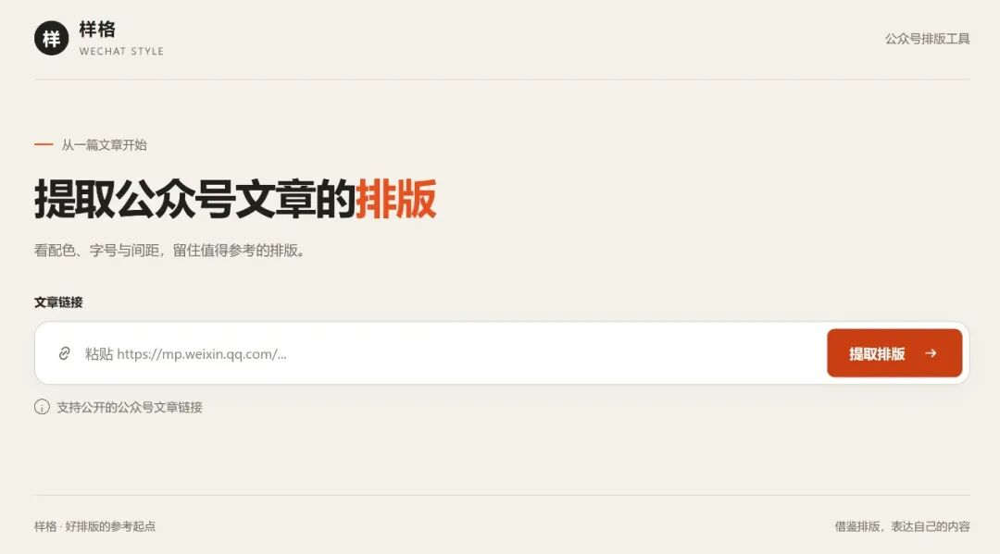
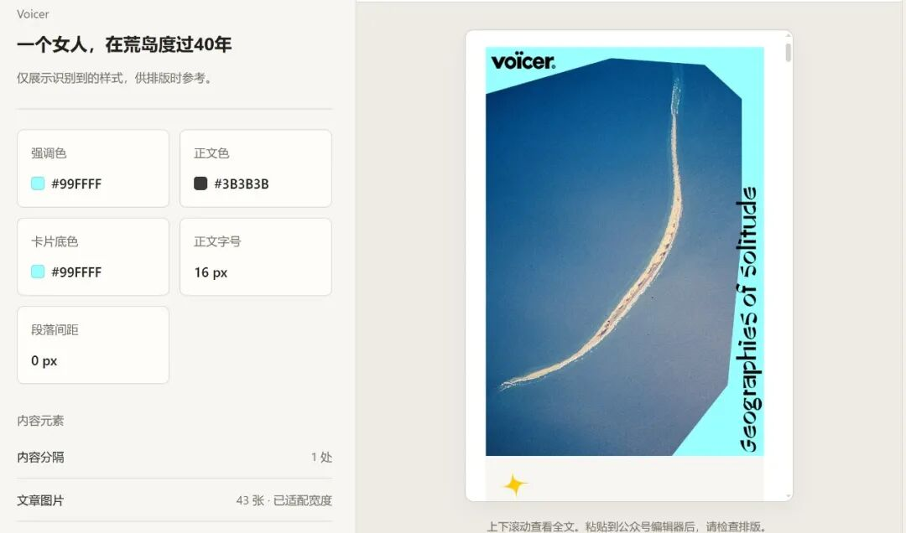

# 开源免费！一键提取大V文章排版风格，新手起号必备~
> 💡 备注属性未写入，可能是备注属性名称或者类型被修改了，建议将字段类型设置为 rich_text，可以在小程序-操作-修改文章数据库页面进行调整
> 💡 原文链接:[https://mp.weixin.qq.com/s?__biz=Mzg4MDE4ODA0OQ==&mid=2247485481&idx=1&sn=bcae6a4088e515ab7fb2a2472dda9165&chksm=ce65933f6ac4e5f6f0052ad381a22a692d5cbd22b3e0dcc8982ddf5abb9303d91c763c32b597#rd](https://mp.weixin.qq.com/s?__biz=Mzg4MDE4ODA0OQ%3D%3D&mid=2247485481&idx=1&sn=bcae6a4088e515ab7fb2a2472dda9165&chksm=ce65933f6ac4e5f6f0052ad381a22a692d5cbd22b3e0dcc8982ddf5abb9303d91c763c32b597#rd)
这里是Amy。
在朋友圈刷到别人家的爆款文章，神仙排版真的绝了。想直接扒下来当自己的模板参考，但还得一点点复刻，太麻烦了！
最近挖到一个超级实用的开源小工具——**wechat-style-extractor**。

可以把你喜欢的任意公众号文章链接丢给它， **就能把里面的文字、图片，甚至那种花里胡哨的排版样式， 一键提取出来。**
还能再复刻出一套同类型的主题直接套用，效率起飞
推荐给有需要的朋友~
**传送门：https://github.com/sennkuwu/wechat-style-extractor**
**01wechat-style-extractor 是什么？**
公众号文章本质是 HTML + CSS。wechat-style-extractor可以通过服务端请求获取文章 HTML，解析 DOM 结构，定位正文容器。
再根据标签、类名、样式特征，识别出各种组件，并提取每个组件的关键参数：颜色，字体，间距，边框等，生成标准 HTML，然后直接复制到微信编辑器。
**02核心功能/亮点**
**完美保留排版样式**：
喜欢的文章一键提取排版格式，如果新手运营，能快速学习头部账号好看的结构框架， 或者做竞品拆解。
还有一点，有了固定格式，团队协作也能统一视觉规范，避免每篇文章风格不一致。
**一键突破图片限制**： 以前抓下来的微信图片全是个裂开的图标。
wechat-style-extractor能帮你把高清图片完美提取出来。 再也不用手动一张张“另存为”了~
**开源免费开箱即用**：
有在线版，网页打开就能用，没有臃肿的商业客户端。，也没有烦人的广告收费。 直接省下每个月几十块买第三方排版插件的冤大头钱。

我觉得它最合适的用法是拆几篇喜欢的号做成自己的模板，省了好多事。
还有一个邪修用法， 一篇文章如果要发几个号，可以提取后分发，避免直接复制粘贴后出现排版乱码或者图片加载不出来的情况。
------------------
这里是Amy，正在AI圈摸爬滚打的新手小白一枚。
让我们共同进步！！
