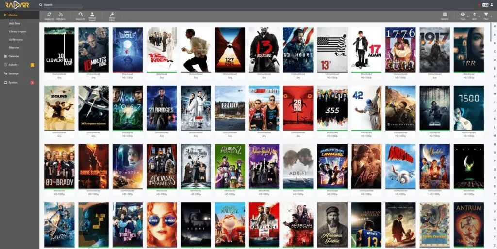
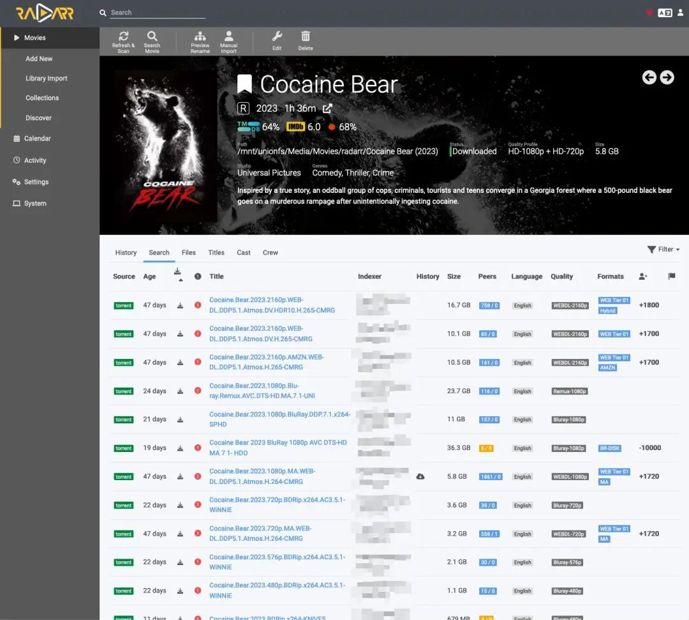
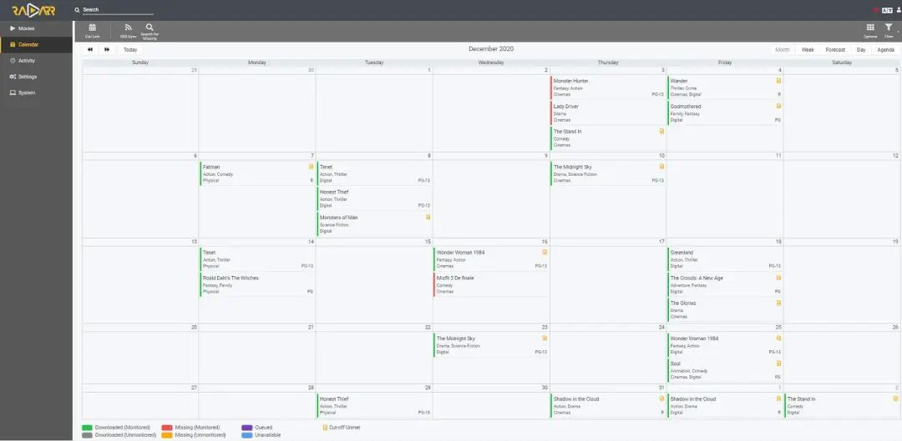

# 开源推荐｜Radarr：14.8k Star 的影视库管家，把找片到洗版全自动跑完
> 💡 备注属性未写入，可能是备注属性名称或者类型被修改了，建议将字段类型设置为 rich_text，可以在小程序-操作-修改文章数据库页面进行调整
> 💡 原文链接:[https://mp.weixin.qq.com/s?__biz=MzkzMzQzNDg2MQ==&mid=2247485362&idx=1&sn=ce9e748149a482127868a5cf48864130&chksm=c3d780f4434eb1e829f2f0050b934a03888e68c62eb0a22b8b56ce6611eb734dda459753ce97#rd](https://mp.weixin.qq.com/s?__biz=MzkzMzQzNDg2MQ%3D%3D&mid=2247485362&idx=1&sn=ce9e748149a482127868a5cf48864130&chksm=c3d780f4434eb1e829f2f0050b934a03888e68c62eb0a22b8b56ce6611eb734dda459753ce97#rd)
大家好，我是 `部长`。
今天，给大家介绍一款影视库管家。
> 关注微信公众号：【
> 源码部落
> 】，获取
> **开源项目分享。
> **
---
## 项目介绍
站内影视方向Jellyfin（播放服务端）、Kodi（客厅媒体中心）、PeerTube（自建视频站）。它们解决的都是"片子已经在硬盘里之后"的事。真正天天耗时间的其实是前半段：想看的片什么时候出、哪个版本画质好、下完文件名一团乱、字幕对不上、洗版要手动重下。
Radarr 就是干这一段的。它是 Servarr 家族（Sonarr 管剧、Lidarr 管音乐、Readarr 管书、Prowlarr 管索引器）里的"电影管家"，一套逻辑跑了很多年，是目前这个领域最成熟的开源实现。
- GitHub 仓库：**Radarr/Radarr**
- ‎**14,847 Star / 1,264 Fork**，主分支 ‎develop，2026-11-20 仍在提交
- 开源协议：**GPL-3.0**
- 最新版本：**7.0.3**（发布标签 v7.0.3.10918）
- 官方文档：Servarr Wiki（‎wiki.servarr.com/radarr）
- 多语言界面：社区通过 translate.servarr.com 翻译，**包含简体中文**
### 功能特性
以下均来自官方 README 与 Servarr Wiki：
**添加与检索**
- 添加电影时自动带出**预告片、评分、简介、海报**等元数据
- ‎**手动搜索**：能列出所有候选源，看得到每个源的体积、做种数、语言、画质、自定义格式得分，也能看到某条为什么没被自动选上
- ‎**自动搜索 + RSS 同步**：盯着多个 RSS 源，新片一出现就抓
- ‎**导入列表（Import Lists）**：可从 IMDb、Trakt 等列表批量导入想看片单
**下载与整理**
- 对接下载客户端：**qBittorrent、Transmission、Deluge、rTorrent、uTorrent、SABnzbd、NZBGet** 等
- ‎**失败自动重试**：某个源下载失败，自动换下一个
- ‎**下载完成自动导入**：按命名规则重命名、建文件夹、归档到电影库
- ‎**质量自动洗版**：库里有 720p，出现 1080p/BD 版本会自动升级替换（例如 DVD → Blu-Ray）
- ‎**识别特殊版本**：导演剪辑版、加长版、硬字幕版、别名（AKA）都能识别
- ‎**质量配置（Quality Profile）**：按分辨率、编码、来源定义"只要这种"，结合**自定义格式（Custom Formats）**做精细打分
- ‎**延迟配置（Delay Profiles）**：故意等几天再抓，避开抢首发的低质量版本
**管理与联动**
- ‎**日历视图**：按月看已上映、待上映、已入库
- ‎**电影合集（Collections）**：一个系列一次加全（如三部曲）
- ‎**标签、多根目录、权限/属主设置**
- 全量 **API（v3）**，配 API Key 调用，方便接自建面板或小程序
- 与 **Kodi、Plex** 联动：下载完成推送通知并触发媒体库刷新
- 通知渠道：Discord、Telegram、邮件、Webhook 等
- 备份与恢复、日志、健康检查都在 Web UI 里
> ⚠️ 一个硬限制：**同一部电影只能保一个版本**。想同时留 4K 和 1080p，得开两个 Radarr 实例。
> 
### 技术选型
- ‎**语言/框架**：C# / **.NET**（仓库 ‎global.json 锁定 SDK **10.0.404**）+ **React** 前端（Servarr 统一底座）
- ‎**数据库**：**SQLite**（库文件 ‎radarr.db，随 ‎/config 目录一起备份即可）
- ‎**平台**：Windows、Linux、macOS、树莓派均有官方发布包
- ‎**Web 端口**：**7878**
- ‎**Docker**：**官方明确不提供镜像**，由社区维护，官方推荐 ‎lscr.io/linuxserver/radarr 与 ‎hotio/radarr
#### Docker Compose 部署（推荐写法）
官方 Wiki 特意强调：**不要用 Portainer 建容器**，用 compose；并且**不要把下载目录和电影目录挂成两个不同路径**，否则会变成跨文件系统拷贝，慢且破坏做种。
正确做法是挂一个统一根目录 `/data`，里面分 `Movies` 和 `downloads`：
```
services:
  radarr:
    image: lscr.io/linuxserver/radarr:latest
    container_name: radarr
    environment:
      - PUID=1000
      - PGID=1000
      - TZ=Asia/Shanghai
    volumes:
      - /path/to/radarr/data:/config
      - /path/to/data:/data          # 电影与下载同根，才能硬链接、秒移动
    ports:
      - 7878:7878
    restart: unless-stopped

```
起来后访问 `http://你的IP:7878`，首次进 Web UI 会要求设置用户名密码和 API Key。
关键三处配置（都在 Settings 里）：
1. ‎**Media Management → Root Folder** 指向 ‎
1. ‎**Download Clients** 填 qBittorrent/Transmission 地址，下载路径写 ‎
1. ‎**Indexers** 添加你自己的索引源，或接 **Prowlarr** 统一管理（Prowlarr 可把索引器一键同步给 Radarr）
如果需要 HTTPS 和域名，前面挂一层 Nginx 反代到 7878 即可，认证已经由 Radarr 自己做。
### 项目截图



### 开源地址
- ‎**GitHub 仓库**：https://github.com/Radarr/Radarr
- ‎**官网**：https://radarr.video
- ‎**官方文档（Servarr Wiki）**：https://wiki.servarr.com/radarr
- ‎**Docker 安装文档**：https://wiki.servarr.com/radarr/installation/docker
- ‎**API 文档**：https://radarr.video/docs/api/
- ‎**镜像**：‎lscr.io/linuxserver/radarr（LinuxServer.io）、‎hotio/radarr
---
> **如果您觉得这篇文章对您有帮助，请通过点赞和转发来支持作者，您的每一次互动都是对我们努力的肯定。谢谢！
> **
**-End-**
