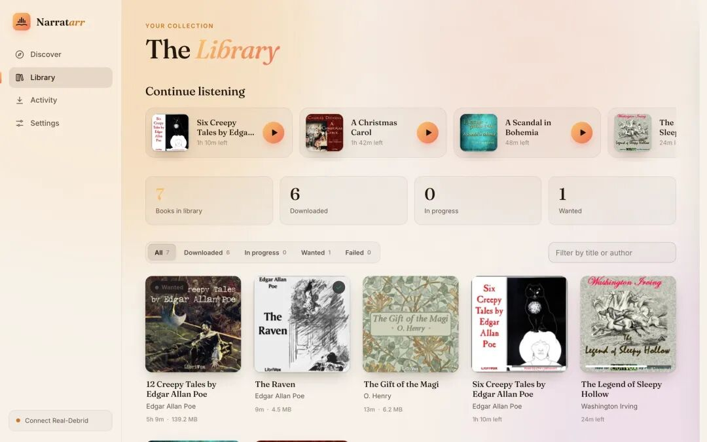
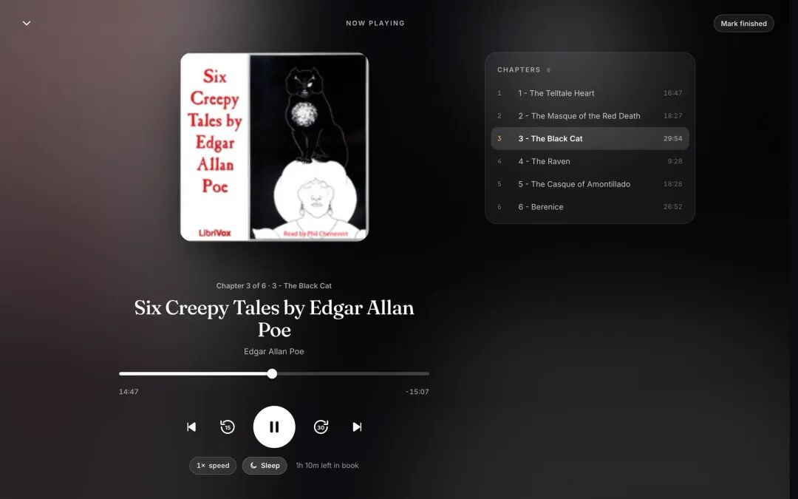

# 开源有声书管家，搜书下载播放收听全内置
> 💡 备注属性未写入，可能是备注属性名称或者类型被修改了，建议将字段类型设置为 rich_text，可以在小程序-操作-修改文章数据库页面进行调整
> 💡 原文链接:[https://mp.weixin.qq.com/s?__biz=MzkwODQzNzk1OQ==&mid=2247503548&idx=1&sn=b927edd93650ac491dc57b5b8f3292c0&chksm=c1f30c1e75074b3115b77b324420eb9240eecb9e93362e585b376fdeb8abc1618d9ee71bb7f0#rd](https://mp.weixin.qq.com/s?__biz=MzkwODQzNzk1OQ%3D%3D&mid=2247503548&idx=1&sn=b927edd93650ac491dc57b5b8f3292c0&chksm=c1f30c1e75074b3115b77b324420eb9240eecb9e93362e585b376fdeb8abc1618d9ee71bb7f0#rd)
> 💡 ❝
**Narratarr 是一款开源自托管的“*arr 风格”有声书管理器：从发现、搜索、下载到整理、播放全部内置，连电子书阅读也包了，还能接入 Prowlarr、qBittorrent、Audiobookshelf 等自托管工具链。
**
作者表示，发现一本书，点一下，它就带着标签、整理好、随时能听，进了你的书库。

**要点**
- **免费内容即点即得**：内置 LibriVox 和 Old-Time Radio 两大目录，超过 30,000 部公有领域有声书和经典广播剧，按类型、语言、格式筛选，直接 HTTPS 免费下载。

- **搜索容错强**：拼错也不怕，输入“sherlok holms”照样找到《福尔摩斯》，边输入边出带封面的联想建议。

- **一键入库**：下载前可看时长、体积、格式和简介；下载排队执行、活动页实时跟踪，完成后自动按“作者/书名”归档，连封面和简介都写好了。
- **真·内置播放器**：不用装其他 App，支持章节（含 .m4b 章节标记）、0.75~3 倍变速、章节结束即停的睡眠定时器、进度记忆、锁屏与耳机线控；手机加到主屏幕，在同一 Wi-Fi 下随时听。

- **电子书一并管**：同一本书可要有声书、EPUB 或两者都要，内置翻页阅读器（多主题、字号与字体可调），电子书自动放进有声书同目录，Audiobookshelf 里显示为一本书。
- **接入 *arr 全家桶**：Prowlarr（或任意 Torznab 索引器）负责搜索，Usenet 走 SABnzbd/NZBGet，种子交给 qBittorrent/Transmission/Deluge 或 Real-Debrid、AllDebrid、TorBox、Premiumize。
- **自动追更**：关注作者或系列后，新书自动进 Wanted 列表，每 12 小时检索一次（可调），标题和作者都对上才抓，匹配到就自动下载。
- **一键对接 Audiobookshelf**：自动发现本机、Docker 内或局域网的服务器，登录一次，每次下载完自动重扫。
- **全家多账号**：管理员管设置，听众只能浏览、点书、收听，每人有独立的收听进度；听众请求默认需管理员批准。
- **旧书可导入 + 库可整理**：扫描已有文件夹一键导入，Tidy 功能按自定义模板批量移动整理，先预览、能撤销，改名瞬间完成且保留收听进度。
- **零遥测**：不向外上报数据，外部请求明细全部列在文档里。
**上手**
- **设备门槛**：macOS/Linux 有终端一键脚本安装器；Docker 镜像支持 x86 和 ARM（树莓派 4/5、NAS 都能跑），Unraid 有模板；Windows 没有一键安装器，常用路线是 Docker Desktop，也可用 uv 从源码跑。
- **别暴露公网**：项目明确定位家庭网络使用，直接开端口到互联网有风险；远程访问请套 Tailscale/WireGuard 或带认证的反向代理，并把代理域名加进 `NARRATARR_HOSTS` 环境变量，否则会被拒。
- **Docker 用户**：Narratarr 必须能“看到”下载客户端的完成目录——把同一个宿主机目录挂载进所有容器且尽量保持路径一致，不一致就到设置里配路径映射；qBittorrent 的 `WEBUI_PORT` 必须与发布端口相同，否则连不上。
- **版权责任自担**：LibriVox 和 Old-Time Radio 内容免费合法，但通过 Prowlarr、AudiobookBay 等渠道下载的内容需自行确保合法；用 qBittorrent 等直连种子会暴露 IP，介意的话改用 Real-Debrid 等云下载服务。
项目由 GitHub 开发者 criticalconnections（narratarr 组织）主导开发，共 2 位贡献者，部分提交由 Claude AI 协助完成；当前 102 Stars。
> ❝
> **项目地址：github.com/narratarr/narratarr（MIT）
> **
