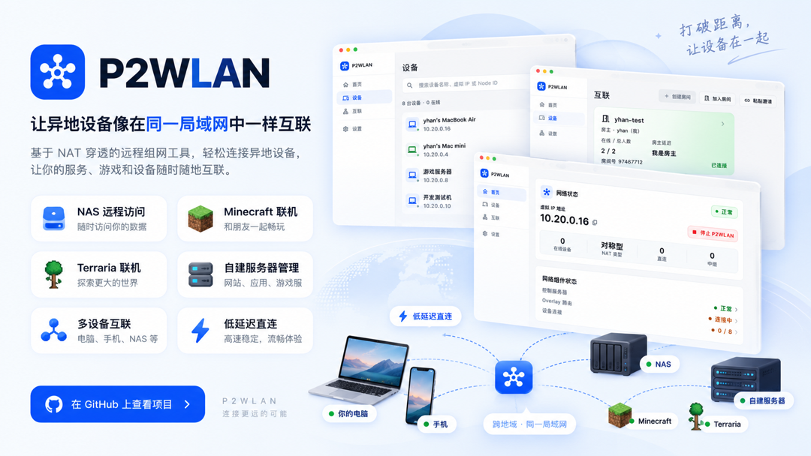
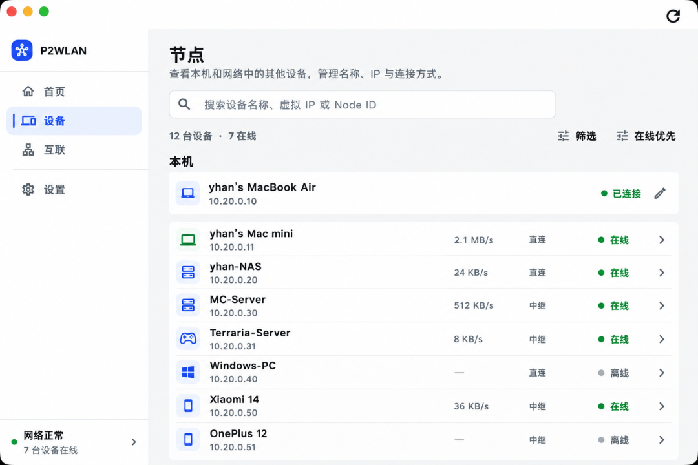
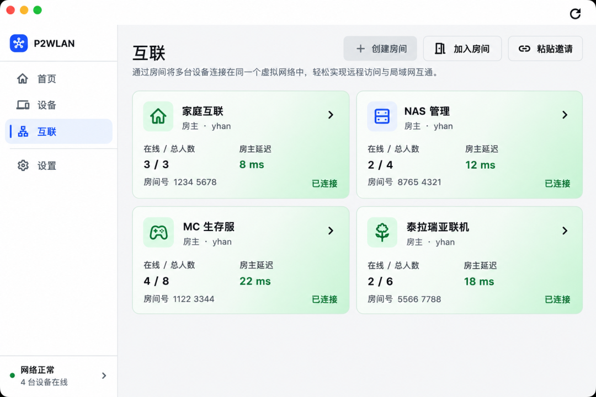
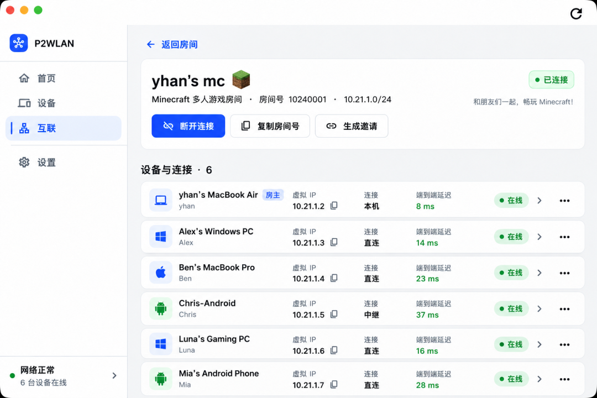
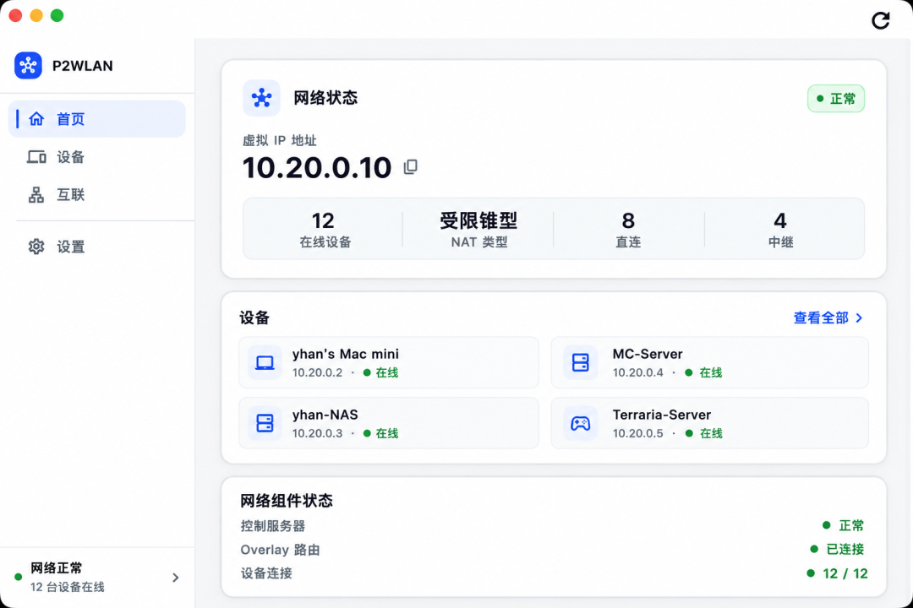

# 开源版 Tailscale，异地设备直连同一局域网
> 💡 备注属性未写入，可能是备注属性名称或者类型被修改了，建议将字段类型设置为 rich_text，可以在小程序-操作-修改文章数据库页面进行调整
> 💡 原文链接:[https://mp.weixin.qq.com/s?__biz=Mzk2NDMzMDY3OA==&mid=2247485643&idx=1&sn=95a2c5588895d8696be93e195db83089&chksm=c56b3131da54c3d9d4416a05da2f0369cc7d8225b5de64e29de5d5463d97efed18eb3caba620#rd](https://mp.weixin.qq.com/s?__biz=Mzk2NDMzMDY3OA%3D%3D&mid=2247485643&idx=1&sn=95a2c5588895d8696be93e195db83089&chksm=c56b3131da54c3d9d4416a05da2f0369cc7d8225b5de64e29de5d5463d97efed18eb3caba620#rd)
**1.3K Star，MIT 协议，Rust 写的数据面。**

把分布在不同宽带、云服务器里的设备，拉进同一张虚拟局域网。
你在家里开 NAS，人在公司想连回去；远程开发要 SSH 到家里那台测试机。
这些场景，以前要么用 Tailscale，要么手动配端口转发。
p2wlan 全免。开源、可自托管。

---
### 01 它解决了什么问题
先说痛点。
你有一台 NAS 跑在家里，想从公司远程访问管理页。传统做法：路由器端口转发，暴露公网。不安全，而且每个服务都要单独开一个端口。
你和朋友打 Minecraft 联机。他和你隔着不同运营商，NAT 类型不同，打洞失败。以前要么开第三方服务器，要么手动配 STUN。
你在公司有一台开发机，在家想 SSH 过去改个代码。走公网不安全，走 VPN 太重。
这三个场景的共性：**跨网络环境的设备互联**。以前靠 Zerotier、Tailscale 这类商业服务。
p2wlan 把这件事做成了一个完整的开源方案。
---
### 02 连接策略：先直连，打不通再回退
这是 p2wlan 最核心的设计，值得展开讲。
它把连接分三层：
**第一层：局域网直连。** 两台设备在同一张网里，直接走 LAN，延迟最低，走法最简单。
**第二层：公网 UDP 打洞。** 跨网络就尝试 NAT 穿透。p2wlan 内置 UDP P2P 引擎，对对称型 NAT（最难的那种）也有针对性处理。打通了，走加密直连，中继不介入。
**第三层：加密 Relay 回退。** 打洞失败就自动切到中继节点，Relay 只做数据转发，**不解密**。端到端加密保证数据不经过第三方明码。
整个切换过程对应用层透明。你只需要连虚拟 IP，底层是直连还是中继，客户端界面里看得到，但你的应用代码不用改。

▲ 设备列表，能看到每台机器的在线状态和连接方式。
这种"直连优先，Relay 兜底"的策略，跟商业闭源 Tailscale 的核心逻辑是同一套，区别在于 p2wlan **Relay 可以自托管**，数据流不经过别人的服务器。
---
### 03 虚拟 IP：你的设备有了一个固定地址
连进 P2WLAN 之后，每台设备会拿到一个虚拟 IP，比如 `10.20.0.5`。
这个 IP 在你的整个虚拟局域网里是固定的，只要设备在线，别的机器就永远能 ping 通它、能 SSH 过去。跟 Tailscale 的 CGNAT 机制是一个思路，但 p2wlan 走的是**自己分配**，不依赖 Google 的 CGNAT 池。
用这个 IP 能做什么：
- • **远程访问 NAS 管理页**：浏览器直接输虚拟 IP，不用记公网地址
- • **SSH / RDP 远程开发**：从任何地方连回家里那台测试机
- • **Minecraft 联机**：把朋友拉进同一个"房间"，他输虚拟 IP 就能进你的服
- • **访问数据库 / API / 面板**：所有服务都能挂到虚拟 IP 上，不暴露公网

▲ 房间页，同一房间里的设备自动互联。
---
### 04 房间组网：把"跟谁互联"管起来
设备多了，你需要一种方式告诉 p2wlan"哪些机器能连哪些机器"。
p2wlan 用**房间**来做这个隔离。你创建一个房间，把相关设备拉进去，同一个房间里的设备互相可达，不同房间的之间默认隔离。
这对 Minecraft 联机特别好用。你给 Minecraft 服创建一个房间，把 3 个朋友拉进来，这 3 台机器能互连，但他们访问不到你房间外的其他设备。
对远程开发也一样。你的工作机在一个房间，你的个人设备在另一个房间，权限天然分离。

▲ 房间详情，展示虚拟 IP 和连接路径。
---
### 05 技术栈：Rust 写数据面，不是套壳
这里要讲清楚，因为很多人对"又一个组网工具"的默认印象是 Python 套壳或者 JavaScript 套壳。
**p2wlan 数据面是 Rust 写的。** 虚拟网卡、TUN 路由、NAT 穿透、加密会话（X25519 密钥交换 + ChaCha20-Poly1305 加密 + BLAKE2s 认证）、Relay 回退逻辑，全在 Rust 里。
为什么这重要：Rust 内存安全，组网工具长期运行，跑一天不出问题跟跑一个月不出问题，是质的差距。
客户端是 Flutter 跨平台，从 Windows、macOS、Linux 到 Android 全覆盖，iOS 有实验性版本。CLI 是 Rust 写的，适合无界面环境。服务端（Control Plane + Relay）是 Go，可以自托管到自家 VPS。
加密方案是 **Noise Protocol**，p2wlan 的加密层跟 WireGuard 不是同一个东西，它自己实现了完整的加密会话，没有依赖 WireGuard 协议栈。

▲ 首页展示当前设备状态、在线设备列表和延迟。
---
### 写在最后
异地组网这个需求，被 p2wlan 打通了，开源、可自托管、免翻。
GitHub：https://github.com/yhan-sun/p2wlan
