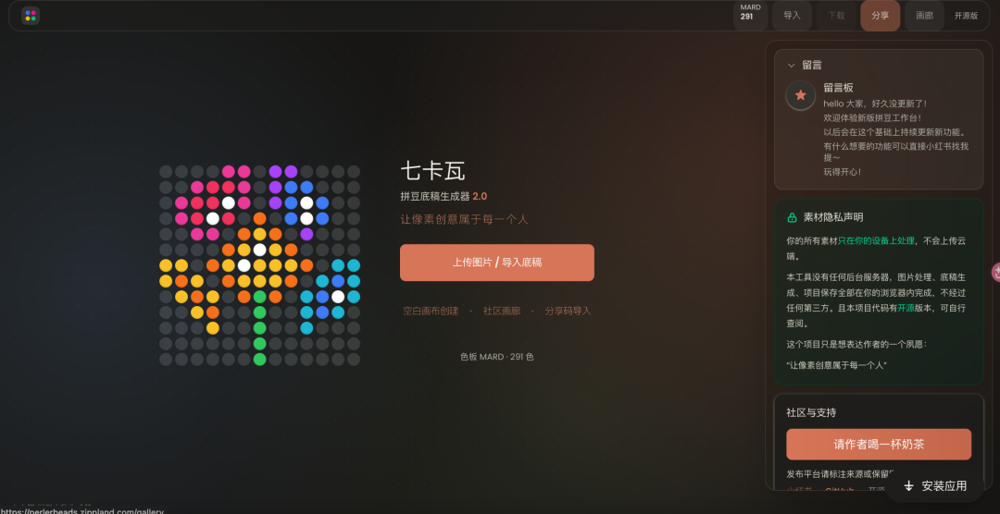

# 开源的 拼豆底稿生成器：把任意图片转成拼豆图纸的开源工具
> 💡 备注属性未写入，可能是备注属性名称或者类型被修改了，建议将字段类型设置为 rich_text，可以在小程序-操作-修改文章数据库页面进行调整
> 💡 原文链接:[https://mp.weixin.qq.com/s?__biz=Mzg2MjY1NDIzNg==&mid=2247502083&idx=1&sn=7a59a3b82996c13673d67f63132f83f3&chksm=cfa202b33adc187d68b64f6e79c9d0028486bbf3c3e08cf80c7c39034fbac7c26d7c3525b5ee#rd](https://mp.weixin.qq.com/s?__biz=Mzg2MjY1NDIzNg%3D%3D&mid=2247502083&idx=1&sn=7a59a3b82996c13673d67f63132f83f3&chksm=cfa202b33adc187d68b64f6e79c9d0028486bbf3c3e08cf80c7c39034fbac7c26d7c3525b5ee#rd)
perler-beads
> “
> 上传图片就能生成拼豆底稿，支持调色、去背景、手动改色，还能导出带色号标注的图纸和采购清单。
> 
Github地址
**https://github.com/Zippland/perler-beads**
在线体验
**https://perlerbeads.zippland.com/**

功能特性
- 智能像素化：不是简单取平均色，而是抓每个区域的主色调，避免边界发灰
- 多品牌色号：内置 MARD、COCO、漫漫、盼盼、咪小窝 5 家色板，168/144/96 色规格都有
- 杂色清理：自动把相近颜色合并成块，图纸更干净
- 去背景：自动识别并去掉外圈背景，只保留主体
- 颜色调整：排除不想要的颜色，自动找最接近的替代色
- 手动精修：单个格子点改，不满意就调
- 导出图纸：PNG 格式，带网格线和色号，直接打印照着做
- 采购清单：自动统计每种颜色要多少颗，生成清单图
怎么用
线上直接用：访问 perlerbeads.zippland.com
本地跑：
```
git clone https://github.com/Zippland/perler-beads.git
cd perler-beads
npm install
npm run dev

```
然后浏览器开 `localhost:3000`。
手机竖屏适合快速出图，电脑横屏适合精细调整。技术栈是 Next.js + TypeScript + Tailwind，图像处理纯前端 Canvas 完成，部署在 Vercel 上。
