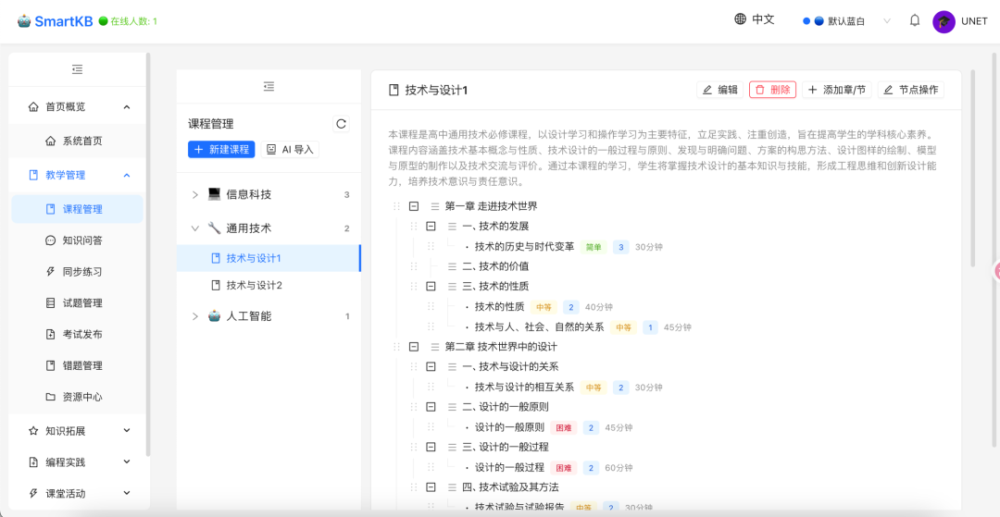

# 开源的 面向小学、初中、高中三个学段的 AI 智慧教学平台，覆盖 教 · 学 · 练 · 评 · 管 五条主线
> 💡 备注属性未写入，可能是备注属性名称或者类型被修改了，建议将字段类型设置为 rich_text，可以在小程序-操作-修改文章数据库页面进行调整
> 💡 原文链接:[https://mp.weixin.qq.com/s?__biz=Mzg2MjY1NDIzNg==&mid=2247502254&idx=1&sn=34cebc8bb50f896b3e8992983e9017d4&chksm=cf96284fb4f54177488acac2c08abadaf77107bfcf52c84a3b0dc859ebb6ca19f4f2b01c09be#rd](https://mp.weixin.qq.com/s?__biz=Mzg2MjY1NDIzNg%3D%3D&mid=2247502254&idx=1&sn=34cebc8bb50f896b3e8992983e9017d4&chksm=cf96284fb4f54177488acac2c08abadaf77107bfcf52c84a3b0dc859ebb6ca19f4f2b01c09be#rd)
smartkbs
> 💡 “
全学段全学科通用 AI 智慧教学平台。AI 对话与智能学伴、智能题库与组卷导出 Word、在线考试自动批改、课堂互动抢答闯关、分组讨论 AI 助教、学情分析与成长档案、积分称号激励，50+ 功能模块。FastAPI + React 构建，深度集成通义千问与 DeepSeek，支持私有化部署。

Gitee地址
**https://gitee.com/youufis/smartkbs**

功能特性
- AI 对话：学生问问题、上传图片或文档，AI 逐字流式回复，历史记录自动存好
- AI 学伴：专门给学生用的陪伴模式，知道你的名字、年级、薄弱点，可选鼓励型、严谨型、幽默型三种性格
- 智能题库：AI 按科目、题型、难度出题，也支持粘贴文本或上传文件自动识别入库；LaTeX 公式、配图都能处理
- 在线考试：发布考试、自动批改客观题、成绩统计导出 Excel
- 组卷导出 Word：选完题直接出三份文档——学生卷、答案卷、答题卡
- 课堂互动：随堂测验、投票、提问、知识抢答、分组讨论带 AI 助教、协作白板
- 学情分析：AI 分析班级或学生个人情况，生成报告
- 积分称号：参加活动自动积分，12 级称号加成就徽章，班级排名
- 成长档案：汇总考试、积分、练习等数据，AI 生成评价，可导出 Word
怎么用
三种方式，看你想省到哪一步：
| **方式** | **适合谁** | **要准备啥** |
| 桌面版一键安装 | 不想折腾环境的 | 下载 exe 双击装完，自带 Python 和前端，局域网内直接用 |
| 源码包部署 | 有 Python 基础的 | 下 ZIP 解压，pip 装依赖，python backend/main.py 启动 |
| Git 克隆部署 | 学校机房长期用 | git clone 下来，同样装依赖启动，但后续能在线增量升级，自动拉代码、迁数据库、重启 |
默认管理员账号 root/root，进去先改密码。AI 服务要填 DashScope 的 API Key，不填也能用基础功能，AI 相关的会提示你配置。数据全在本地 SQLite 和目录里，备份就把 .db 文件和几个用户目录拷走就行。

## 摘要

（待补充）

## 我的笔记

（待补充）
