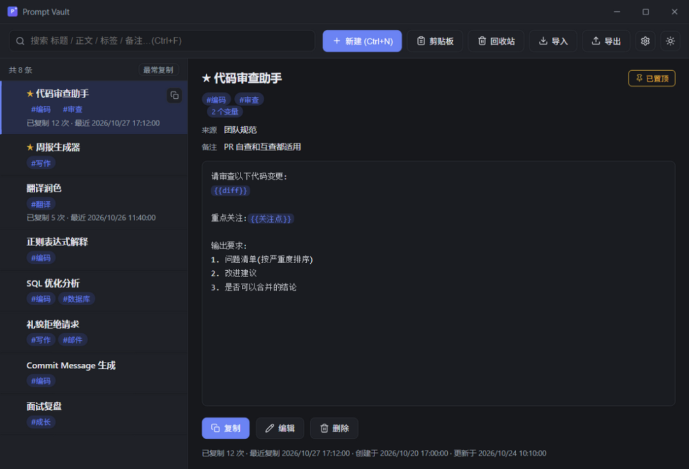

# 开源的本地优先的 Prompt 提示词 收藏工具— 收集、检索、填空、一键复制
> 💡 备注属性未写入，可能是备注属性名称或者类型被修改了，建议将字段类型设置为 rich_text，可以在小程序-操作-修改文章数据库页面进行调整
> 💡 原文链接:[https://mp.weixin.qq.com/s?__biz=Mzg2MjY1NDIzNg==&mid=2247502652&idx=1&sn=fae0a7cecc0074d9a50f1813350b7654&chksm=cfae29c81a3cc00eaffb07869fe6299218f5e58b2c28cbe8579b67a73bb2b3cbf9f8f41c48eb#rd](https://mp.weixin.qq.com/s?__biz=Mzg2MjY1NDIzNg%3D%3D&mid=2247502652&idx=1&sn=fae0a7cecc0074d9a50f1813350b7654&chksm=cfae29c81a3cc00eaffb07869fe6299218f5e58b2c28cbe8579b67a73bb2b3cbf9f8f41c48eb#rd)
prompt-vault
> “
> Windows 上的 prompt 管理工具，数据存本地，不联网。
> 
Github地址
**https://github.com/zklmiao/prompt-vault**

功能特性
按 Alt+Q 呼出窗口，搜 prompt、填变量、复制粘贴，全程不用离开当前应用。
- 收集：手动新建、Alt+Shift+N 剪贴板速存、拖 JSON 或纯文本导入
- 搜索：标题/内容/标签模糊匹配，命中词高亮，点标签直接筛选
- 变量：正文写 {{变量}}，复制前弹窗填空，上次填的值自动记住
- 快速拾取：Alt+Q 双栏面板，左边搜右边预览，空查询显示最近/最常复制
- 命令面板：Ctrl+K 搜操作，? 看快捷键表
- 整理：星标置顶、自由标签、来源备注、回收站、批量操作
- 统计：记录每条复制次数和时间，按最近更新/最近复制/最常复制排序
- 其他：暗色亮色主题、自绘标题栏、托盘常驻、中文输入法防误触、原子写入+自动备份
数据与隐私
- **所有数据只存在本地**：一个 JSON 文件，内容完全透明，随时可用任意编辑器查看
- **原子写入**：临时文件 sync 落盘后经 MoveFileEx(REPLACE_EXISTING) 原地替换，不存在写一半的中间态
- **自动备份**：每次写入前旧文件保存为 prompts.json.bak；数据解析失败时应用暂停读写，并可一键从 .bak 恢复
- **配置同样本地**：%APPDATA%\prompt-vault\config.json 只保存数据文件路径、窗口位置与全局热键，不包含收藏内容
- **无网络请求**：应用不发起任何外部请求，不采集任何信息
怎么用
下载安装包或绿色版双击运行，首次启动选个 prompts.json 的保存位置。要备份就复制这个 JSON 文件，换机器直接导出再导入。
