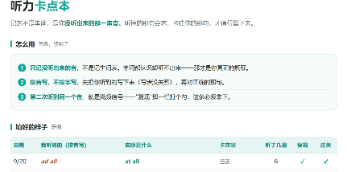
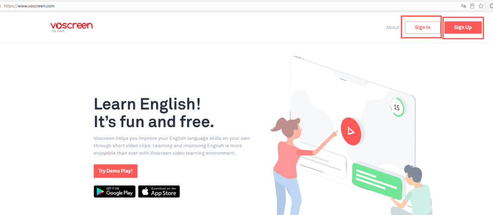
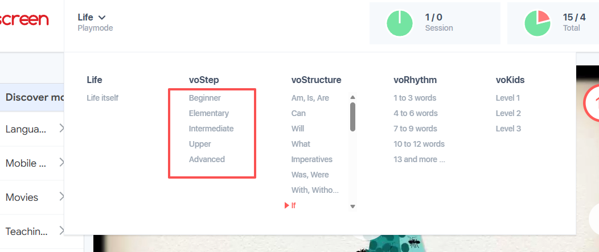
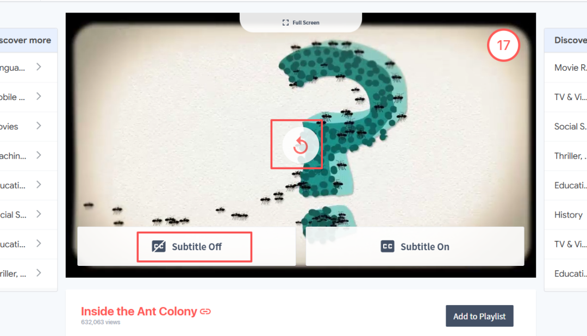
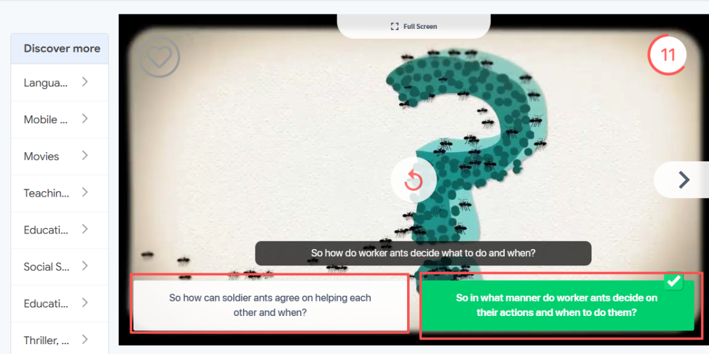

# 强烈推荐一个有趣实用、能让你持续练习并帮你提升听力的免费 APP
> 💡 备注属性未写入，可能是备注属性名称或者类型被修改了，建议将字段类型设置为 rich_text，可以在小程序-操作-修改文章数据库页面进行调整
> 💡 原文链接:[https://mp.weixin.qq.com/s?__biz=Mzg4ODg1OTE4Ng==&mid=2247485902&idx=1&sn=a71fb13241fb2a9f791a7b216d46bdf0&chksm=ce0c9a57f72ecd079283a3d5b70b2d899e30b139d5ba2489fcbc4fa32b6c1b0a71fa60316006#rd](https://mp.weixin.qq.com/s?__biz=Mzg4ODg1OTE4Ng%3D%3D&mid=2247485902&idx=1&sn=a71fb13241fb2a9f791a7b216d46bdf0&chksm=ce0c9a57f72ecd079283a3d5b70b2d899e30b139d5ba2489fcbc4fa32b6c1b0a71fa60316006#rd)
---
前几天我在视频号里分享过一个练听力的工具，很多小伙伴挺感兴趣，问有没有网页端的；
那今天就用文字版的形式和大家分享网页端具体怎么用~
它是什么、好在哪、**适合谁又不适合谁**、怎么用才不浪费，网页端如何操作，一次说清。
🔗 它叫 **Voscreen**——**网页版和手机 App 都能用，免费，打开就能用，不用翻墙。**
**我先分享这个软件的一些优势，因为只有你知道它好在哪里，你才会更有意愿度去坚持使用！**
**然后分享网页版怎么操作、点哪里，配着截图分享；**
---
### 先说个扎心的事实
很多人练听力，练的不是听力，是**耐心**。
打开一集播客、一部美剧，一响就是四十分钟。
中间听不懂的地方，你不可能每句都倒回去，倒回去一次，这一集就感觉不想再听了，因为专注力有限。
即便你顺着往下听。听到最后，你说"我听完了"。
可你到底听懂了什么？
大概率是：听懂了大意，靠上下文猜出了一部分，剩下那些真正卡住你的音 - 
连读、吞音、弱读、没听过的表达- **一个都没解决，全溜过去了。**
听力有个麻烦的地方：**它没有检测，你很难知道自己真实水平在哪。**
阅读遇到不认识的词，你一眼就知道自己不认识；听力不一样：**你以为你听懂了。**
---
### 它最实在的好处：把起步的门槛降下来了
听力还不那么好的时候，最大的敌人其实不是"听不懂"，是**一打开就被吓退。**
一集 40 分钟的播客，你得先说服自己坐下来；
但一条 15 秒的片段，不用说服任何人，**点开就听了**。
**1）语料本身就短，这是它最被低估的地方：**

它不要求你攒够一小时的专注力才能开始。等电梯、排队的间隙，练两句就是两句。
**2）短还带来第二件事：重复的代价变小了。**
一句话听不懂？**再点一下，就一遍。**

再点一下，又一遍，听到听懂为止——代价是 15 秒。
而一集 40 分钟的播客，你想"再来一遍"的代价是 40 分钟，容易让很多基础偏弱的学生放弃再听。
短，才让你愿意一遍一遍地听：**直到那些黏在一起的音，真的进耳朵。**
---
### 另外两个我很喜欢的点
**1️⃣ 语料是真的，语速也是真的。**
它把电影、美剧、纪录片、TED、新闻、广告里的原声剪下来
不是找人重录的教科书听力，是**演员真的那么说、老外真的那么说话**的那种。
这一点太重要了。
很多人听力卡住，不是词汇量不够，是**从来没听过这个语速**。
**它不给你调速。**

 刚开始会难受，两周之后你会发现：耳朵开始跟得上了。
**2️⃣ 检测方式是英文，不是中文。**
这是它跟别家最不一样的地方。
一般听力练习怎么检测？给你四个中文选项，问你"这句话什么意思"。
那练的是**翻译**，不是听力。你大脑走的是"英文→中文"的通道，而中间那一下翻译，恰恰是最该戒掉的。
**Voscreen 不给中文。**
它给你几个**英文句子**，问的是：**刚才听到的那句，跟下面哪一句意思一样？**
你要用英文去理解英文，再用英文去判断。
一次练两件事：**真听力，和英文思维。**
---
### 它适合谁，不适合谁（这段请对号入座）
**✅ 适合你，如果你——**
- 单词都认识，一到真实语速就糊，连读一多就断片
- 打开材料先看时长，一集 40 分钟的直接放弃
- 想说英语时，脑子里还在"先翻译成中文再说"
- 只有通勤、排队、等外卖这种三五分钟的碎片时间
- 每次都是"听个大概"，从没把一段材料真正听懂过
**❌ 不用勉强，如果你——**
- 已经能裸听长播客、TED，那就继续听长的，**别退回来刷 15 秒的片段**
- 想系统学语法、刷考试题——它练的是听力和语感，不是课本
- 词汇量还在很早期（基础词汇都还没过）——真实语速会把你劝退，先补基础词汇
**一句话：它的价值是把真实语速里那些"黏在一起"的音，一句一句抠出来。**
---
### 怎么用才不浪费（这一段最重要）
它最大的风险是：**太好玩了，你会把它当短视频刷。**
刷着爽，价值全稀释掉。
所以用它的唯一原则是：**不要看你今天刷了几条，要看你有几条被用透了。**
按这四步走：
**1️⃣ 一条没过关，继续练习，通关了再打开下一条。**
听不懂就原地循环，听到听懂为止。
在这一条被榨干之前，绝不换下一条。
这是这个工具的核心用法，其他都是次要的。
**2️⃣ 听不出来的音，记下来。**
不是记单词，是记**你没听出来的那一串音**。
"at all" 听起来像 "ad all"，"want to" 是 "wanna"，"did you" 变成 "dija"——**这些黏在一起的音，才是你听力真正的瓶颈。**
我做了个**听力卡点本**的表格，需要的可以在公众号后台回复 ：听力卡点

**3️⃣ 听顺了，跟着读几遍。**
片段短，读三遍、甚至背下来都不费劲。**读出来的音，才真正进耳朵。**
**4️⃣ 每天 3 到 5 条起步，别贪。**
我的建议是：**宁可 3 条听透，不要 30 条刷完。**
慢就是快。这句话在听力上尤其成立。
**一条听透，胜过十条刷过。**
---
### 具体怎么操作（跟着点就行）
**💻 电脑上 · 网页版**（第一次建议先用这个，屏幕大，看得清）
**第 1 步：打开 voscreen.com**
免费，不用翻墙，打开就能用。⚠️（国内邮箱可注册，点sign up,注册完后点击sign in就可以登录了）

**第 2 步：选一个级别**
不知道选哪个，就从 beginner 开始。
选高了会挫败，选低了没意思。 

**第 3 步：听片段, 选答案**
它放一段 10–15 秒的原声，然后给你2个英文句子**
**
**选出跟刚才听到的意思相同的那个**。 
（注意先点击subtitle off这个，不要点击右边的，不然直接出现原文字幕，没办法真正练习听力）

**第 4 步：选完立刻出对错**
答对了点下一题；**答错了别急着走，点重播，把这一条反复听到听懂为止。**

**📱 手机上 · App**
App 里按钮的位置跟网页版不一样，下面视频后半段有录屏实操，跟着操作就行：
---
### 最后说点实在的
我不觉得一个 App 能改变什么。它顶多是把"练听力"这件事，从"我得抽出一小时"，变成"我等电梯的时候能练三句"。
能不能练出来，还是看你明天会不会再点开它。
所以别贪，就给自己定个小目标：**接下来 7 天，每天 3 条。
**
**另外一定要做记录，对自己总是听不出来的做记录，专门记录自己的听力卡点**
---
**🎁 想要这份「听力卡点记录模板」的，公众号后台回复：听力卡点**
也想听听你的情况：你最卡的是哪一种音？
连读、吞音，还是人家语速一快就全糊？
评论区来聊聊~~。

**·END·**
如果这篇分享对你有所帮助和启发，请一定记得告诉我，感谢你的陪伴和关注。
如果可以的话记得【点赞】和【在看】，感恩你的支持。
又是快乐成长的一天~

作者简介：
教英语的Cherry老师，一个热爱英语教学，热爱阅读和分享，追求终身成长的成人英语老师。
如果你也热爱英语学习，或者也喜欢分享，欢迎添加微信，一起陪伴交流学习。

