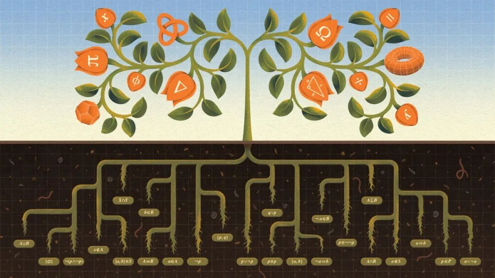
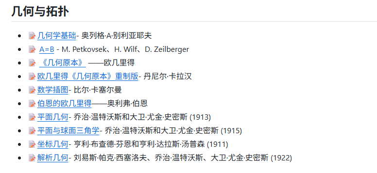
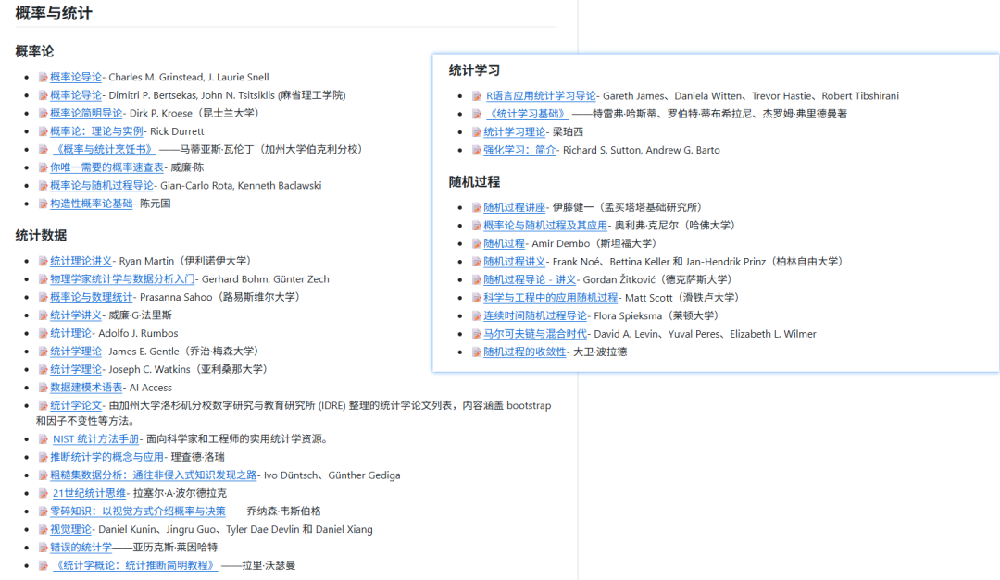
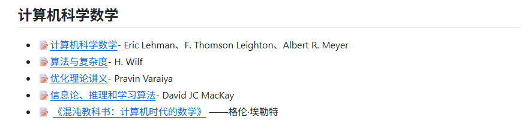
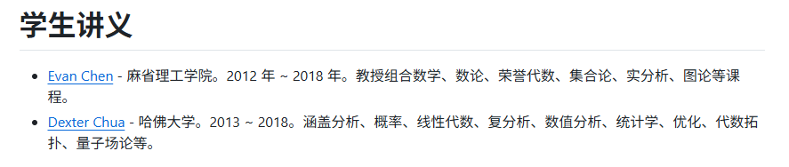

# 当了10多年工程师，我在GitHub上给孩子存了一份18年数学地图
> 💡 备注属性未写入，可能是备注属性名称或者类型被修改了，建议将字段类型设置为 rich_text，可以在小程序-操作-修改文章数据库页面进行调整
> 💡 原文链接:[https://mp.weixin.qq.com/s?__biz=MzU2MTI1MDY2NA==&mid=2247483774&idx=1&sn=3e816c4293ae169f1a4f9c5061b6844d&chksm=fda6d3d1563259753d97c2a07bbf0524a49f58aa702e92839e0f329c71977895a881bf3f65dc#rd](https://mp.weixin.qq.com/s?__biz=MzU2MTI1MDY2NA%3D%3D&mid=2247483774&idx=1&sn=3e816c4293ae169f1a4f9c5061b6844d&chksm=fda6d3d1563259753d97c2a07bbf0524a49f58aa702e92839e0f329c71977895a881bf3f65dc#rd)
它不止是一个链接清单，而是一份可以用到孩子上大学的「数学资源拓扑图」。

**按孩子6岁上学算：小学6年 + 中学6年 + 大学4年 = 16年，再加个保险系数，就是这个数字。**
凌晨1点，我又在百度搜"一年级数学资料"。
前3条是广告。第4条要扫码加群才能领。
我突然意识到：当了10年WiFi工程师，天天在GitHub上clone代码、看RFC文档，却从没想过用同样的逻辑给孩子找学习资源。
但说实话，我第一遍打开 awesome-math 的时候挺懵的——100多个资源，我一个个点进去，花了两个晚上。不是因为难，是因为资源太多，分不清哪些是配套教辅、哪些是正经教材。
**我把自己这两个晚上的弯路走完了，把真正值得存下来的4个板块标了出来。你不用再走一遍。**

---
### 01｜awesome-math 到底是什么？
它叫 **awesome-math**，作者是一个叫 Cyrille Rossant 的开发者。
GitHub 上 **15,300+ Star**。
但Star数只是它的面子。里子是一份**覆盖数学全领域的资源导航**，分了12个大类、100多个具体资源。
它不教你数学。
但它告诉你——你以后想找真正好的数学资源，应该去哪里。
### 02｜我花了两个晚上，筛出了这4个板块
打开它的 README，你会看到12个板块：
Foundations、Algebra、Geometry and Topology、Analysis、Probability and Statistics、Numerical Analysis、Signal Processing、Mathematics for Computer Science、Mathematical Biology、Mathematical Physics、Students Lecture Notes、Related Awesome Lists。
**我只说4个我筛出来的，其他的你不用管。**
#### 📐 Geometry and Topology｜几何与拓扑

这个板块下面有一个子类叫 **General Geometry**（普通几何）。
里面收录了欧几里得的《几何原本》。
我第一次看的时候直接点了第一个链接，打开发现是一个现代改编版，加了一堆引导性内容，把欧几里得原书的逻辑链打断了。后来翻了几页评论区，才找到了真正的原版（免费公版）。
公理化思维的价值在于"每一步都追问为什么"，现代改编版反而把这种追问喂给你了，孩子失去了自己推演的机会。
所以我存的是原版，不是改编版。
除了《几何原本》，这里还有 Coordinate / Analytic Geometry（解析几何）和 Trigonometry（三角学）。
这些都是初高中核心内容，但不用现在看。你现在存下来，等孩子上到初中，你就知道他该看的是欧几里得，而不是某本网红教辅。
#### 🎲 Probability and Statistics｜概率与统计

新课标已经把统计与概率纳入小学课程。
但这个板块里的大部分资源是大学级别的。比如 Grinstead & Snell 的《概率论入门》，确实是经典，但给一年级孩子看太超前了。
我花了一个晚上，在这一堆里找到了一个对K-12真正有用的——**Seeing Theory**。
它是一个可视化概率论的网站。花了一个晚上自己先学了一遍，才知道统计不是算数字，是理解不确定性。
小四开始孩子要做统计图表了，我翻遍了小红书，全是"这样教孩子画柱状图"的帖子，看完还是不知道怎么培养统计思维。
这个坑我不想让别人再踩一遍。
#### 💻 Mathematics for Computer Science｜计算机科学中的数学

这个板块对工程师家长特别友好。
里面有 Lehman / Leighton / Meyer 的 MIT 课程——计算机数学的经典入门。
还有 MacKay 的《信息论、推理与学习算法》。
我点开了 MacKay 的讲义翻了翻，符号我看得懂，但把它讲给一年级孩子听？不可能。
所以这一部分不是给孩子现在用的。是给家长的。
如果你的孩子将来走编程/算法路线，这些就是地基。你现在不用教他，但你知道地基在哪里。等他上了初中，你至少能告诉他：你要补的数学，在GitHub的哪个位置。
#### 📝 Students Lecture Notes｜名校学生笔记

这个板块是宝藏——收录了 MIT 和 Harvard 学生整理的真实课堂笔记。
**Evan Chen**（MIT, 2012–2018）的笔记：组合数学、数论、 Honors 代数、集合论、实分析、图论。
**Dexter Chua**（Harvard, 2013–2018）的笔记：分析、概率、线性代数、复分析、数值分析、统计、优化、代数拓扑。
这些笔记不是给小学生看的。但它们是**真实的**——不是商业包装出来的"名师课程"，而是学生一个字一个字记下来的课堂内容。
等孩子上到高中、大学，这些笔记比很多付费课程都靠谱。
### 03｜说个我不确定的事
awesome-math 里每个资源前面都有格式标识：
📝 = 讲义/笔记 | 📖 = 实体书/出版书籍 | 🎥 = 视频课程
这本来是个好事。但说实话，这个分类不是非常严格——有的资源同时是📝和📖，有的 🎥 点进去发现只剩文字讲义。
**所以不要完全依赖这些标识。点进去看一眼，比看标识更靠谱。**
说到靠谱，我判断一个资源靠不靠谱就一个标准——有没有人在实际项目里用过它。
这份清单上的每个资源，GitHub 上都有真实的issue和PR在维护，不是放那儿积灰的。
### 04｜这份清单为什么可以用18年？
作为一个工程师，我欣赏它的不是内容，而是结构。
**第一层：它是分层的。**
从 Foundations（基础）→ Algebra（代数）→ Geometry（几何）→ Analysis（分析）→ 进阶应用，这是一个完整的学习路径。
孩子现在一年级，用不上 Analysis（分析）。但等孩子上到高中、大学，这个清单还在那里，路径是通的。
**第二层：它会自动更新。**
上次我存的某个资源链接失效了，去主页一看，作者已经换成了更好的替代品。这种事在百度上不会发生。
**第三层：它是社区验证的。**
10k+ Star 不是刷出来的。每一个 Star 都是一个真实用户的认可票。这比任何"专家推荐"都可靠。
### 05｜我的真实使用策略
我的孩子今年9月上学。
说实话我也不知道这套方法管不管用——毕竟我懂WiFi，不懂教育。
但我至少知道一件事：能用到孩子高考的资源清单，比什么"幼小衔接礼包"可靠。
**阶段1（现在-小学3年级）**：看 Foundations + General Geometry
了解数学的底层逻辑，建立公理化思维
**阶段2（小学4年级-初中）**：看 Probability + Algebra
Seeing Theory 先自己过一遍，知道统计思维从哪里开始培养
**阶段3（高中-大学）**：看 Analysis + CS Math + 名校笔记
微积分、线性代数、概率论的系统学习
如果孩子走计算机方向，提前看 Mathematics for Computer Science
### 06｜说实话一开始我也怂
全英文资源，孩子才一年级，能看懂吗？
后来发现我多虑了。数学里90%的内容是符号和公式，不是文字。你要看的只是目录结构，不是正文。
而且里面不少资源其实有中文译本。浏览器翻译一开，目录一目了然。不放心的话，花10分钟自己翻一遍目录，就知道哪些值得存了。
### 最后
我们这一代人找资料的习惯，是从百度开始的。
但百度给你的，是谁付了广告费。
这份清单是全球数学学习者的真实投票。经过真实用户投票筛选过的信息，比搜索引擎给你的干净得多。
收藏这个地址：
```javascript
https://github.com/rossant/awesome-math
```
总之，我先存了。管不管用，8年后见。
如果你是工程师，也还在百度上找孩子的学习资料，那这个链接值得存一下。不用谢。
**你给孩子找资料时踩过哪些坑？**
评论区聊聊，咱们一起建一个低噪声的知识库。
