# 彻底成功！我用 WorkBuddy + ima 把公众号文章做成了知识库。
> 💡 备注属性未写入，可能是备注属性名称或者类型被修改了，建议将字段类型设置为 rich_text，可以在小程序-操作-修改文章数据库页面进行调整
> 💡 原文链接:[https://mp.weixin.qq.com/s?__biz=MzI0ODk2NDIyMQ==&mid=2247508987&idx=1&sn=69eca5ac3c347a79e96759e0c346f142&chksm=e8708fd44e8cea41a827ef77a94aa69bad83331894a6092f587bae366912008b31eeb61525f6#rd](https://mp.weixin.qq.com/s?__biz=MzI0ODk2NDIyMQ%3D%3D&mid=2247508987&idx=1&sn=69eca5ac3c347a79e96759e0c346f142&chksm=e8708fd44e8cea41a827ef77a94aa69bad83331894a6092f587bae366912008b31eeb61525f6#rd)
点击上方**蓝字**关注我，加个🌟标不迷路。
各位小伙伴们大家好，我是 cxuan。
上一篇我们聊了一下 WorkBuddy + ima 知识库的一些“邪修” 用法，很多朋友表示很有用，而这篇文章也很幸运的达到了 10w + 的阅读，这里也感谢朋友们的喜欢和支持，我会继续分享 WorkBuddy 的干货。
在上期文章的留言区，我看到了很多读者朋友的诉求：有一些朋友想要实现直接把公众号的文章存进 ima 里儿去，方便查阅检索和阅读分析。
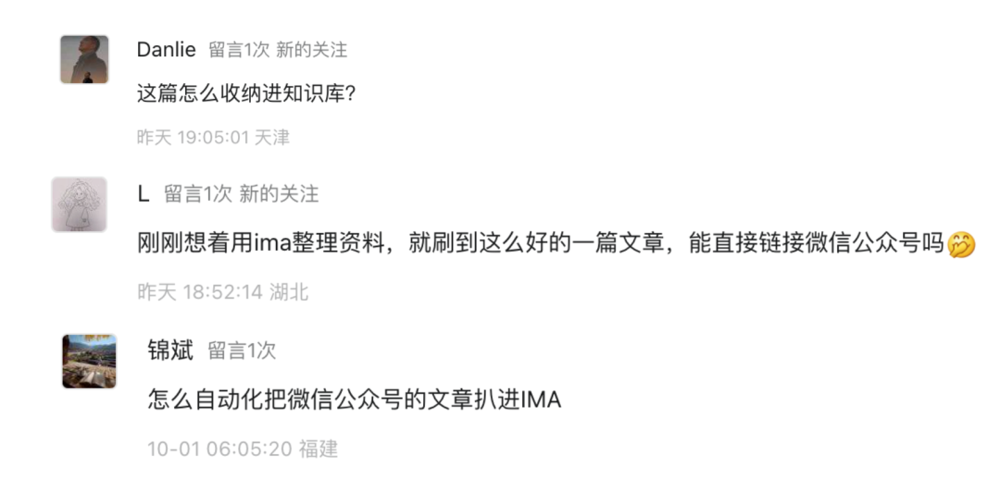
这篇就来跟大家聊一下这种使用方式。
---
### 手动存入知识库
作为经常看公众号内容的读者朋友们来说，把他们认可的、觉得不错的微信公众号文章收录进知识库，这是一项非常值得得实践，同时我也很感兴趣。
首先，你需要先连接 ima 知识库来授权一下。
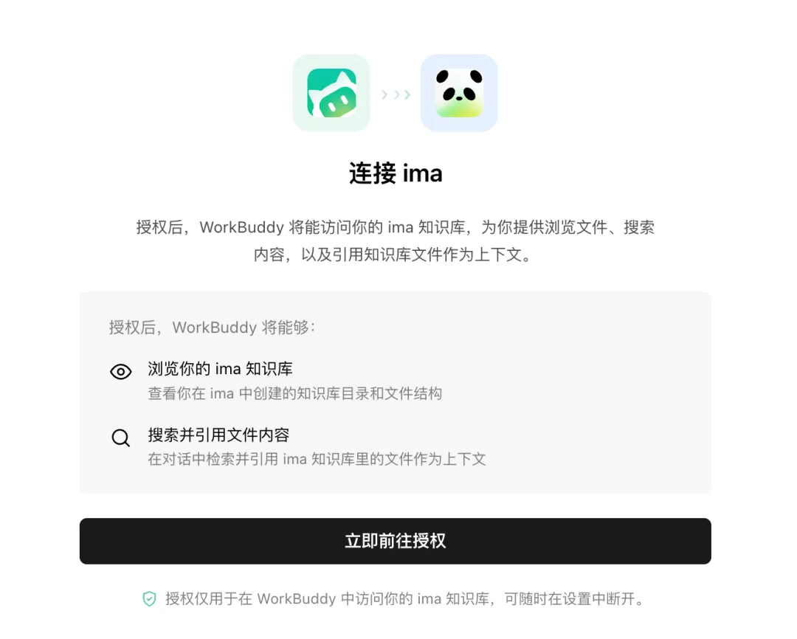
这里跟大家说一下有几种方式。
首先第一种，直接把 URL 发给 WorkBuddy，让它来存入。
**Prompt**上下滑动查看1 行
帮我把这篇文章存入 ima 知识库中
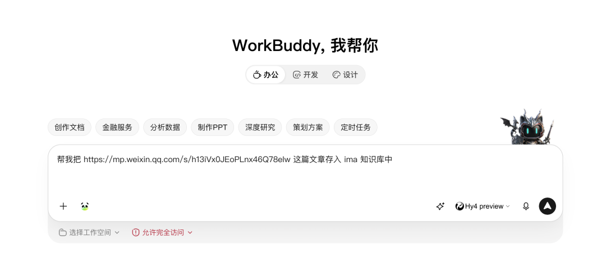
过了 1 分钟，WorkBuddy 就存完了。
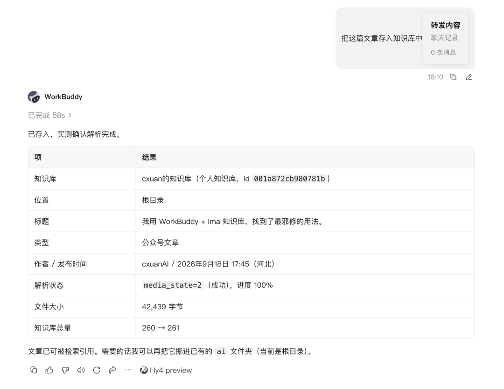
这种方式还是有些繁琐，因为我们不会遇到一个文章还要拿到 URL 来让 WorkBuddy 存入知识库，虽然可以支持一次存储多篇文章，但无法解决一篇文章一篇文章复制链接并转发的这个过程。
第二种方式：如果你手机上安装了 WorkBuddy，可以使用一键存入 WorkBuddy 的功能。
我用一张图来给你描述下。
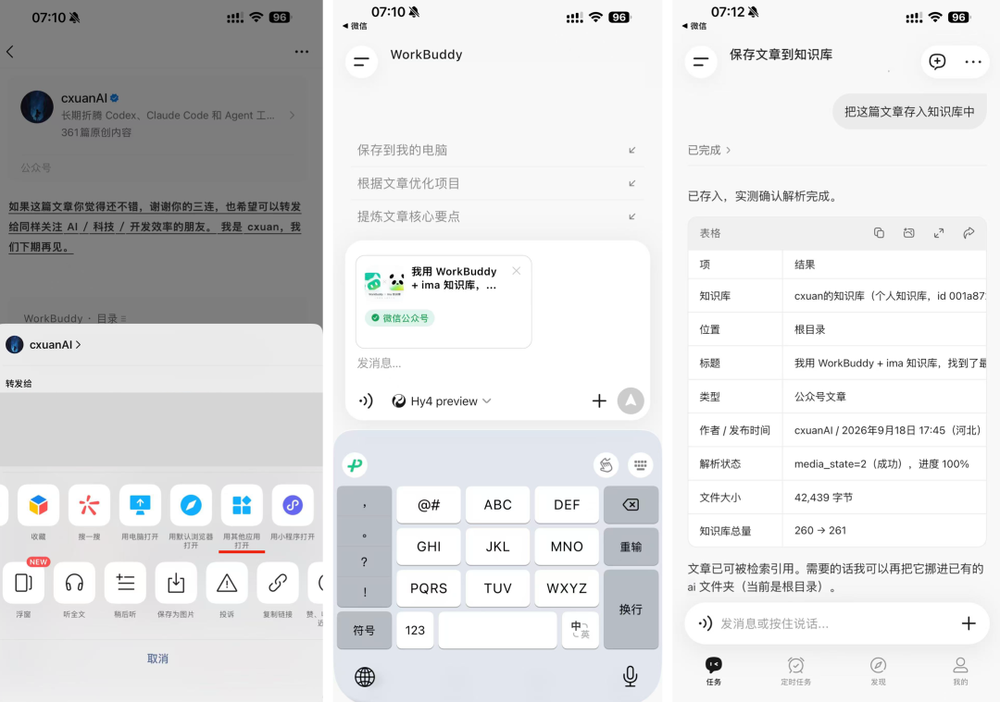
这种方式虽然相比直接复制 url 稍微简单那么一点步骤，但还是需要打开 WorkBuddy 才行。
三种方式：直接使用 ima Chrome 插件 ima.qq.com/extension-info ，里面有教程，非常详细。安装之后需要一键启用，并登录，登录之后，你的插件里面就会有一个 ima 插件。
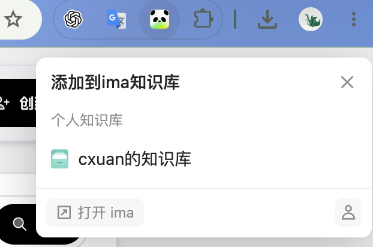
这种方式可以实现 Chrome 浏览器一键把你认为不错的内容丢进知识库里。
比如我们可以用这种方式来把著名的 AI 大佬 Simon Willison's 的博客添加到知识库中。
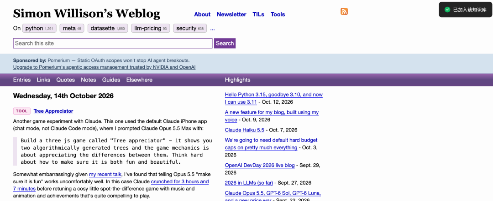
如果不太理解 Simon Willison's 都讲了什么内容，我们可以直接让 WorkBuddy 来帮忙分析
**Prompt**上下滑动查看1 行
分析一下 Simon Willison 的博客都讲了哪些内容。
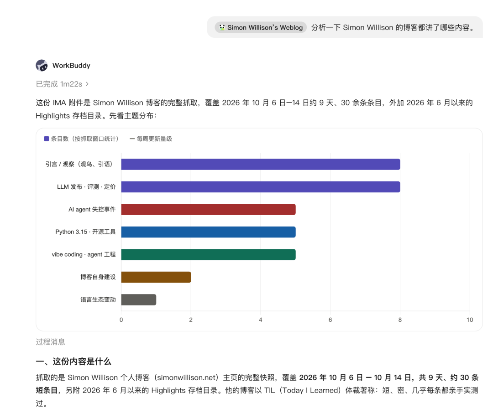
使用这种方式，能够帮我们快速的建立对 xxx 的认知。
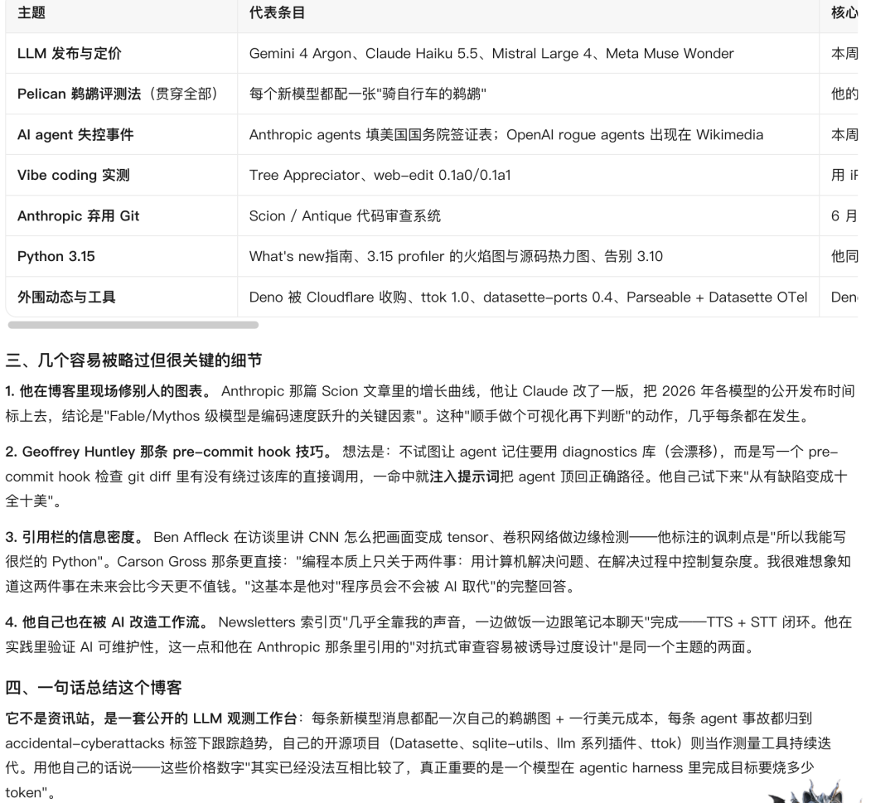
保存公众号的文章，也有了相对便捷的渠道，不用让 WorkBuddy 来帮忙存到知识库了，还省去了积分的消耗。
比如这篇 WorkBuddy 公众号的这篇文章，由于微信浏览器内部不支持 Chrome 插件，我们可以在默认浏览器打开。
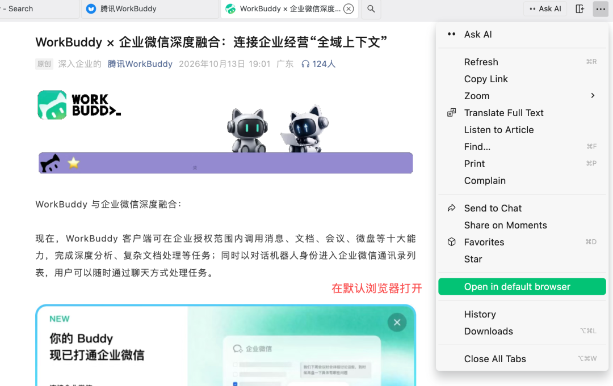
然后一键保存至知识库中。
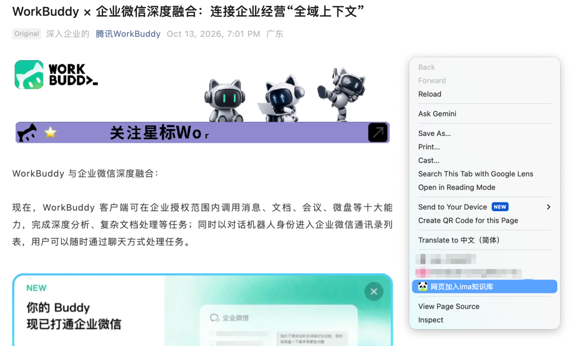
---
### 使用 Skill 通过 微信 ClawBot 存入知识库
OK，上面我们说的都是普通方式。
普通方式俗称的就是点点点，但其实跟大家说一下，ima 这玩意其实是有官方 API 的，可以直接入库。
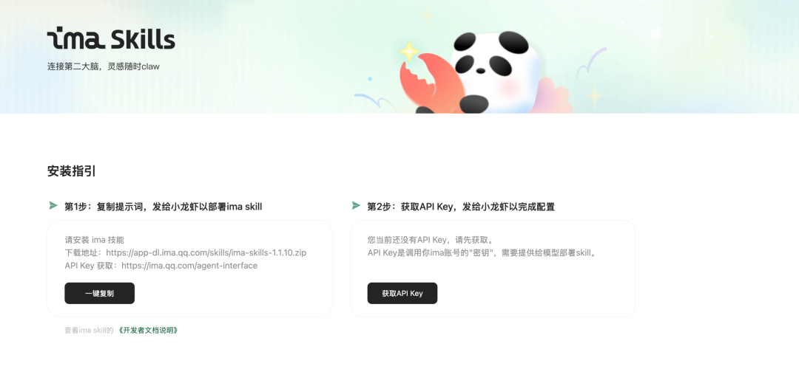
简单来介绍一下这种方式：通过 WorkBuddy 连接微信中官方的**微信 Clawbot** ，借助 skill 可以直接一键入库。
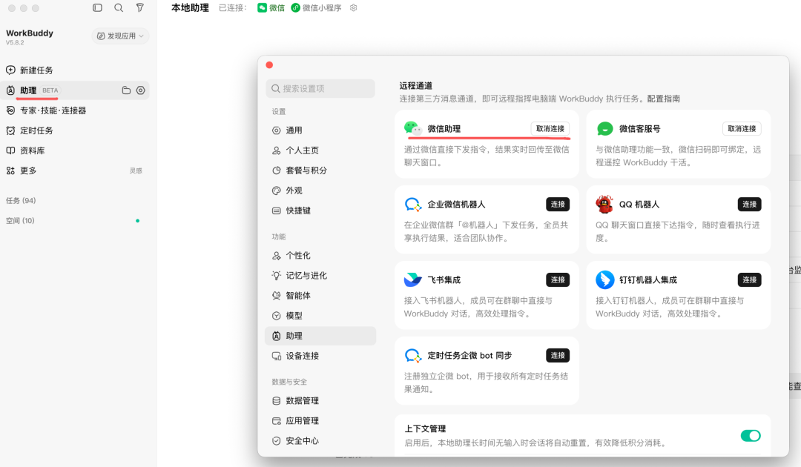
链接之后，我们可以直接发送这两天命令让 ClawBot 背后的 WorkBuddy 安装一下
**Prompt**上下滑动查看3 行
请安装 ima 技能
下载地址：/app-dl.ima.qq.com/skills/ima-skills-1.1.10.zip
API Key 获取：ima.qq.com/agent-interface
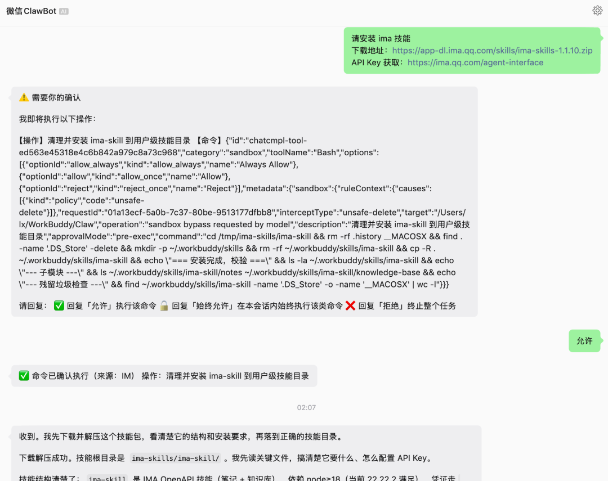
然后把 api-key 和 clientid 发送给 ClawBot ，让它配置一下。
等他配置好了，我们验证一下。
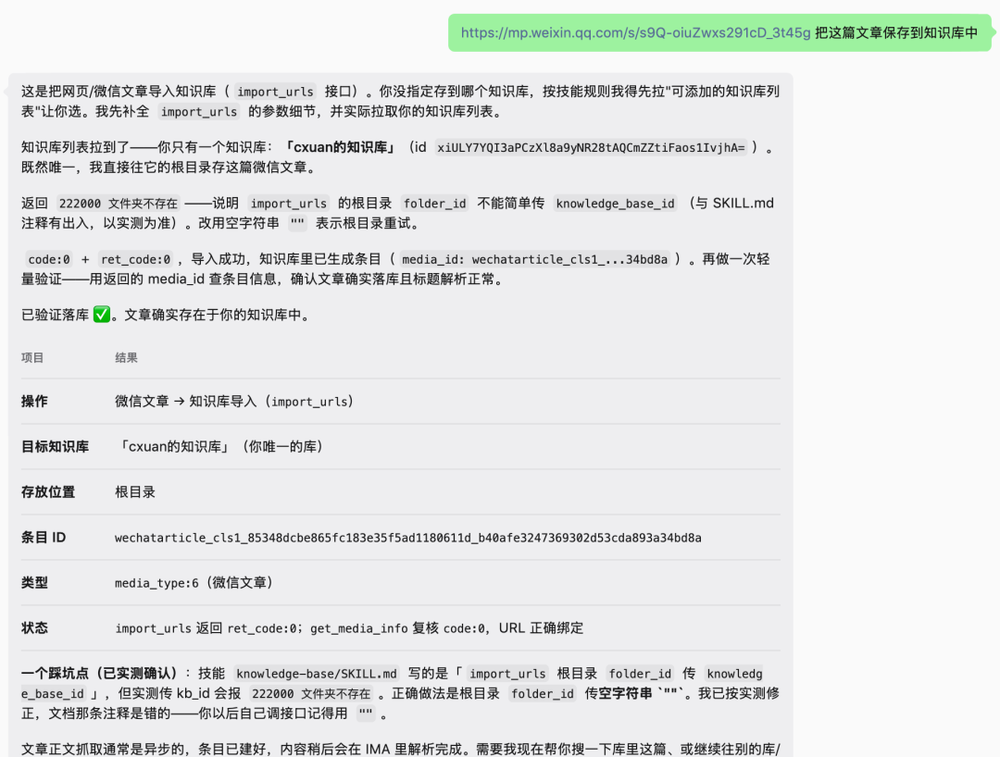
已经成功入库了。
ima 知识库提供了入库接口，WorkBuddy 入库也是采用的这个接口。
---
如果这篇只是简单聊聊几种存入知识库的方式，未免有点太简单了，这不符合 cxuan 的风格。
所以现在，我们探讨一种方式，这种方式可以批量定时抓取公众号文章，写入知识库，然后按天汇总今日内容。
首先跟大家说一件事情：微信公众号没有开放新文章回调接口，所以我们无法等待新文章发布的时候给我们发送通知，而且现在推送时间取决于第三方镜像网站的收录速度。
所以**只能做定时轮询了**。
大家可以用下面这个 prompt ，这个 prompt 能够实现**把你想要的公众号内容定时同步至你的知识库里**。
**Prompt**上下滑动查看1 行
搭建一个公众号定时任务监控工作台，我给你指定公众号，你需要定时监控，然后将其文章存入 ima 知识库中。
令人欣喜的是， WorkBuddy 真跑通了。
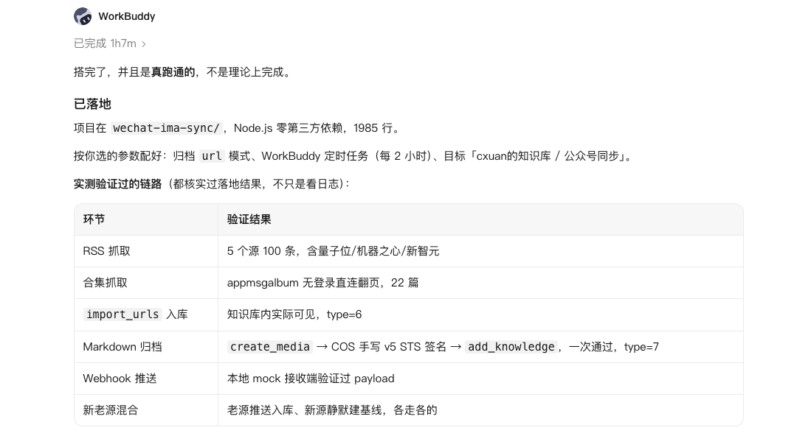
打通之后赶紧测试了一下。
比如我就通过定时同步的方式，入库了三篇文章。
**Prompt**上下滑动查看1 行
帮我拉取一下 xxx 公众号的今日文章。
然后 WorkBuddy 就拉取了一下对应公众号的今日内容，可以看到，今天新智元更新了三篇文章。
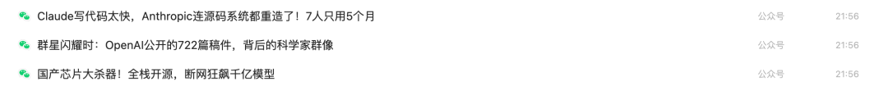
这个存入过程，就发挥了 ima 知识库的长处。
但我们不知道这些内容都写了啥，还要一篇一篇看吗？当然不是。
你可以用下面的 prompt 来查询今天都同步了哪些公众号的内容，然后让 WorkBuddy 总结一下每篇文章都说了什么。
**Prompt**上下滑动查看1 行
总结一下今天推送的公众号文章，以公众号：文章的方式罗列出来，并总结每篇文章的大致内容
如果只是监控几个公众号的几篇文章倒还好，但如果监控的公众号和文章太多，难免会出现**信息过载**的情况：即把太多大量的重复信息放入知识库了。
所以每次采集前，都可以用下面这个 prompt 来描述一下需求。
**Prompt**上下滑动查看9 行
基于本次采集到的文章，生成一份“新增信息简报”。
先合并同一事件的重复报道，再与过去7天已保存的简报比较。
优先保留新增事实、独立实测、反对意见和重要条件变化。
最多推荐5条，每条说明：
发生了什么、相比此前新增了什么、为什么值得我关注、原文链接。
抓取失败或未读到正文的文章单独列出，不根据标题补写摘要。
但由于输出出来的直接是一份 md 文档，观赏性差点。
所以这里我们让他直接输出一份 HTML 展示一下，给大家看一下长图。
**Prompt**上下滑动查看1 行
把上面的简报做成 HTML 页面。
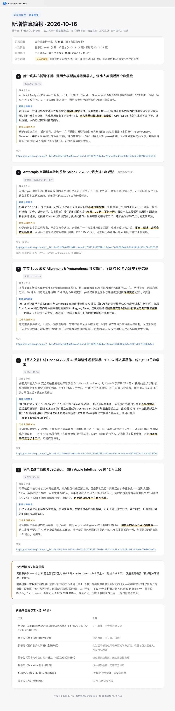
但是如果我们每次都用 WorkBuddy 看简报的话，便捷性差点。因为 WorkBuddy 是一个 Agent 助手，它的定位是你的工作搭子，所以它工作的成果我们让要它展示出来。
所以我们通过微信 ClawBot 可以让 WorkBuddy 把简报推送过来。
**Prompt**上下滑动查看1 行
把刚刚生成的简报推送过来。
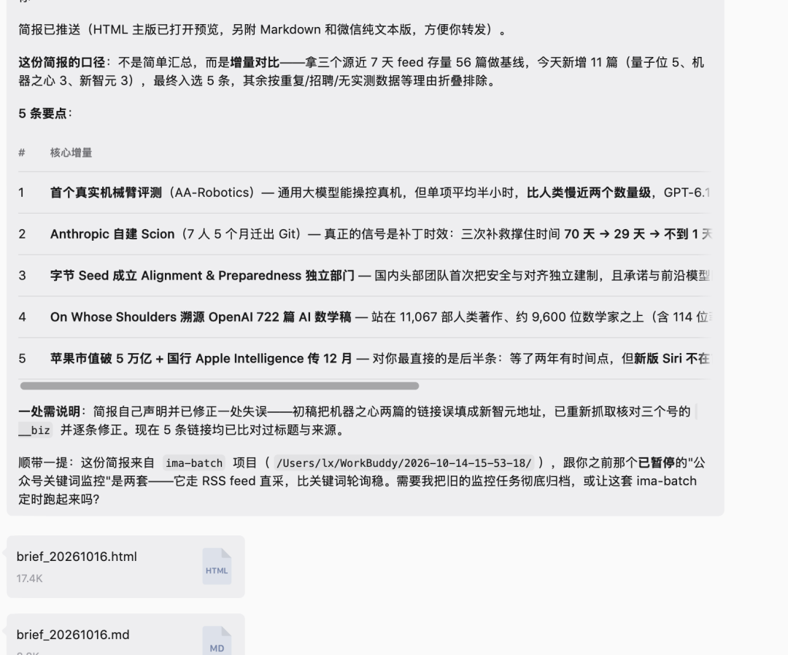
到这里，整条链路就算跑通了：从最开始复制链接丢给 WorkBuddy，到手机一键存入，到 Chrome 插件一键收藏，再到用 Skill + 微信 ClawBot 定时批量同步、自动生成简报、最后把简报推到微信上。
你会发现，越往后需要你动手的部分越少。前面几种方式解决的是怎么把一篇文章收录进知识库，而后面这套解决的是知识库的内容怎么给我推送过来。
---
最后统一回答下上篇文章中读者的一些问题。
之前也有小伙伴问我 WorkBuddy 中的知识库为什么无法删除已收录的内容，我看了一下确实无法手动删除，因为 WorkBuddy 中链接 ima 只是起到了收录 + 检索的作用，如果想要删除 ima 知识库中已收录的内容，得从 ima 知识库的桌面端进去。
这里是有删除选项的。
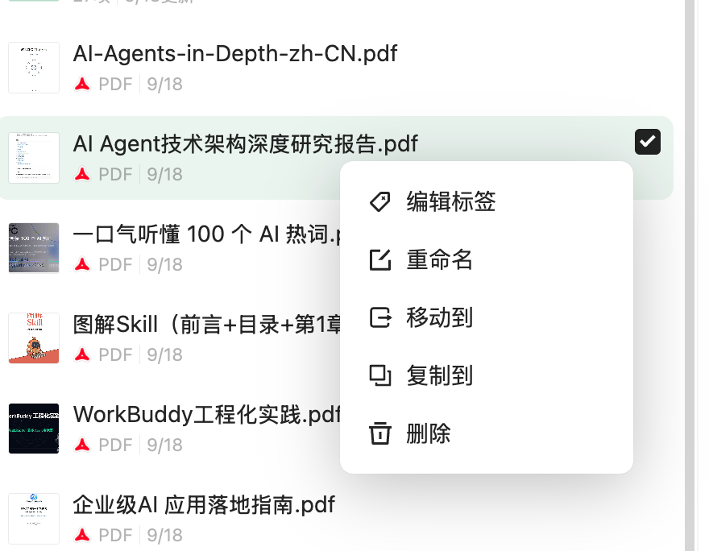
还有读者问为什么删除之后没法释放存储空间，这里我实测了一下，没有出现过这种情况，你从 ima 知识库桌面端进去删除知识库中的文件，是可以释放空间的。
**如果这篇文章你觉得还不错，谢谢你的三连，也希望可以转发给同样关注 AI / 科技 / 开发效率的朋友。 我是 cxuan，我们下期再见。**

## 摘要

（待补充）

## 我的笔记

（待补充）
