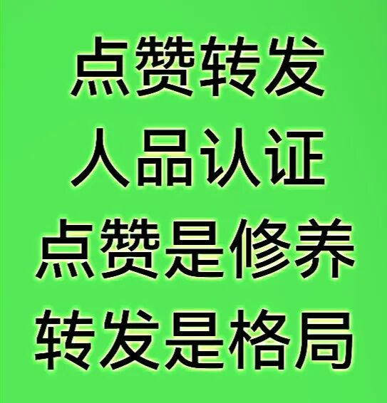

# 德国出版业AI转型
> 💡 备注属性未写入，可能是备注属性名称或者类型被修改了，建议将字段类型设置为 rich_text，可以在小程序-操作-修改文章数据库页面进行调整
> 💡 原文链接:[https://mp.weixin.qq.com/s?__biz=MzU1MzE1OTc5MQ==&mid=2247496708&idx=1&sn=9bfa443dfadc568b3a6967d80c5a36e1&chksm=fadeeeb5b21bce7024cb897b4b5743a5460ec9666e28581fe97212e31f7fc0a9b74b12bbb66d#rd](https://mp.weixin.qq.com/s?__biz=MzU1MzE1OTc5MQ%3D%3D&mid=2247496708&idx=1&sn=9bfa443dfadc568b3a6967d80c5a36e1&chksm=fadeeeb5b21bce7024cb897b4b5743a5460ec9666e28581fe97212e31f7fc0a9b74b12bbb66d#rd)

**德国出版业AI转型：把“慢”变成武器，把“规则”变成护城河**
2026年，法兰克福书展。德国书业协会主席古戈尔茨站在台上，说了一句话：“我们等待的是对我们工作的尊重。”
台下120家出版社签署了“法兰克福呼吁”，要求欧盟和德国政府管住AI公司，让他们公开训练数据、支付合理报酬。
与此同时，一份行业调研显示，69%的德国出版从业者已经在工作中使用AI，平均每人用在3.7个不同环节。
一边起诉OpenAI，一边用AI写营销文案；一边喊“不公平”，一边把AI嵌进工作流。
这种“分裂”背后，是德国人想清楚了一件事：AI跑得越快，规则越值钱。

一

2026年法兰克福书展开幕当天。

德国书业协会主席塞巴斯蒂安·古戈尔茨没有讲“书业繁荣”之类的客套话。
他讲的是“尊重”。

“我们等待的是对我们工作的尊重。”他说。
台下坐着来自120家出版社的代表，他们共同签署了一份文件，叫“法兰克福呼吁”。

这份呼吁书的内容很具体：要求欧盟委员会、欧盟议会和德国政府，强制AI公司披露训练模型时使用了哪些受版权保护的作品，建立公平的授权模式，提供有效的版权执法工具。

古戈尔茨说了一句让很多人不舒服的话：“AI公司未经出版商和作者同意，就使用受版权保护的作品训练模型，无偿利用有价值的作品，而且在很大程度上逍遥法外。”

他还说，版权持有者被迫“自己费力寻找证据，通过昂贵的法律程序主张权利”。

这不是德国出版业第一次对AI发火。但这次不一样。
这次是在法兰克福书展，全球最大的书业聚会上。
时机、地点、对象，都经过了精确的计算。

二

就在古戈尔茨讲话的同时，德国出版业的另一组数据正在流传。

2026年的KI-Studie，德国书业协会做的一份调研，采访了196位出版从业者。
结果显示：69%的人在工作中使用AI生成或修改内容，66%用它做头脑风暴，56%用它做研究和信息聚合，49%用在营销和销售。

平均每个人在3.7个不同的工作环节使用AI。

这个数字说明一件事：德国出版业不是“要不要用AI”的问题。
他们已经在用了。而且用得比很多人想象的更深、更广。

那为什么还要“呼吁”？

因为德国人想清楚了一个逻辑：用归用，规则归规则。 
你可以用AI提高效率，但你不能不打招呼就用别人的东西。
这两件事不矛盾。
一个行业可以同时做两件事：把AI嵌进工作流，把版权规则立在法律里。

三

德国出版业的AI转型，有一个底层逻辑和很多地方不一样。

很多地方对AI的态度是“先发展，后规范”。
德国人的态度是“先定规则，再谈发展”。
这个顺序的差别，决定了整个行业的姿态。

2026年3月，Penguin Random House（企鹅兰登书屋）在慕尼黑地方法院起诉OpenAI。原因是：ChatGPT能生成与《小恐龙可可奈》系列几乎一模一样的插图和故事，而该系列是企鹅兰登旗下的畅销童书。

2026年8月，Carlsen出版社联合作者Marc-Uwe Kling和插画家Astrid Henn，同样在慕尼黑地方法院起诉OpenAI。
原因是：ChatGPT能生成与《NEINhorn》系列高度相似的文本和插图，甚至“主动”提供完整的印刷版式建议，包括封面设计和虚假的出版社logo。

Carlsen出版社的出版人桑德拉·哈尔泽-库克斯说了一句很重的话：“作者和插画家的创造力是我们最宝贵的资产；代表和保护他们的权利，是我们作为出版社的责任。”

这些诉讼不是“情绪化”的。它们有明确的法律策略。
起诉一个具体案例，目的是建立一个可参照的判例。
一旦法院认定“记忆化”属于侵权，所有AI公司都得重新评估自己的训练数据来源。

四

德国出版业的AI运用，还有一个特点：分层。

不是“一刀切”地说“用”或“不用”。而是在不同环节，用不同的标准。

在运营和营销环节：放开用。 
调研显示，49%的德国出版从业者在营销和销售中使用AI。
生成不同渠道的文案、做个性化的newsletter、测试不同版本的书封描述，这些工作，AI做得比人快，而且质量“够用”。

在翻译环节：有条件地用。 
Karl Rauch出版社的负责人Hans-Gerd Koch说，他会用AI工具做初步翻译，然后自己对照检查。
“它能帮我看到翻译对不对，然后我可以把精力集中在德语翻译的质量上。”但他强调，翻译最终要交给人类专业人士。

在文学编辑环节：谨慎。 
德国自由编辑协会（VFLL）发布了一份基本立场文件，明确说：“没有人类编辑，不行。”
协会的要求是：不管用不用AI，高质量文本是最高目标；用AI的人必须注意数据保护和版权；编辑必须知道AI的边界，永远不能未经检查就接受AI的结果；AI系统只有经过作者事先同意才能用于文本。

在创作环节：守住底线。 
2026年，18家德国青少年图书出版社联合推出一个标签：“由人——撰写——设计——审核”（Von Menschen - geschrieben - gestaltet - geprüft）。这不是“禁止AI”，是“透明和负责”。
用这个标签，读者就知道这本书的核心创作是由人完成的。

五

德国出版业还有一个值得注意的做法：建自己的工具。

霍尔茨布林克出版集团（Holtzbrinck）在2022年创建了CHAPTR公司。
这家公司和施普林格·自然、麦克米伦是同级子公司，专门做AI解决方案。

CHAPTR正在开发一个叫NOA（No Ordinary Assistant）的项目，用多个AI模型，针对集团需求提供定制服务。
它的一个核心应用是：自动更新老书的元数据。

霍尔茨布林克的兰德尔解释了这个工具的逻辑：“手动更新老书关键词和内容描述的传统做法，不仅耗费人力，而且效率低下。我们利用AI智能识别当前趋势，将其与出版社的老书相匹配，随后AI系统推荐关键词和图书描述等最新信息。”

这个应用看起来“不性感”。
但它解决了一个真实的痛点：老书怎么被重新发现。
德国出版社的库存里，有大量已经出版多年、但仍有价值的书。
它们的元数据过时了，在电商平台上搜不到。AI可以帮它们重新“浮”出来。

六

德国出版业的AI转型，对中国出版业至少有三条可参照的经验。

第一，把“规则”当作战略资产，不是障碍。 
德国出版业花大量精力推动立法、发起诉讼、建立行业标准。
这些动作看起来“不直接产生收入”，但它们做了一件事：把AI公司的成本提高了。 
当AI公司面临诉讼风险、合规成本、授权费用时，它们必须为使用版权内容付费。
这笔钱，最终会流向内容生产者。规则不是“限制”，是“定价权”。

第二，把“透明”当作竞争壁垒。 
18家青少年出版社的“由人创作”标签，本质上是一种差异化策略。
在AI生成内容泛滥的市场里，“由人创作”成了一种稀缺标识。
读者愿意为“确定是人写的”付费。
这种信任，是AI无法替代的。

第三，把“慢”当作一种能力。 
德国出版业没有急着“全面AI化”。
他们在不同环节用不同的速度。营销环节快，编辑环节慢，创作环节守住。
这种“分层速度”，让行业既能享受AI的效率，又能保护核心价值。

七

古戈尔茨在法兰克福书展的开幕词里，还有一句话被很多人忽略了。

他说，现在书市被“AI垃圾”淹没，尤其是指南书和旅行指南。“没有人类参与，就生产出可能甚至危险地误导读者的书。”

他还提到一个数据：根据最新的PISA研究，三分之一的15岁青少年已经无法正确理解文本。“谁不能再进行理解性阅读，谁就再也无法检查AI的回答。”

这句话点出了一个更深的问题：AI转型的前提，是还有能读懂书的人。 
如果一代人失去了深度阅读的能力，那AI生成的内容就真的没人能验证了。
到那时候，出版业保护的就不只是版权，是整个社会的认知能力。

德国出版业的AI转型，说到底是在做一件事：在AI重构一切的时候，守住那些不能被重构的东西。 
守住作者的署名，守住编辑的判断，守住读者对“这本书是人写的”的信任。

这些东西，看起来“慢”，看起来“不效率”。
但它们才是出版业存在的理由。AI可以加速一切，但加速不了信任。
信任只能慢慢攒。而攒信任的人，最后会赢。

## 摘要

（待补充）

## 我的笔记

（待补充）
