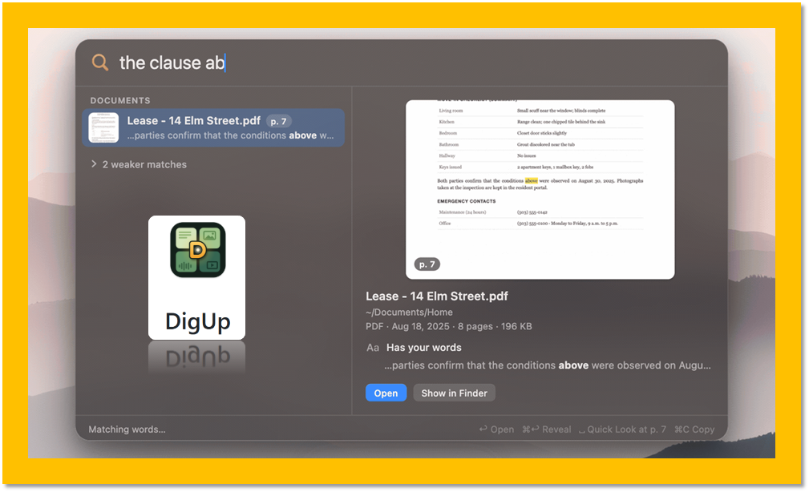
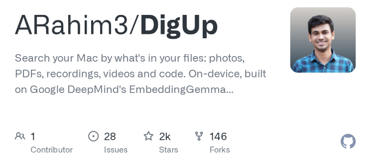
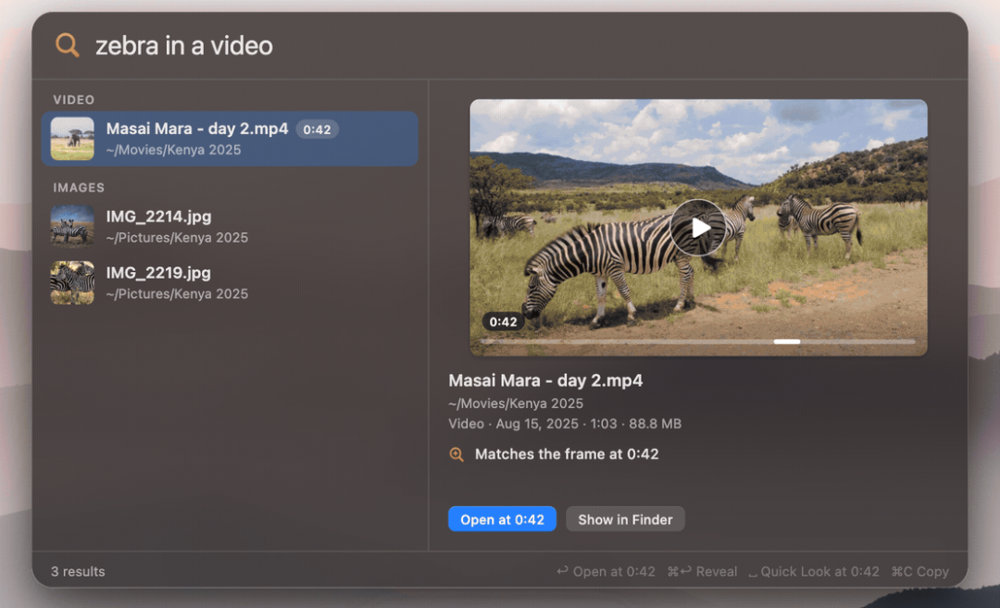

# 忘了文件名也能找到：DigUp 让 Mac 用自然语言搜索照片、PDF 和视频
> 💡 备注属性未写入，可能是备注属性名称或者类型被修改了，建议将字段类型设置为 rich_text，可以在小程序-操作-修改文章数据库页面进行调整
> 💡 原文链接:[https://mp.weixin.qq.com/s?__biz=MzI2MjEyODE4OA==&mid=2650484570&idx=1&sn=e4a32f6110d2c5e93ad6438cad509e4a&chksm=f31ca0141dbea4d9cb7755b03a2244f946a6d5b01ce6a848c169b0cd622d2f41e4176b1c763e#rd](https://mp.weixin.qq.com/s?__biz=MzI2MjEyODE4OA%3D%3D&mid=2650484570&idx=1&sn=e4a32f6110d2c5e93ad6438cad509e4a&chksm=f31ca0141dbea4d9cb7755b03a2244f946a6d5b01ce6a848c169b0cd622d2f41e4176b1c763e#rd)

大家知道，Windows 下的 Everything 找文件很方便，但它最擅长的是根据文件名快速定位文件。Everything 也能通过 content: 搜索文件内容，只是这类搜索主要依靠文字匹配，而不是理解文字的含义。
这也是传统文件搜索经常遇到的问题。有时候，我们只记得文件的一部分内容，使用的词语未必和文件名一致，甚至想找的信息只出现在文件内部。这时候，即使知道自己要找什么，也不一定搜得出来。macOS 虽然有内置的 Spotlight，但在理解照片、录音、视频等内容方面，也不是所有场景都能满足需要。
最近，我发现了一个开源项目，利用 Google 开放的本地 AI 模型为文件建立语义索引，于是第一时间拿来试了一下。
这个项目叫 **DigUp**，是一款免费、开源的 Mac 文件搜索工具。我们只需描述记得的内容，它就能尝试找到对应的照片、PDF、文档、录音和视频，甚至定位到 PDF 的某一页、录音的某个时间点或者视频中的某个画面。

截至 2026 年 10 月 13 日，DigUp 最新公开版本为 0.6.0，也是它的首个公开版本。作为一个刚发布的工具，表现已经相当出色了。
## DigUp 和 Spotlight、Everything 有什么不同？
首先要记住，DigUp 的特色是**语义搜索**。它既不是传统的文件名检索，也不只是按照文件内容逐字匹配。
比如，文件名是 IMG_4821.HEIC，我们记得的却是「海边的船」。又或者，一段视频叫什么名字并不重要，我们真正想找的是其中出现斑马的那个片刻。
DigUp 可以把文字、图片、音频和视频等内容纳入同一套语义检索。根据项目介绍，搜索视频中的斑马，可以打开对应的画面；搜索录音里讨论睡眠的内容，也可以跳到相关时间点。

我自己的使用体验是，搜索词不一定需要与文件内容完全一致，只要意思接近，就有机会找到。而且它支持跨语言语义检索，可谓相当强大！
我这里有个比较实际的例子。搜索 Dragon 这个词时，不仅找到了相关的文字稿，还找到一张以前和客户的合影，照片背景的墙壁上恰好有 Dragon 字样。
更进一步，一些 PDF 和扫描文件中的内容也能被找到，而且能够定位到相关页面。比如，我有个客户公司的名字出现在某份 PDF 的第 4 页，DigUp 在搜索结果中的预览就显示了那一页。
虽然，Apple Photos 本身也能根据照片内容进行搜索，但它主要围绕照片图库工作。DigUp 的优势是可以给自己指定的工作目录建立索引，把不同格式的资料放在一起查找。
所以，我更愿意把 DigUp 看作 Spotlight 的强力补充。我会把工作文件夹交给 DigUp，而日常的系统搜索和私人文件查找，还是继续使用 Spotlight。
## DigUp 实测：索引速度和准确率如何？
先说索引速度。
我让 DigUp 对一个混合了 PDF、图片和 Markdown 笔记的工作文件夹建立索引，里面大约有 1000 个文件。在一台 16GB 内存的 MacBook Air 上，没几分钟就完成了，期间也能看到进度。
这只是我这次测试的结果，具体耗时自然会受到文件大小、格式和硬件配置影响。索引完成后，搜索结果返回得很快，几乎是瞬时的。
至于准确率，语义搜索确实能找出一些传统文字匹配容易漏掉的信息，这是很大的加分项。但它也会带来另一个问题：有些结果虽然和关键词有一点语义联系，却不是我真正想找的内容，算是一种检索噪音。
因此，我建议大家不要只输入一个过于宽泛的单词，而是尽量加一点上下文，把真正想找的内容描述清楚。这样搜索结果的相关性通常会更好。
如前面所说，DigUp 也保留了精确词匹配，用来查找文件名、文档正文以及截图中的文字。比如已经知道准确的客户名称、编号或者报错信息时，精确搜索反而更适合。它并没有把所有问题都交给 AI 模型处理。
另外，DigUp 还有专门的 Code 搜索，可以按代码的用途寻找函数，比方说：找到写客户数据库的信息登记函数。不过，这项功能需要自行启用并指定代码目录。我已经有合适的 Agent 和 IDE 来处理这类专业工作，就没有继续测试它了。
我觉得扫描资料、会议录音、短视频也都很适合这种搜索方式。只是这次我的实测重点仍然是文档和图片，音视频的具体识别准确率，还需要后续更多实际使用来检验。
## EmbeddingGemma 2：为什么本地 AI 搜索开始变得可行？
大家肯定关心，这种搜索用到了 AI，会不会把私人文件上传到云端？
DigUp 使用的是 Google DeepMind 开放的EmbeddingGemma 2。这是一个约 7.4 亿参数的多模态向量模型，不是用来聊天和写文章的那种生成式模型，而是适合把文字、图片、声音和视频内容转化成可以比较的语义表示。
DigUp 首次运行时，需要下载约 800多 MB 的模型文件。按照项目官方说明，建立索引和执行搜索都在 Mac 本机完成，不会把索引的文件内容上传到在线 AI 服务。联网主要用于首次下载模型和检查软件更新，更新检查也可以关闭。
换句话说，它没有把整个工作目录送给云端模型分析，只是在本机建立一份用于检索的索引。
这也让我想到过去一些公司花费大量精力搭建的 RAG 系统。EmbeddingGemma 2 这样的轻量模型，确实降低了本地语义索引的技术门槛。对于普通用户和小团队来说，要获得实用的 AI 搜索能力，甚至未必需要复杂的云端服务了。当然，严格来说，语义检索只是 RAG 的一个环节，后面还有内容召回、排序和生成回答等步骤，不能把两者混为一谈。
## 安装前，有几个限制需要知道
目前 DigUp 只支持Apple Silicon（M 系列芯片）的 Mac，要求macOS 14 或更新版本，Intel Mac 暂时不能使用。
安装方式也很直接，从 GitHub Releases 下载 DMG，拖入应用程序文件夹即可。首次启动时下载模型，然后选择需要建立索引的目录。默认按下 Shift + Command + Space，就能从其他 App 呼出搜索窗口。
另外，还有几点要留意。
对于特别长的 PDF，DigUp 会优先处理前 30 页，其余页面在后台继续索引，每份 PDF 最多处理 5000 页。因此，初步索引完成也不一定代表长文档已经全部处理完毕。
如果有不希望纳入索引的文件类型或文件夹，可以在设置中排除。
我强烈建议，大家像我一样把日常工作的库扔进去索引即可，不要什么文件夹或者全盘都扔进去。
## 最后：它能取代 Spotlight 或 Everything 吗？

一个开源、在本机运行 AI 模型的文件搜索工具，效率和准确率都不错。对于刚发布的版本而言，虽然还需要更多真实资料来检验，但这个方向和发展潜力，我很喜欢。
我们也清楚，语义搜索并不是精确搜索的完全替代品。查找确定的文件名、路径或编号，Everything 和 Spotlight 依然很合适；如果只记得「那张照片里有什么」「哪份报告谈过这个问题」，DigUp 这样的工具就很有优势。
DigUp 目前还只有 Mac 版本。我希望以后能有 Windows 版本，但它现在使用了不少 Apple 平台的系统组件和 Metal 加速，真正移植到 Windows PC时，可能有效率上的些许影响。（看过项目公开库就可知，Windows 移植完全可行，不排除有大佬手搓一个，因为重点能力都在那个离线模型上，App 主要是壳）
甚至我觉得，Windows 和 macOS 以后都应该原生集成类似这种更强的本地语义检索能力，成为操作系统标配。
不管如何，明显能感觉到，随着本地 AI 模型越来越实用，最近的生产力工具开始出现不少令人惊喜的变化。这也是我很乐意继续关注并和大家分享的方向。
DigUp 官网地址
https://github.com/ARahim3/DigUp

## 摘要

（待补充）

## 我的笔记

（待补充）
