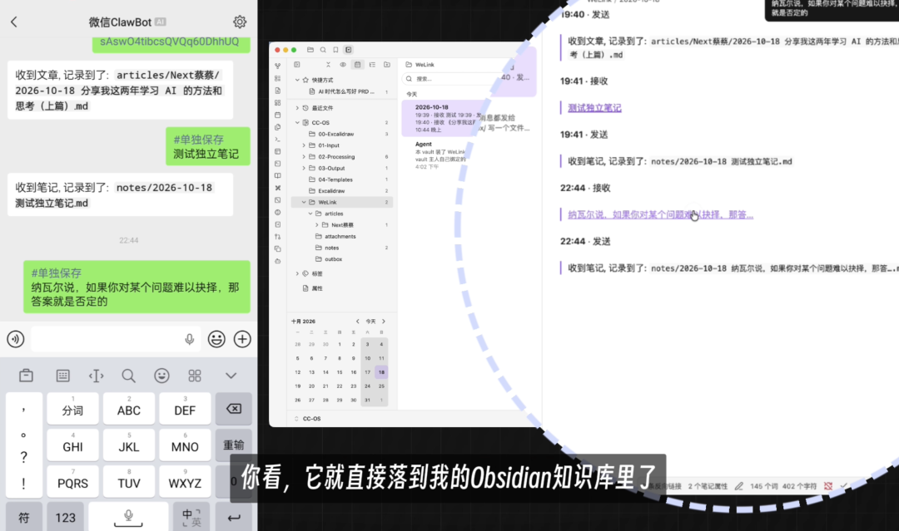
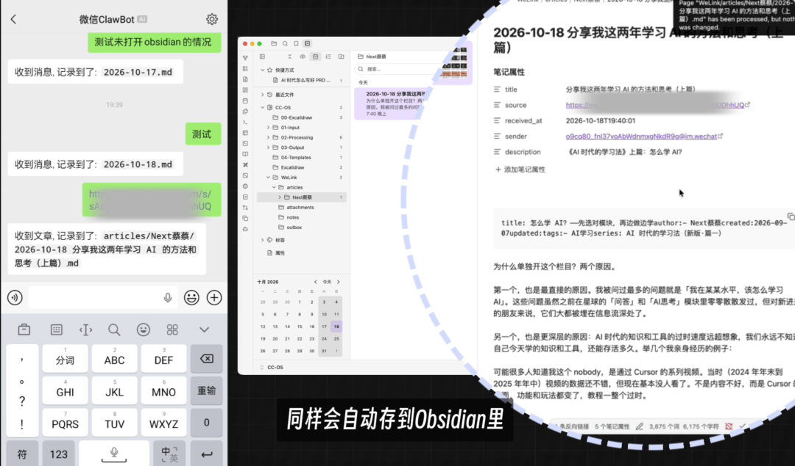
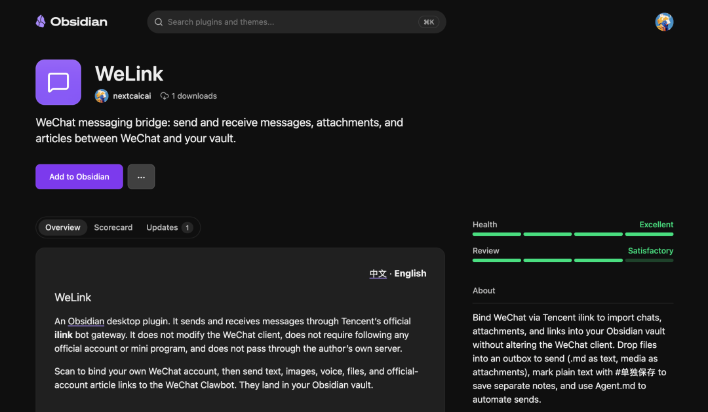
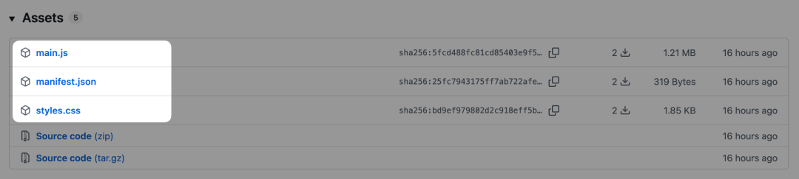
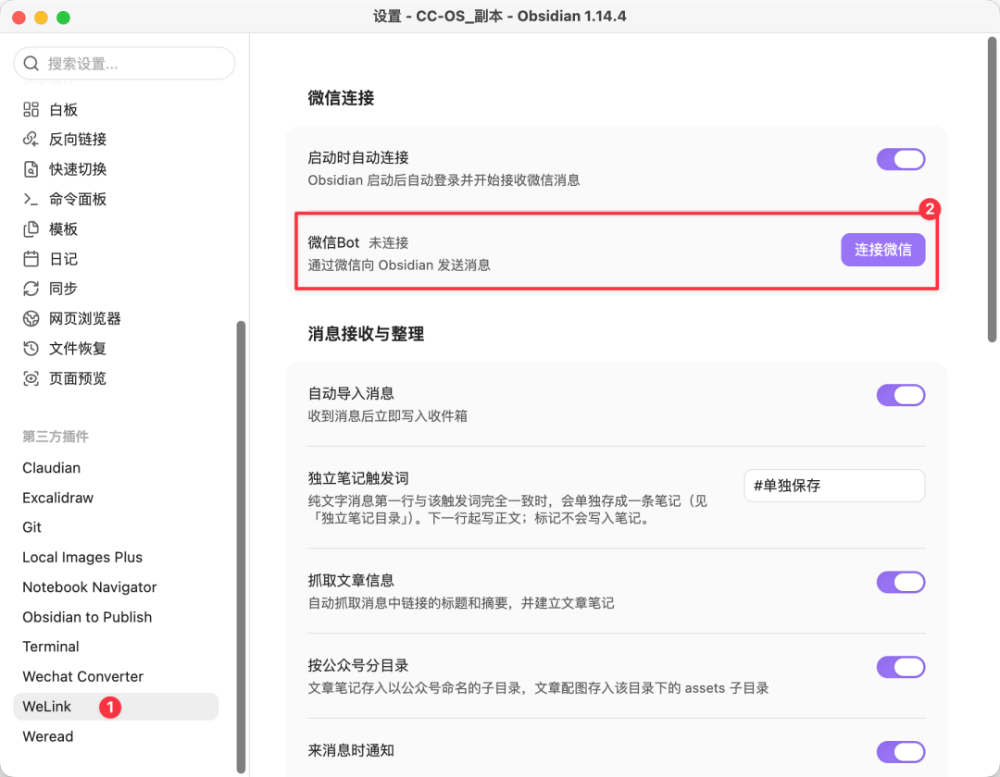
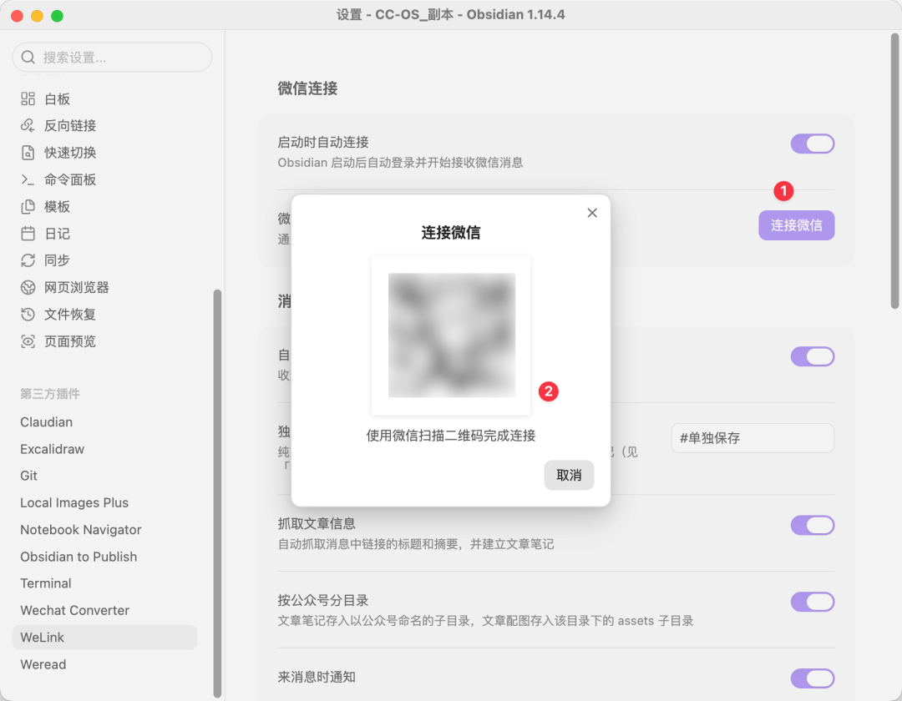
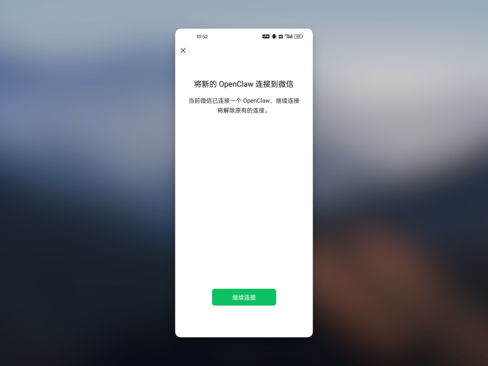
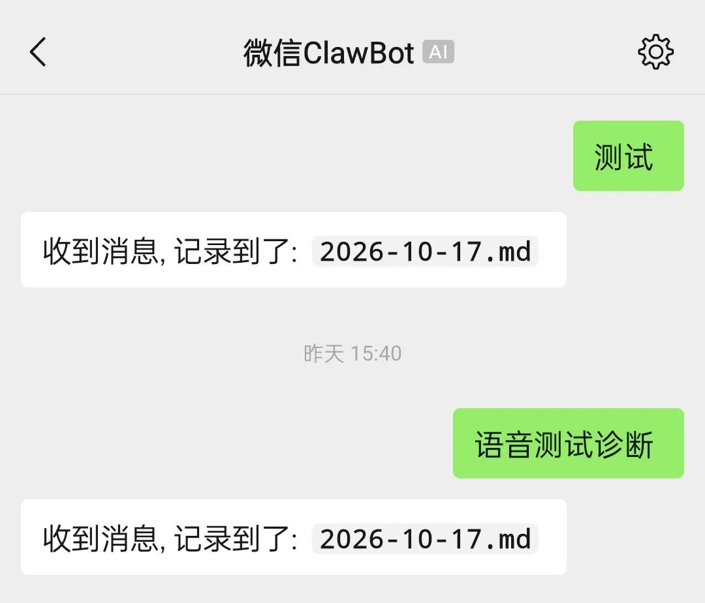
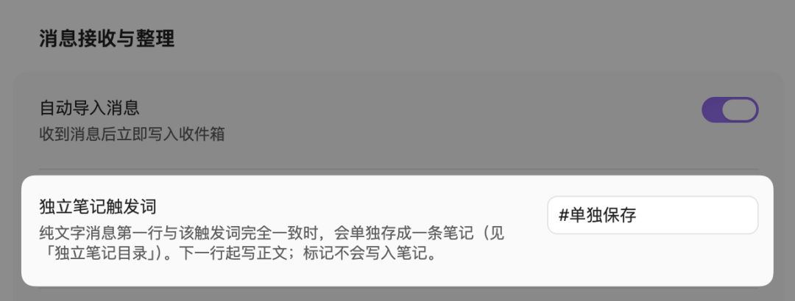

# 怎么把微信随手记、公众号文章快速同步到 Obsidian？
> 💡 备注属性未写入，可能是备注属性名称或者类型被修改了，建议将字段类型设置为 rich_text，可以在小程序-操作-修改文章数据库页面进行调整
> 💡 原文链接:[https://mp.weixin.qq.com/s?__biz=MzIyMzk3MTEwNQ==&mid=2247488542&idx=1&sn=b942da31ca358d88cdb135ee611d62b7&chksm=e919281b7d8194ed05954764441c5e290a70803a7293cef4d864acaaa085c0df5907365925d0#rd](https://mp.weixin.qq.com/s?__biz=MzIyMzk3MTEwNQ%3D%3D&mid=2247488542&idx=1&sn=b942da31ca358d88cdb135ee611d62b7&chksm=e919281b7d8194ed05954764441c5e290a70803a7293cef4d864acaaa085c0df5907365925d0#rd)
```
title:
author:
- Next蔡蔡
created:2026-10-18
updated:
tags:
```
先给大家直接看效果：
打开微信 Clawbot，把我的灵感快速记录下来，点击「发送」，它就能直接落到 Obsidian 知识库里；

还可以把我觉得不错的公众号文章链接丢给它，同样会剪存到 Obsidian 知识库中。

全程只用到我开源的这个 Obsidian 插件—— WXLink。**它是基于腾讯官方的 ilink 协议，不需要关注任何服务号或小程序，也不经过任何个人服务器**，应该是目前在「微信和 Obsidian 双向通信」最安全、稳定的方案。
WXLink🔗：https://community.obsidian.md/plugins/welink
接下来，我会给大家详细介绍这个插件的由来和使用：
### WXLink 的由来
我其实很早就在想怎么实现把自己在微信中快速记录的笔记，以及看到不错的公众号怎么更低阻力地同步到 Obsidian 中。
但当时得出来的方案大致有这么两种：
**第一种是「服务号 + Obsidian 插件」**。当时就有现成的工具，比如「Flomo」、「笔记同步助手」，关注它的服务号，再装对应的 Obsidian 插件，之后把文字、图片、文件、链接转发给服务号，打开 Obsidian 就会同步进来。
但这种方案要走其他人的服务器，对于部分信息会有一定顾虑；而如果只是为了这个场景自己搭的话，又太重了；
**第二种是「小程序 + Obsidian 插件」**。实现思路和第一种一致，也有现成工具。和前面的顾虑是一样的。
所以后面很长一段时间就搁置了这个探索。
直到后来看到 Wechatian，它的思路就是用腾讯官方 ilink 机器人网关打通微信和 Obsidian。说 ilink 大家可能比较陌生，但应该都知道基于它的**微信 ClawBot 插件**。 所以我才说这个思路应该是最安全、稳定的。
**Wechatian**🔗：https://community.obsidian.md/plugins/wechatian
**OpenClaw Weixin Channel**🔗：https://www.npmjs.com/package/@tencent-weixin/openclaw-weixin
不过在实际体验 Wechatian 后，我发现存在不少可以优化的点，也想基于自己的一些场景做针对性调整，所以就有了现在 fork 后的 WeLink。
### WXLink 的使用说明
WXLink 插件已经提交 Obsidian 社区审核并通过，不过由于官方的插件市场 API 存在 **数据同步延迟**，可能得一天后客户端才能索引到新插件。所以现在点击「Add to Obsidian」跳转到客户端会显示为空（现在应该不会为空了）。

如果大家想现在用上的话，可以用下面几种方法：
**方法一：让 Agent 安装**
复制下面整段提示词，把 `REPLACE_WITH_YOUR_VAULT_PATH` 换成你自己的 Obsidian 库目录，再交给 Agent：
```
请将 WeLink Obsidian 插件（https://github.com/nextcaicai/WXLink）安装到我的 Obsidian 库。

我的 Obsidian 库目录是：
REPLACE_WITH_YOUR_VAULT_PATH

请自行安装到该目录下的 .obsidian/plugins/wxlink/。只安装 manifest.json、main.js、styles.css；三个文件必须直接放在 wxlink 文件夹内，不要多套一层目录。
不要修改我的笔记内容。不要删除其他插件目录。不要读取、打印或提交密钥（包括 state.json、data.json）。
装完后告诉我：文件放在了哪、要不要重启或重新加载插件，以及接下来如何扫码绑定。

```
当然，也可以用传统的手动方法，比如从 Releases 安装，以及用 BRAT 安装。
**方法二：从 Releases 安装**
打开本仓库的 Releases，下载 `main.js`、`manifest.json`、`styles.css`。

然后放到你的插件库里 `/.obsidian/plugins/welink/`。
不论你用方法一还是方法二，安装后都要在「设置-第三方插件」中关闭安全模式，接着点击「刷新」，就可以「启用」**WXLink** 了。
启用后，进入 **WXLink** 的设置窗口，你会看到「微信 Bot」选项，点击右侧「连接微信」按钮；

接着就会弹出二维码窗口，选择你常用的个人微信进行扫码；

扫码后就会弹出这个确认连接的窗口，点击「继续连接」，理论上就完成微信和 Obsidian 的连接了。

之所以说理论上，是因为得自己测试下。
比如你发送「测试」，如果它给你返回”收到消息，记录到了：2026-xx-xx.md“，就代表真的连接成功了。

除了纯文字，还支持文章链接、语音、图片、附件等等。所有这些内容，它都会直接落到 Obsidian 的 WXLink/inbox 目录的文档中。这个文档是按每天的时间线进行整理的，也就是你当天发送的都可以在这里找到，后续用 Agent 进行整理即可。
这里面比较不一样的是，对于文章链接，会单独新建笔记并剪存进去；
当然，如果你希望某段纯文字也作为独立笔记保存到 Obsidian 中，也可以的。在设置窗口中配置「独立笔记触发词」，比如这里默认用的就是「#单独保存」，你可以自己改。

最后，有两个小提醒：
1、电脑没开 Obsidian 时，发给机器人的消息不会立刻丢。下次打开 Obsidian 并连上后会补收。不过官方的机器人网关具体保留多久没有公开说明，很久以前的离线消息确实说不准。
2、如果你会比较频繁地给微信发消息，那么建议在「设置」窗口中将「总是回复」选项切换到关闭，因为消息较多时可能会触发网关限流。
以上就是我用 WXLink Obsidian 插件解决微信消息同步 Obsidian 的实践，如果对你有启发或帮助的话，欢迎一键三连，我们下期再见 ~
