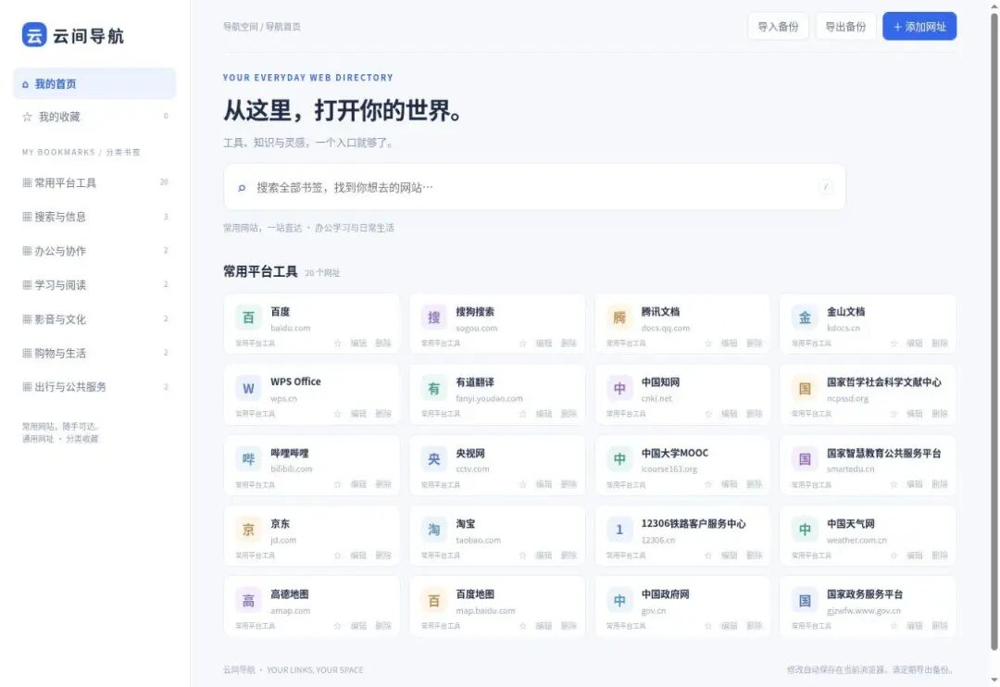

# 怎么用AI把3703个网址做成自己的导航网页？
> 💡 备注属性未写入，可能是备注属性名称或者类型被修改了，建议将字段类型设置为 rich_text，可以在小程序-操作-修改文章数据库页面进行调整
> 💡 原文链接:[https://mp.weixin.qq.com/s?__biz=MzI0ODE1OTk1MA==&mid=2247484526&idx=1&sn=ec53e30af992c61a8b5ffcbdb13c6faf&chksm=e88d175859cd47c23eef4be5b3acd9c1e9eaf9c7a3b7a1bc2d8648c8bdaad7acfca2ea3ba901#rd](https://mp.weixin.qq.com/s?__biz=MzI0ODE1OTk1MA%3D%3D&mid=2247484526&idx=1&sn=ec53e30af992c61a8b5ffcbdb13c6faf&chksm=e88d175859cd47c23eef4be5b3acd9c1e9eaf9c7a3b7a1bc2d8648c8bdaad7acfca2ea3ba901#rd)
 浏览器收藏夹用了很多年，存的时候很顺手，真要找的时候就难了：文件夹越分越多，同一个网站存过好几处，临时存的工具和天天用的网站混在一起。
 前几天我把收藏夹导出来一数，3703条。我没去用公共导航站，那是别人的分类习惯。
 我让AI做了两件事：先把这些网址整理干净，再做一个能浏览、能搜索、能自己维护的网页入口。

动手前，先准备这几样
 书签文件。浏览器的书签管理里能导出一个HTML文件，里面有网址、网站名称和文件夹层级，直接就是网页的原始数据。先留一份原件，拿副本给AI。
 用法说明。哪些目录是常用入口，哪些是临时收集区，哪些目录的名字和层级不能动。
 整理规则。重复的网址留哪一处，相近分类合不合并，同一网站的不同文章留不留，拿不准的怎么放。
 成品形式。我定的是一个单文件HTML导航页，下载后用浏览器打开。
分类、合并、去重
 常用区的21条，排列一条没动。临时区的142条，让AI按用途拆成16个子文件夹，AI对话、图像设计、视频、编程、写作、办公等。
 然后合并相近分类，把90条归属明确的书签挪进对应目录，清掉88条重复的，最后剩3615条。
 去重有两个讲究：重复的网址优先留在常用区；同一网站下的不同文章、项目页要分开留，不能看域名一样就整站删掉。这次整理的是数据和分类，3615个网站现在能不能打开，没有逐个验证。
从收藏夹变成网页
 目录变成左侧的分类菜单，每条书签变成一张卡片，写着网站名和域名。顶部是全站搜索，首页放常用网站，白蓝配色，电脑手机都能看。
 功能有这些：按层级逐级浏览；按名称、网址、分类搜索；标星放进我的收藏；添加、修改、删除书签；导出和导入数据备份。
 有三个HTML别搞混：浏览器导出的原始书签、整理后能导回浏览器的书签、导航网页本身。网页里的导入，读的是它自己导出的备份，不是任意书签文件。

再拆出小专题
 总导航三千多条，有些专题用起来还是嫌杂。我又挑了两个文件夹，单独做成一个60条的小导航，有自己的搜索和编辑，数据跟总导航分开存。
可以直接复用的三段话
 整理数据：请读取我导出的浏览器书签，统计网址和文件夹，保留常用区排列，按用途整理临时区，合并相似分类，重复网址优先留常用区，同站不同文章都保留，拿不准的单独放，输出可导回浏览器的书签文件，并告诉我整理前后的数量。
 生成网页：请用整理后的书签做一个单文件HTML导航页，左侧分类，首页放常用网站，支持搜索、标星、增删改和备份导入导出，布局明亮，适配电脑和手机，数据写在文件里。
 拆专题：请从总导航提取指定文件夹，做成独立的小导航，保留搜索和编辑功能，数据单独存放。
 AI负责批量读取、分类建议、写代码和核对数量。哪些网址重要、分类顺不顺手，还得自己定。
本地、备份和上线，是三回事
 网页打开后，分类和网址断网也能浏览，点开外部网站还是要联网。
 添加、修改、标星这些改动存在当前浏览器里，不会改写那个HTML文件，也不会同步到别的设备。
 清了浏览器数据、换了电脑，改动可能就读不出来了，定期导出备份最省心。
 现在它只是一个本地文件，不是网站。想换设备也能用，得部署成在线网页；想多台设备同步修改，还要再加同步功能。先让它能找、能点、能存，其他的后面再说。
| **如****果****觉****得****内****容****不****错****，****随****手****点****赞****、****分****享****、****推****荐****吧****。**THANKS FOR READING |

