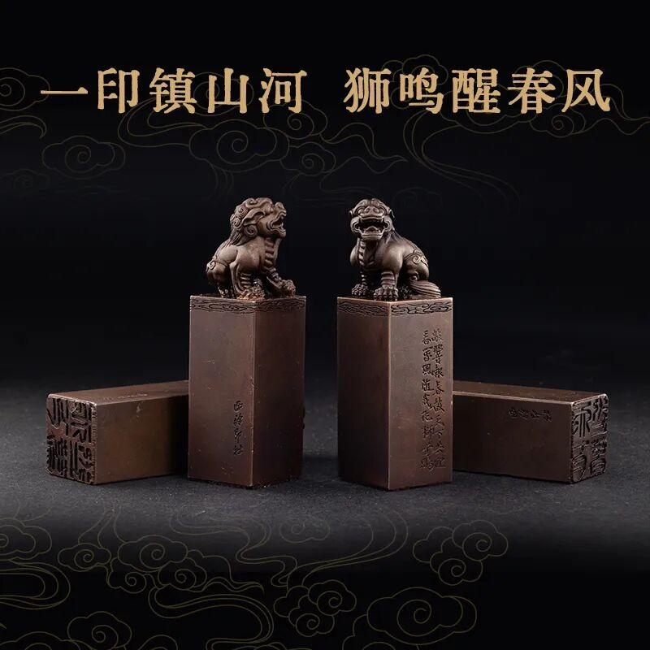
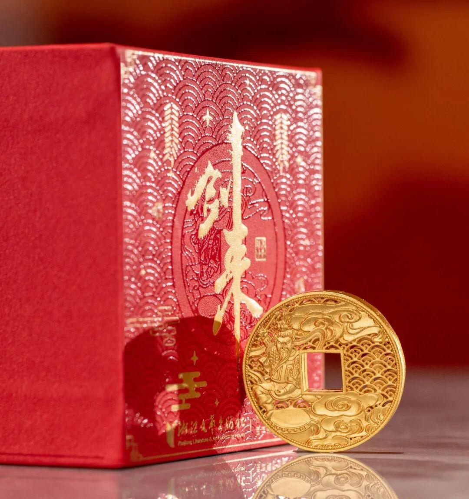
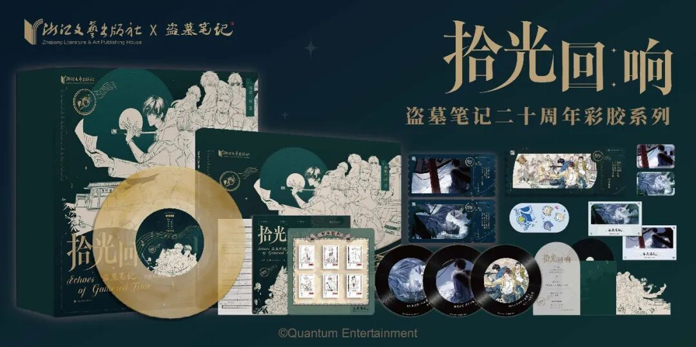
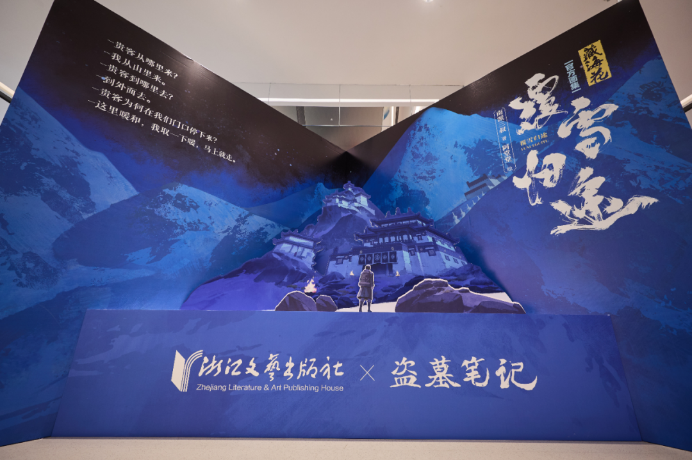
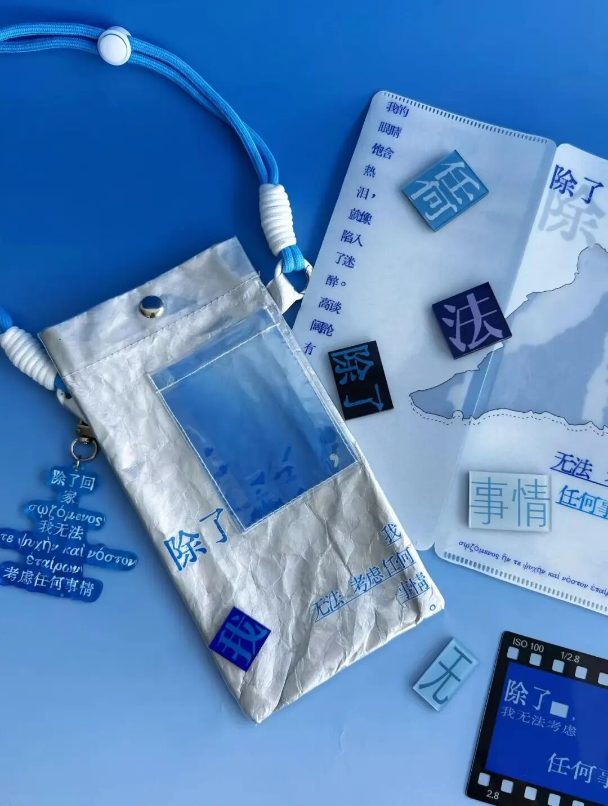

# 总销售额超1500万元，这家社如何做文创全产业链开发？
> 💡 备注属性未写入，可能是备注属性名称或者类型被修改了，建议将字段类型设置为 rich_text，可以在小程序-操作-修改文章数据库页面进行调整
> 原文链接:[https://mp.weixin.qq.com/s/mCAhCFa6KMj_-16k0y9y-A](https://mp.weixin.qq.com/s/mCAhCFa6KMj_-16k0y9y-A)
整理 | 黄小菲
2022年，浙江文艺出版社（以下简称“浙江文艺社”）从头部网络文学作品《剑来》系列图书的读者反馈中，发现了一个新的需求：粉丝对书中器物与设定的情感投入，远超一般图书读者。他们自发地在贴吧、超话里“催更”周边，希望把书里的世界带回现实。
这一发现，让浙江文艺社意识到，优质IP在图书之外存在巨大的延伸价值。
2022年底，浙江文艺社试水推出首款《剑来》新年礼盒，限量2023个、逐一编号，开售当天即告售罄。2023年，浙江文艺社正式成立文创工作室（现文创中心），并创建自有文创品牌“文艺光年”，取“文学星河”之意——每一部作品都是星河中的一颗星球，读者是追光之人，文创则是读者与作品对话的实体载体。
这也是浙江文艺社布局文创业务的起点。一方面，文创是IP影响力积累到一定阶段后的自然延伸，既能延长IP生命力，也会反哺IP本身。另一方面，传统出版业态相对单一、利润微薄，浙江文艺社希望以文创为切口，在书业之外开拓创新出版的可能性，同时打开逐渐成为消费主力的年轻读者市场。
截至目前，“文艺光年”已推出三四十款文创产品，总销售额超过1500万元，多款产品上线即售罄。其中，《剑来》系列衍生品贡献销售额超千万元；《藏海花：覆雪归途》官方画集上市1个月连续3次加印、销量超3万册、码洋超500万元。“剑来金精铜钱·供养钱”入选2025“长江好物”十佳出版文创，“静心得意扇”获2025年度IP开发产品称号，“文艺光年”获评2025年度影响力文创品牌。
本文根据《出版人》杂志专访浙江文艺出版社文创中心负责人徐莺的内容整理。

**文创升级为“双主业”重要一极**
文创业务在浙江文艺社战略中的定位，经历了一次根本性的升级。
2022—2023年，文创更多被视为图书业务的营销配套，是给IP“锦上添花”的周边，也是维系粉丝情感的纽带。当时的目标很朴素：把新年礼盒做成出版社和粉丝之间“心照不宣的传统”。
随着金精铜钱、养剑葫、珍藏版折扇等产品连续售罄、系列销售额突破千万元，社里对文创的战略定位发生了质的变化：从“图书的附属”升级为“图书出版+IP文创”双主业结构中的重要一极。

剑来动画·静心得意扇
在这一定位下，文创不再只是图书促销的添头，而是被放在IP运营的视角下重新定义：它既能延长IP生命周期，又能反哺图书销售，大量粉丝经由文创反向回流购买原著，还能提升IP整体版权价值，为动画、影视等全产业链开发奠定用户与市场基础。
与此同时，文创板块的利润率高于图书，已成为出版社全新的增长曲线。
从社级层面看，文创还承担着另一重战略功能，即探索“网文IP+非遗技艺+文旅场景”的融合路径，推动网络文学优质内容与中华优秀传统文化的创造性转化相结合。这既是出版单位社会效益的落点，也是出版社在同业中形成差异化定位的壁垒。浙江文艺社长期深耕网络文学积累的独家IP资源和对粉丝群体的深度理解，是一般文创公司不具备的核心优势。
与新业务板块相适应的是组织机制的调整。目前，浙江文艺社文创业务由文创中心（原文创工作室）归口管理，实行负责人制，专职团队按业务发展逐步扩充，走的是“小团队、大外协”路线：产品定义、IP运营、营销销售等核心环节自建，工业设计、生产制造等环节依托稳定的外部合作网络完成。
文创项目以IP为单位整体规划、按项目制立项，纳入社内选题决策流程统一审议；预算单列、独立核算，避免与图书业务混同。考核坚持“双效”口径，既看销售额、利润等经济指标，也看品牌声量、粉丝增长等长效指标，避免为短期销量透支IP价值；激励则纳入社内统一的绩效体系，向爆款项目和核心操盘人员倾斜。

剑来·天下迎春印
在跨部门协同上，文创中心和编辑部门、新媒体与发行部门形成常态化协作，努力打通“图书编辑—文创策划—市场销售”全链路。
不过，两种业务的节奏并不完全一致。图书出版以年为单位，文创上新以季度甚至营销节点为单位；图书发行走征订体系，文创走电商现货逻辑，两套库存与渠道体系并不兼容。此外，文创项目前期的设计、打样、开模投入大、周期长，与传统出版的成本结构差异明显，考核与利润归属需要持续沟通磨合。
目前，我们一方面让文创中心自建新媒体渠道与私域运营能力，减少路径依赖；另一方面也通过爆款项目的业绩事实，逐步争取出版社内资源与制度适配的倾斜。

**文创产品如何从IP内容中“长”出来**
对于文创产品而言，浙江文艺社负责最核心的部分——IP授权、内容理解把关、产品策划、整体营销与粉丝运营；外部合作方则负责工艺实现与生产落地。
目前，浙江文艺社已与西泠印社、朱炳仁·铜、王星记、方回春堂等非遗单位建立战略合作，同时长期储备非遗匠人、工业设计、周边生产、二次元运营等合作伙伴，形成稳定的合作队伍，以降低新品试错周期、支撑多品类同步上新。
在品质把控上，浙江文艺社坚持三条原则：一是内容内核一票否决——文创开发全程与版权方深度沟通，确保不出现IP形象失真，这是粉丝认可度的源头；二是设计稿迭代不设上限——金精铜钱系列前后做了十余轮设计稿迭代，直至精准还原书中“镂空透雕、祥云飞流、有一尊披甲神人在擂鼓”的意象；三是打样环节高标准验收——通过与“朱炳仁·铜”的深度技术协作，采用熔铸、镂雕、镀金等复合工艺，把成品合格率提升至行业标准以上。

剑来金精铜钱·迎春钱
我们对此形成的一个重要认识是，外部合作不是简单的“代工”，而是品牌叠加：非遗品牌的公信力为文创品质背书，出版社的IP内容为非遗技艺提供当代表达，双方互相引流，实现1+1>2的效果。
判断一个IP是否适合开发文创，我们形成了三条硬标准。
第一，看内容承载力，即IP是否拥有可视化、可器物化的文化符号体系。《剑来》有钱币体系、金石文化、剑气长城意象，《盗墓笔记》有高人气角色和二十年积累的音乐记忆，这些都具备转化为实体的天然条件。只有热度、没有符号体系的IP，做出来的只能是通用贴牌产品，我们基本不做。

剑来金精铜钱·供养钱
第二，看与内容的绑定深度。文创必须从IP的内容叙事里“长”出来，而不是贴上去。金精铜钱的开发源于小说中完整的钱币设定和“进入骊珠洞天须交纳金精铜钱”的关键情节；《盗墓笔记》二十周年彩胶礼盒抓住的是《相逢此间》《惟此一人》《十年人间》等歌曲构成的集体记忆坐标。粉丝拿到产品时能立刻认出“这就是书里的东西”，情感连接才会发生。

《盗墓笔记》二十周年彩胶礼盒 
第三，看情绪价值与实用价值的平衡。金精铜钱在书中是货币、是身份象征，实体化时分别设计成钥匙扣、手链和摆件，覆盖不同使用场景；剑气长城在书中是人族关隘、精神支柱，因此选择万年历的形式，可以经年使用，兼具桌面装饰与功能性。
在方法论上，浙江文艺社以“收藏属性—社交货币—情绪价值”的产品价值三角做评估，并高度重视用户调研。“天下迎春印”的立项就直接来自粉丝对小说《百剑仙印谱》具象化的强烈呼声。此外还有一个隐含前提：该IP要有真实、可触达的粉丝基本盘，我们更倾向于选择与我社有出版合作、版权关系清晰的IP，从源头保障粉丝认可度。

**跑通“内容—产品—消费”闭环**
供应链是我们交过学费最多的环节，目前的策略是“核心自建、重度借力”。
自建的环节包括产品定义、IP内容、营销渠道、粉丝运营；外包的环节包括工艺设计、生产制造、仓储物流——尤其借助非遗品牌的成熟供应链，如“朱炳仁·铜”的铜艺生产体系、“王星记”的制扇技艺。
成本核算与定价方面，浙江文艺社对标同类非遗工艺收藏品，并结合核心粉丝的支付意愿综合测算。起订量与库存是出版社的核心风控点：限量编号制造稀缺感与购买紧迫感；“限时不限量”平衡市场需求；再配合预售与分批加单模式快速响应市场、降低库存风险。

剑来·银票银箔收藏书签
在文创渠道方面，浙江文艺社目前主要有自营新媒体矩阵、电商平台、线下活动和文旅联动场景。其中，自营新媒体矩阵以抖音直播间为核心，小红书、B站、快手KOC矩阵协同；线下活动包括展会、粉丝节、书店与签售活动等。渠道中最关键的是“抖音直播+垂类节点场景”的组合。对于IP粉丝群体，短视频平台的精准触达远比传统渠道高效。金精铜钱系列主要通过抖音销售，曾策划的直播专场1小时销售额即破百万元；直播间天然聚集了高浓度粉丝，转化效率是传统渠道无法比拟的。
在用户沉淀方面，浙江文艺社形成了三个层面的做法。
一是把“买过的人”变成“圈内的人”。直播间观众导入粉丝社群，围绕《剑来》开展UGC内容征集，激励粉丝二创，强化参与感与情感连接。
二是把“产品节点”变成“关系节点”。新年礼盒连续多年开售即空，已成为浙江文艺社和道友之间“心照不宣的传统”，让一次性购买沉淀为可持续的情感关系。
三是把“线上热度”导到“线下场景”。《盗墓笔记》稻米节四城画师签售、杭州为期三周的沉浸式体验展，以及赴浙江龙泉拍摄《剑来》动画点映礼纪实视频，展现永和桥与书中廊桥的场景呼应，播放量超600万，带动“骊珠洞天”实地打卡热潮，验证了IP实景化对消费转化的促进作用。

《藏海花：覆雪归途》画中游主题活动
截至目前，《剑来》金精铜钱系列总销量已突破4万件。我们认为做对了四件事：一是极致的内容绑定——三枚铜钱直接复刻原著设定；二是借力非遗供应链，实现工艺水准与品牌公信力的叠加；三是踩准节点——小雪上线、元宵收官，契合“辞旧迎新”的寓意与仪式感；四是渠道策略精准，抖音专场直播1小时销售额破百万元。
文创业务的发展过程中，浙江文艺社遇到的主要困难集中在三方面：一是人才。文创需要“既懂内容又懂年轻消费市场”的复合型操盘手，传统出版的编辑培养体系产出不了这类人才，市场化的文创人才又往往缺乏对出版版权生态和内容的敬畏，招人、留人都难。二是机制。国有出版单位的立项、预算、考核、审计流程是为图书业态设计的，文创的非标属性——长打样周期、节点营销、库存风险等——与既有制度的适配需要持续磨合，激励机制的灵活性也有提升空间。三是外部环境。流量获取成本持续走高，公域投放的投产比越来越不理想；文创赛道涌入者众多，同质化竞争加剧。
对此，浙江文艺社采取了以下调整措施：一是“小团队+大外协”控制固定成本；二是聚焦头部IP深耕圈层，用私域运营和粉丝自发传播（UGC、二创）替代高额公域投放；三是把营销节点化、事件化，用文化叙事换取自然流量。

**先想清楚“不做什么”**
当前大量出版机构涌入文创赛道，我们认为其中存在两种认知误区：一种是“赠品思维”，把文创当作图书促销的赠品或营销添头，随手印个封面、LOGO就上架——这既做不出溢价，也在消耗IP信用。另一种更隐蔽，是“流量生意思维”：只看见谷子经济、情绪消费的风口，把文创当成短期现金流业务冲进去铺SKU，却低估了供应链、库存与品控的门槛——一波滞销库存就足以吞掉前面所有的利润。

奥德赛系列文创
出版文创的本质不是零售生意，而是把文化内容转化为情感载体的能力生意。一个项目开始前，我们会建议先想清楚“不做什么”：在想清楚内容根基之前，先不铺品类、不轻易开模、不压库存。具体而言，可以先从一个自有版权或深度合作、拥有真实粉丝基本盘和可器物化符号体系的IP做起，用一款深度绑定内容的产品小步验证，跑通“内容理解—产品定义—供应链—圈层营销”的完整闭环，再谈放大。
出版机构真正的护城河不在供应链把控，而在于对内容的理解，以及把精神认同转化为生活方式的能力——当一枚铜钱、一张彩胶能够承载粉丝对一部作品数年的感情时，礼盒就不再是商品，而是一种文化仪式，市场自然会给出答案。
一审：李星星

二审：张竞艳
三审：杨   帆
END
-出版人原创文章 欢迎转发至朋友圈-
