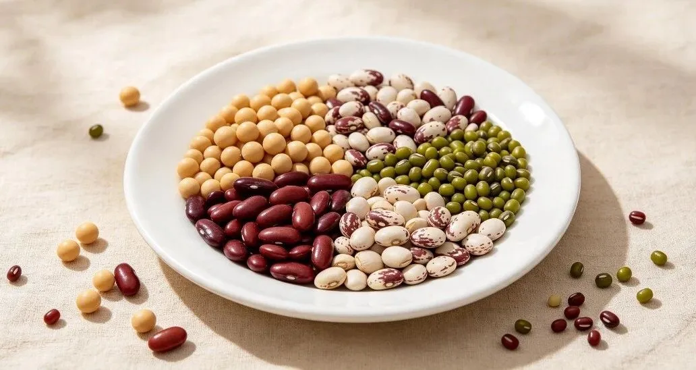

# 想消除脂肪肝，少吃喝这三样！
> 💡 备注属性未写入，可能是备注属性名称或者类型被修改了，建议将字段类型设置为 rich_text，可以在小程序-操作-修改文章数据库页面进行调整
> 原文链接:[https://mp.weixin.qq.com/s/TZ7vj5LIkE5iULsucSDYjA](https://mp.weixin.qq.com/s/TZ7vj5LIkE5iULsucSDYjA)

“轻度脂肪肝”“中度脂肪肝”……很多人的体检报告上都会出现这些描述。如何让脂肪肝好转？可以尝试在日常饮食方面做出改变。
**脂肪肝是怎么来的？**
北京协和医院消化内科副主任医师杨莹韵介绍，脂肪肝的形成是一个缓慢发展的过程。
我们每天摄入的油脂和糖类被吸收后，会分解转化成脂肪酸、甘油和葡萄糖，由肝脏负责加工，合成脂肪，再通过血液、淋巴送往有需要的细胞中存储。
正常情况下，肝脏含脂量仅为3%~5%。**如果每天摄入过多高糖高脂食物，又不爱运动，大量脂肪就转运不出去，导致肝脏被迫成为“脂肪仓库”，形成脂肪肝。**
**少喝甜饮料**
2025年12月，哈佛大学和耶鲁大学的研究团队在《自然·食品》期刊上发表了一项重要研究，无论是普通含糖饮料，还是标榜“无糖”“零卡”的人工甜味饮料，每天只要多喝一小杯（约250毫升），都可能实实在在地损伤肝脏。
研究追踪近17.4万名成年人长达9年，结果发现，每天每增加一份含糖饮料（250毫升）：
**脂肪肝风险增加10%**
**肝硬化风险增加21%**
**严重肝病风险增加18%**
**慢性肝病死亡风险增加37%**
更让人意外的是，“无糖”饮料并没有更安全，每天每增加一份人工甜味剂饮料（250毫升）：
**脂肪肝风险增加15%**
**严重肝病风险增加14%**
**慢性肝病死亡风险增加41%**
为什么甜饮料这么伤肝？研究指出，常喝甜饮料的人，血液中有数百种蛋白质水平异常。这些蛋白质掌管身体的炎症、消化和脂肪代谢，一旦长期紊乱，肝脏就成了“重灾区”。
研究给出明确建议：用白水、茶或不加糖的咖啡替代甜饮料，能够显著降低多种肝病的发生风险。这也是日常生活中保护肝脏最为简单有效的方式之一。
**少吃精制碳水**
精制碳水化合物是指经过工业加工处理，去除了麸皮、胚芽等天然成分的碳水化合物食品，包括精白米饭、白面条、白馒头、白面包等。
大量摄入精制碳水化合物会让血糖迅速升高，身体为了稳定血糖，会将多余的糖转化为脂肪，堆积在肝脏里，久而久之就形成了脂肪肝。
而对于素食者，肉吃得少了，精米白面就可能吃多，增添碳水化合物的吸收。当摄入量超过人体代谢的需要时，就会转化为脂肪积于肝内。
其实，有一类“碳水”，不仅不会致人肥胖，甚至还有减轻脂肪肝的作用，那就是抗性淀粉。
抗性淀粉存在于很多天然食物中，以下几种富含抗性淀粉的食物，升血糖慢，饱腹感强，可以作为优质主食。
**谷物：燕麦、甜玉米、大麦、小麦、高粱等。**
**豆类：鹰嘴豆、豌豆、大豆、黑豆、小扁豆、红豆、绿豆、斑豆等。**
**薯类：红薯、土豆等。**

AI生成图
**少吃反式脂肪酸**
反式脂肪酸（如油炸食品）可促使脂肪在肝内堆积，引发非酒精性脂肪肝。
日常饮食中，反式脂肪酸最常见的来源是西式快餐、油炸食品、糕点等加工食品。对非酒精性脂肪肝患者来说，这些食物尽量不吃。
研究显示，摄入反式脂肪酸含量高的氧化大豆油和人造奶油，会显著增加肝损伤。
少吃炒、煎、炸、烤的食物；少吃配料中含有人造奶油、植脂末、植物奶油、麦淇淋、奶精等含有氢化植物油的零食，常见的有三合一咖啡、冰淇淋、蛋黄派、桃酥、蛋糕等。
**3个护肝小习惯**
**1.严格戒酒**：酒精会直接损伤肝细胞，无论白酒、啤酒还是红酒，都会加重脂肪肝，患者必须滴酒不沾。
**2.规律作息**：肝脏主要在23:00～3:00进行代谢修复，建议23点前入睡，保证7～8小时睡眠，避免熬夜加重肝脏负担。
**3.调整进食顺序**：遵循“先喝汤→吃蔬菜→摄入蛋白质→最后吃主食”的顺序，能有效减少总热量吸收，减轻胃部和肝脏压力。
来源：新华社微信公众号综合工人日报微信公众号、人民日报健康客户端、生命时报、广东疾控、云南卫健委、央视财经
---

**转发提醒！**
