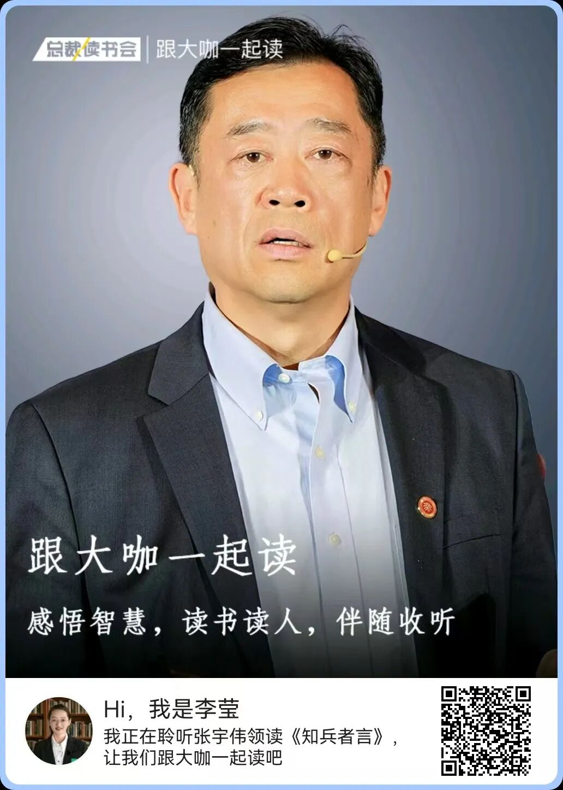

# 成长最大的敌人：惯性思维
> 💡 备注属性未写入，可能是备注属性名称或者类型被修改了，建议将字段类型设置为 rich_text，可以在小程序-操作-修改文章数据库页面进行调整
> 💡 原文链接:[https://mp.weixin.qq.com/s?__biz=MzUxMDU0Mzg4Mw==&mid=2247587460&idx=1&sn=d2fb9914f54a4d11a5981c547ce5bdf3&chksm=f88b40feddd4daf00bd2ebff7cedccc8fa171b3e14d38e4755653b96b522041f1384c6f7293b#rd](https://mp.weixin.qq.com/s?__biz=MzUxMDU0Mzg4Mw%3D%3D&mid=2247587460&idx=1&sn=d2fb9914f54a4d11a5981c547ce5bdf3&chksm=f88b40feddd4daf00bd2ebff7cedccc8fa171b3e14d38e4755653b96b522041f1384c6f7293b#rd)

**作者：**李莹，总裁读书会小书僮，总裁读书会微信公众号责任编辑
**来源：**总裁读书会（ID：winnerbook_club），本文摘编自《思维的囚徒》，亚历克斯·佩塔克斯 著

一个反直觉的现象：真正拖垮一个企业、困住一个人的，往往不是它遇到了多大的外部困难，而是它曾经有多成功。
你大概见过这样的公司，十年前是行业霸主，产品无人能敌；可当技术变了、用户变了、规则变了，它还在用当年的打法，试图守住一座正在沉没的城堡。也见过这样的人：明明很有能力，却总在重复同样的选择、犯同样的错误，仿佛被什么东西牢牢拴住。拴住他们的，不是外部的高墙，而是一种看不见的力量**惯性思维**。
《思维的囚徒》这本书，讲的就是这件事。作者亚历克斯·佩塔克斯师从心理学家维克多·弗兰克尔，把弗兰克尔在纳粹集中营里死里逃生的经历，提炼成了一套哲学。
集中营的铁丝网是真实的，牢门也确实上了锁。可弗兰克尔发现，**真正决定一个人能否活下去的，不是体质、不是运气，而是他是否还能在绝境中为生命找到意义、是否还能行使选择的自由。**弗兰克尔还观察到，集中营里最终活下来的人，往往不是身体最强壮、最能挨饿的人，而是那些心里还装着未竟之事的人，有人惦记着还没写完的手稿，有人放不下还在等自己回家的亲人。正是这份意义感，给了他们在最极端环境里继续行动的理由。这个发现让他意识到：当一个人找不到活着的意义时，哪怕身处最安全的环境，他也会逐渐枯萎；而当一个人确信自己的生命还有意义时，哪怕是集中营，也夺不走他活下去的意志。**人不是被环境决定的，而是被自己对环境的解读决定的。**
而大多数普通人，生活里没有集中营，却亲手为自己建起了一座更坚固的无形监狱。它没有门锁，因为门一直开着，只是我们自己放弃了走出去的力气。这就是思维的囚徒。对于企业家和管理者来说，这句话值得反复咀嚼。因为我们的组织、我们自己，往往就是最大的思维囚徒。

**用昨天的地图，走今天的新路**
什么是惯性思维？一句话：用昨天有效的方法，去应对今天已经不同的世界。它不来自懒惰，而来自过去的成功。
心理学家称之为功能固着或路径依赖。当一种做法曾经带来过巨大回报，大脑就会给它贴上有效的标签，从此不再重新审视它。你越成功，这条路径被验证的次数越多，惯性就越强。
问题在于：世界在变，而惯性不变。反馈机制失灵了，因为过去投入十分能得到十分回报，现在投入十分可能连三分都换不回来，可人还在按旧的投入方式行事；评价标准变了，过去拼规模、拼渠道，现在拼体验、拼数据，可组织还在用旧指标考核自己。
惯性思维最危险的地方，是它让人产生一种幻觉：只要我更努力地重复过去，就能挽回局面。于是柯达更努力地卖胶卷，诺基亚更努力地打磨键盘手机。不是它们不努力，恰恰是它们太努力了，错在努力的方向，被惯性锁死在了过去。
第一原则是自由地选择你的态度，这句话的反面，就是惯性思维最常见的伪装：告诉自己只能这样、行业就是这样、我们别无选择。当一个人、一个组织说出别无选择的时候，他不是真的没有选择，而是主动放弃了选择，放弃了人性里最珍贵的那份自由。

**困住巨头的，恰恰是他们最成功的过去**
柯达是一个教科书级的例子。它是胶卷时代的绝对霸主，1975年就发明了世界上第一台数码相机。但管理层算了一笔账：数码相机会摧毁胶卷的巨额利润。于是他们选择把这项颠覆自己的技术雪藏，继续把宝押在胶卷上。对手评价柯达：**败在自满，即使危机已经十分明显，它对自身的营销和品牌实力过于自信。**2012年，柯达申请破产保护。
诺基亚同样如此。它一度占据全球手机市场超过一半的份额，却拒绝拥抱智能手机和安卓生态，死守塞班系统。2010年，诺基亚研发投入高达39亿美元，是主要对手的近三倍，其中三分之一仍砸在已经过时的塞班上。它并非看不见变化，而是看见了，却不相信，或者说，相信了，却舍不得否定自己过去的成功。2013年，诺基亚手机业务被微软收购，一个帝国的时代就此落幕。
这两个案例说明一个残酷的道理：**让你失败的不是你不知道，而是你太相信你知道的。**当你已经拥有一个无比成功的过去，改变就成了自我否定。承认世界变了，就等于承认自己过去错了。为了维护那份成功带来的确定感，组织会本能地选择看不见、不承认、不改变。
更值得警惕的是，这种惯性往往在组织最鼎盛、最自信的时候最牢固。管理学里有一个词叫能力陷阱：一个人、一个组织越擅长某件事，就越容易把所有问题都看成这件事，越是投入，越是强化，直到环境突变才发现，自己已经把全部资源押在了一条注定消失的路上。柯达和诺基亚不是死于平庸，恰恰是死于它们引以为傲的核心能力：把胶卷做到极致、把键盘手机做到极致。**能力越强，惯性越重；成功越久，转型越难。**这是每一个正在成功的组织，都必须时刻提醒自己的。
这正是惯性思维作为成长最大敌人的真正含义：它不是一个技术问题、资金问题、人才问题，而是一个认知问题，就是你用什么定义自己，就很容易被那个定义锁死。柯达定义自己是胶卷公司，于是数码是敌人；诺基亚定义自己是做手机的，于是软件生态是威胁。定义一旦固定，视野就随之封闭。

**打破惯性，让组织重生的正面样本**
好消息是，惯性可以被打碎。而且，恰恰是那些最高明的组织，把打破惯性做成了制度和习惯。
但要真正做到这一点，需要逆着人性走。因为人的大脑天然追求稳定和确定，天然倾向于维护那个曾经被证明有效的自己。**打破惯性，本质上是和自己的舒适区、自己的过去、自己的确定性作战。**所以，仅仅靠想通了是不够的，必须把打破惯性变成一种机制、一种制度、一种组织本能，才有可能在安逸时仍保持清醒。这正是下面几个样本真正值得学习的地方：
微软是重生最彻底的案例。2014年，萨提亚·纳德拉接任CEO时，微软深陷PC业务下滑的困境，市值一度不足3000亿美元，被外界评价为活在过去。纳德拉做的第一件事，就是推翻微软最根深蒂固的惯性：Windows中心主义。他提出移动优先、云优先，把赌注压在Azure云上；他拥抱Linux和开源，这在比尔·盖茨时代简直是异端；他甚至把刚收购的诺基亚手机业务减值注销，果断止损。微软从软件授权垄断者重新定位为平台提供者。今天，**微软市值一度站上全球之巅。它的重生，不是靠运气，而是靠一次次主动打碎自己过去的成功**。
在中国，华为同样把自我批判做成了制度。任正非说：**自我批判是拯救公司最重要的行为。**烧不死的鸟是凤凰，从泥坑里爬出的是圣人。华为专门设有蓝军，一支在内部专门唱反调、模拟危机、给主流意见挑刺的团队，把自我批判从口号变成对抗集体盲目自信的机制。2000年前后，华为还发动了声势浩大的研发反幼稚运动，系统揭露管理中的幼稚病。正是这种持续否定自己、持续纠偏的能力，让华为穿越一次次生死考验。
海尔的张瑞敏，则是用砸来对抗惯性的代表。1985年，他砸了76台有质量缺陷的冰箱，砸出零缺陷的品牌；2005年，他砸掉1.2万个中间管理层岗位，彻底砸碎科层制，提出人单合一，让员工人人皆创客；二十年后，他再一次砸标签，走向零边界生态。每次砸的，都是自己上一段成功的惯性。张瑞敏说：**企业不是金字塔，而是无数探索世界的小船，每条船都在寻找属于自己的新大陆。**

**给管理者的五个破惯动作**
看了正反两面的案例，你会发现：那些真正穿越周期的组织，不是没有惯性，而是建立了一套对抗惯性的机制。对每一位管理者来说，这里有五个可以落地的动作。
**第一，警惕别无选择。**弗兰克尔的第一原则是自由地选择你的态度。当一个方案被冠以只能这样、市场就是这样时，恰恰是惯性最隐蔽的时刻。管理者要训练自己和团队，在说出别无选择之前，先问一句：我们是不是还有别的选项？
**第二，主动给自己找一个蓝军。**从远处审视自己，是弗兰克尔的第五原则。人最难看见的是自己的盲区。给自己配一个反对者，无论是内部的影子团队，还是外部顾问，让唱反调成为常态，而不是等到危机到来才被迫听见反对声。
**第三，定期复盘什么已经变了。**改变你的关注焦点，是弗兰克尔的第六原则。很多组织死于用不变的标准衡量变化的世界。每年、每季度，刻意地审视一次：我们的客户变了吗？我们的成功假设还成立吗？哪些过去的优势，正在变成今天的包袱？
**第四，防止习惯性麻木。**发现生命瞬间的意义，是第三原则。组织大了、日子好过了，最容易陷入麻木，如开会照开、流程照走、指标照报，却没人问这些还有没有意义。管理者要警惕组织里那种一切都很好的沉默，那是惯性正在悄悄生长的信号。
**第五，敢于超越自己。**这是第七原则，也是最难的一条。破惯的本质，是愿意用不确定换确定、为了明天的可能否定今天的成功。就像纳德拉拥抱Linux、张瑞敏砸科层制，敢于自我推翻，是一个组织最稀缺的能力。
这五个动作，其实对应的是同一种能力，就是把被迫改变变成主动改变。惯性思维最擅长的一件事，就是让你把改变无限推迟，总想着等时机成熟、等业绩稳了再说。但真正穿越周期的组织都明白：**改变最好的时机，永远是在你还没有被迫改变的时候。与其等危机来敲门，不如自己先动手拆墙。**

**牢门从未上锁**
回到《思维的囚徒》那个隐喻。集中营的大门其实是有锁的，但弗兰克尔发现，人可以带着锁生活，也可以在心里选择自由。
对企业家和管理者来说，这句话的启示是：真正困住你们的，从来不是市场的寒冬、竞争的激烈、技术的颠覆，而是你们如何看待这一切。当你说行业就是这样、我们别无选择、过去的成功已经证明了这条路的时候，你就在亲手加固那座无形的牢房。
成长最大的敌人，不是失败，而是用昨天的成功定义明天；不是无知，而是太相信已知；不是外部的高墙，而是内心的惯性。
那扇门，一直没有锁。唯一需要你做的，是停止用惯性喂养它，重新拿起选择的权利。
**投稿 |李老师：15810534093（微信）**
**城市合伙人招募 |高老师：18811050287（微信）**

[张维迎：当官和干事是两码事](https://mp.weixin.qq.com/s?__biz=MzUxMDU0Mzg4Mw%3D%3D&mid=2247587283&idx=1&sn=b1ebc1cdc16cb2c6bf67b77aa1bcfb7a&scene=21#wechat_redirect)
[芒格：终身阅读，是成本最低的自我投资](https://mp.weixin.qq.com/s?__biz=MzUxMDU0Mzg4Mw%3D%3D&mid=2247587390&idx=1&sn=2867b4324f869b3cd7f616b96acc3849&scene=21#wechat_redirect)
[楼宇烈先生辞世，曾提出：安身立命的根本，在于向内求，而非向外逐](https://mp.weixin.qq.com/s?__biz=MzUxMDU0Mzg4Mw%3D%3D&mid=2247587407&idx=1&sn=3f814ceddd15288f950126f74da36eb9&scene=21#wechat_redirect)

## 摘要

（待补充）

## 我的笔记

（待补充）
