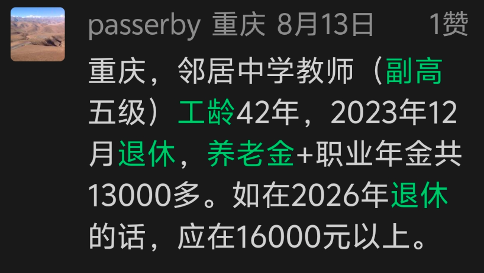

# 我69岁，江西一大学副教授，副高6级，工龄41年，现退休金6000元，都说老师退休金过万，我却是一个例外
> 💡 备注属性未写入，可能是备注属性名称或者类型被修改了，建议将字段类型设置为 rich_text，可以在小程序-操作-修改文章数据库页面进行调整
> 💡 原文链接:[https://mp.weixin.qq.com/s?__biz=MzY4MjI0MTIxNw==&mid=2247486982&idx=1&sn=f2dfc5e2625e8b8021e6fe720850dd24&chksm=f26c3256a24c59da51e911702cd325a91567adf93de0a38f33fcd65f8563110e11a3db6e2313#rd](https://mp.weixin.qq.com/s?__biz=MzY4MjI0MTIxNw%3D%3D&mid=2247486982&idx=1&sn=f2dfc5e2625e8b8021e6fe720850dd24&chksm=f26c3256a24c59da51e911702cd325a91567adf93de0a38f33fcd65f8563110e11a3db6e2313#rd)

大家好，我是李晚书。
事业编制的老师之间，退休金的差距，有多大？普遍人都认为教师的退休金都能破万，甚至，不少人有这样的观点，小学老师退休金不如中学老师，中学老师不如高中老师，退休金最高的是大学老师。
现实的实际情况，并非以学校阶段，决定老师退休金的高不低，依旧要看工龄和平均缴费指数、以及职称。

江西一位粉丝留言：
**我是江西某大学副教师，副高6级，工龄41年，2017年1月退休金，现在退休金6000元。**
企退人员看到这一份6000元的退休金，肯定都会觉得不错，但对比同行老师退休，退休金属于垫底的存在，重点还有41年工龄，副高6级这些关键信息。
2017年退休，大学教授按照60岁办退休，到2026年现在已经过去了9，如今69岁，养老金普调9年的前提，才到6000元，可想而知，起始退休金也就临近5000元。
那么，为何这位大学教师，副高6级，工龄41年，退休金才6000元呢？
我们按照已知信息，帮他算一下三项退休金各是多少。
**先把关键参数说清楚**
计发基数， 2017年1月退休，采用退休上年度2016年全省在岗职工月平均工资，江西省2016年度机关事业单位养老保险使用的全省在岗职工月平均工资为4244元。**如果退休地是南昌，2016年设区市口径为4777元，但机关事业单位养老保险的省级统筹口径优先使用全省数4244元，以下按4244元测算。**
缴费年限的拆分，工龄41年，2017年1月退休，参加工作年份约在1976年前后。机关事业单位“中人”的视同缴费年限是2014年9月30日之前的连续工龄；实际缴费年限是2014年10月至2017年1月，约2年4个月（2.33年）。
据此，视同缴费年限约为38年8个月（38.67年），与实际缴费年限合计约41年。
这个结构意味着：养**老金的大头来自“视同”那一端，实际缴费仅2年多，个人账户积累有限。**
副高六级的视同缴费指数，江西省机关事业单位的视同缴费指数由“**岗位指数＋薪级指数＋退休补贴指数**”三项合成，按退休时的专业技术岗位等级核定。
**副高六级在薪级43级左右时，视同缴费指数参考值约1.25；薪级41级左右约1.24。41年工龄、副高六级，薪级通常落在41—43级区间，以下取**1.25作为测算中值。
平均缴费指数，平均缴费指数是视同缴费指数与实际缴费指数的加权平均。视同段长达38.67年，权重约94.3%；
实际缴费仅2.33年，权重约5.7%。如果实际缴费指数按副高六级在岗工资对应的水平估在1.3—1.5之间，综合平均缴费指数大致在1.25—1.27左右，我们取1.26来计算。
过渡系数， 江西省机关事业单位过渡性养老金计发系数为1.3%。
#### 基础养老金
公式：计发基数 ×（1＋本人平均缴费指数）÷ 2 × 缴费年限 × 1%。
代入：4244 ×（1＋1.26）÷ 2 × 41 × 1%。
计算：4244 × 1.13 × 0.41 ≈ **1966元/月**。
**过渡性养老金**
公式：计发基数 × 视同缴费指数 × 视同缴费年限 × 1.3%。
代入：4244 × 1.25 × 38.67 × 1.3%。
计算：4244 × 1.25 ≈ 5305；5305×38.67年≈205143元；205143× 1.3%≈**2667元/月**。
**个人账户养老金**
2014年10月才开始实际缴费，到2017年1月仅2年4个月。副高六级2014—2016年的月缴费工资基数大致在5000—6000元区间，个人按8%计入账户，30个月左右的累计本金约1.0万—1.4万元，加上有限的记账利息，**账户储存额大致在1.1万—1.5万元左右。**
计发月数：男干部60岁退休为139个月。
**个人账户养老金约为80元—110元/月**
**三项相加：**1966元＋2667元＋95元**=4728元/月。**
机关事业单位“中人”还有职业年金，单位缴8%、个人缴4%，2014年10月起积累，2017年退休时积累期仅2年多，账户规模有限。按月领取的话，职业年金部分大致在每月几十元到一百多元的量级。
**把职业年金加进来，起始待遇（基本养老金＋职业年金）大致在4800—5100元。**
到了这里，还不能算完，2017年退休的老师，作为“早退中人”，要实现老办法计算养老金，新办法高于老办法的差额，还要乘以一个计发比例30%补发，差额并非全部发放。
所以，事业编退休老师，退休金破万不是所有，部分在2014年养老金改革后，早退的“中人”，因为个人账户累计少+计发基数低，退休金本身并不高。
在这位粉丝留言的下方，一位来自重庆的粉丝跟帖说道：
**重庆，邻居中学教师，副高5级，工龄42年，2023年12月退休，养老金+职业年金共13000多元。如在2026年退休的话，在16000元。**

这位粉丝的留言，一点都不夸张。
2023年退休的老师，退休金为何高，首先个人账户积累了9年，另外还有职业年金积累。
除此之外，2022年社平岗位工资高，直接提升了计发基数。
另外，同样是过渡期十年中人，他的新办法—老办法的差额，计发比例为90%。
多重因素下，他越晚退休金，退休金只会越高，对比2017年早退的大学副教授，起始退休金就高出一倍。
这一结果，恰好是普遍早退“中人”与晚退“中人”意难平的地方。同样是老师退休，只是早退几年，退休金差距好几千。
从群体来看，早退中人没有吃上养老金改革的红利，不过，从大局观上来看，养老金双轨制并轨，他们是做贡献、牺牲最大的一批人。
因此，旁人在说老师退休金都破万的时候，不妨插一句话：
**早退中人阶段的老师，部分人退休金并不高，只有五六千元。**

**【聊一聊】**
**不看退休金，你们认为当老师这个职业，好不好？**
