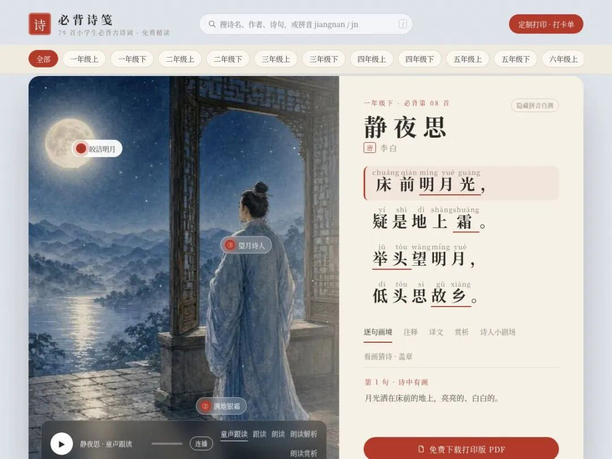
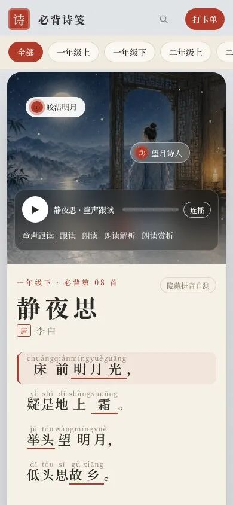
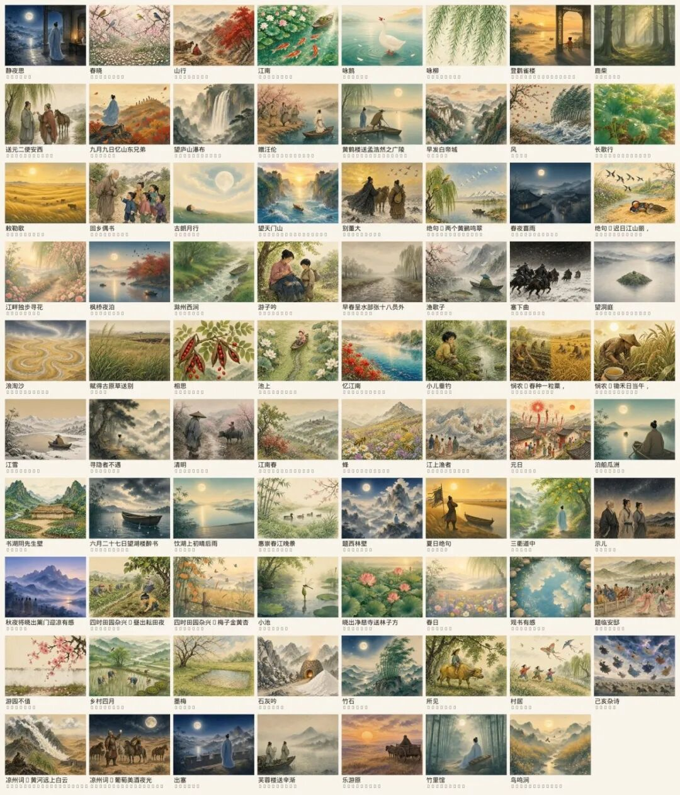

# 我AI做了一个能看、能听的古诗网站
> 💡 备注属性未写入，可能是备注属性名称或者类型被修改了，建议将字段类型设置为 rich_text，可以在小程序-操作-修改文章数据库页面进行调整
> 原文链接:[https://mp.weixin.qq.com/s/KmXg7pzPQhBgkvaTwvS7-Q](https://mp.weixin.qq.com/s/KmXg7pzPQhBgkvaTwvS7-Q)
**AI 生活化 · 家长向思维热布丁**
最近家里幼儿园小朋友问总是我：「粒粒皆辛苦」是什么意思？
诗他会背，意思却不懂。
这触发让我想做一个能看、能听、讲得明白的古诗内容，能让孩子看到画面把诗句和画面联系起来能更好的理解。并且古诗画面必须精美、必须能播放朗读，让孩子能理解古诗的意境。
与其一首一首做，不如把所以小学的古诗都做一遍，于是有了「必背诗笺」。
地址在这里：
https://ancient-chinese-poems-for-primary-school.iamgengxiaowen.workers.dev/?p=jingye
（公众号外链点不开，复制到浏览器打开即可。）
打开默认是《静夜思》。横排，一句一行，带拼音；旁边是水墨设色画；底下有注释、译文、赏析；还能听好几种朗读。
一共 79 首小学生常背的古诗。一年级上到六年级下，加上课外，都能筛。手机上也能看。想打印的，可以留邮箱领 PDF。
我是产品经理，不会写代码。这篇文章不讲怎么搭站，只讲一件事：**这个站到底给孩子和家长解决什么问题，以及你怎么用。**
· · ·
**一、会背，不等于懂**
幼儿园、小学阶段，古诗常常是「先背下来」。
背得很溜，不代表脑子里有画面。
「日当午」有多热？「汗滴禾下土」是什么样子？「盘中餐」和田里的人有什么关系？
大人会自动脑补。孩子未必有。
没有画面，就只剩字。只剩字，就容易死记。
所以我想要的不是又一份电子默写表，而是一个**孩子愿意打开、家长愿意收藏**的地方：
• 字要看得清，带拼音
• 意思要讲得明白，适龄
• 最好还能听，跟得上
• 最好还有一张画，帮他把诗「看见」

▲ 《静夜思》桌面页：横排带拼音，旁边是水墨画
· · ·
**二、打开「必背诗笺」，你会看到什么**
首页标题写着：79 首小学生必背古诗词 · 免费精读。
顶部可以按年级筛：一年级上到六年级下，也能看课外。还有搜索，按诗名、作者或拼音找。
点进一首，大致是这样排的——
**左边是画。**
每首配一幅水墨设色画。不是随便贴张古风图，是按诗意画的场景。比如《静夜思》，人在廊下望月，地上银霜，月亮很亮。
**右边是诗。**
横排，一句一行，字上方有拼音。小学生跟读时，横排比竖排古风更顺。
**底下是「讲明白」。**
注释、译文、赏析，都尽量改成孩子能懂的话，并注明出处。不是堆一堆漂亮空话。
**还能听。**
大多数诗配了 5 个朗读版本：童声跟读、跟读、朗读、朗读解析、朗读赏析。可以连播。孩子听一句、看一句，比家长干讲省力。
**手机也能用。**
竖屏打开，字和图都会跟着缩，方便睡前或路上随手点开。

▲ 手机宽度打开《静夜思》

▲ 「必背诗笺」首页：按年级筛、可搜索
· · ·
**三、我刻意留下的几条产品决定**
做这个站时，有几条边界我一开始就定了，后面也基本没改。家长用的时候，大概也能感受到：
**1. 像绘本，不像教辅。**
视觉偏东方绘本感。孩子愿意多看一眼，家长才愿意转发。
**2. 横排，一句一行。**
竖排很好看，但跟读、点拼音，横排更顺。
**3. 第一版只要音频，不要视频。**
音频够跟读、听赏析；视频体积大、加载慢，先不做。
**4. 注释、译文、赏析要适龄，并写清出处。**
内容从网上找来源，再改写成孩子能懂的话。不能「AI 随便编一版」。
**5. 免费。**
给小学生和家长用。家长可以留邮箱，免费领可打印 PDF；当前页面也会给直接下载链接兜底。
这些决定看起来平常。但正是这些「不做清单」，让站没有胖成资料堆。

▲ 全站水墨设色画合集
· · ·
**四、你可以这样用**
给家长几个我自己设想的用法，不一定要全做：
**睡前点一首。**
打开对应年级，选孩子最近在背的那首。先听童声跟读，再一起看注释和画。
**先看画，再背字。**
让孩子说说「画里发生了什么」，再对照诗句。很多时候，懂了画面，字就粘住了。
**筛年级，做本周清单。**
按上下册筛出本周要背的几首，连播听一遍，比翻教辅找音频快。
**打印出来打卡。**
需要纸质的，用页面上的打印 / PDF 入口。墙上贴一张，比只存在手机相册里有仪式感。
站是开源的，代码在：
https://github.com/xiaowen-pm/Ancient-Chinese-Poems-for-Primary-School
（复制到浏览器打开即可。）
欢迎小学生、家长来用；也欢迎同样在陪孩子背诗的人，告诉我哪首还不够好懂、哪张画还差点意思。
· · ·
**五、写在最后**
「粒粒皆辛苦」四个字，孩子问了一句，我却想了很久：
**背下来，只是开始；看见、听懂，才算真正进到脑子里。**
「必背诗笺」还很新，肯定有疏漏。但我希望它先把一件小事做好——
让孩子在背下一首诗的时候，脑子里多一幅画，耳朵里多一个声音，嘴边多一句自己的话。
站点再贴一次：
https://ancient-chinese-poems-for-primary-school.iamgengxiaowen.workers.dev/?p=jingye
如果你也在陪孩子背诗，欢迎关注「思维热布丁」，在留言区告诉我：你家孩子最近卡在哪一句？哪首诗最想要「能看懂」的版本？
我在。
**💬 欢迎关注「思维热布丁」**
📌 觉得有用，欢迎点赞、在看、转发给同样在陪孩子背诗的朋友。
