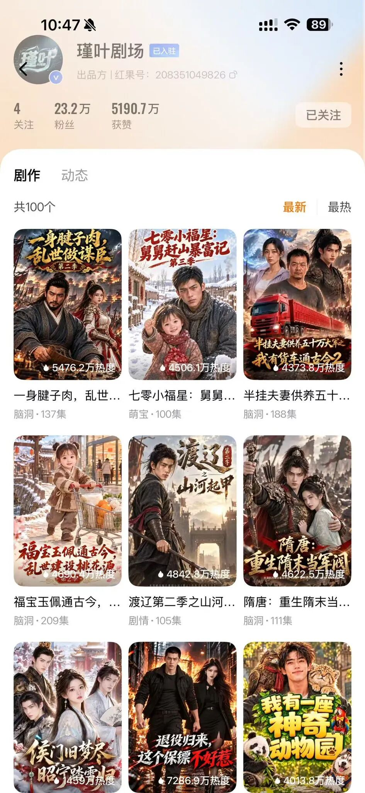
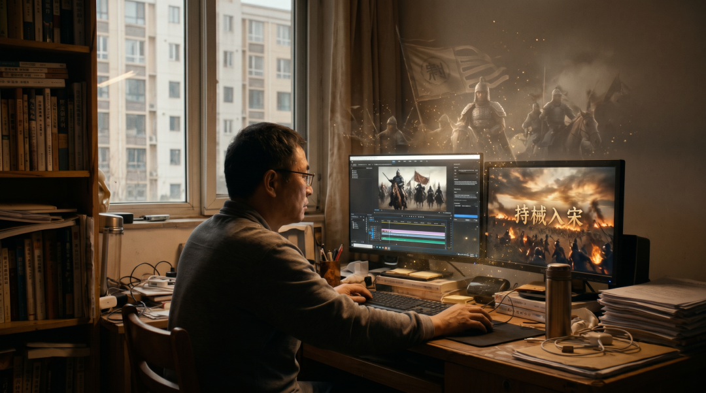
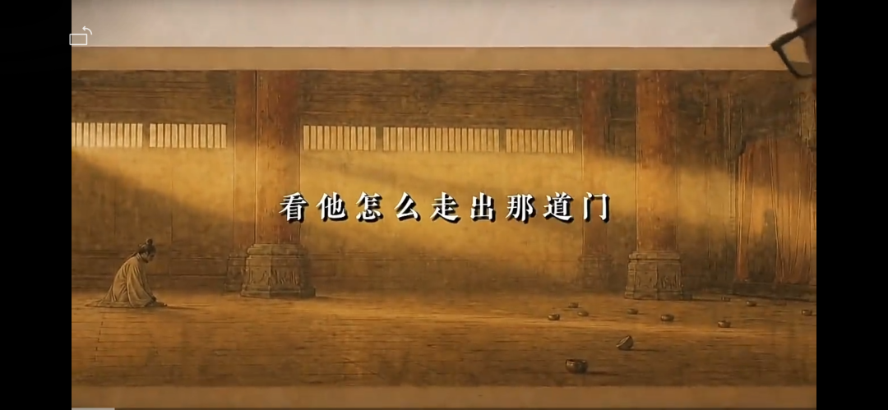

# 我们正在迎来内容创作的大平权时代  —— 从《持械入宋》想到的
> 💡 备注属性未写入，可能是备注属性名称或者类型被修改了，建议将字段类型设置为 rich_text，可以在小程序-操作-修改文章数据库页面进行调整
> 💡 原文链接:[https://mp.weixin.qq.com/s?__biz=MzU5NDQ1Njc1OQ==&mid=2247484279&idx=1&sn=bfead63b1dd37aea640e5133b0ea09b7&chksm=ffafff5e10080ad894586178cf25680ba8e07cca43068f8f19f12371a40ffb61ffb052301883#rd](https://mp.weixin.qq.com/s?__biz=MzU5NDQ1Njc1OQ%3D%3D&mid=2247484279&idx=1&sn=bfead63b1dd37aea640e5133b0ea09b7&chksm=ffafff5e10080ad894586178cf25680ba8e07cca43068f8f19f12371a40ffb61ffb052301883#rd)
最近大火的《持械入宋》，透着一股久违的、扎实的“正剧气质”。
故事讲的是一支现代五人特战小队，意外携械穿越到了北宋末年——那个距离“靖康之耻”只有五年的风雨飘摇之世。它没有走传统男频爽剧“开后宫、无脑开金手指”的老套路。主创非常清醒地给出了现实逻辑：现代武器的碾压只是一时的，子弹打一颗少一颗。于是，这支五人小队落户清河村，建军火库、练乡兵、搞医疗、做情报，甚至去考科举入朝堂，一步一个脚印地把现代的组织方式与技术思维移植进宋代，在千军万马的巷战与攻城战中，去推演一种“挽华夏于天倾”的历史新可能。
这部剧火到了什么程度？连更十季，拿下红果季榜第一，仅收藏量就高达1141万，单季最高热度冲到8206万，全网系列累计播放量超过了40亿。
连对历史考据颇为挑剔的文化大V“六神磊磊读金庸”和“馒头说”都先后发文推荐。
六神磊磊在文章里感叹了一句很耐人寻味的话：“现在看短剧，知识居然不够用了。刚看了一个《持械入宋》，发现自己不懂宋朝兵制。”
能让被群嘲“降智”的AI短剧彻底扳回一局的制作团队究竟是哪路神仙？
《持械入宋》的制作团队是“瑾叶剧场”，团队已做近40部剧，分成5个组同步推进，每部均盈利。
**这家公司的注册地，不在北京，不在上海，也不在横店，而是在河南新乡一个普通住宅小区里。**
**支撑起这个最新头部厂牌的30多名团队成员，大多数是网约车司机、全职宝妈、送货员、普通企业职工。**

他们散落在各地，平时主要靠线上协作。而团队创始人张汉生，今年已经54岁。他原本是一名自由职业者，2025年3月才刚刚开始学习AI影视制作，因为是班里的第11号学员，大家便叫他“老十一”。
他和担任总制片兼总编剧的核心搭档李朝华一起，带着这群完完全全的草根，从AI短剧承制做起，摸爬滚打积累经验，到2026年果断转型做自有IP。
短短不到两年时间，这个从河南三四线城市居民楼里长出来的草根团队，把30多名普通人拆成5个剧组同步推进，做出了近40部剧，而且做一部成一部，每部都在盈利。
在《持械入宋》里，传统真人剧组一天要花几十万才能跑下来的一场古代攻城战争戏，他们把建好的宋代村落数字资产反复复用，省掉天价片酬与实景搭建，把一集三分钟的成本控制在1000到2000元，把省下来的算力和精力全砸进大场面调度与剧本打磨里，硬生生在小区房里干出了40亿的播放量。

把时间的标尺拉长，回望人类几千年的内容创作史，我们会发现，每一次文明的跃迁，本质上都是一场媒介工具的平权运动。
在竹简与羊皮纸的时代，书写是巫师与贵族的特权；造纸术与雕版印刷术的出现，让知识开始流向士大夫与民间；十五世纪古登堡铅字印刷机的诞生，打破了教廷对文本的垄断，直接催生了文艺复兴与宗教改革；再到后来，互联网与智能手机的普及，让文字与日常短视频的记录权交到了每个人手里。
但是，唯独“影视叙事”——这门融合了视听语言、宏大场面、复杂调度的工业艺术，在过去整整一百多年里，始终是重资本、重设备、重权力的贵族游戏。
在传统的影视工业体系下，你想把脑海里一段“北宋末年金戈铁马”的想象变成画面，你需要什么？
你需要先写出剧本去敲开影视公司的大门，需要经过层层制片人的审阅与立项会，需要几千万甚至上亿的资金盘子，需要去横店租场地、搭景、雇佣几百人的摄制组和群演，需要昂贵的阿莱摄影机、灯光阵列和庞大的后期视效团队。
在这套森严的工业高墙面前，一个没有科班文凭、没有圈内人脉、没有资本加持的普通人，哪怕脑子里装着再波澜壮阔的宇宙，也连摸一下摄影机的入场券都拿不到。
甚至就在今年一季度，行业里还发生了一个极具反差感的现象：短短几个月内，AI短剧活跃承制方从1216家洗牌到了698家，退场的反而不少是有气派办公室、有中层管理、有严格项目审批流程的传统正规公司。
为什么？因为现在的AI大模型迭代周期是以“周”为单位的，大公司的立项过会、选题论证、层层汇报，在技术狂飙面前反而成了沉重的减速带。
而像“瑾叶剧场”这样的草根团队，今晚想到一个分镜方向，明天一早就能抽卡看效果，不行立刻推倒重来。
当AI把视听执行的边际成本压缩到接近于零，那道横亘在普通人与影视工业之间长达百年的高墙，轰然倒塌了。
这不仅仅是几千块拍出千军万马的成本账，这是一场前所未有的空间平权与阶层平权。
**今天，一个身处中国东北小城的创作者，与一个坐在美国纽约曼哈顿工作室里的创作者，在人类历史上第一次具备了同等获取机会的可能性，与完全对等的创作条件。**
**这是内容创作的历史上从未发生过的事。**
在过去，纽约、好莱坞、伦敦、北京、上海，垄断了全球最顶尖的摄影棚、最熟练的工业技工和最密集的发行资本。
地理位置的偏远，往往就意味着创作资源的匮乏。但今天，无论你是在中国东北、在河南新乡，还是纽约，你们面对的是同一个对话框，调用的是同样迭代到顶尖水准的生成式模型，拥有的是同样庞大且即时的全球内容分发网络。
没有设备代差，没有地域壁垒，全凭你的审美、你的历史底蕴、你对人性的洞察，以及你讲好一个故事的能力。
最近在短视频平台上，一位叫“编导李让”的创作者，用AI还原了李白、杜甫、韩愈、刘禹锡、苏轼五位千古诗人在人生至暗时刻被贬瞬间的画面，没有百万级的服化道，却让无数人在屏幕前热泪盈眶，单条视频拿下了668万点赞。

当技术抹平了制作的鸿沟，真正昂贵的东西终于浮出了水面——在AI能生成一切画面的时代，一个人在“做什么”和“不做什么”上的判断力，他对角色弧光的拿捏、对历史细节的敬畏、对人类情感的共鸣，成了他全部的身价。
我们必须清醒地看到，接下来的几年里，有三件事正在不可逆转地发生：
**第一，一切的游戏规则要被改写**
过去那种“大IP+流量明星+天价宣发”的传统影视公式正在迅速失效。
观众的眼睛和手指是最诚实的，他们不为“是不是大制作”买单，甚至也不单纯为“AI炫技”买单，只为“下一集值不值得点开”的好故事买单。
当一家河南小区里的30人草根团队能用两年时间跑出40亿播放量、且做到近40部剧全部盈利时，传统影视工业那种冗长的资金评估、排片博弈与中心化话语权，已经从根基上被改写了。
**第二，所有传媒、艺术学院的专业设置要重新洗牌**
过去一百年，全球的电影学院、传媒大学、艺术院校，都是按照传统工业流水线的“螺丝钉分工”来设置专业的：学摄影的只管扛机器布光，学美术的只管画分镜搭景，学剪辑的只管在时间线上拼接素材，学表演的只管在镜头前走位。
但在今天，一个懂叙事、懂审美的人配合AI工具，一个人就是一支完整的摄制组、一个视效公司、一座动画工坊。
如果我们的高校依然固守着十年前的教材与学科壁垒，还在按部就班地培养传统流水线上的单一工种，那么学生走出校门的那一刻，面对的就是一个早已换了天地的新世界。
**传媒与艺术教育的底层逻辑，必须从“培养单一技术工种”彻底转向“培养具备人文底蕴、导演思维与AI驾驭能力的超级创作者”。**
**第三，内容创作的所有规则要重新改写**
几千年来，历史与文化的叙事权，绝大多数时候掌握在少数精英与机构手中。
而今天，54岁从零学起的自由职业者、开网约车的司机、带孩子的宝妈，开始拿起AI这支神笔，去描绘北宋的万里山河，去重构辽金的铁骑铮铮，去讲述他们所理解的家国大义与人间烟火。
这让我想起大航海时代开启前的那个清晨。当造船术与罗盘不再只属于皇家舰队，无数原本只能在海岸线上仰望波涛的普通水手，终于拥有了扬帆远航的权利。
河南新乡小区里的这40亿播放量，只是大潮拍岸的第一朵浪花。旧的壁垒正在消融，新的大陆已经隐现。
在这个万物皆可重构的内容创作大平权时代，每一个心怀故事的普通人，都值得为即将到来的变革，干上一杯。(PS：文章火了：）高校老师想探讨教学如何引入AIGC，如何带学生做实训，可加我微信 kentcai )
