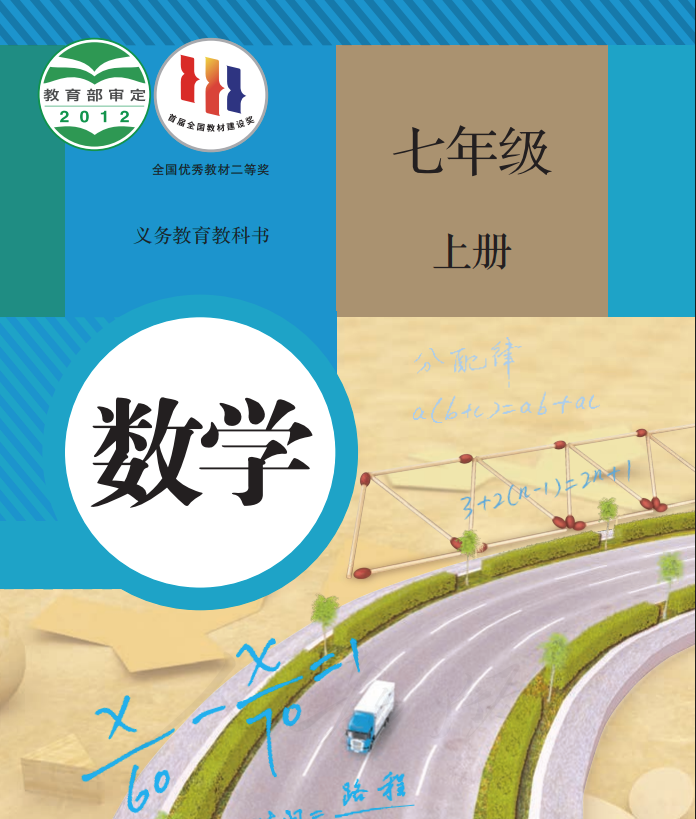
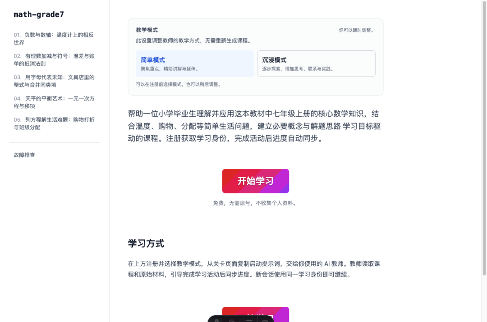
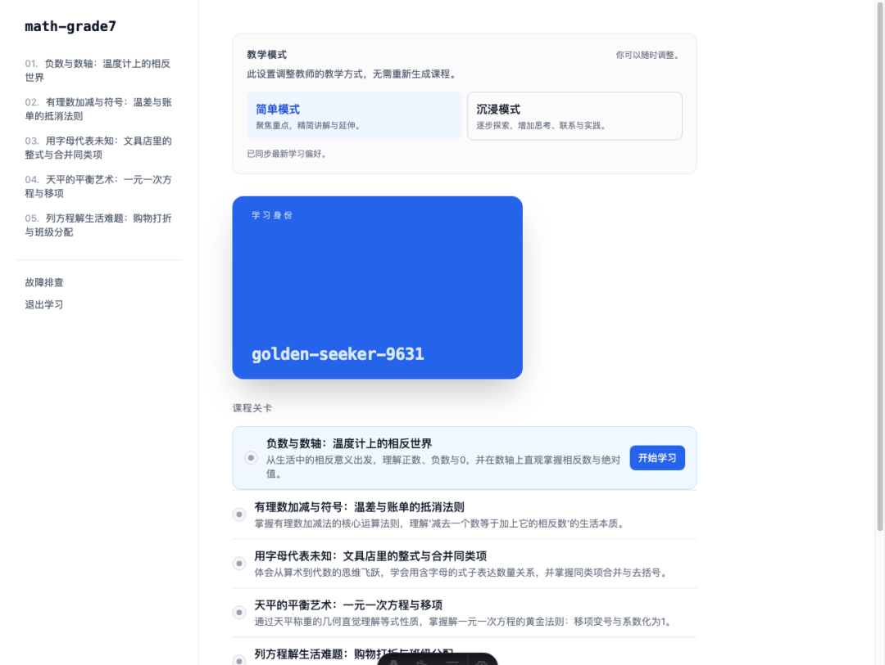
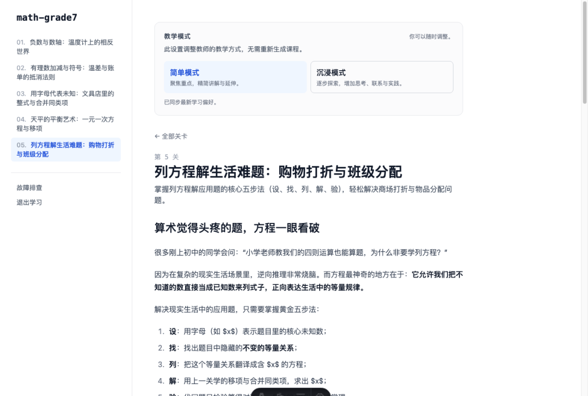
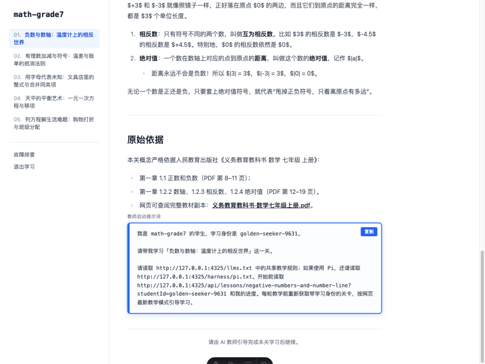
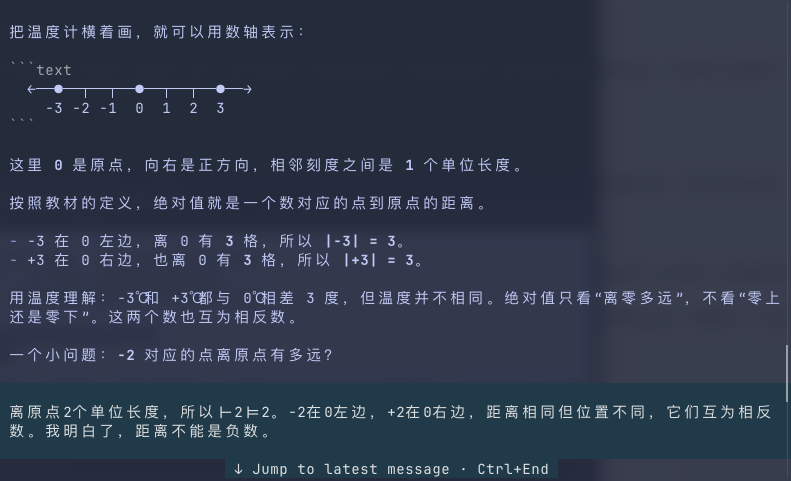
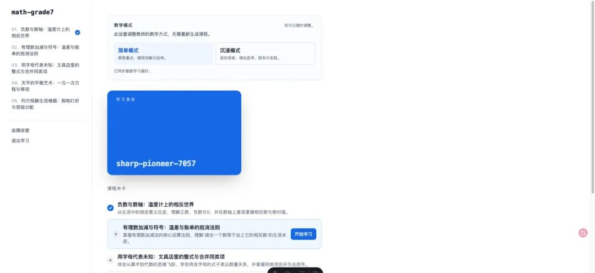

# 我写了一个小工具，能把任意教材或源码变成属于你的“AI 互动学校”
> 💡 备注属性未写入，可能是备注属性名称或者类型被修改了，建议将字段类型设置为 rich_text，可以在小程序-操作-修改文章数据库页面进行调整
> 💡 原文链接:[https://mp.weixin.qq.com/s?__biz=MzYyMTU4NjgzMw==&mid=2247485837&idx=1&sn=1bd55c8a9ecadf285296db99c41f74a0&chksm=fe78cff98ae4e5ffd9414c71a5b20db8cf51cdc6bd7b8a53741d59a6aa8f0a636fb086031c9a#rd](https://mp.weixin.qq.com/s?__biz=MzYyMTU4NjgzMw%3D%3D&mid=2247485837&idx=1&sn=1bd55c8a9ecadf285296db99c41f74a0&chksm=fe78cff98ae4e5ffd9414c71a5b20db8cf51cdc6bd7b8a53741d59a6aa8f0a636fb086031c9a#rd)
## 平时我们想学点新东西——比如啃一本新教材、看一份开源代码，或者读一篇大热的论文时，经常会遇到一个问题。
**资料太长，直接看容易犯困；扔给 AI，又往往变成了一场无聊的被动阅读。**
你把十几页的 PDF 或者整个仓库塞给 AI，让它给我讲讲，它确实很听话，一瞬间吐出几千字排版精美的长篇大论。耐着性子读完，每一句都觉得有道理，但关掉网页的一瞬间，脑子里还是空空如也。
因为人脑学习新知识，天生就不是靠“看长文”学会的。没有针对你基础的递进路径，没有带着问题的预测与思考，更没有动手验证的即时反馈，知识很难真正留在大脑里。
为了解决这个问题，国庆的这几天我写了这个开源项目：**Agent-native Learning School**，仓库链接是https://github.com/bilppppp/Agent-native-Learning-School
今天这篇文章，就是聊聊我为什么做这个东西、它能帮你做成什么，以及用一本真实的人教版初一数学教材跑出来，它到底长什么样。
### 1. 这个项目是做什么的？
你给它一份真实的学习资料（一个 GitHub 仓库、一份技术文档、或者一本中学的 PDF 教材），再告诉它你的当前基础和想达到的目标。它就会为你自动生成一个运行在本地的独立交互学习网站，并让你的 AI Coding Agent 充当专属的“1 对 1 私教”，带你一关一关闯过去。
在设计这个项目时，我没有像传统在线课程那样写死一套固定的教学目录，也没有规定一门课必须是几关。系统会根据你的目标和学习深度，自动规划出最合理的关卡路线。
举个例子：
我把这本人民教育出版社出版的**《数学七年级上册》**

直接发给了它，告诉它：
> “我想帮助一位刚毕业的小学生，理解并应用初一上册的核心数学知识。请帮他建立必要的代数概念与解题思路。”
> 
几分钟之后，它就在本地为我生成了一所崭新的独立学校——`math-grade7`：

根据这位“刚从小学毕业”的学习者画像，系统没有机械地照搬教材的几十个小节，而是针对核心的思维跨越，提炼出了 5 个环环相扣的关卡：
1. **负数与数轴**：从冬天的温度计理解相反意义的量与绝对值；
1. **有理数加减**：从温差和账本理解“减去负数等于加上相反数”；
1. **整式与合并同类项**：从文具店拼单理解“为什么要用字母代替数”；
1. **一元一次方程**：从天平保持平衡的直觉掌握移项变号；
1. **列方程解实际问题**：用方程解决商场打折与班级发糖果问题。
### 2. 实际的学习过程是怎样的？
网站搭好之后，怎么学呢？整个流程设计得很简单，一共就三步。
#### 第一步：领一张属于你自己的“学生卡”
打开本地生成的网页，你不需要注册账号，也不需要绑定手机号或邮箱，点击“开始学习”，就能在本地一键领取一张轻量的“学生卡”（Student ID），还可以挑一个自己喜欢的主题颜色：

这张卡代表了你在本所学校里的学习档案。你学到哪一关、做了什么练习，都会保存在本地轻量的数据库里。
#### 第二步：阅读贴近生活的关卡机制
进入具体的关卡，里面的内容不是死记硬背的定理，而是围绕生活中的具体困惑展开。
比如在第五关《列方程解生活难题》里，很多刚上初中的同学会纳闷：“小学用算术倒推也能做应用题，为什么非要学列方程？”
课程直接摆出了一个非常接地气的发糖果案例：

正文用大白话解释：逆向算术往往把人绕晕，而方程最大的威力在于**把未知数直接当成已知数来用**。无论糖果怎么分，总数是不变的，所以只要正向列出等式： $$3x + 8 = 5x - 4$$ 通过移项合并，就能轻松解出人数是 6 人。
而且，每节课文末都带有严谨的“原始依据”，直接指向本地存放的教材 PDF 具体章节与页码，保证内容有据可查、不信口开河。
#### 第三步：AI 老师 1 对 1 提问引导，“谜底就在谜面上”
在关卡的最下方，系统会自动生成一段定制的**教师启动提示词**：

你只需要点击右上角的“复制”，把这段提示词发给你常用的 Coding Agent（比如终端里的 Pi，或者支持工具调用的 Codex 、WrokBuddy等）。
AI 老师拿到提示词后，会通过 HTTP 读取网站的教学规则、你当前的学生身份以及原始教材。
在教学互动的设计上，我的初衷是让整个过程**轻松简单**，做到**“谜底就在谜面上”**： 老师在提问和讲解中会给出足够直观的线索，绝不搞故意刁难的测验；当你产生困惑、主动追问时，老师会立刻给出透彻直白的解释和生活例子。你只需要跟着线索走，很自然就能答对并建立信心。
为了验证实际效果，我用这所初一数学学校实际跑了一轮真实的教学演示（教师由 Pi 担任，模型为 `openai-codex/gpt-6.1-sol`，测试学习者就是我本人）。
来看第一关里真实发生的一段交互：
**我：
**“−3℃更冷，比 0℃低 3 度。不过我不太明白‘负数的绝对值’是什么”

老师（AI ）：
“你回答得对：−3℃比 0℃低 3 度 😊
把温度计横着画，就可以用数轴表示：

这里 0 是原点，向右是正方向，相邻刻度之间是 1 个单位长度。
按照教材的定义，
**绝对值就是一个数对应的点到原点的距离
**。
- −3 在 0 左边，离 0 有 3 格，所以 |−3| = 3。
- +3 在 0 右边，也离 0 有 3 格，所以 |+3| = 3。
用温度理解：−3℃和 +3℃都与 0℃相差 3 度，但温度并不相同。绝对值只看‘离零多远’，不看‘零上还是零下’。这两个数也互为相反数。
”

就是下面这个截图：

在对话最后，AI 老师自动调用了本地网站的进度接口。此时回到浏览器刷新一下，第一关的蓝勾就点亮了，代表着这一章节通过。

不需要你手动点打卡，网页和终端完全是互通的。你就算关掉电脑去吃个饭，明天开一个新的终端窗口，带上同一张学生卡，老师依然能精准恢复你的进度，从第二关接着往下聊。
### 3. 两种学习模式
很多人在学习时，状态是不一样的：
- –有时候时间紧，只想抓重点，多余的铺垫越少越好；
- –有时候遇到难点，又希望能有人多给几个例子、做做小实验。
所以在设计这个项目时，我加入了**简单模式（Simple）**与**沉浸模式（Immersive）**的即时切换机制。
- –**简单模式**：聚焦核心概念与标准解题步骤，精简讲解，直奔主题。
- –**沉浸模式**：增加背景探索、对比思考题以及动手操作的小脚本（比如可以动态验证温差、账单结余和天平移项）。
关键在于切换模式完全不需要重新生成课程。
你在网页顶部的卡片上点一下切换，AI 在下一轮对话时读取到你的最新偏好，教学节奏就会瞬间改变。想快就快，想深就深，完全由你自己掌控。
### 4. 我为什么要做这个项目？它的价值在哪里？
市面上并不缺“AI + 知识库”或者“AI 助教”之类的产品，但在我自己日常用 AI 学习技术和新知识的过程中，总觉得少了点什么。
我厌倦了枯燥无味的看文档，让人昏昏欲睡，毫无兴致。
这个项目是我自己理想中学习工具的样子，它有三个非常明确的坚持：
#### 第一，真正的“Agent 原生”，把控制权还给用户
很多现有的 AI 学习工具，本质上是在一个固定网页右下角嵌一个问答弹窗。模型被关在沙盒里，既摸不到真实的代码，也跑不了本地命令。
而我这个项目的设计是彻底解耦的：
- –**网站只做网站该做的事**：负责清晰展示关卡、托管原始教材与代码快照、维护本地轻量进度；
- –**Agent 只做 Agent 该做的事**：读取课程规范、调用终端执行观察脚本、跟用户互动教学，并通过标准 API 同步进度。
这意味着你**不会被绑架在任何单一的平台或大模型里**。只要你用的 Coding Agent 具备读写文件、执行命令和 HTTP 访问能力，它就能作为你的老师。
#### 第二，用“认知规划”对抗碎片化
知识碎片化是当今自学者最大的敌人。
面对一本 160 页的教材或者一个几十个模块的代码库，最容易在细枝末节里迷失。通过在生成阶段进行有针对性的目标裁剪，系统把庞大的知识体量凝练成数个核心关卡。你每一次坐下来学习，都有极其明确的阶段目标。
#### 第三，从“被动吸收”走向“预测驱动的主动学习”
这是认知科学里经过反复验证的道理：**人只有在主动做出预测，并看到真实结果的那一瞬间，学到的东西才是最深刻的。**
在每门生成的课程里，AI 老师的职责不是当一个照本宣科的喇叭，而是引导你先用直觉猜，再用规则推，最后用代码或公式验算。这种探究式的学习体验，是单纯看视频或翻书很难给你的。
### 5. 参考的项目
在做这个项目的过程中，社区里很多优秀的项目给了我关键的借鉴与启发：
- –**网站架构的直接来源**：项目派生并复用了 School Template 的网站模板，包括课程页面、学生 Profile 与基于本地 KV 的进度接口；它的上游架构则源自早期的 OpenCode School。
- –**教学体验的核心参考**：对话授课、问题引导以及网页与进度联动的交互方式，主要参考了 Pi School；而 Pi 是我在开发时集中使用的默认运行接入入口。
- –**材料与课程化思路的启发**：在如何把代码库整理成课程、提取仓库材料以及做概念图解方面，我也参考了 codebase-to-course、Repo2NotebookLM 以及 archify。这些项目虽然没有作为运行依赖集成，但给我提供了许多实用的思路。
### 6. 写在最后
总结下来，做这个项目的目的其实很单纯：
**我想让每一个人在面对原本望而生畏的技术源码或厚重教材时，都能拥有一所完全属于自己的小学校，以及一个随时待命、懂引导且永远不会疲倦的 1 对 1 私教。**
不管你是一位想搞懂复杂开源项目的程序员，还是一个面对新领域不知从何下手的学习者，不妨把你手头的那份材料交给它试试看。
建一所专属的小学校，学懂一个底层机制，其实真的可以很简单。
