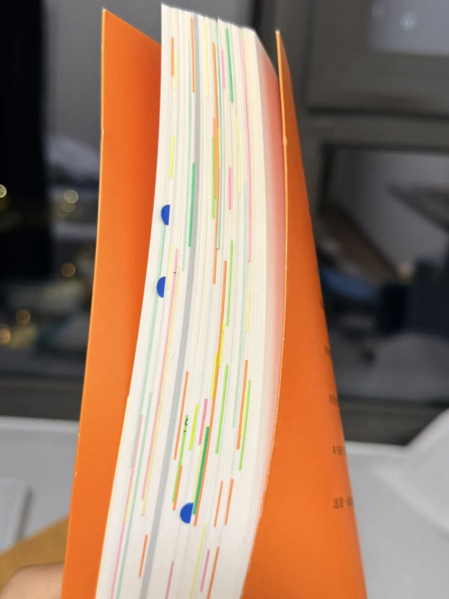
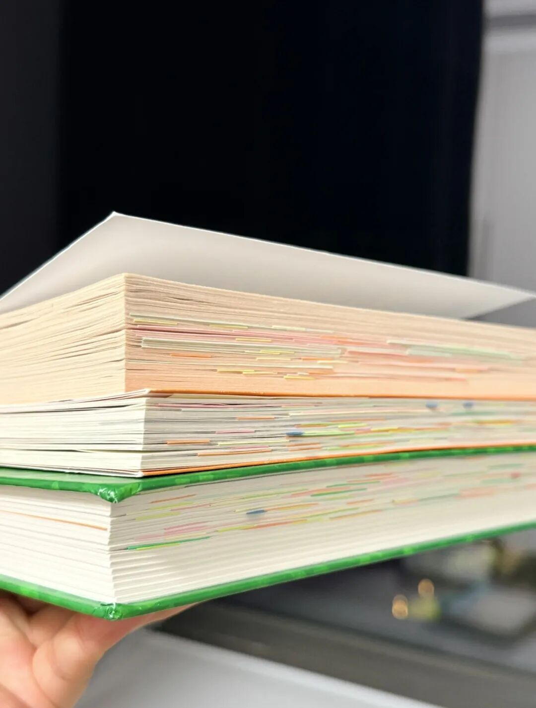

# 我发现这样写读书笔记，才是最适配纸质书的阅读方法
> 💡 备注属性未写入，可能是备注属性名称或者类型被修改了，建议将字段类型设置为 rich_text，可以在小程序-操作-修改文章数据库页面进行调整
> 💡 原文链接:[https://mp.weixin.qq.com/s?__biz=MzAwNDE3ODQ3NA==&mid=2649853437&idx=1&sn=0b3baaf455c6d6351647750e84b66771&chksm=8250cdafff6965081768f21fe01d957aebecd3099284cabcf32b6bf7280ad90d74b1baf41197#rd](https://mp.weixin.qq.com/s?__biz=MzAwNDE3ODQ3NA%3D%3D&mid=2649853437&idx=1&sn=0b3baaf455c6d6351647750e84b66771&chksm=8250cdafff6965081768f21fe01d957aebecd3099284cabcf32b6bf7280ad90d74b1baf41197#rd)

**Hi 我是小简，欢迎收看我的每日思考碎片**
-
刚刚看完了《显化》这本书，整个人神清气爽，甚至有些亢奋。合上书的一瞬间，我看到书中贴满的便利贴笔记，五颜六色都是我的思考痕迹。

突然感觉好幸福啊，这已经不是一本书了，这是我的内在探索记录本。
只是这种探索，是跟作者不断交流完成的，上面的笔记的都是我从当前的认知水平出发，对当下的问题、所做之事的思考。
它像是一个“鲜活的、当下的我”的定格。已经开始期待未来有一天，再次打开这本书，重看这些笔记的时候，会有什么样的感触？
-
我以前总是执着于“为未来而记录”。
为此我尝试了很多笔记软件和方法，每次都希望自己的笔记可以井井有条，所以花了很多时间去做分类整理。
无论是标签体系，还是文件夹体系，都让我费尽心思。
结果每当笔记软件变得臃肿不堪时，我就开始焦虑，焦虑这么多凌乱无序的信息，我未来需要的时候，怎么能记住曾经写过什么？
于是丧失记录的动力，放弃一个又一个笔记软件。
-
读书笔记的写法，也是其中最让我纠结的点，一开始我只用眼睛看，看完的书就像没看过一样，于是我开始在书上划线，结果我发现划线也没有太大作用。
过了几年，我慢慢领悟到：
阅读时的思考非常重要，所以我开始尝试拿出一个本子，边读边做笔记，在有共鸣的地方停下来，用笔在本子上写下感受和思考。
但当时我内心对这种方式是抵触的。
因为觉得边读边写实在是太浪费时间了，打断了我的阅读连贯性，降低了我的阅读速度。
-
当我的读书笔记逐渐写满了一个200页的A5本时，阅读对我而言好像变成了一种负担：
每次看书都需要正襟危坐，一边打开书，一边打开本子，看一会左边，写一会右边。
而且笔记和原文的分离，也让我完全没有重读笔记的欲望，时间太久的笔记，我自己都不记得那些话的上下文是什么：
诶？我何出此言？
-
现在我意识到，自己当时在阅读这件事上恐怕有太多强迫症或者焦虑，我太担心自己看完了记不住，浪费了时间。
也很担心阅读时的思考得不到记录，就等于白读，可是写完了笔记又担心自己不会重看，更等于白记。
归根结底，我没法在阅读这件事上臣服于当下，杂念太多，匮乏感很重，总怕失去这个失去那个。
-
今早看到这本《显化》上的便利贴笔记时，我猛然想起，诶？这种我曾经认为是最浪费时间的阅读方式，竟然已经融入到了每一天的生活。
是的，我曾经在小红书上看到挺多博主用这个方法，当时就觉得好麻烦，花里胡哨，我肯定不会尝试。
但自从孕期开始阅读那本《此生何为》，就好像有一只大手，把我那颗张牙舞爪、拼命折腾、什么都想抓住的心，给按住了。
-
我也忘了是什么原因，那本书读到一半，就莫名地开始用便利贴做笔记，而这些便利贴都是我几年前买来写每日计划的，翻墙倒柜才找出来。
当时一点也不担心这个方法会浪费太多时间，只觉得这本书让我思绪万千，心里有很多想要消化的东西，就想用方便的方式写一写。
所以那本书我确实读了很久，收获也很大，可以说是收获了一个全新的我，也莫名地培养了这种笔记方式。
-
回头一看，已经不知不觉在用它读第三本书了，我的心里没有一丝烦躁或者不安，而且是觉得很踏实：
没有敷衍作者的心血，也没有辜负自己的时间。

 20261109 05:47 晨间笔记
**◉作者介绍**
小简，94年摩羯INFJ，自由职业6年+，10年线上汉语老师。10万粉小红书博主，10万粉instagram博主。专注分享时间管理、阅读感悟、副业笔记等个人成长经验。
**-End-**
关注公众号👇，领取小简精选20本电子书
