# 我在 GitHub 上搜罗了 6 个高质量数据集，看看哪些会用到。
> 💡 备注属性未写入，可能是备注属性名称或者类型被修改了，建议将字段类型设置为 rich_text，可以在小程序-操作-修改文章数据库页面进行调整
> 💡 原文链接:[https://mp.weixin.qq.com/s?__biz=MzUxNjg4NDEzNA==&mid=2247538180&idx=1&sn=f8f37078438b90a2815051c5012a8acc&chksm=f8e5ca0b9f0a38d80be8dfe8a732915c130330a9561f59de3597dd9c90a72e7a965e912899fa#rd](https://mp.weixin.qq.com/s?__biz=MzUxNjg4NDEzNA%3D%3D&mid=2247538180&idx=1&sn=f8f37078438b90a2815051c5012a8acc&chksm=f8e5ca0b9f0a38d80be8dfe8a732915c130330a9561f59de3597dd9c90a72e7a965e912899fa#rd)
**01**
**三十多万首唐宋诗词**
chinese-poetry **把约 5.5 万首唐诗、26 万首宋诗和 2.1 万首宋词整理成了数据文件。**
此外还收录了《诗经》《论语》等古典文集。
这个开源项目已经有 5 万多个 Star。
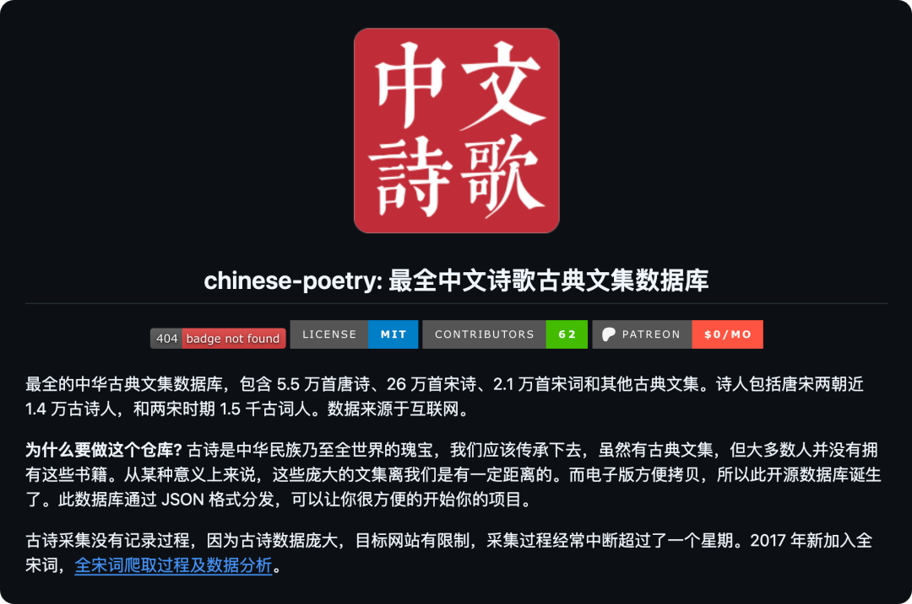
想做一个飞花令小游戏，可以从诗句里筛选指定的字。
想做诗人的作品集，**可以按作者归类。**
每天挑一首诗，配上日期和自己设计的页面，也能做成诗词日历。
这些应用需要的基础文本，在这里就能找到。
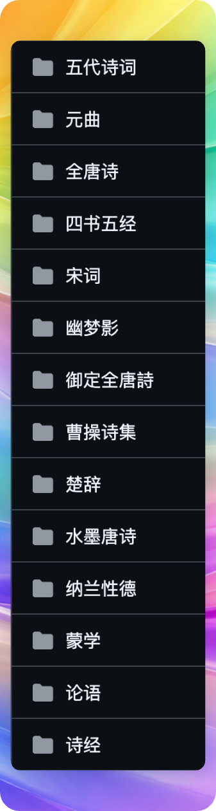
作品以 JSON 文件保存，程序可以读取标题、作者和正文，再接上搜索、收藏或背诵功能。
如果你想通过 Vibe Coding 去做一些给小朋友、小学生家长用的小应用、小程序啥的，这个数据集可以研究研究哈。
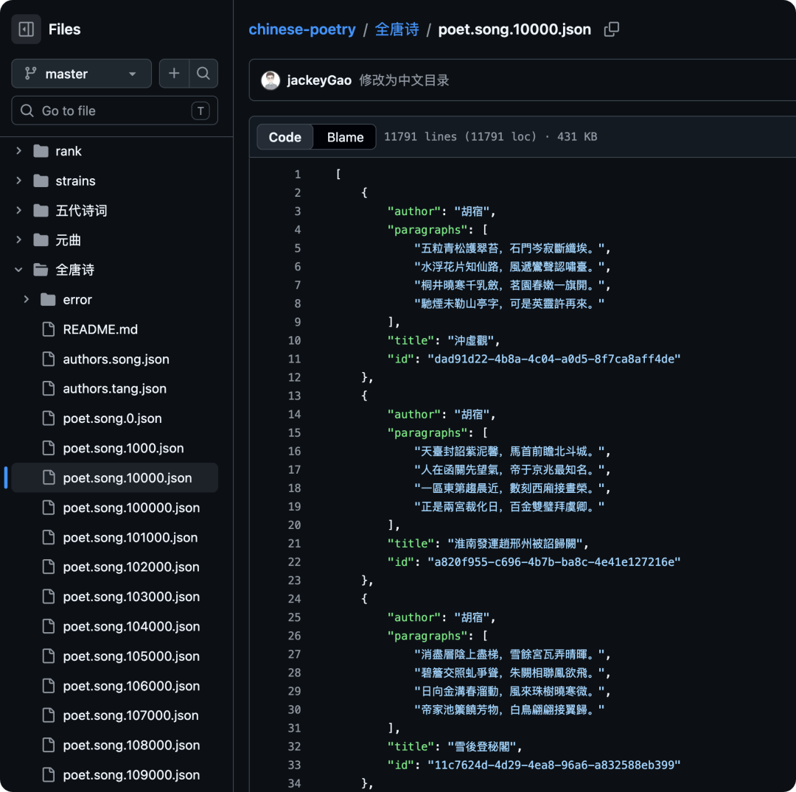
```javascript
开源地址：https://github.com/chinese-poetry/chinese-poetry
```
**02**
**3D 资产数据集**
第一个是**英伟达开源的。**

这是一套已经做好的** 3D 物品素材，里面有纸箱、推车、厨房用品、工业设备等。**
约 472GB，一共 2575 个 3D 资产。
做机器人训练场景时，可以从里面挑选物件，省去一部分自己建模的工作。
它是**面向物理仿真。**
在支持的软件里，模型可以配合碰撞、重量、摩擦等属性，模拟箱子落地、物体碰撞等情况。
适合做机器人训练、工业仿真和虚拟场景。
使用前需要确认软件支持它的 OpenUSD 格式。
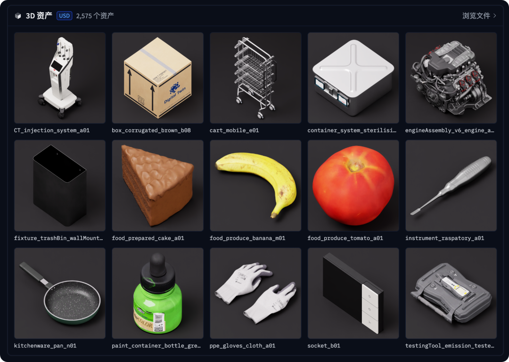
#### 还有一个数据集是 Scenario 3D Collection 。
#### 收集了 AI 生成的 3D 模型，比如卡通角色、宝箱、家具和车辆。
大约 38.7GB，一共 1342 个素材，其中有 GLB 等不同格式。

```ruby
数据地址：https://huggingface.co/datasets/nvidia/simready-assets
数据地址：https://huggingface.co/datasets/scenario-labs/3d-collection
```
**03**
**雅思英语单词数据集**
如果你想做一个背单词的工具。

除了单词和释义，还得准备例句、图片和发音。
这个叫词光 Word Atlas 的开源项目就是一个**这样英语单词学习的数据集。**

一共 7298 个单词和例句、7298 幅插画，以及两万多段英音、美音和例句朗读音频。
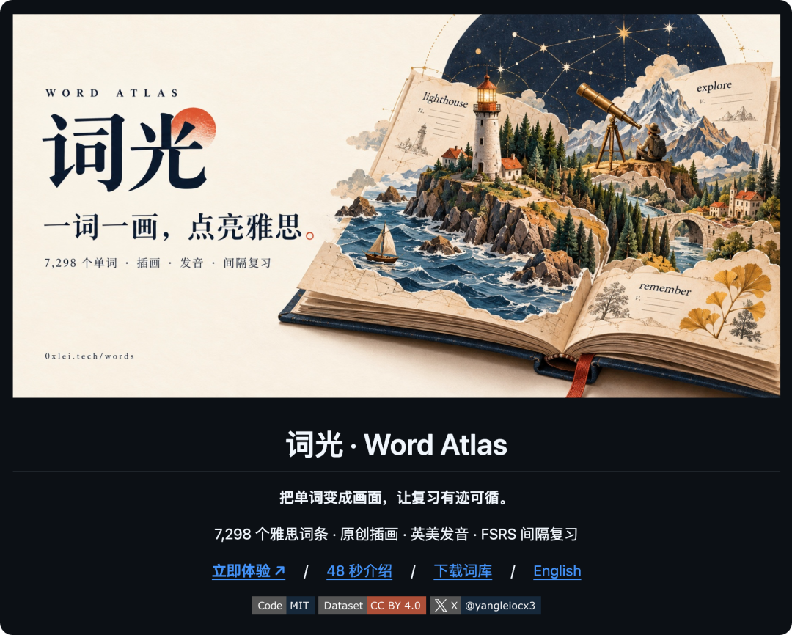
单词和例句，其实还会包括**中英文的释义、常用搭配，而且还有难度和话题呢。**

开发者还做了一个背词应用，支持看图练习、听音辨词、拼写和间隔复习。
其实这个数据集，文字和插画都是用 AI 生成的。然后语音由 ElevenLabs 生成。


```javascript
开源地址：https://github.com/designfuchen/word-atlas
```
**04**
**1324 个健身动作数据集**
Exercises Dataset 收集了 1324 个健身动作。
每个动作都配有**缩略图、GIF 演示和文字步骤，已经有 2 万多个 Star。**
我之前应该介绍过这个。
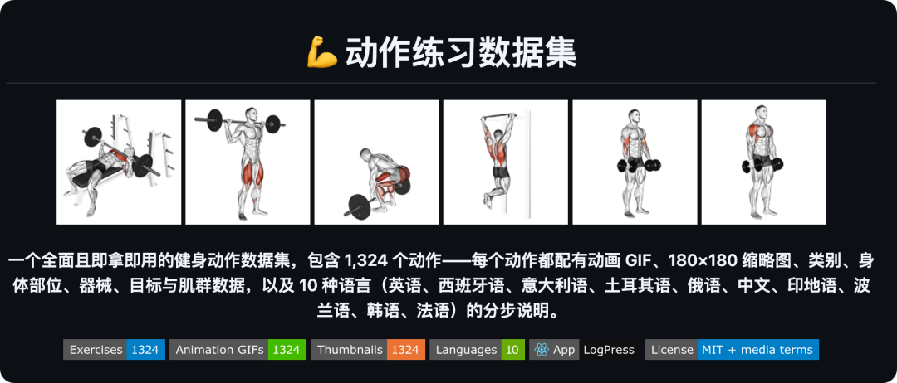
这个数据集每一个动作的内容包括器械、训练部位、目标肌肉和辅助肌群。
支持 10 种语言。

```javascript
开源地址：https://github.com/hasaneyldrm/exercises-dataset
```
**05**
**各国家的城市、省州名称数据集**
Countries States Cities Database 收集了**约 250 个国家及地区的信息，包含 15 万多个城市、城镇和区县条目。**
做跨国地址表单、城市查询工具或旅行地图时，可以从这里找基础数据。
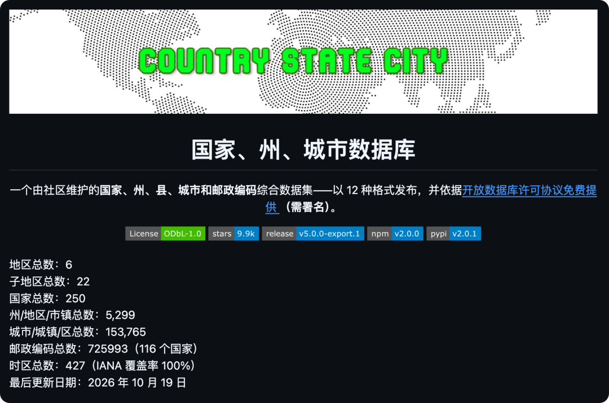
注册页面里常见的“先选国家，再选省州，最后选城市”，就需要这样的层级关系。
把相关数据读进程序，便能根据上一级选择，显示下一级选项。
数据中还包含**国家代码、经纬度、时区、货币等信息，具**体字段随数据类型而变化。
比如做一张旅行地图，可以读取城市条目的经纬度，配合地图工具标出地点。
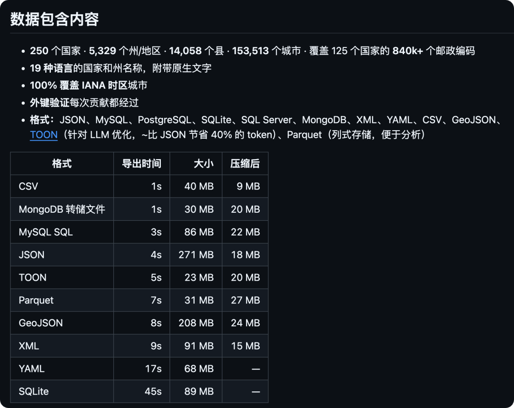
项目备有 JSON、CSV、SQL 等格式，按自己的使用方式选择即可。
只做国家选择框，就先用国家数据，需要更细的地址选择，再接入省州和城市文件。
```bash
开源地址：https://github.com/dr5hn/countries-states-cities-database
```
**06**
**15TB 物理模拟数据**
这个开源项目收集了 16 组物理模拟数据，总规模达到 15TB。
包括**流体运动、声波传播、生物系统和超新星爆炸等场景。**
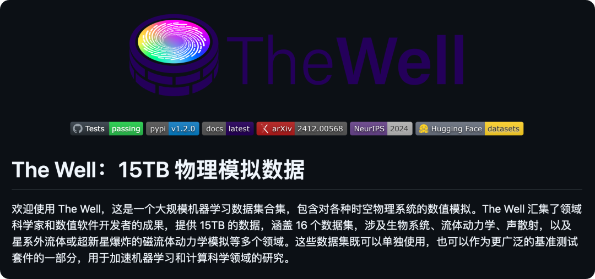
这些数据保存了模拟系统在不同时刻的状态。
把连续几个时刻的数值画出来，可以观察一个物理过程怎样变化。
把它们交给机器学习模型训练，则可以研究如何根据已有状态预测后续演变。
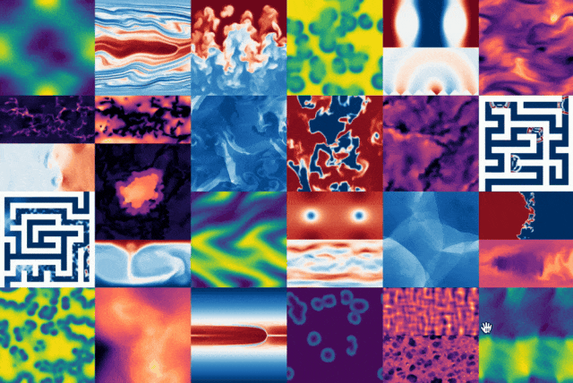
各组数据采用统一的格式和读取方式，除了随时间变化的物理量，也包含模拟参数等信息。
```bash
开源地址：https://github.com/PolymathicAI/the_well
```
**07**
**点击下方卡片，关注逛逛 GitHub**
这个公众号历史发布过很多有趣的开源项目，如果你懒得翻文章一个个找，你直接关注微信公众号：逛逛 GitHub ，后台对话聊天就行了：
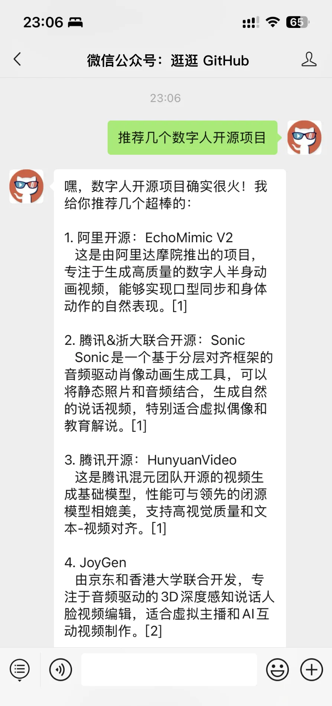
