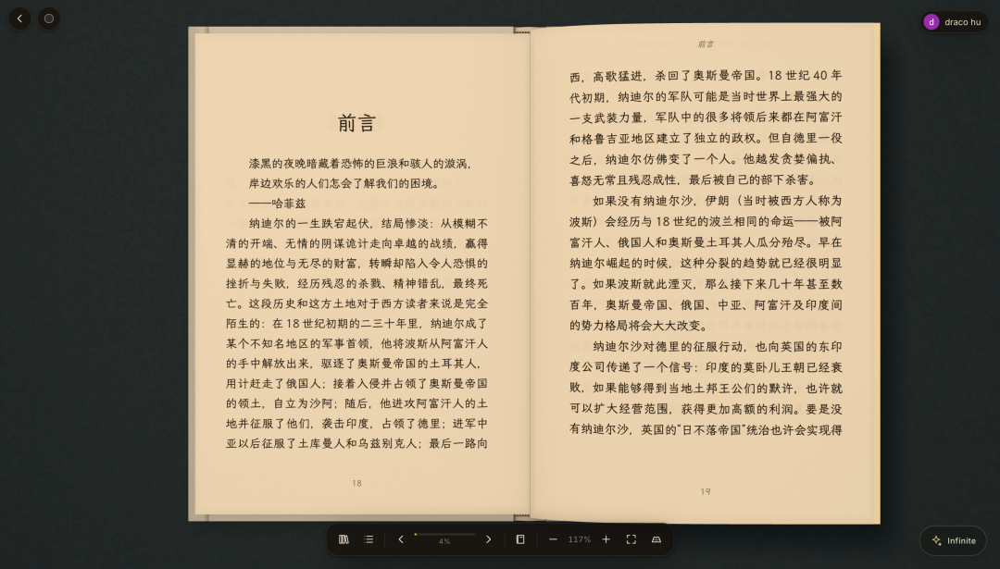
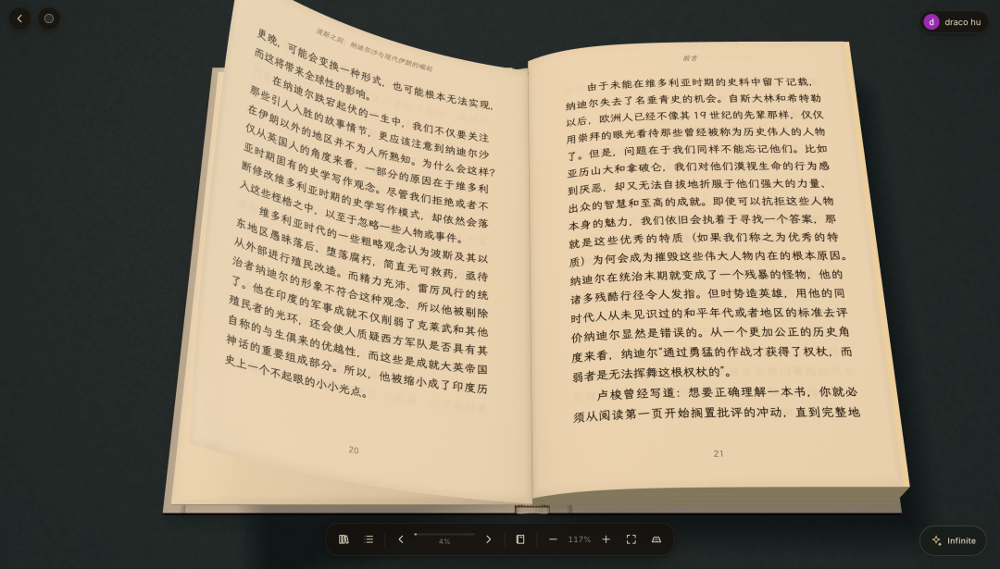
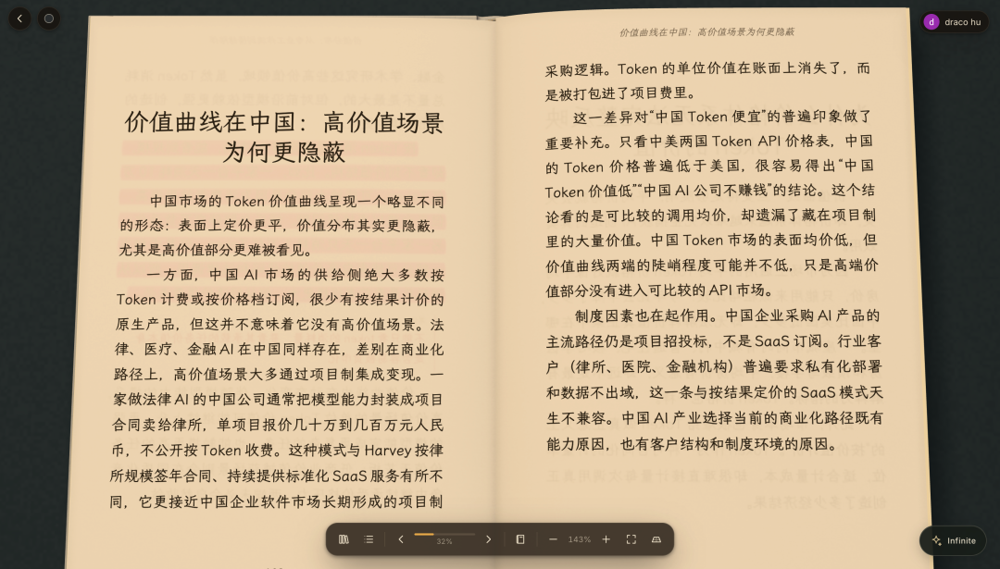
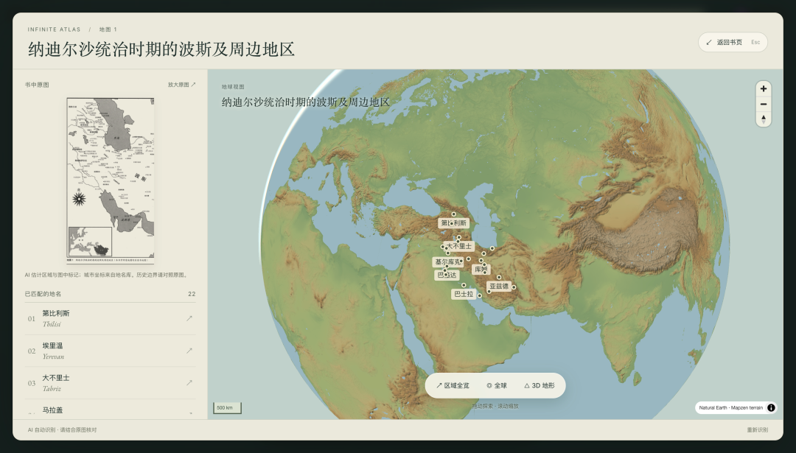
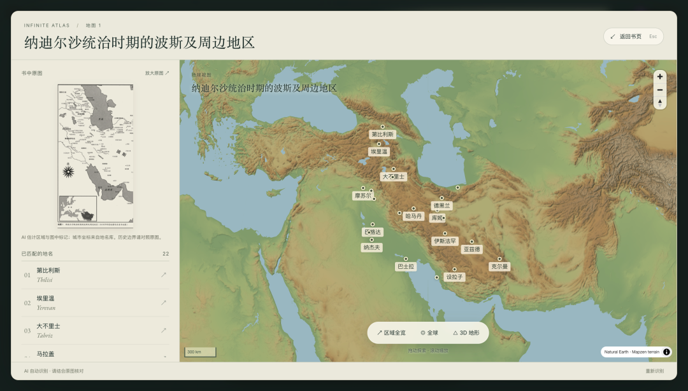
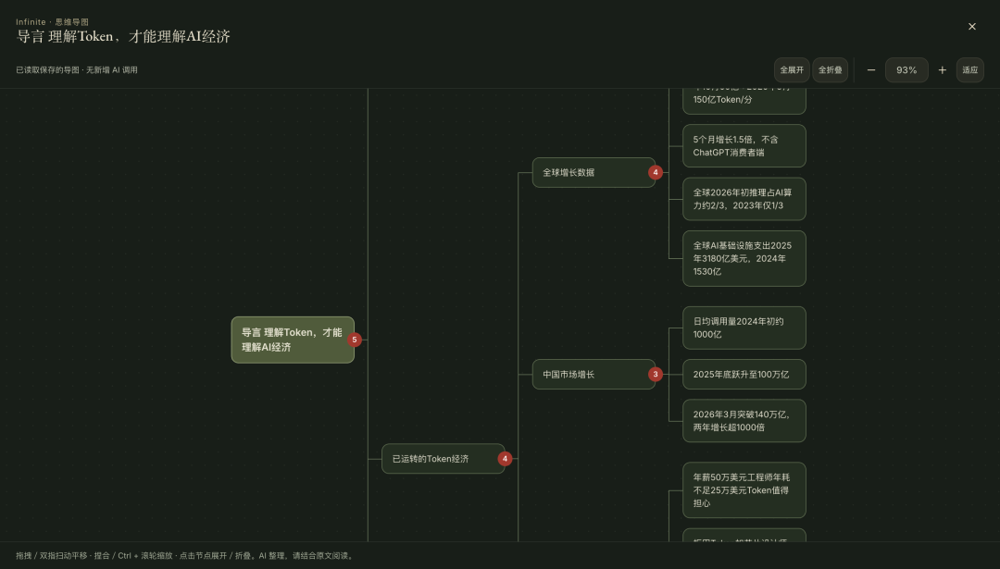
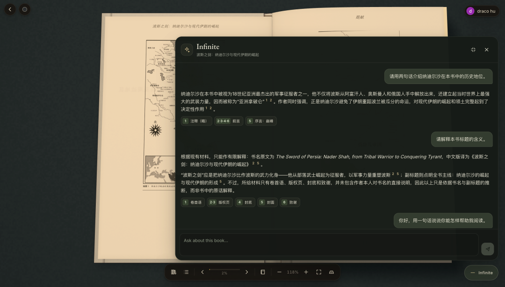
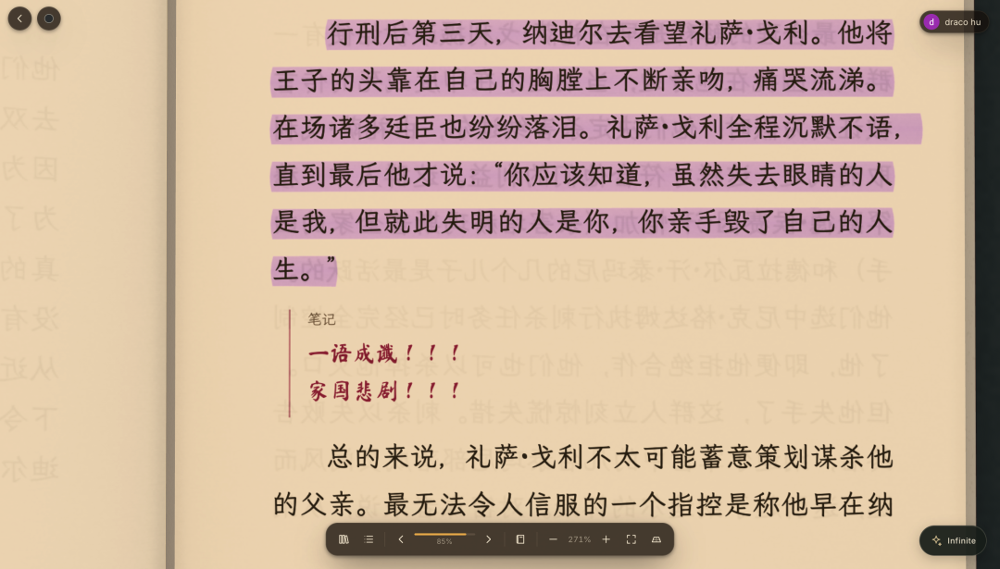
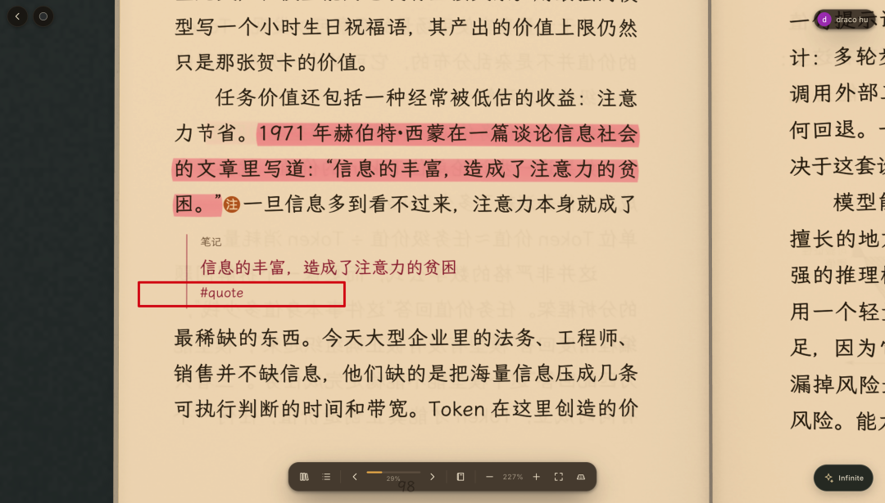
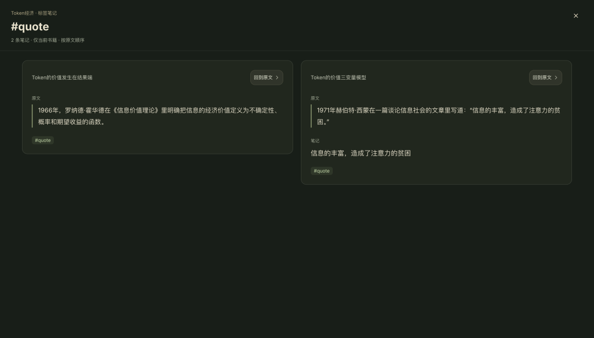

# 我在开发全世界最好的电子书阅读器
> 💡 备注属性未写入，可能是备注属性名称或者类型被修改了，建议将字段类型设置为 rich_text，可以在小程序-操作-修改文章数据库页面进行调整
> 💡 原文链接:[https://mp.weixin.qq.com/s?__biz=MzI2NzM4MTQwMg==&mid=2247498524&idx=1&sn=48a739ee1c2d8e7d161bddc7cd022364&chksm=eb2a8faf27ef914c243a781e1ddaf684738873c123c74b6e93e8fba25c4b7c7a7b1226068fd1#rd](https://mp.weixin.qq.com/s?__biz=MzI2NzM4MTQwMg%3D%3D&mid=2247498524&idx=1&sn=48a739ee1c2d8e7d161bddc7cd022364&chksm=eb2a8faf27ef914c243a781e1ddaf684738873c123c74b6e93e8fba25c4b7c7a7b1226068fd1#rd)
读书这件事，我是认真的。
但我不满意当下既存的所有读书体验。
阅读纸质书体感最好，但是阅读过程中产生的各种划线和笔记无法被数字化，很多重要的参考内容由于无法数字化导致看起来很痛苦很低效，比如地图，印在纸上的黑白地图为什么不能变成3D的呢？
电子书虽然天然是数字化的，但是缺少实体书阅读时对于进度的把控感，以及很多内容的数字化依然不够完善；当然，最大的问题是，所有电子书阅读器都是别人开发的，我要添加功能是半点也不行啊 😂
所以，开发自己的电子书阅读器这件事一直都在我的计划中！
从上个周末开始，让Opus5.5打了个底儿把UI框架搭好，后续用Codex（Codex每天都在重制啊有没有，几乎是无限token的GPT-6 Astra开着Ultra Fast模式拼命薅）陆陆续续地把这个电子书阅读器的雏形勾勒出来了，以下是一些基础功能，分享给大家，大家如果有什么产品方面的建议也可以留言区告诉我：
**1. 尽量还原纸质书阅读的体验**
1.1 俯仰皆宜：可以调整俯仰视角，能清晰地看到书籍当前已经阅读的部分和剩余部分的厚度

1.2 翻页拟真

1.3 灵活Zoom in/out

**2. 阅读增强**
2.1 书中地图可转化为可互动的3D地球仪形态

2.2 章节都可以生成思维导图（可自动全折叠/全展开）

2.3 提供了一个叫做Infinite的AI Agent当你的伴读书童，底层是Pi Agent + DeepSeek-V4.1-Flash-1017

**3. 笔记系统**
3.1 采用了我最喜欢的inline note的方式（即直接将批注放在内容中，并提供了多种手写字体和颜色的选择，指点江山激扬文字，感觉自己好似金圣叹，哈哈哈）

3.2 提供了笔记的 #tag 标签系统，方便聚类同一部书相同标签的笔记

后续迭代：
将主要聚焦于Agent能力，大幅度增强这个“伴读书童”的能力：
1. 实现由Agent为主导（引导）的阅读体验，比如Agent在阅读过程中随时提出具有挑战性的问题，从而实现读书的IPO 「I（input）-P（processing）-O（output）」的完整链路；
2. 引入游戏化机制，比如完成Agent提出的关于书籍的挑战则获得成就激励等；
总之，如[《Token经济》阅读笔记（0）](https://mp.weixin.qq.com/s?__biz=MzI2NzM4MTQwMg%3D%3D&mid=2247498496&idx=1&sn=a11b2b05926c678626ffd3ae7ef2fec1&scene=21#wechat_redirect)这篇笔记中所言，人要想进步得快，还是要：读好书，多读好书！
而我开发的这个电子书阅读器，就是为了“多读好书”而准备的：工欲善其事必先利其器！
