# 我在开发全世界最好的电子书阅读器（2）
> 💡 备注属性未写入，可能是备注属性名称或者类型被修改了，建议将字段类型设置为 rich_text，可以在小程序-操作-修改文章数据库页面进行调整
> 原文链接:[https://mp.weixin.qq.com/s/Asq-tkZsopPLwKJUg2kN9A](https://mp.weixin.qq.com/s/Asq-tkZsopPLwKJUg2kN9A)
真没想到，一篇[开发手记](https://mp.weixin.qq.com/s?__biz=MzI2NzM4MTQwMg%3D%3D&mid=2247498524&idx=1&sn=48a739ee1c2d8e7d161bddc7cd022364&scene=21#wechat_redirect)也能触发平台的推荐流量，这一周阅读量已然破万了；并且，还有近百位朋友已经在持续使用这个产品，感谢大家的信任~ 

今天和大家同步一下最近的feature更新：
- 进一步优化了书籍倾角操作及翻页操作的速度和性能（键盘← →键也可以翻页了）；
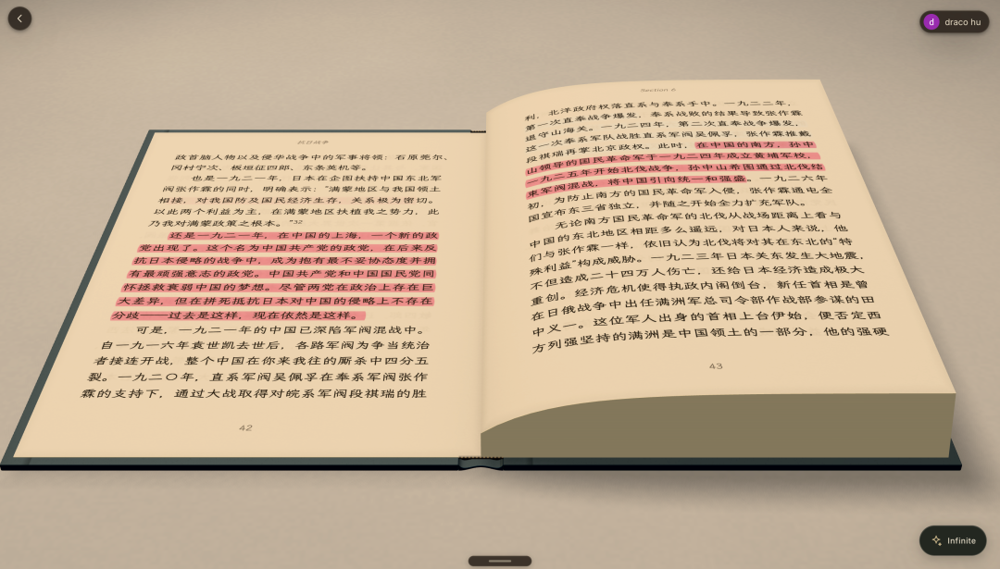
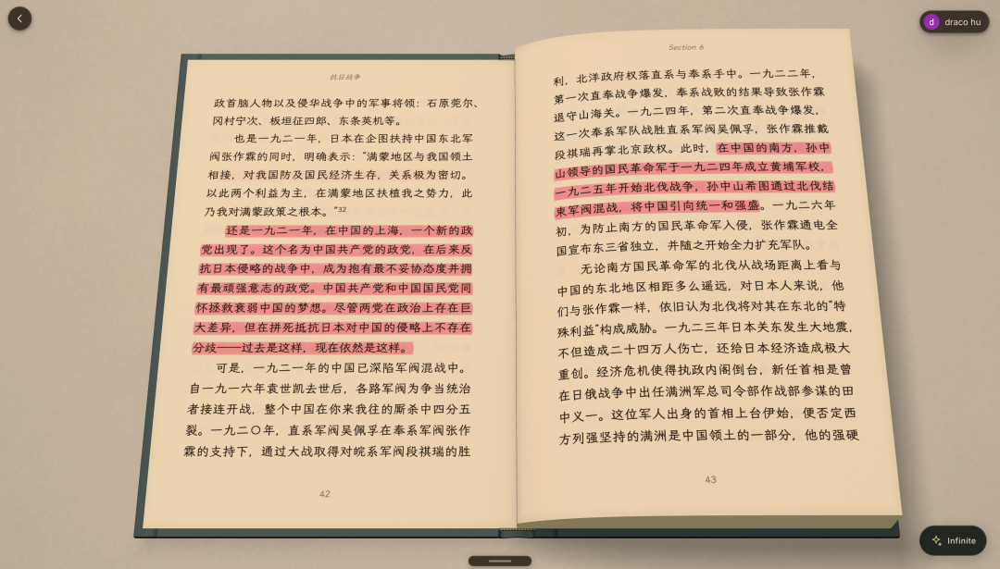
- 提高了3D地图加载效率（以及不会重复识别以降低token消耗）
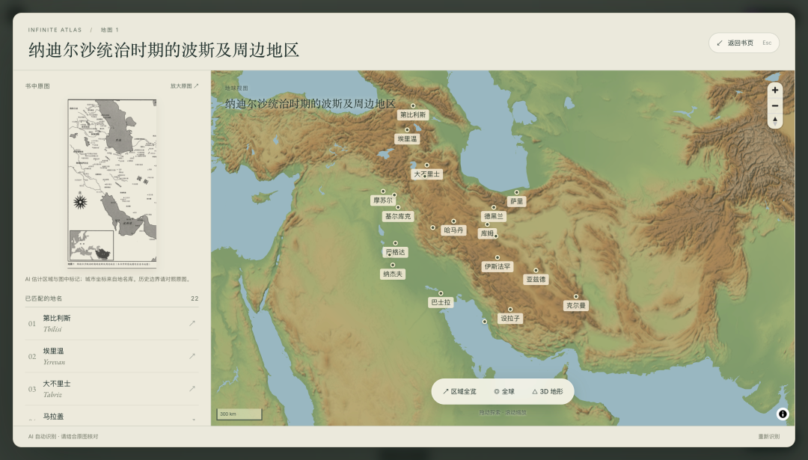
- 伴读书僮（Infinite Agent）可以扩大到半屏显示，并且进一步提高对原生Markdown语法渲染的支持（Cloudflare Pi Harness + Pi Durable + Vectorize + DeepSeek-V4.1-Flash-1017）；并且，点击释义中的数字锚点可以直接跳转到书籍正文的相应位置；
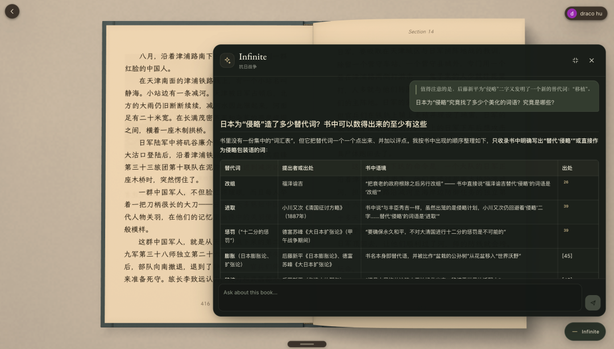
- 为了进一步提高界面的简洁度，底部工具栏在不交互时将默认隐藏在底部横条中（有点像iPhone的设计）
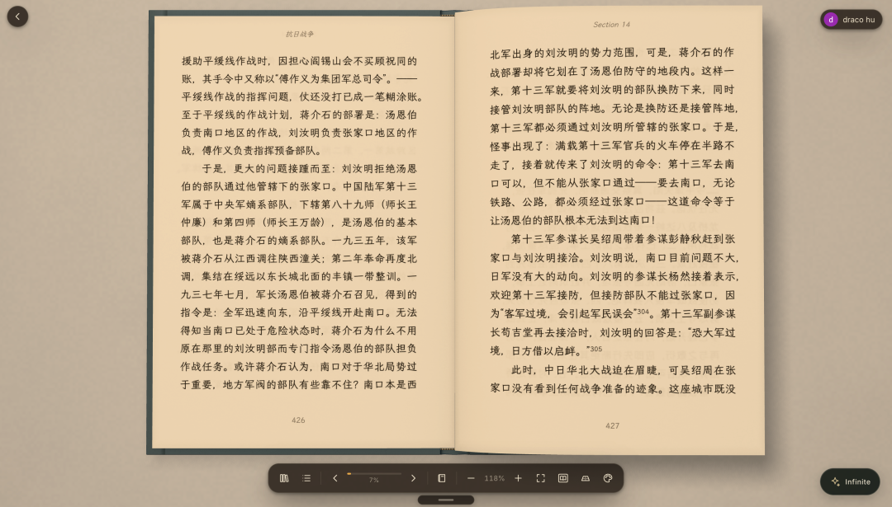
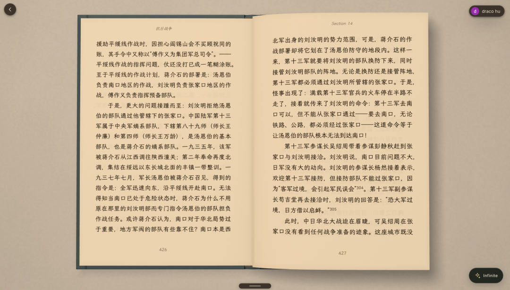
- 主题色和字体选择也统一放到了底部工具条中
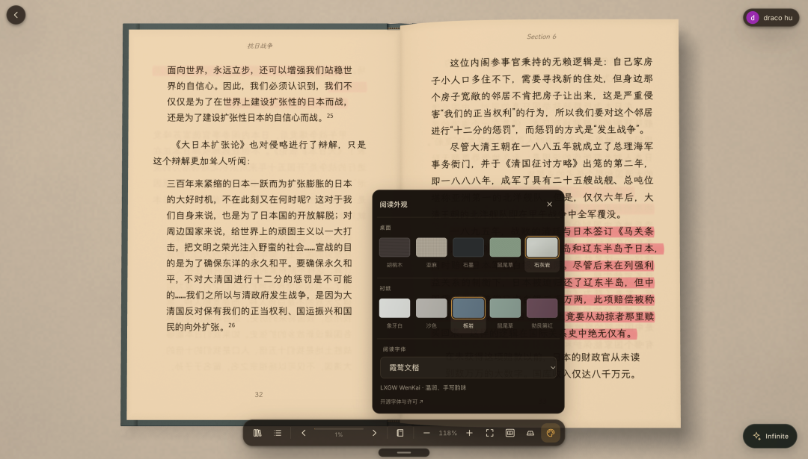
- quote block默认采用“霞骛文楷”字体；
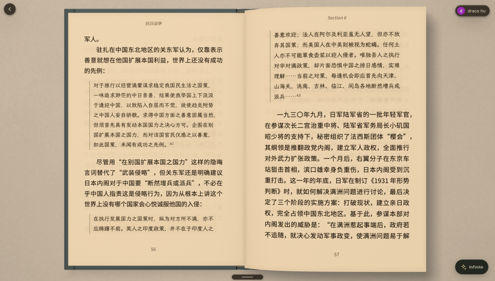
- 思维导图可以针对任意划线段落来生成了；
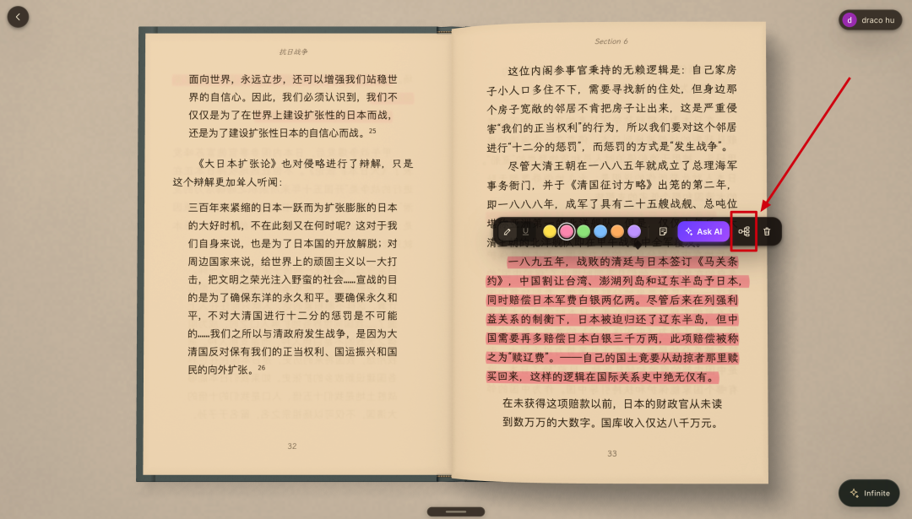
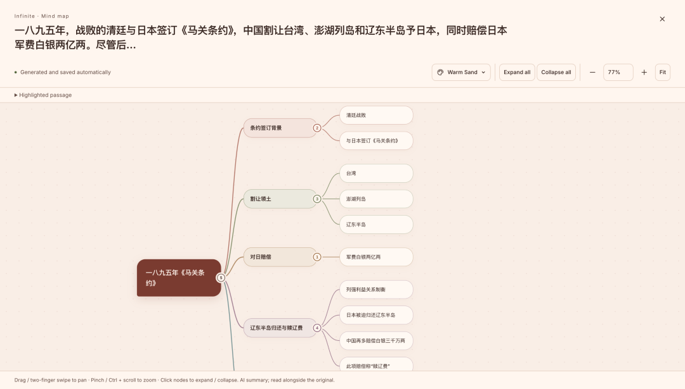
- 思维导图支持5种不同模板（除了上面的👆🏻还有👇🏻的4种）；
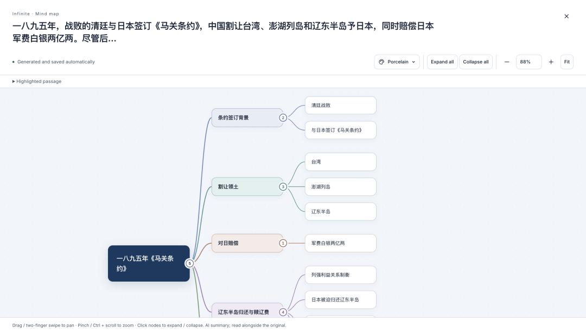
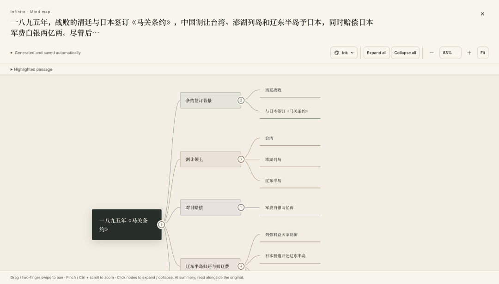
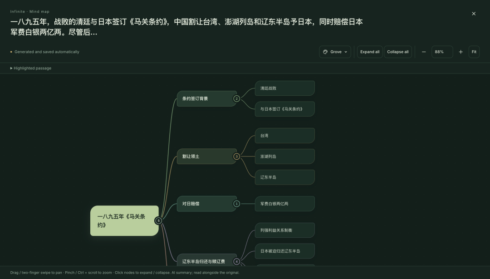
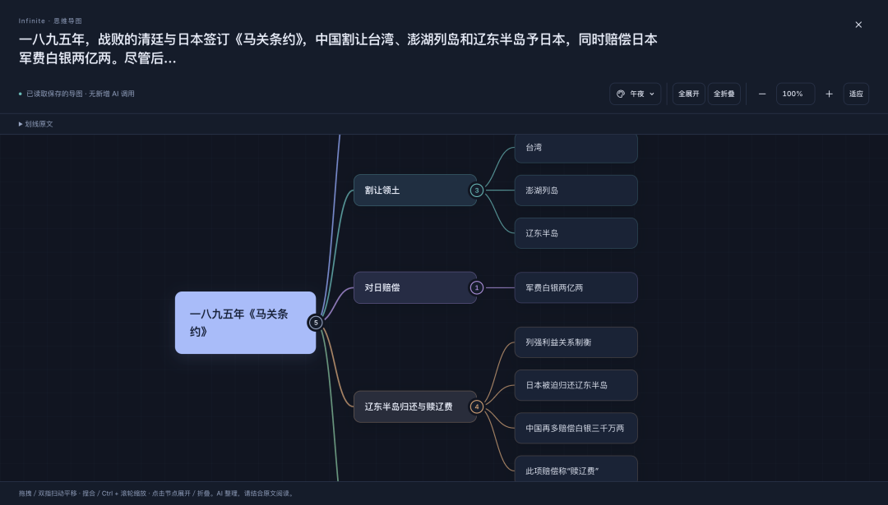
- 大幅度提高了“大部头（50万字以上）”书籍的inline note的编辑和排版效率，不会出现写下inline note的5秒后才显示出来的性能问题了；
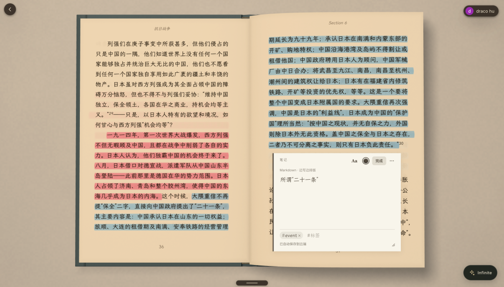
- 制作了一个简单的landing page
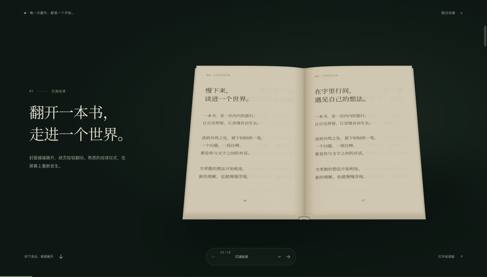
- 优化了书籍列表页的排版

欢迎大家继续试用和给出优化建议~
