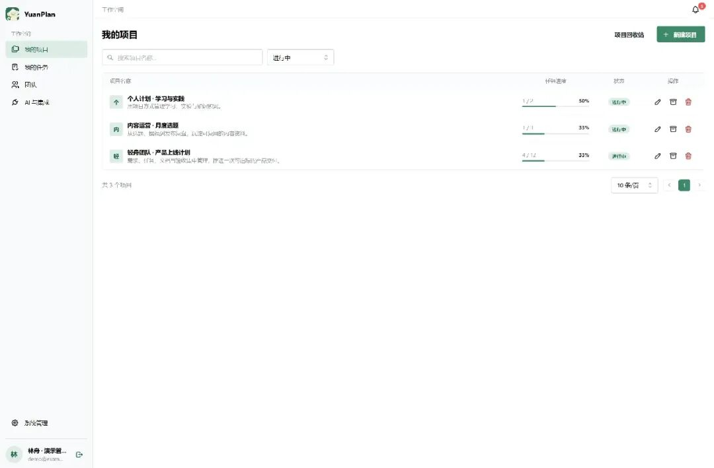
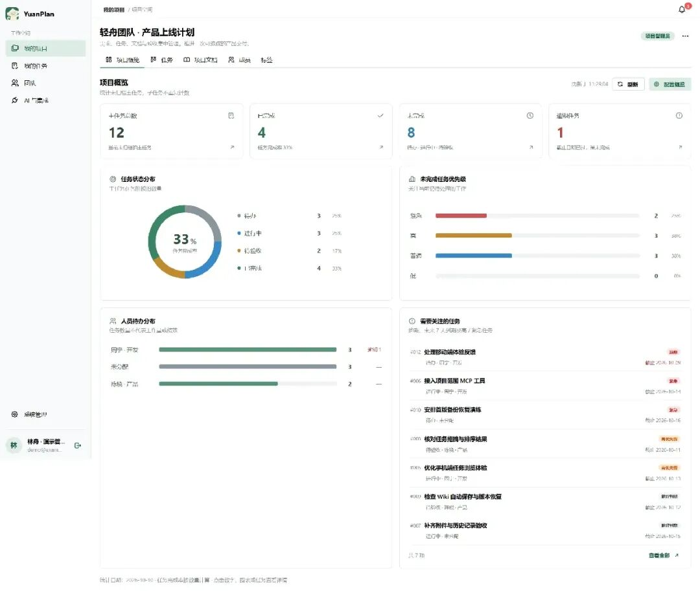
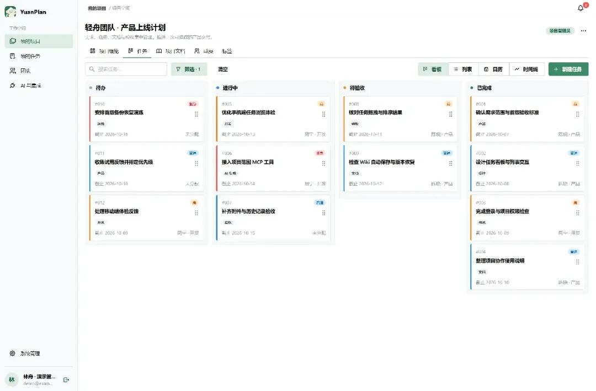
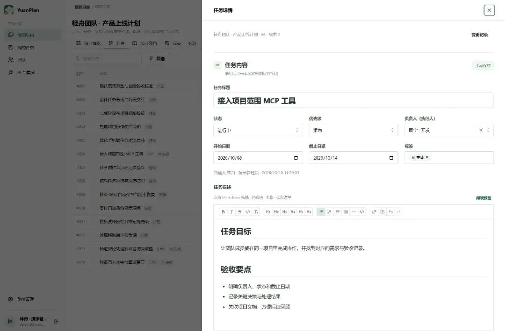
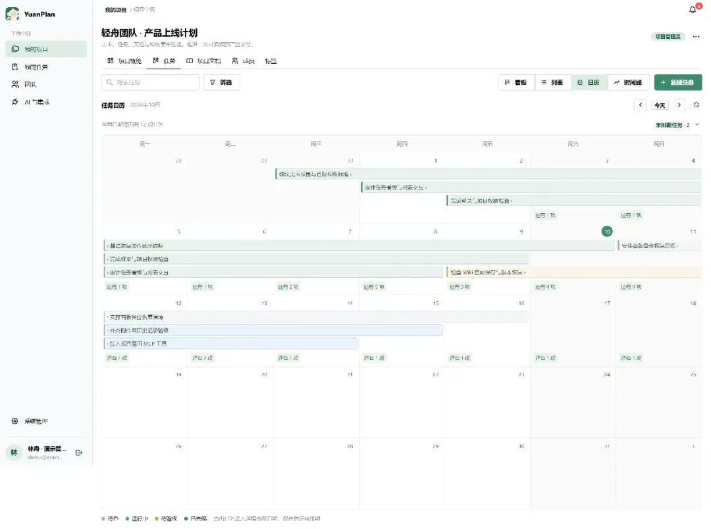
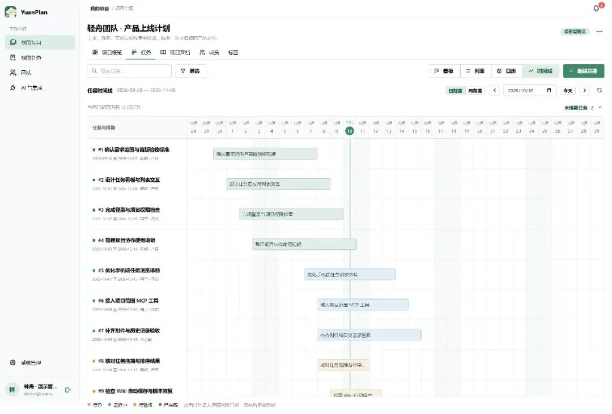
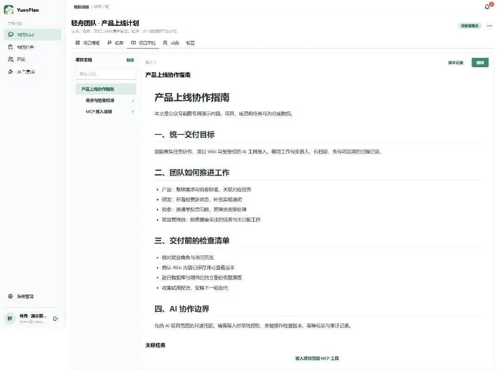
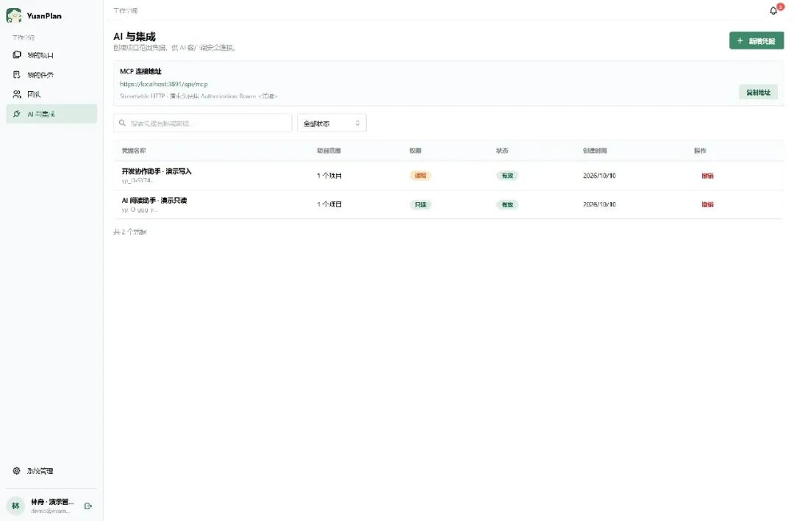
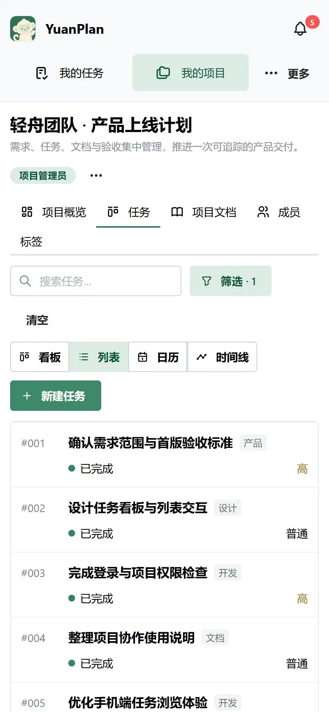
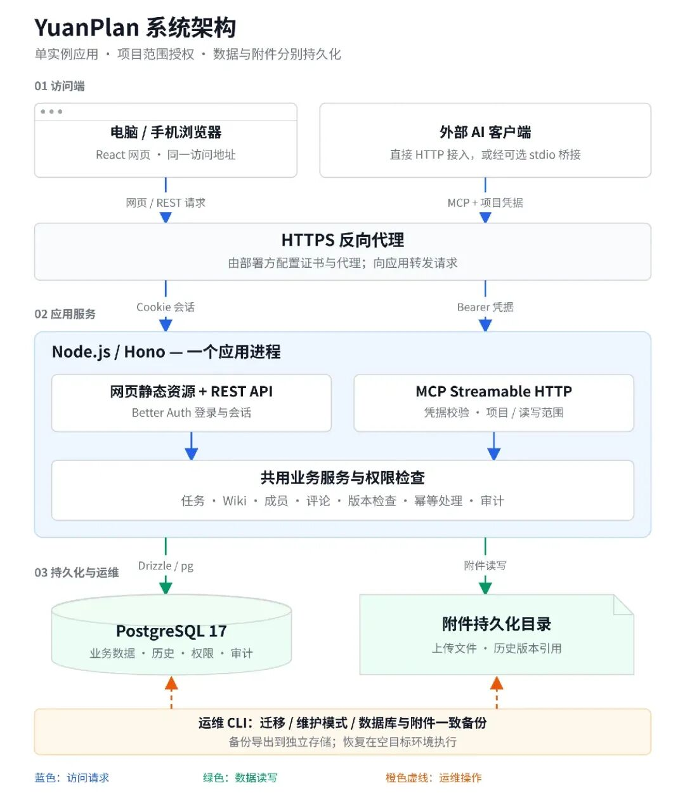

# 我把 YuanPlan 开源了：让任务、项目文档和 AI 协作在同一个地方发生
> 💡 备注属性未写入，可能是备注属性名称或者类型被修改了，建议将字段类型设置为 rich_text，可以在小程序-操作-修改文章数据库页面进行调整
> 💡 原文链接:[https://mp.weixin.qq.com/s?__biz=MzkwMDY1Mjc1Mg==&mid=2247488917&idx=1&sn=d923bde9d5b701d7fc85c0e1fa02a1ea&chksm=c1b9f6d64655f75e3ff1673a91a7df85585ab3171c09200e975db8480fc194af38f1048b9716#rd](https://mp.weixin.qq.com/s?__biz=MzkwMDY1Mjc1Mg%3D%3D&mid=2247488917&idx=1&sn=d923bde9d5b701d7fc85c0e1fa02a1ea&chksm=c1b9f6d64655f75e3ff1673a91a7df85585ab3171c09200e975db8480fc194af38f1048b9716#rd)
> ❝
> 一个面向个人与小团队的自托管项目协作系统。用看板推进工作，用 Wiki 保存上下文，通过 MCP 让 AI 在授权范围内参与协作。
> 
项目推进到一半，往往会遇到一些很具体的问题：任务说好了，却没有明确负责人；需求文档更新了，执行的人还在按旧版本理解；讨论散落在聊天记录里，后来加入的同事只能重新问一遍。
当 AI 开始参与工作，又多了一层重复劳动。为了让它理解项目，需要不断复制任务、整理文档、解释当前进展。它给出了建议，结果还要手动搬回协作系统。
我希望 YuanPlan 能把这些工作放到同一个项目里：一项任务对应什么需求，由谁推进，什么时候完成，讨论过什么，最终留下哪些资料，都有可以继续使用的记录。
现在，YuanPlan 已经开源。当前源码版本是 **v0.1.1，处于 MVP 阶段**，提供任务管理、项目 Wiki、团队与角色管理，以及项目范围授权的 MCP 接入能力。
如果你只是想管理日常工作，可以直接看前面的功能和截图；如果你准备自己部署，或想让 AI 客户端连接项目，后面也会展开架构、权限与部署方式。
项目地址：https://github.com/zhylq/YuanPlan
### 一、YuanPlan 是什么？谁适合用它？
YuanPlan 是一个可以部署在自己环境中的项目协作系统。成员通过浏览器访问，在项目里管理任务、维护文档、补充评论和附件；开发者也可以通过 MCP，把支持该协议的 AI 客户端接入这些项目。
“自托管”意味着部署方负责运行环境，并掌握数据库、附件和部署配置。团队成员日常使用时，仍然是打开网页、登录、进入项目，不需要人人都了解服务器和命令行。
它主要面向以下几类使用者：
| **使用者** | **可以怎样使用** |
| 个人开发者 | 管理开发任务、问题修复、部署笔记和技术实验，把计划与记录放在同一处 |
| 小团队负责人 | 查看进展、负责人、逾期和未分配工作，围绕需要处理的事项安排协作 |
| 产品、运营与普通成员 | 维护需求或内容计划，更新任务状态，查找资料，记录讨论与验收结果 |
| 希望接入 AI 的团队 | 让 AI 读取已授权的项目资料，或在明确授予写权限后辅助创建任务和更新文档 |
例如，一次产品上线可以作为一个项目；一次月度内容计划也可以作为一个项目。工作需要持续推进、资料需要不断积累的时候，任务和文档放在一起会更容易维护。

**图 1：真实运行的项目列表。本文全部页面截图来自独立演示实例，项目、姓名、邮箱、任务和文档均为合成数据**
### 二、先从一个具体项目看起
为了展示系统，我准备了一个“轻舟团队 · 产品上线计划”的演示项目。
项目中有产品、开发、测试等协作角色，包含 12 个主任务，以及“接入项目范围 MCP 工具”下面的 2 个子任务。主任务覆盖需求确认、交互设计、权限检查、移动端体验、文档整理和交付验收。
这个示例里，产品与开发拥有成员权限；测试账号被设为只读，用于展示不同访问范围。实际团队需要测试人员直接提交评论或修改任务时，可以给其成员权限。“产品”“开发”“测试”是团队分工，系统权限由项目角色决定。
截图中的日期、完成比例和任务数量用于解释界面。它们由演示数据计算得出，不代表真实团队的交付成果，也不是性能测试数据。
这次演示最想展示的是一条完整过程：把工作拆成任务，分配负责人，在看板推进，关联验收文档，并保留讨论和变更记录。团队之后回看项目时，也能找到当时的上下文。
### 三、项目概览：先发现需要处理的工作
负责人进入项目后，通常先关心几个问题：现在做到了哪一步？还有哪些工作没有完成？有没有逾期事项？哪些任务需要尽快分配或确认？
YuanPlan 的项目概览围绕这些问题展示信息：主任务总数、已完成与未完成数量、逾期任务、状态分布、未完成任务的优先级、人员待办分布，以及需要关注的任务。概览布局可以配置并保存。

**图 2：演示项目有 12 个主任务，完成 4 个，未完成 8 个，其中 1 个逾期。概览按当前未归档的主任务统计，子任务不重复计数；显示的完成率约为 33%。**
在这个项目里，“处理移动端体验反馈”已经逾期；“安排首版备份恢复演练”优先级较高，但还没有负责人。这样的信息适合作为项目沟通的起点：确认延期原因，补上执行人，或者调整排期。
点击概览中的数字、图表或任务，可以继续查看相关任务。负责人可以从总览进入具体事项，减少逐条翻找的步骤。
这里也需要区分数量与工作量。一项任务可能需要十分钟，也可能需要几天。人员待办分布展示的是任务数量，不能直接用来评估成员的工作量或绩效；完成率同样按数量计算，不能等同于实际工时完成比例。
### 四、看板与列表：让每项工作都有明确状态
任务是 YuanPlan 的日常协作中心。一个任务可以记录标题、描述、状态、优先级、负责人、开始与截止日期、标签，并配合子任务、评论、附件和关联文档继续展开。
当前任务状态包括“待办、进行中、待验收、已完成”。优先级包括“低、普通、高、紧急”。团队可以按这些字段搜索和筛选，也可以拖拽调整任务排序。

**图 3：同一组主任务按状态展示。卡片保留优先级、标签、负责人和截止日期，便于在讨论进展时直接定位工作。**
看板适合看工作流：哪些工作还没开始，哪些正在推进，哪些已经交给其他人验收。列表适合逐项核对与快速浏览。成员切换视图时，操作的是同一份任务数据，任务状态和日期不需要分别维护。
任务详情则用于补齐执行所需的信息。比如“优化手机端任务浏览体验”，标题只说明方向，描述中还需要写清适用页面、预期操作和验收条件。有人接手时，可以从任务本身了解要求。

**图 4：演示任务“接入项目范围 MCP 工具”的详情。任务内容区域明确提示手动保存；Wiki 则使用自动保存，两种编辑方式在界面中有各自的提示。**
YuanPlan 当前支持一级子任务，可以把一项工作拆成几个可执行步骤。在演示项目中，MCP 接入任务下拆出了“验证只读凭据的项目访问范围”和“验证写入冲突与重试幂等”。子任务与主任务保持关联，也可以分别跟踪状态。
对执行成员来说，“我的任务”入口用于集中查看分配给自己的工作。站内通知支持任务分配与评论通知，并提供未读数量和已读状态，方便成员发现需要跟进的变化。
### 五、日历与时间线：把日期真正用起来
当项目里有了开始日期和截止日期，团队就可以从时间角度检查计划。
日历把任务放到对应日期范围中，适合看某一天或某一周安排了哪些工作。例如，内容团队可以看本周的撰稿与发布安排；开发团队可以看验收与交付前有哪些事项集中到期。

**图 5：演示任务按日期范围放入月历。未设置日期的任务在未排期入口中保留，不会因为缺少日期而从工作清单中消失。**
时间线则把每项任务的时间范围横向展开，适合观察工作之间的时间重叠、阶段安排，以及今天处在整个计划的什么位置。当前支持日刻度与周刻度查看。

**图 6：时间线展示已有任务的日期区间。点击任务进入详情修改日期，保存后更新排期。**
这里展示的是任务日期视图。当前版本没有经过验证的自动资源调度、关键路径计算或复杂任务依赖分析。对小团队来说，可以先用它检查最直接的排期问题：有没有日期，是否已经到期，同一阶段是否挤了太多工作，再由团队决定怎样调整。
### 六、项目 Wiki：让需求和经验留下来
任务解决“要做什么、由谁做、做到哪一步”，文档则承载更完整的说明：为什么这样设计，怎样验收，系统如何使用，以及哪些决定以后仍然需要参考。
YuanPlan 的项目 Wiki 支持层级目录、同级排序和富文本内容，可以使用标题、列表、图片与表格组织资料。编辑时提供自动保存、本地草稿、版本记录、版本恢复与冲突处理。

**图 7：演示项目的“产品上线协作指南”，下面包含“需求与验收标准”和“MCP 接入说明”。正文底部关联了对应任务。**
项目文档可以这样组织：
```
产品上线协作指南
├── 需求与验收标准
└── MCP 接入说明

```
团队可以把交付目标写在总览文档里，把验收条件写在单独页面，再把相关页面关联到执行任务。任务与文档支持双向关联：从任务进入文档查看完整要求，也可以从文档找到正在推进的工作。
这种关联适用于很多场景。产品需求可以关联功能实现任务；部署说明可以关联上线检查任务；一篇文章的选题说明可以关联撰稿与校对任务。资料逐渐积累后，后来加入的人也有明确的阅读入口。
版本记录提供了内容变化的回看入口。需要恢复时，可以按系统提供的版本恢复流程处理；多人编辑遇到版本冲突时，系统会提示处理，避免直接以旧版本覆盖最新内容。
本地草稿有助于保留尚未完成保存的编辑内容，但它依赖当前浏览器环境。正式记录仍需成功保存到服务端，部署方也应对数据库和附件进行备份。
### 七、评论、附件与历史：把过程记录在任务旁边
协作中的很多信息来自推进过程：验收发现了什么问题，某个方案为什么调整，下一步准备怎样处理。把这些记录放在任务附近，之后回顾时更容易找到。
YuanPlan 支持任务评论、附件、活动时间线与变更历史。演示中的 MCP 接入任务就添加了说明：“已完成只读接入验证。下一步检查写入冲突与重试，结果统一记录在协作指南中。”任务的优先级也从“高”调整为“紧急”，形成了对应变更记录。
这些内容可以用于日常交接与复盘：成员看到当前状态，也能继续查看变化过程和相关资料。附件则用于补充问题截图、验收材料等文件。
项目还提供归档、回收站与恢复，以及孤立附件清理等资源管理能力。归档可以收起已经结束的工作；回收站为相应的删除操作提供恢复入口。部署备份负责更完整的数据恢复，两者各有用途。
### 八、MCP 接入：让 AI 读取真实项目上下文
MCP 可以理解为 AI 客户端连接外部工具的一种协议。YuanPlan 提供工具接口，AI 客户端通过这些接口获取项目资料，并在获得相应权限后执行支持的写入操作。
对使用者来说，一个直接的变化是：接入后，客户端可以通过工具查询任务和文档，减少反复复制项目背景的操作。AI 如何分析这些资料、怎样生成回答，取决于你使用的外部客户端、模型以及具体指令。

**图 8：演示实例中创建了两个凭据，均只授权一个项目。页面中的 localhost 是已经清理的临时本机演示地址，凭据前缀也来自一次性合成环境；它们不指向真实线上服务器。**
当前 MCP 提供 18 个工具，可以按用途理解：
| **用途** | **支持的工具** |
| 项目与成员 | `list_projects`、`get_project`、`list_project_members` |
| 任务 | `list_tasks`、`get_task`、`create_task`、`update_task` |
| 子任务 | `list_subtasks`、`create_subtask` |
| 评论 | `list_comments`、`add_comment` |
| 文档 | `search_documents`、`get_document`、`create_document`、`update_document` |
| 历史与版本 | `list_task_history`、`list_document_versions`、`get_document_version` |
例如，可以先用只读凭据向 AI 客户端提出这样的请求：
> ❝
> 查询产品上线项目中尚未完成的任务，列出负责人、截止日期与优先级，再结合相关文档整理需要确认的问题。请说明信息来自哪些任务或文档。
> 
如果确实需要辅助写入，再授予相应范围的写权限，并提出具体要求：
> ❝
> 根据刚确认的验收清单，先给出准备新增的任务与子任务。等我确认后，再创建到指定项目中，保留清单里的验收要求。
> 
这些是使用思路，本文没有展示已经执行的模型对话结果。“等我确认”属于给客户端的工作指令；真正的项目权限、读写范围和版本检查由 YuanPlan 服务端执行。部署方仍需设置好 AI 客户端自己的执行与确认策略。
#### 项目范围授权如何生效？
MCP 凭据可以限定项目，并区分只读与读写。客户端能访问的资源还受凭据所属用户的业务权限约束，因此拿到凭据不会自动获得实例管理能力。
服务端在执行操作时，会结合用户状态、项目成员角色和凭据范围检查权限；凭据支持到期与撤销。网页操作与 MCP 操作沿用相同的业务权限及审计逻辑，MCP 也不提供项目管理类高权限变更能力。
写入操作还使用版本检查和幂等标识。版本检查用于发现读取之后又发生的修改；幂等处理用于在相同操作重试时避免重复创建。这些机制让自动化接入有更明确的执行边界。
文档写入还要考虑格式。Wiki 使用富文本结构，MCP 提供 Markdown 读写时，需要判断内容是否能够无损往返。遇到无法安全表示的复杂内容，相关写入会被拒绝，避免在转换中悄悄丢失文档结构。
接入方式包括直接连接 Streamable HTTP，或者让需要 stdio 的客户端通过仓库提供的桥接程序连接。当前已验证 Codex 实际运行时中的 HTTP 与 stdio 接入；Claude Desktop 的实际客户端接入仍待验证。具体配置见 MCP 客户端指南。
### 九、手机端：外出时也能查看和跟进
团队成员可以在手机浏览器打开相同地址。窄屏导航优先显示“我的任务”和“我的项目”，其他入口收在“更多”中；项目任务默认采用列表展示，也可以切换看板。

**图 9：390 像素宽度的真实浏览器截图。成员可以沿用同一账号与项目数据查看任务。**
手机端适合临时查看待办、确认状态、浏览资料等工作。复杂文档编辑与批量管理更适合在电脑端完成。目前通过联网网页使用，没有离线同步能力。
### 十、系统架构：网页和 AI 共用一套业务服务
对准备部署和二次开发的读者，下面这张图展示当前系统结构。

**图 10：蓝色箭头表示访问请求，绿色表示数据读写，橙色虚线表示运维操作。stdio 桥接是外部客户端的可选接入方式；HTTPS 代理由部署方配置。**
YuanPlan 采用单实例应用结构。生产构建后的前端静态资源、REST API 和 MCP 接口由 Node.js 应用提供；业务数据保存到 PostgreSQL，附件保存在持久化目录中。
| **层级** | **技术与职责** |
| 前端 | React、TypeScript、Vite；Mantine 提供界面组件，Tiptap 用于编辑内容，dnd-kit 支持拖拽交互 |
| 后端 | Node.js、Hono；Better Auth 处理认证会话，Zod 校验输入 |
| 业务逻辑 | 项目角色、任务与文档操作、版本检查、幂等处理和审计 |
| 数据层 | PostgreSQL、Drizzle ORM；业务数据与文件对象分别持久化 |
| AI 接口 | MCP SDK、Streamable HTTP；可选 stdio 桥接程序转发客户端调用 |
| 工程验证 | npm Workspaces、Vitest、Playwright、esbuild 与 GitHub Actions |
#### 一次网页修改怎样完成？
成员登录后打开项目，编辑任务并提交。请求经过 HTTPS 代理进入 API，服务端检查会话、项目角色和输入内容；涉及版本的写入核对当前版本，再通过业务服务完成更新并记录相应历史与审计，最后把结果返回界面。
#### 一次 MCP 修改怎样完成？
外部 AI 客户端携带 Bearer 凭据调用 MCP。服务端先检查凭据，再核对用户权限、项目范围和读写能力；通过检查后，调用同一套业务服务。客户端收到结果，可以继续向使用者报告成功、冲突或权限错误。
两个入口的认证方式不同，业务约束保持一致。维护者修改任务或文档逻辑时，也能在同一业务层处理相关规则。
AI 模型运行在外部客户端一侧，YuanPlan 负责提供项目工具与保存协作记录。接入云端模型时，调用返回的项目内容可能进入客户端和模型服务的处理流程，团队应按自己的资料范围选择客户端、模型与凭据权限。
### 十一、自托管的价值：能够掌握数据，也能够恢复数据
对个人和小团队而言，自托管的吸引力在于可以明确知道数据保存在哪里，自己决定运行环境、访问方式、备份位置和维护节奏。
YuanPlan 使用 PostgreSQL 保存业务数据，附件单独持久化，仓库提供部署、迁移、备份与恢复指南。代码采用 MIT 许可证，允许在遵守许可要求的情况下使用、修改与分发。部署方仍需要承担主机、存储、网络、维护，以及可选 AI 服务的成本。
当前容器部署还做了几个具体安排：应用以非 root 身份运行；应用数据库角色与迁移角色分离；应用运行账号不拥有业务表，也不能修改、删除或清空审计和版本表；数据库不向宿主机开放端口。
这些安排减少了运行账号拥有的权限，但主机和数据库管理员仍承担管理责任。自己的环境能否稳定运行，仍要通过部署、升级和恢复演练确认。
备份尤其需要同时考虑两类数据：数据库里的项目记录，以及附件目录中的实际文件。只保留数据库，恢复后可能仍然缺少图片或其他附件。
YuanPlan 提供维护模式下的一致备份流程，备份包含数据库归档、附件与校验清单，并保留历史版本引用的文件。恢复前核验备份信息，在空目标环境执行恢复；部署配置、原有认证密钥和所用代码或镜像标识需要另行安全保存。
Docker 命名卷用于持久化运行数据；完整备份还应导出到独立存储，并实际验证可以恢复。具体命令与失败处理见 容器部署与一致备份指南。
### 十二、当前开源版本已经做过哪些验证？
开源发布之前，项目进行了依赖检查、构建与测试、生产镜像检查、浏览器操作演练，以及隔离环境中的备份恢复。
截至 2026 年 10 月 10 日，公开记录中的主要结果如下：
| **验证项目** | **本次结果** |
| 类型检查、集成与发布防泄漏测试 | 12 个测试文件、101 项测试通过 |
| 全量与生产 npm 依赖审计 | 本次检查均为 0 项漏洞告警 |
| 前端、服务端和 stdio 构建 | 通过，并检查了构建后服务与许可通知 |
| 应用及数据库镜像扫描 | 本次 HIGH / CRITICAL 均为 0 |
| 本机 HTTPS 浏览器演练 | 登录、项目创建、任务保存与历史、Wiki 自动保存及刷新通过 |
| 独立备份恢复演练 | 恢复 9 项迁移，业务表数量与备份前一致 |
| Codex 实际 MCP 运行时 | HTTP / stdio 与 18 个工具，以及权限、幂等、冲突、审计和撤销等场景通过 |
这组结果代表对应代码、依赖与构建镜像的一次检查快照。它不等于所有部署环境都已验证，也不等于未来不会出现新问题。MCP 运行时验证没有启动模型回合，因而不能据此宣称某个模型已经完成真实项目交付。
验证范围和具体说明可查看 开源发布检查记录，持续构建结果可查看 GitHub Actions。
### 十三、MVP 阶段，适合怎样开始使用？
MVP 是 Minimum Viable Product，通常译为“最小可行产品”。对 YuanPlan 来说，当前版本已经提供能够串起项目、任务、文档与受授权工具接入的核心流程，同时仍需要在更多真实使用场景中完善。
目前适合个人和小团队，从范围清楚的项目开始试用，观察界面与工作方式是否匹配自己的需求，再决定是否承载更长期的资料。
当前版本的范围也需要说明：
- 采用单实例部署，尚无经过验证的大规模负载与高可用方案。
- 没有离线同步和 MCP OAuth。
- 完整无障碍能力、更多实际 AI 客户端兼容性仍待验证。
- 当前日历和时间线用于查看任务排期，没有复杂资源调度与依赖分析能力。
- HTTPS 代理、邮件投递、容量规划与独立备份需要在自己的部署环境验证。
如果团队需要经过验证的大规模并发、多节点故障切换或复杂企业治理，应先评估这些要求与当前版本之间的差距。小团队也可以先选一个非关键项目，把登录、协作、附件、权限和恢复完整走一遍。
作为维护者，我更希望收到具体反馈：哪些操作容易误解，什么情况下找不到任务，文档保存提示是否清楚，AI 调用遇到了怎样的冲突。这样的反馈能够帮助下一轮迭代确定优先级。
### 十四、想体验的话，从这里开始
如果团队里已有维护环境的人，可以由他完成部署，再邀请其他成员加入。普通用户从接受邀请、登录和进入项目开始即可。
准备自托管时，需要 Git、Docker Engine 与 Docker Compose v2，并准备好 HTTPS 访问环境。在 Linux / macOS 中，可以从下面的步骤开始：
```
git clone https://github.com/zhylq/YuanPlan.git
cd YuanPlan
git checkout v0.1.1

cp deploy/.env.example deploy/.env
# 先编辑 deploy/.env，再执行构建与启动
docker compose --env-file deploy/.env build
docker compose --env-file deploy/.env up -d app
docker compose --env-file deploy/.env ps -a

```
Windows PowerShell 的复制命令为：
```
Copy-Item deploy/.env.example deploy/.env

```
配置文件中的 `APP_URL` 应填写实际 HTTPS 访问地址；`AUTH_SECRET`、`SETUP_TOKEN` 和三组数据库密码都要使用独立随机值，替换示例占位内容。真实配置文件不要提交到公开仓库。
启动流程会等待数据库健康、完成迁移，再启动应用。检查迁移退出状态与应用健康状态后，由部署方配置证书和反向代理。当前配置不会自动签发证书，生产登录需要通过正确的 HTTPS 环境验证。
首次访问时，使用初始化令牌创建管理员，然后创建项目、邀请成员。SMTP 是可选配置；需要邮件相关功能时，应单独验证自己的投递环境。
一个实用的首次体验顺序是：
1. 创建一个试用项目，写清目标和参与者。
1. 添加几项真实待办，填写负责人和日期。
1. 在 Wiki 写一份需求或验收说明，关联对应任务。
1. 用列表、看板和概览检查计划是否清楚。
1. 有 AI 接入需求时，先创建单项目只读凭据验证查询，再决定写权限范围。
1. 在独立环境完成一次数据库与附件恢复演练，再承载重要资料。
开发者也可以按 README 配置本地 Node.js 与 PostgreSQL 环境，研究接口与业务逻辑，或者参与改进。
### 十五、欢迎一起把 YuanPlan 用得更好
YuanPlan 目前最直接的价值，是把项目中的执行工作和长期资料联系起来：看板推进任务，Wiki 保留说明，评论和历史记录变化，MCP 为外部 AI 客户端提供受授权的访问入口。
如果你正在寻找这样的协作方式，欢迎从一个小项目开始体验。使用中遇到问题，可以提交出现步骤、预期行为与实际结果；涉及账号、凭据或私人资料时，请先移除这些信息。安全问题按仓库的安全说明私下报告。
欢迎分享你的使用场景，也欢迎通过 Issue 和 Pull Request 参与完善。

## 摘要

（待补充）

## 我的笔记

（待补充）
