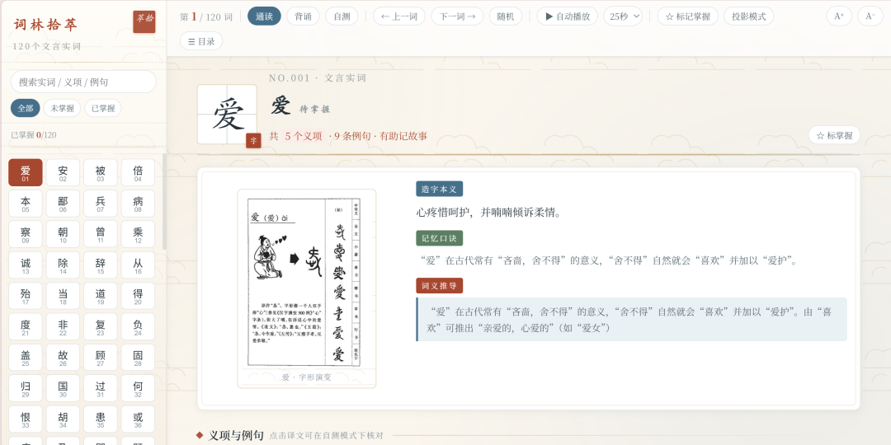
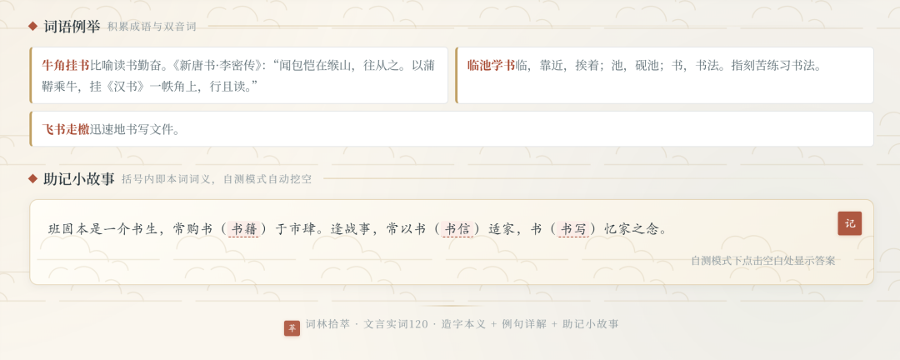
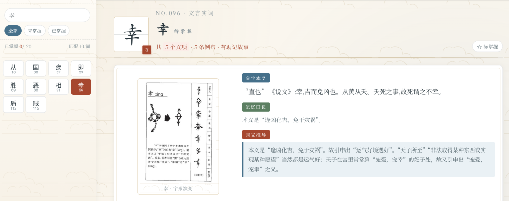
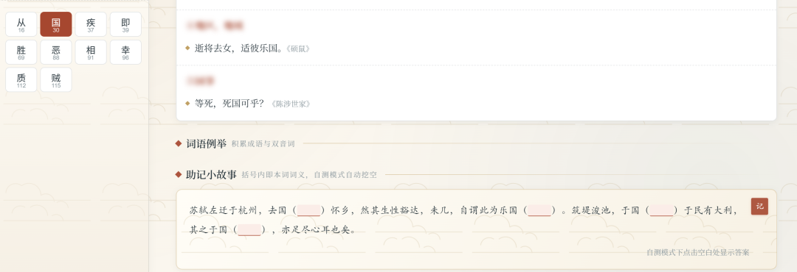
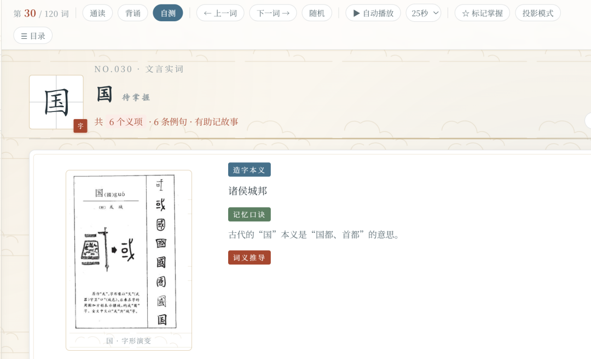
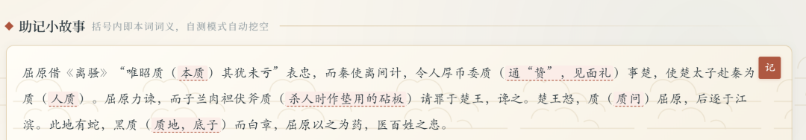

# 我把120个文言词做成了早读交互式网页
> 💡 备注属性未写入，可能是备注属性名称或者类型被修改了，建议将字段类型设置为 rich_text，可以在小程序-操作-修改文章数据库页面进行调整
> 💡 原文链接:[https://mp.weixin.qq.com/s?__biz=Mzg2MTY4MTkyNw==&mid=2247491000&idx=1&sn=7a24a853a697768d31719c18ff785c3c&chksm=cfad22547788aa49e06a071afc7d560b7f926880146d674ce145bc719fac84a1dbfab772222f#rd](https://mp.weixin.qq.com/s?__biz=Mzg2MTY4MTkyNw%3D%3D&mid=2247491000&idx=1&sn=7a24a853a697768d31719c18ff785c3c&chksm=cfad22547788aa49e06a071afc7d560b7f926880146d674ce145bc719fac84a1dbfab772222f#rd)

**一、先说痛点：文言实词，学生卡在哪**
带过高三的老师都知道，文言文阅读的失分，大多不在“读不懂句子”，而在“认不准词”。
120 个常见实词，几乎覆盖全部考点。可学生背了很久，仍然记不住，问题出在三个地方：
1. **义项是散的。**“爱”既是“喜爱”、又是“吝惜”、还能通“薆”作“隐蔽”，学生只能死记一串不相干的解释。
2. **例句是碎的。**课本里见一次记一次，换了语境就认不出来。
3. **复习没有抓手。**背到哪了、哪几个还没掌握，学生心里没数；早读课上，老师也缺少一个能“带着全班走”的载体。
手上的素材其实不差。我有一份整理得比较扎实的文档：每个词都有造字本义、词义推导、课内例句、成语例举、助记小故事，还配了字形演变图。但它是一份word文档，word文档不会自己走进早读里。

**二、创新点**
**创新一：从“背义项”到“追根溯源”**
我没有按原顺序罗列义项，而是先给学生搭一条路：明本义→理引申→记例句→串故事。
汉字是表意文字，字形里藏着本义，本义是所有义项的出发点。我在课件里专门做了一页“词义引申的路径”。学生判断一个陌生义项时，先问它属于哪条路径。记住一个本义，就能串起一串义项，这是很重要的一步。
**创新二：一份素材，两种形态**
|  | **面向对象** | **使用场景** |
| **PPT****导学课件** | 教师 | 方法指导、复习规划 |
| **交互式网页** | 学生 | 早读齐读、课后自学、自主检测 |
课件负责“讲清楚方法”，网页负责“天天练得起来”。两者共用同一套数据结构，内容一致。
**创新三：网页不是“翻页版PPT”，而是按早读课的真实场景设计**
这一步是 AI 最能发挥价值的地方。我不是让AI做个网页，而是把使用场景讲清楚：
●早读课老师要带读，没空一直点击，要有自动播放
●学生自己复习要有梯度，要有通读／背诵／自测三种模式
●单文件离线可用，图片全部内嵌，拷进U盘就能用

**三、实操过程：人机怎么分工**
**整个过程我把它拆成四步：**
**第一步：素材结构化（AI做）**
让AI解析原始word，把120个词拆成统一格式：造字本义、词义推导、词性分组的义项、课内例句及译文、成语词条、助记故事、字形演变图。这一步人做要一整天，AI几分钟完成，且120个词零遗漏。
**第二步：教学逻辑设计（我做） **
决定讲什么、什么顺序、什么节奏。这部分不能交给AI，因为它需要学科判断和学情判断。
**第三步：双形态生成（AI做，我验收）**
●PPT（省略）
●网页：单文件HTML，120词全目录可搜索、可标记掌握，三模式切换，自动播放，投影模式，字号调节。
**第四步：审美校准（我做，AI改）**
初版网页功能齐了，但风格偏工具感。于是，我根据自己的审美提出要求，AI修改。

**四、效果：到底便利了学生什么**
我不想空谈“提升效率”，下面每一条都对应一个具体的使用场景。
**1.早读**：老师不用守着电脑了。打开网页，设好xx秒一词，自动翻页，底部有进度条。老师可以走下讲台巡视。
**2.学习闭环**：
●**通读**：字形图、本义、推导、例句、译文、成语、故事，全显示；
●**背诵**：隐去译文、成语和义项标题，看着原文说意思；
●**自测**：义项标题模糊化、故事里括号内的词义自动挖空，点击才显答案。
**3.进度看得见，学生知道自己到哪了**。侧栏是120词全目录，已掌握的词自动打勾、变蓝；顶部实时显示“已掌握X/120”和进度条。可以按“全部／未掌握／已掌握”筛选——第二天早读，直接筛“未掌握”接着过，不用从头翻。
**4.遇到不确定的词，三秒钟查到。**搜索框支持搜词目、义项、例句、故事。做题时碰到“这个‘当’到底是什么意思”，输入即出结果，比翻字典快得多，而且配的是课内学过的例句。
**5.分层学习成为可能。**基础弱的学生用通读模式跟读；基础好的可进入自测模式；“随机翻词”适合课前五分钟抽查。同一个页面，三种进度，老师不用准备三份材料。
**6.课后和假期不断线。**单文件HTML，发到班级群、拷进U盘、发到家里电脑都能打开，随时随地记忆打卡。

**五、给想试一试的老师三条建议**
**1. 先想清楚“谁用、在哪用”，再让AI动手**。我的做法是先写一段“使用说明书”给AI，而不是先说要什么格式。
**2. 把素材一次性喂给AI，让它做结构化**。越规整的素材，产出越可控；不要分批零散地喂，容易出现内容遗漏和口径不一致。
**3. 选哪些词、什么顺序、什么梯度、给学生什么梯度**——这些是教师的专业价值所在，也是AI替代不了的部分。

**六、写在最后**
过去做一个这样的课件加配套材料，至少要花掉几个周末；现在从想法到成品，一次对话就完成了骨架，我只需要做两件事——**定教学逻辑、做审美判断**。而学生拿到的，不再是一份密密麻麻的word文档，而是早读课上会自己翻页的网页，课后能自己检测的网页。
愿更多老师能积极拥抱AI，让自己教得轻松一点，让学生学得高效一点。

