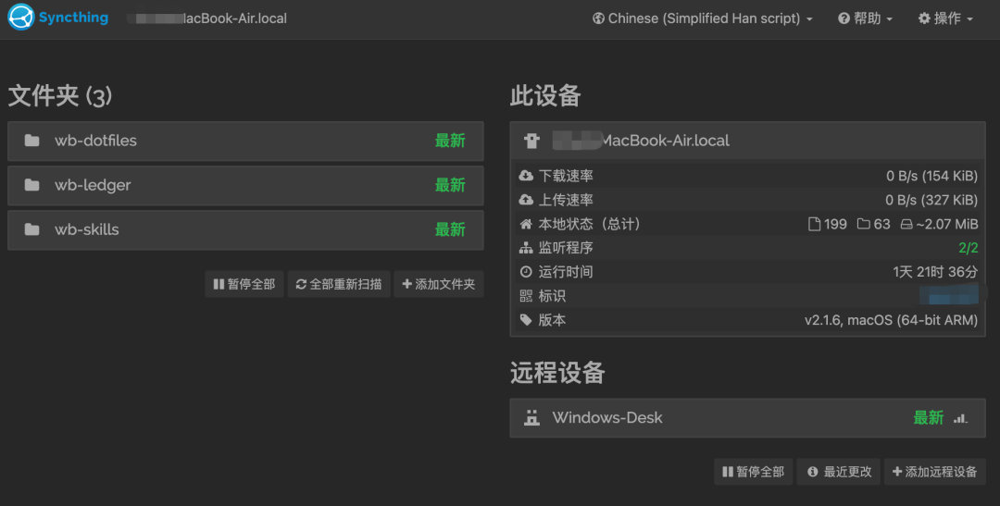

# 我把两台电脑的 Workbuddy 打通了
> 💡 备注属性未写入，可能是备注属性名称或者类型被修改了，建议将字段类型设置为 rich_text，可以在小程序-操作-修改文章数据库页面进行调整
> 💡 原文链接:[https://mp.weixin.qq.com/s?__biz=MzU3NzUxOTE4Mg==&mid=2247483720&idx=1&sn=94e038bdb403c8c11d934a962f447820&chksm=fc0fdbeed3d40a44889e98857fb157a769e9798f39b3c306ee75f6286cc8fcf0bc40bf66a17e#rd](https://mp.weixin.qq.com/s?__biz=MzU3NzUxOTE4Mg%3D%3D&mid=2247483720&idx=1&sn=94e038bdb403c8c11d934a962f447820&chksm=fc0fdbeed3d40a44889e98857fb157a769e9798f39b3c306ee75f6286cc8fcf0bc40bf66a17e#rd)
这次分享一个工作技巧实践，我有一台 Windows 台式机在家常开，平时娱乐为主，也跑一些 Workbuddy 定时任务；另一台 Mac 主要是去图书馆或出门的时候用，大部分的项目活都在它上面干。
因此我希望：晚上回家的时候如果想临时干个活，不用再掏出Mac，而是在台式机上切个窗口，就能接着之前在Mac上的历史接着干。但 Workbuddy 目前还没有类似功能，我花了两个晚上把同步机制建立了起来。
## 要同步的是什么
想清楚"接着干"到底缺什么：
**第一样是技能包**。 Workbuddy 在干活中会不断沉淀技能。但它们只存在本地磁盘上，两边各攒各的几个星期下来就完全分叉了，很可能同样是文件处理，两台电脑做出来的结果会有小差异。所以这是要同步的重点。
**第二样是工作进展和产物**。 我的习惯是在这台电脑上做完任务，下次换另一台电脑做下一个。任务的进展和最终结果得能接得上。我之前建过一套跨会话的任务账本，每天的摘要、产物路径、关键结论都会更新到进同一个文件，这套账本正好拿来当同步的基础。
**第三样是记忆**。 这里要说一下 WorkBuddy 的记忆是怎么存的，分三层：
第一层装的是长期偏好和背景，这个云上自动同步不用操心。
第二层是长期用户记忆，装的是工作习惯这类跨项目的东西，AI 每次开工都会读，只在本地换台电脑就没有，这一层是我需要重点同步的。
第三层是项目自己的记忆和过程细节，各项目工作区独立。但这一层我没打算同步，因为我两台电脑的项目区有些差异，整层同步过去要做规则合并和映射，麻烦死了。并且我一个任务不会在两个电脑间分开干，接续靠的是产物和账本，不是项目内部的细节状态和过程。所以这层同步就没啥必要。
所以最终要同步的就是三样：技能包、工作账本、第二层记忆。
额外说一下，如果你想要同一个任务 A 电脑干一半接着 B 电脑继续干，那就所有信息两边都要一致，得把第三层甚至整个工作区也同步起来。
## 最终的实现方式
我开始的想法是都统一放资料库里，哪台电脑要用就来取或更新。
但考虑了下，这几样文件放云端每次都得先查、拉下来、用完传回去，但技能、记忆这东西是会话发生时就加载，如果用 Agent 自行云同步就会变成它先不带新记忆的启动，然后在干活前再自己去云端下载-比对-更新，白白增加了三四步token消耗，并且便宜模型还经常会漏约束忘记这步。这类东西最好不是"要用时取得到"，是"打开就在"。
最终方案是用 Syncthing 加 Tailscale 走磁盘对磁盘同步，前者负责在两台电脑之间点对点对拷文件，不经过第三方服务器；后者负责组网，让两台机器不管在什么网络里都能互相找到，两个都免费。
至于工作产物的实时性要求没有那么高，就放在资料库，让 Agent 每次需要用到的时候再去读取或更新。
## 运行的效果
现在的效果是，两台电脑会在双方都在线的时候，实时检测比对上述技能、记忆、任务账本三个文件夹之间的差异并自动更新同步，遇到错误它不会自己猜着改，而是把出错的文件停下，存成单独的冲突文件标在管理页里等人裁决，我只需要偶尔瞄一眼状态页就够。或者有空了再花个功夫搭一个通知也行。

这样我打开 Workbuddy 继续对话可以接着上次的进度干，中间不需要任何手动"同步"。
如果你想用，可以把下面的话给AI
下面这段是我最后交给 AI 的提示词，踩过的两个坑也写在里面了。照着提可以和 AI 讨论起来明确自己的需求和方案。
//Prompt：
我有两台电脑，用同一个 Workbuddy 助手干活。它的技能包、跨项目的本地记忆（MEMORY.md）和我的工作账本都存在各自本机的用户目录下，换一台机器就是另一套环境。我想让这几样东西在两台机器之间实时同步，任何一台都能接着另一台的进度干活。要的是"打开就在"，不是"要用时再去云端取"。
方案上我倾向于 Syncthing（机器间点对点同步，文件不经过第三方服务器）加 Tailscale（组网，保证两台机器在任何网络下互相可达），你可以先评估这个组合，不合适再提别的。动手之前，先看一遍我两台机器的目录结构、现有的记忆和账本情况，梳理完来问我三个问题，等我逐个确认了再动手：一，我要是还没有跨会话的任务账本机制，要不要先建一个——它是跨机接续工作的基础；二，项目级的记忆和项目文件（第三层）要不要纳入同步——我的默认是不纳入，两台机器的项目区不完全重叠，整层同步会互相污染；三，同步目录怎么划分，以及两台机器各自的开机规律。
两个已知的坑：一，Syncthing 的忽略规则文件（.stignore）本身不会被同步，每台机器要各配一份；规则自上而下第一条命中生效，白名单要写在"全部忽略"那行之前。二，配置开机自启时，在你的终端环境里可能装不上，这一步要让我在自己的终端 App 里手动执行。最后给我一份自检脚本，自动核对两边的文件数和同步状态，报成功或失败，我要自己验证真的同步上了。
另外 Workbuddy 更新比较快，有可能官方后续会推出类似的同步能力，或者是有新的机制变化，在实施时建议让你的 Agent 进行查证复核。
关于我：
非计算机出身10年+的产品狗
AI时代的前朝余孽 ┐(´～｀)┌
下岗后探索个人项目再就业ing
希望这些分享能给你一点灵感或共鸣。我会一直写下去，欢迎关注。

## 摘要

（待补充）

## 我的笔记

（待补充）
