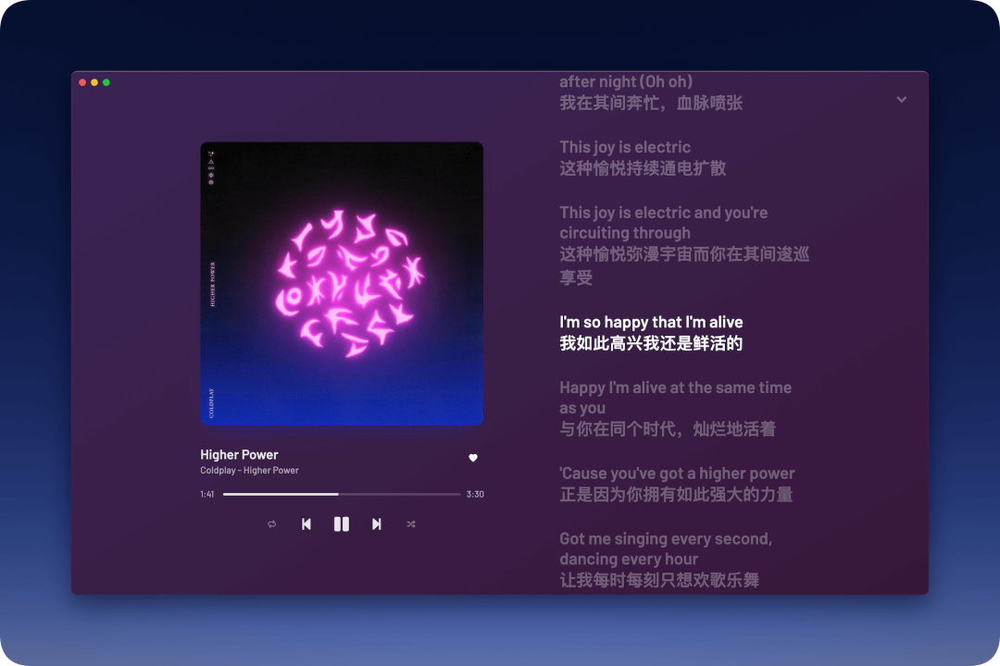
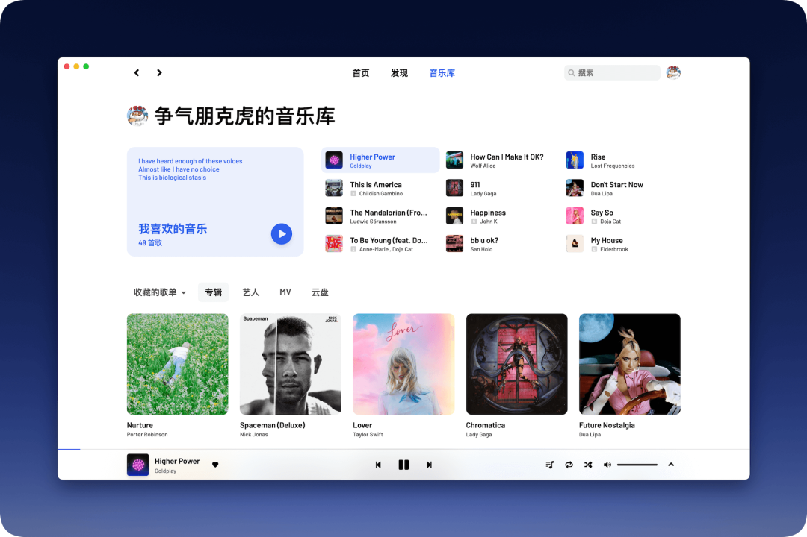

# 我把用了五年的网易云换掉了：这个 3.3 万人收藏的免费播放器，打开就是歌
> 💡 备注属性未写入，可能是备注属性名称或者类型被修改了，建议将字段类型设置为 rich_text，可以在小程序-操作-修改文章数据库页面进行调整
> 💡 原文链接:[https://mp.weixin.qq.com/s?__biz=MzY5MzI5OTk3Ng==&mid=2247484482&idx=1&sn=50be9ed59774e50db83f781ebe478982&chksm=f5a886530892341b2ce8a298cb31e03c6d531d83926e762d734cfbe62266112248decb303c84#rd](https://mp.weixin.qq.com/s?__biz=MzY5MzI5OTk3Ng%3D%3D&mid=2247484482&idx=1&sn=50be9ed59774e50db83f781ebe478982&chksm=f5a886530892341b2ce8a298cb31e03c6d531d83926e762d734cfbe62266112248decb303c84#rd)
**打开网易云音乐，一屏开屏广告扑面而来，想听的歌一半是灰的，点一下弹出开通会员。**GitHub 上一个被 33,443 人收藏的第三方网易云播放器，叫 YesPlayMusic：装上，登录自己的网易云账号，歌单、收藏、每日推荐全都在，界面干净得只剩音乐。
| ** ****壹 ** | ** ****简单介绍** |
YesPlayMusic，作者 qier222，是一个高颜值的第三方网易云播放器。GitHub 仓库 33,443 颗星、4,662 个 fork，MIT 协议开源，免费；最新版 0.4.11（2026 年 10 月 10 日发布），Windows、macOS、Linux 三端都有，浏览器里也能打开在线版 music.qier222.com 试听。
它干的事很专一：套在网易云账号外面的一层干净壳子。原来在网易云攒的歌单、收藏的专辑、每天听的私人 FM，登录后全都在；官方客户端里的广告、直播、短视频、社交动态，这个壳子里一样没有。

主界面（仓库自带截图）：打开就是推荐歌单和播放器，没有开屏广告，歌单封面排得干干净净。
| ** ****贰 ** | ** ****主要功能** |
**1. 登录账号，歌单全跟过来。** 支持扫码、手机号、邮箱三种方式登录网易云账号。登录之后，我喜欢的音乐、收藏的歌单、关注的歌手全在。
**2. 界面干净，没有广告和社交。** 首页只有推荐歌单和每日推荐，没有开屏广告、直播入口、动态和评论区。README 里写得很直白：无任何社交功能。
**3. 歌词、MV、私人 FM 都在。** 播放页有歌词显示，支持 MV 播放，私人 FM 和每日推荐歌曲也都保留。
**4. 变灰的歌有替换机制。** 软件自带 UnblockNeteaseMusic 支持，变灰的歌曲会换个音源接着播（网页版没有这项）。这只是播放器自带的功能，边界在注意事项里写清楚了。
**5. 细节不少。** 深色、浅色模式自动切换，支持音乐云盘、Last.fm 记录、自定义快捷键，海外登录账号也能直接播放。

播放页（仓库自带截图）：左边是专辑封面和进度条，右边是中英对照歌词，当前唱到哪句亮哪句。
| ** ****叁 ** | ** ****应用场景** |
- **每天通勤听歌的人**：打开就是歌单和播放器，不用划掉开屏广告，不用在直播入口里找播放键；
- **歌单攒了好几年的人**：换壳不换号，账号里的收藏全在，歌单不用重建；
- **家里电脑放音乐的人**：Windows、macOS、Linux 都有客户端，浏览器打开在线版也能听；
- **喜欢边听边看歌词的人**：播放页歌词跟着进度走，英文歌还有中文对照。

音乐库（仓库自带截图）：我喜欢的音乐、收藏的歌单、专辑、艺人、MV、云盘都在这一页，登录账号后自动同步。
| ** ****肆 ** | ** ****使用说明** |
下载安装，三种方式任选一种：
|  Windows / macOS / Linux：去 GitHub Releases 页下载对应系统的安装包macOS：brew install --cask yesplaymusicWindows：scoop install extras/yesplaymusic |
装好之后，用起来就三步：
1. 打开 YesPlayMusic，点右上角头像登录网易云账号，扫码、手机号、邮箱都行；
2. 登录后首页就有每日推荐和推荐歌单，右上角搜歌名、歌手；
3. 点歌名直接播放，喜欢的歌点一下爱心，收到"我喜欢的音乐"里。
不想装软件的，浏览器打开 music.qier222.com 就能听，Chrome、Edge 地址栏右边点加号还能装成 PWA。
| ** ****伍 ** | ** ****注意事项** |
**版权有边界，别当成"所有歌免费"。** 它是一个播放器壳子，不产音乐。部分歌曲受版权限制，变灰的歌换了音源也可能播不了，以实际体验为准；遇到要充会员才能听的歌，该开会员还是开。
**登录用自己的官方账号，注意账号安全。** 扫码登录和官方客户端登录是一回事，密码不要告诉别人，公共电脑用完记得退出。
**认准官方发布页，别下改版。** 安装包只从 GitHub Releases 页下，搜到的来路不明的"破解版""去广告版"不要碰。项目 README 也写明了：仅供个人学习研究使用，禁止用于商业及非法用途。
**老版本进入维护模式。** README 写明：当前版本进入维护模式，除重大 bug 修复外不再加新功能；全新的 2.0 Alpha 测试版已经发布，日常用装 0.4.11 稳定版，想尝鲜再下测试版。
| ** ****陆 ** | ** ****个人感觉** |
每天听歌超过一小时、歌单全在网易云、又烦透了开屏广告和臃肿界面的人，这个壳子值得装一个：免费、开源、登录后东西全在，打开就是听歌。
也有不适合的人：曲库严重依赖某一家独家版权、又不想折腾的，主流 App 的会员该开还是开。它省掉的是广告和臃肿，变不出来版权内容。
项目地址：https://github.com/qier222/YesPlayMusic
资料来源：项目仓库 README 与仓库页面（star 数、fork 数、许可证、最新版本、安装方式、功能特性均截至 2026-10-25 抓取核实）；在线版 music.qier222.com。

