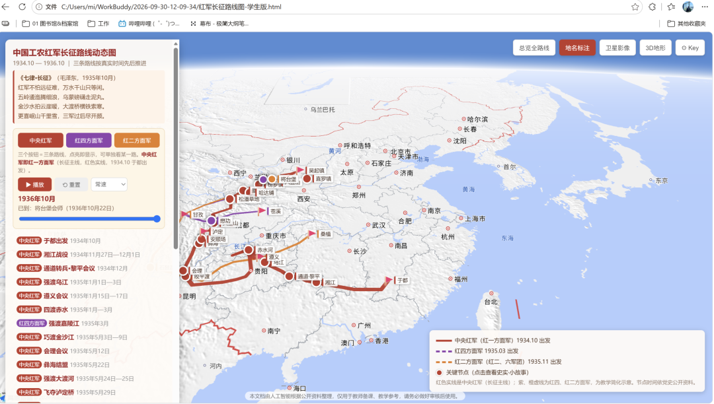
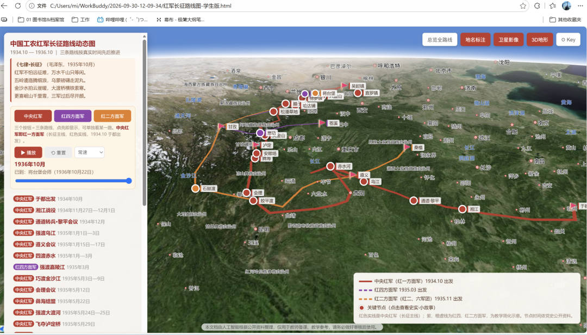

# 我把课本上那张静态长征图，做成了一张“会走”的 3D 地图
> 💡 备注属性未写入，可能是备注属性名称或者类型被修改了，建议将字段类型设置为 rich_text，可以在小程序-操作-修改文章数据库页面进行调整
> 💡 原文链接:[https://mp.weixin.qq.com/s?__biz=MzUyMjgxMjQwMw==&mid=2247483960&idx=1&sn=653c06e28838c6f8a6cbce9d6a0b0b3e&chksm=f8606168cca284b3441ed14ef91b002aef07f18357163a386037421b0001a4a75024600f82a0#rd](https://mp.weixin.qq.com/s?__biz=MzUyMjgxMjQwMw%3D%3D&mid=2247483960&idx=1&sn=653c06e28838c6f8a6cbce9d6a0b0b3e&chksm=f8606168cca284b3441ed14ef91b002aef07f18357163a386037421b0001a4a75024600f82a0#rd)
导语：长征一课，学生最怕的不是背事件，而是“记不住地点、分不清先后、搞不清哪支队伍走到哪”。今年9月，我用 AI 把教材上那张静态的长征路线图，改造成了一张能看三维地形、能按时间“走”起来、能点开每个节点看史实的交互式地图。这篇短文记录三件事：为什么做、难在哪、还可以怎么改。

推荐大家电脑打开查看
### 一、背景：难点不在知识点，在“关系”
《义务教育历史课程标准（2022 年版）》把“时空观念”列为历史学科核心素养之一，要求学生能在具体的时空条件下考察历史事物；“红军长征”这一内容还承担着“家国情怀”的育人任务。
但真正教过这一课的老师都知道：长征的难点从来不是单个知识点。**遵义会议是转折点、飞夺泸定桥很英勇，这些学生记得住；难的是“关系”**——26 个关键节点之间的先后关系、三支红军之间的并行关系、路线与地形之间的关系。
教材上的长征路线图恰好在这一点上“沉默”：它是静态的，一张图里同时压着三支红军、纵横十余省、两万五千里的行程，信息高度压缩。**学生能“看到”，却很难建立“时间在推移、空间在变换”的完整图景。**
这就是项目要解决的现实困境。具体表现为四类反复出现的错误：
· **顺序错乱**——把“四渡赤水”“巧渡金沙江”“强渡大渡河”“飞夺泸定桥”随意排序，不知道“金沙江—大渡河—泸定桥”是一条线上一件接一件的事；
· **部队混淆**——以为三支红军同时出发、同时到达，甚至把“会宁会师”和“吴起镇会师”混为一谈；
· **空间无感**——不知道金沙江在哪里、腊子口为什么叫“天险”、松潘草地究竟意味着什么，地图上的一个点，学生的心理距离是零；
· **情感单薄**——讲“半条被子”“金色的鱼钩”“丰碑”，只有文字，学生进不去情境。
我也找过现成资源，都不够用：课本插图信息密度大但不能缩放、无法筛选；网络上的长征地图多是图片，看不清细节，更不能点击；纪录片和动画视频是线性播放的，学生只能“顺着看一遍”，没法停下来查“这里发生了什么”。
**我需要的，是一个可以停下来、指过去、点开来的东西。**

成果截图1
### 二、做法：不写代码的老师，怎么把它做出来
先说明一点：**我不是程序员，全程没有手写代码。**我做的是“把教学需求说清楚、把生成结果审准确”。
#### 第一步，先把“要什么”写清楚
动手前我定了三条标准，避免做出一张花哨却不实用的图：一是**能看空间**（要有三维地形和俯仰视角，能看出横断山脉和大渡河的“险”）；二是**能看时间**（路线不是一次画完，而是随时间推移生长）；三是**能查到史实**（每个节点点开就有时间、史实和故事）。
#### 第二步，把需求翻译成AI 听得懂的指令
这三条标准被写成一串具体要求：用高德地图库、覆盖 1934—1936 年、三支红军路线分开、节点史实来源权威、附适合初中生的小故事、给出可直接运行的完整代码。说得越具体，成品越可用——这一点在每一次迭代中都被反复验证。
#### 第三步，四轮迭代，把“能用”打磨成“好讲”
· **第一轮：路线画出来了，但只剩一张空地图。**内容是串在一条链上的，地图建成后任何一步出错，路线、节点、史实列表就全都不出现。改成每一步单独容错，史实列表最先独立生成——**地图即便挂了，史实照样能讲**。
· **第二轮：从静态路线到动态时间轴。**给每个折点、每个节点标上月份，用一个“时间游标”从 1934 年 10 月走向 1936 年 10 月，路线随游标生长、节点按月点亮。三支红军的出发时间差第一次在图上“演”了出来：中央红军 1934 年 10 月于都出发，红四方面军 1935 年 3 月强渡嘉陵江，红二方面军 1935 年 11 月才从湖南桑植出发。
· **第三轮：细节打磨。**把“红一方面军”改标为**“中央红军（红一方面军）”**；给 26 个节点全部加上地名标注，并做成一键开关。
· **第四轮：3D 地形“点不开”，一次完整的排障。**上课前试用时发现：“卫星影像”能看，点“3D地形”却毫无变化。真正原因是原代码用了 AMap.TileLayer.Terrain——这是高德 1.x 的类，**2.0 内核已移除**，那行代码必然报错，又被容错逻辑悄悄吞掉，看起来就像“功能没做”。正确做法是换 v2.1Beta 内核，并在初始化时传 terrain 参数，同时保留“自动退回稳定版 2.0”的机制。
第四轮的收获最大：**向AI 报问题，要报“现象 + 位置”，不要报“结论”。**我只说“3D 看不了”，它只能猜；当我把“点的是哪个按钮、屏幕上出现什么文字、左下角状态栏显示什么”一起交出去，问题一次就定位了。
**最后一步，也是最重要的一步：史料必须由教师亲自把关。**AI 生成的史实必须逐条核对，尤其是时间与数字。我对照统编教材和权威党史资料，逐项确认了湘江战役后中央红军由 8.6 万余人锐减到 3 万余人、遵义会议的历史定位、巧渡金沙江靠 7 只小船 7 天 7 夜、飞夺泸定桥 22 位勇士攀 13 根铁索、1936 年 10 月 9 日会宁会师与 10 月 22 日将台堡会师等。页面图例中也写明：**二、四方面军路线为教学简化示意线，节点经纬度为教学示意坐标，不作测绘用途**——这既是对学生的诚实，也是对学科的尊重。

成果截图2
### 三、可改进之处：四件我想继续做的事
这次经历也把一个道理讲得很清楚：**AI 能做出漂亮的页面，但它不知道这一课的难点在哪里，也不知道哪一句表述必须先经教材核对。**需求由教学经验定义，内容由教师专业把关，这两件事 AI 替不了。
具体到这张地图，还有四处明显不足：
1. **路线仍是示意线，精度不够。**目前三条路线是教学示意，想把中央红军加密到县级，并把“四渡赤水”的四次折返画得更清楚——现在这一点仍然是图上一个点，学生看不出“四渡”到底怎么渡。
2. **学生只能“看图”，不能“用图”。**下一步想加一个学生标注功能：让学生自己拖动节点、复原路线顺序，把“看图”变成“用图”，让地图变成可操作的练习。
3. **缺少教师讲解的节奏控制。**想加一个“逐节点暂停”模式，每停一次讲一个事件，便于教师掌握课堂节奏，而不是让动画自己跑完。
4. **“艰难”还缺少数字支撑。**想在关键节点上标出兵力变化（如 8.6 万降到 3 万），让“牺牲”和“艰难”有具体数字撑着，比反复强调“长征很艰苦”更有效。
### 四、可复制的AI 提示模板
这套方法迁移性很强，只要把提示词里的“主题 + 时间段 + 关键节点”换掉，就能用于丝绸之路、京杭大运河、郑和下西洋、新航路开辟等课题。下面四段可直接复制使用。
#### 模板一· 生成原型（首次使用）
| **复制以下全部内容，把【】内的部分换成你的课题** |
| 你是一名优秀的前端工程师兼教学资源开发者。请制作一个交互式地图html 网页，要求如下：1. 使用高德地图 JS API；注意 3D 地形需要 v2.1Beta 内核，并在初始化地图时传 terrain: true （不要用已废弃的AMap.TileLayer.Terrain，这个类在 2.0 内核里不存在）；2. 主题：【填写主题，如：中国工农红军长征路线图 1934—1936】；3. 呈现【填写时间段】的路线，优先考虑 3D 地形与俯仰视角，并保证内核取不到时能自动退回稳定版；4. 体现关键节点、关键城市与相关史实，史实来源要权威（以统编教材和权威公开资料为准）；5. 如果有适合【填写学段，如：初中生】的小故事，请一并放进去；6. 提供完整的、可直接运行的代码，并添加详细的中文注释；7. 页面要能在本地双击直接打开使用，不要依赖额外的服务器。 |
#### 模板二· 把静态图改成动态时间轴
| **让路线按时间****“ 生长 ” 起来** |
| 请把路线图改成动态的：给每条路线的每个折点、每个史实节点都标上月份，用一个“时间游标”驱动整张地图——路线随时间生长，节点按各自发生的月份逐个点亮。要求：① 不同的部队分别用不同颜色和线型，可以单独显示某一路，也可以全部显示；② 要有播放、暂停、重置按钮和可拖动的时间进度条，进度条能拖到任意时间点看当时的态势；③ 控制区实时显示“当前时间 + 最近经过的事件”；④ 时间往回拖时，已经点亮的节点要收回，保证画面和时间始终一致。 |
#### 模板三· 加注地名与细节打磨
| **让图上每个节点都能被叫出名字** |
| 请给地图上每个关键节点都加上地名标注，要求：① 标签显示地点名称，贴在节点旁边，不要遮住节点图标；② 标签颜色与该节点所属部队的颜色一致；③ 标签随动画同步出现和消失；④ 右上角增加一个“地名标注”开关按钮，标签太多时可以一键收起；⑤ 鼠标悬停在标签上时显示节点的完整名称。 |
#### 模板四· 出问题时的排障提示词（最有用的一条）
| **贴出这三样，****AI **** ****才能定位而不是猜** |
| 我打开页面后出现了下面的情况，请你判断原因并给出完整修改后的代码：【① 把页面上显示的文字或报错原文粘贴到这里】【② 把页面左下角“运行状态”里显示的内容粘贴到这里（如：✗ 路线绘制失败：…）】【③ 说明你的操作环境（浏览器、是否双击本地打开、Key 是否填写正确）】要求：修改后要确保即使某一步失败，其他内容仍能正常显示。 |
**两点使用建议：**一是要求 AI 在页面上做一个“运行状态”面板，把每一步的执行结果显示出来——排障时它比任何描述都有用；二是**不要让AI 直接决定史实**，让它出代码、你出内容，涉及党史的表述一律以权威公开资料为准。
本文所述史实依据统编教材与党史公开资料整理，地图中二、四方面军路线为教学简化示意，节点坐标为教学示意坐标，仅供教学参考，不作测绘用途。

