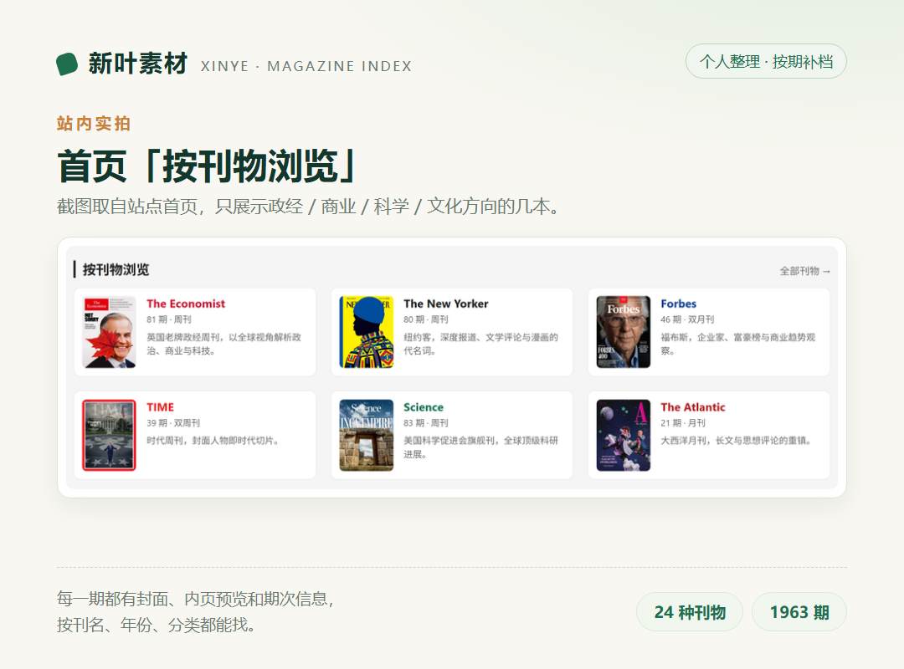

# 我把近 2000 期英文杂志，整理成了一座能检索的小站
> 💡 备注属性未写入，可能是备注属性名称或者类型被修改了，建议将字段类型设置为 rich_text，可以在小程序-操作-修改文章数据库页面进行调整
> 💡 原文链接:[https://mp.weixin.qq.com/s?__biz=MzIxNDg2NjExOA==&mid=2247487023&idx=1&sn=c2c12428c53e8af30dfa90281f328280&chksm=962ca2ce4c87bffaf4deb91e4a4b280e77a0dd4eed00363c9d854033205240427a553c752ecf#rd](https://mp.weixin.qq.com/s?__biz=MzIxNDg2NjExOA%3D%3D&mid=2247487023&idx=1&sn=c2c12428c53e8af30dfa90281f328280&chksm=962ca2ce4c87bffaf4deb91e4a4b280e77a0dd4eed00363c9d854033205240427a553c752ecf#rd)
**想找某一期外刊的时候，你大概也遇到过这种场面：**
链接散在各个地方，文件名是一串看不懂的字母和数字；好不容易点开，发现不是自己要的那本；想按年份往前翻一翻，又得从头找起。
**其实难的从来不是「找不到」，而是「找得乱」。**
这大半年，我做了一件有点笨的事：把散着的英文原版杂志，一期期整理成一个能检索的小网站。它叫**「新叶素材」**。
**一、从一张表开始**
最早只是自己想找某一期，翻了半小时没找到，干脆建了张表，把刊名、年份、期号记下来。后来越记越多，表格不好用了，索性做成网页。
现在站里是 **24 种刊物、1963 期**，年份从 **2017 到 2026**。经济学人、纽约客、福布斯、时代、科学、大西洋月刊、卫报周刊、读者文摘……以周刊和月刊为主，大致分政经、商业、科学、文化几个方向。
**二、最费时间的，其实是起名**
这件事听起来像体力活，真正卡住我的却是一件小事：怎么给每一期起一个以后还能搜到的名字。
同一个月可能出好几个版本；不同地区的同名刊物，期号各算各的；特刊没有月份，只有一个名字；老文件的命名里混着不同语言和拼写，偶尔还有手误。改后缀、猜月份，试过几轮都不牢靠，最后只能按目录和文件名一条条对回去，再给同月多期加一个能区分开的标记。
这段做完之后，后面反而顺了：名字定下来，归档、搜索、按年份翻，才都有了着落。
**三、每一期，当成一条记录来整理**
封面，加四张内页预览。先翻两眼，再决定要不要往下读。
期号、页数、文件大小这些基本信息，一并放在详情页。
预览图是从 PDF 按页面显示尺寸导出的低分辨率试读图，只为认刊和试读，不是印刷级画质。

站内的「按刊物浏览」页面（局部）
**四、三种找法**
按刊物、年份、分类一层层翻；记得刊名或期号，直接搜；想看看别人最近在读什么，还有 7 天和 30 天的热榜。
手机上看也没问题，页面是自适应的。有新刊就补，缺期或者哪里看着不对，也可以反馈，看到会补上。
**五、一点说明**
站内预览仅用于介绍与试读，不替代原刊。杂志版权归原出版方所有，建议通过正规渠道订阅支持出版方；若权利人认为某处内容不妥，联系后会立即删除。
如果你在备考、做外刊精读、写东西要找资料，或者单纯喜欢把东西整理得整整齐齐，大概会用得上。
想看看它长什么样，文末**「阅读原文」**可以直接打开。
网址也放一份，微信里若打不开，复制到浏览器就行：
snail535.github.io
如果你也有一直想找、却总也找不齐的某本刊物，留言告诉我刊名，我看看能不能补上。
