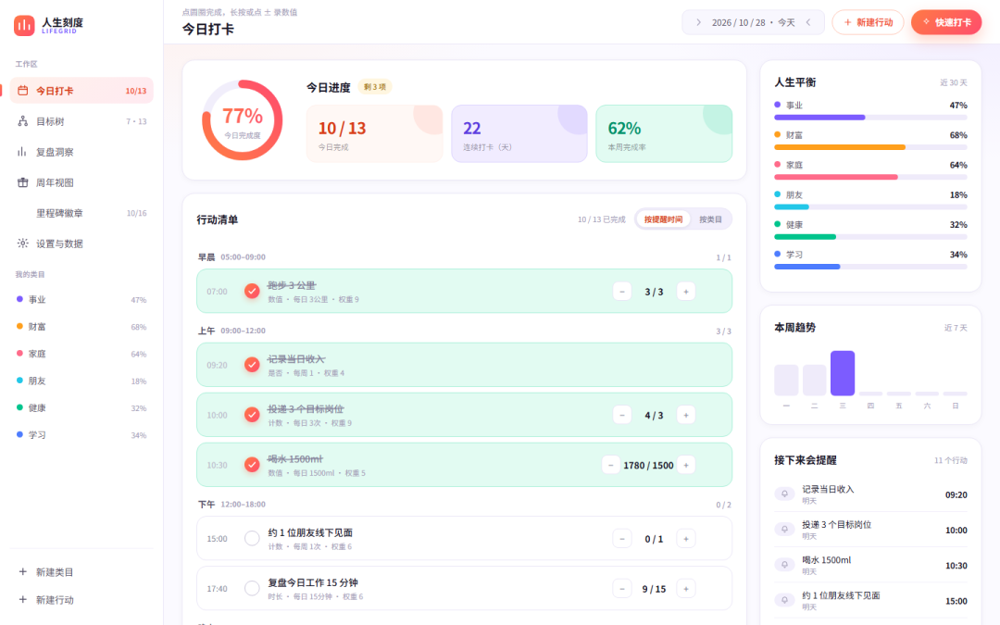
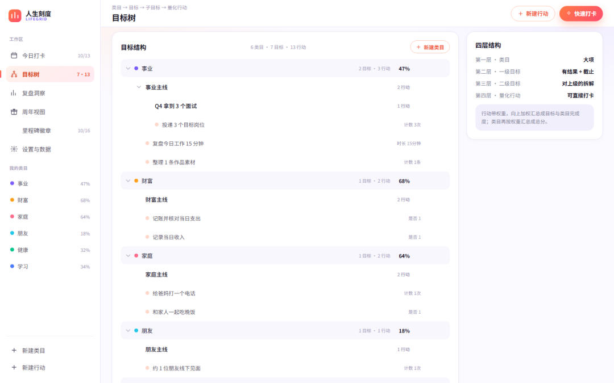
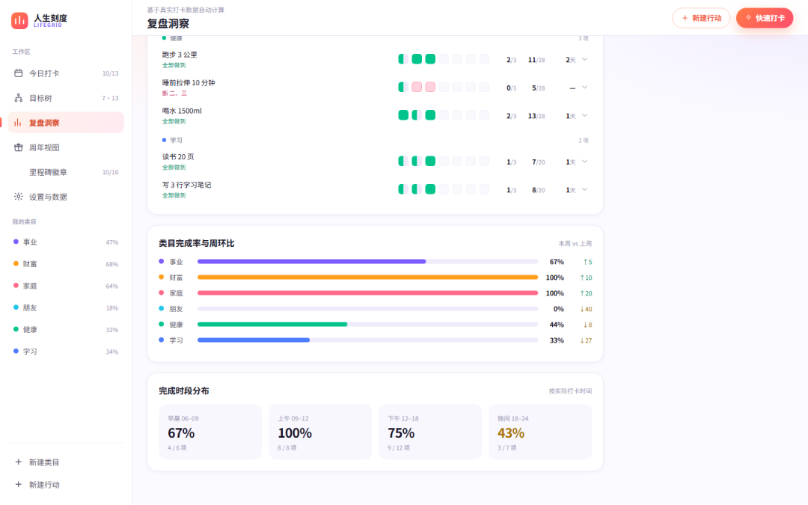
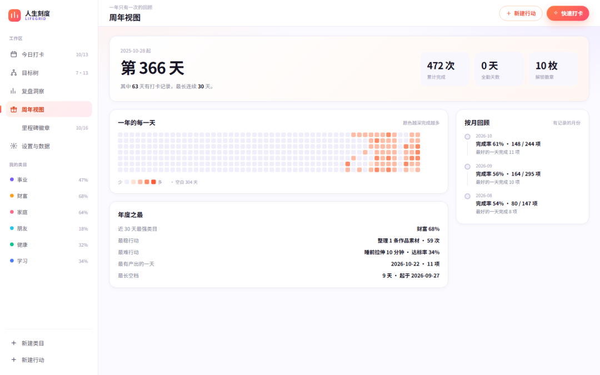
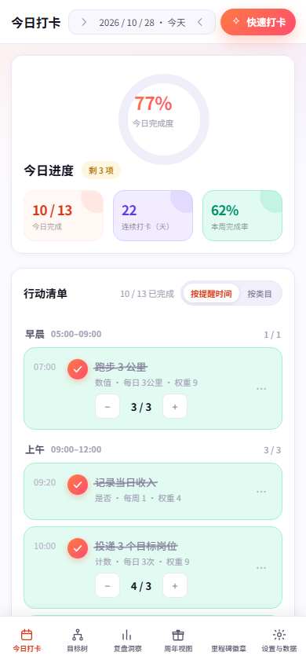

# 我用 15 天做了个把年度目标拆成「今天干什么」的工具
> 💡 备注属性未写入，可能是备注属性名称或者类型被修改了，建议将字段类型设置为 rich_text，可以在小程序-操作-修改文章数据库页面进行调整
> 💡 原文链接:[https://mp.weixin.qq.com/s?__biz=MzY5ODM4NzU2Mw==&mid=2247483934&idx=1&sn=0198d6b1a108ecace6348e1daf26af36&chksm=f588cd3de9c3b12425c89106ef931efff06c6e06716af37ef71a5d40734d16d3ce45faaf870e#rd](https://mp.weixin.qq.com/s?__biz=MzY5ODM4NzU2Mw%3D%3D&mid=2247483934&idx=1&sn=0198d6b1a108ecace6348e1daf26af36&chksm=f588cd3de9c3b12425c89106ef931efff06c6e06716af37ef71a5d40734d16d3ce45faaf870e#rd)
每年年初我都会写几条：多读书、多陪家人、存点钱。
到年底翻出来看，一条都没兑现。
以前我以为是执行力的问题。后来发现不是——那几条根本就不是计划，是许愿。
**「多读书」是个形容词。**它没告诉我今天读哪本、读多久、读到什么程度算完成。
所以我花了 15 天，做了个东西解决这个问题。它叫「人生刻度 LifeGrid」，一个网页应用——https://workbuddy.link/p/s3OUMTedjUdDBweLgTx6Ri——打开就能用。

每天只面对这一张清单：早晨做什么、上午做什么、晚上做什么，按时间顺序排好。
### 一、把目标拆到「今天做什么」为止
结构只有四层，每一层都要能数得清：
- 类目：事业 / 财富 / 家庭 / 朋友 / 健康 / 学习，名字和颜色都能改
- 目标：每个类目能拆两级（主线 → 子目标），带目标值和截止日
- 行动：挂在子目标下，必须能数得清
- 打卡：每天点一下，忘了哪天都能补
关键在第三层。每个行动都必须落到四种计法之一：
- 按份数——投 3 份简历
- 按分钟——读 30 分钟
- 按金额——存 500 元
- 按是否——给爸妈打电话
> 写完一个行动，如果你说不出它属于这四种里的哪一种，那它就还是一句许愿。
> 

从「事业」一路拆到「投递 3 个岗位」，四层全展开。
### 二、周期算得准，才谈得上坚持
我用过不少打卡工具，最劝退的一点是周期太假：
设「每周三次」，它给我排满周一到周五。结果一周五天全红，看着就想删 App。
所以这里的规则是：**每周就只排你勾的那天**（比如只周一），每月就只排你填的那号，还能划掉例外日期。
更重要的是，完成率的分母只算「该做的日子」——还没到的日子不算你没完成。这是数字可信的前提。
### 三、提醒落在它该发生的时刻
写一个行动名，它会自动落到一天里最自然的时刻：
> 💡 晨跑 07:00 · 投简历 10:00 · 喝水 10:30 · 约朋友 15:00 · 下班复盘 17:40 · 和爸妈打电话 20:00 · 读书 21:10 · 记账 21:30 · 睡前拉伸 22:40

同一时刻最多排两件，排满了自动往后挪 10 分钟。
调时间不是下拉框，是一只竖着的拨盘：拖一格走一格、松手会吸附；滚轮一格一格走；想快就直接点数字——点「08」就跳到 8 点。

提醒时间是一只竖着的拨盘，拖一格走一格，也可以直接点数字跳转。
### 四、复盘是算出来的，不是让你写的
大部分工具都让你写周记。我从来写不下去。
所以这里的复盘是自动的。第一眼就是一句结论加三条建议：
> 本周完成 25/39，完成率 64%，较上周持平。
> 
> 学习类目拖后腿，目标定重了，把最低那条砍一半。
> 
> 把晚间行动前移到 19:30。
> 
四个关键数字压成顶部一条细带，版面全留给真正要读的东西。

复盘第一眼就是一句结论加三条建议，不用你写一个字。

类目周环比 + 完成时段分布：哪个类目拖后腿、什么时候最容易完成，它替你算。
### 五、具体到哪天断了
每个行动拆成一周 7 格：**做了 / 做一半 / 没做 / 不要求**，四种颜色区分。
点开是整月日历，几号做了、几号空着，一目了然。
再按星期几统计一次，它会直接告诉你：**「本月周三最容易断。」**

每个行动一周 7 格，点开是整月日历，还能算出「周三最容易断」。
### 六、还得有点情绪价值
16 枚里程碑徽章自动解锁，**断档不收回**；断档之后再连上 7 天，补发一枚「逆袭者」。
打勾不是立刻划掉，会有一笔手写的笔划扫过文字。
而我做这个东西真正想要的画面，是年底那张 366 天的热力图。

第 366 天、473 次打卡、最长连续 30 天——一年的深浅都在这一张里。

16 枚里程碑徽章，断档不收回，再连上 7 天补发一枚「逆袭者」。
### 七、手机上也能用
窄屏不挤压、不横向滚动，两秒打完一次卡，底部导航常驻。

390px 宽的手机视口：不挤压、不横向滚动，两秒打完一次卡。
### 关于技术与隐私
零依赖原生 JavaScript，**没有框架、没有构建、没有后端**。
数据存在浏览器本地，还做了四级降级容错，断网照样用，支持导出 JSON 备份。另有一份单文件版，双击就开，拷到 U 盘就能带走。
不注册、不联网、不上传任何数据——**你的人生目标不该躺在别人的服务器上。**
### 怎么体验
复制下面这个链接到浏览器打开，不用注册、不用下载：
https://workbuddy.link/p/s3OUMTedjUdDBweLgTx6Ri
进来是一段 90 天的示例轨迹：清单、拨盘、复盘、徽章都能直接点。想记自己的，点顶部「清空，开始记我自己的」。
> 如果前面几次你都没坚持下来，它有内置的「精简三件事」模板：三个类目，各一个行动。先活过一周再说。
> 
**#WorkBuddy#1024程序员节**
