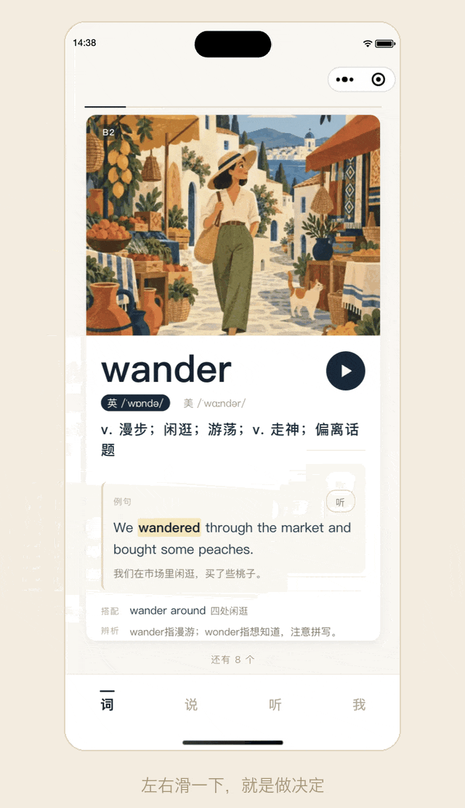
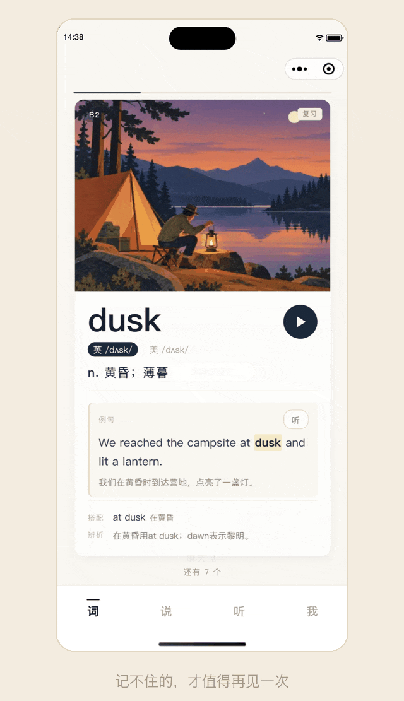
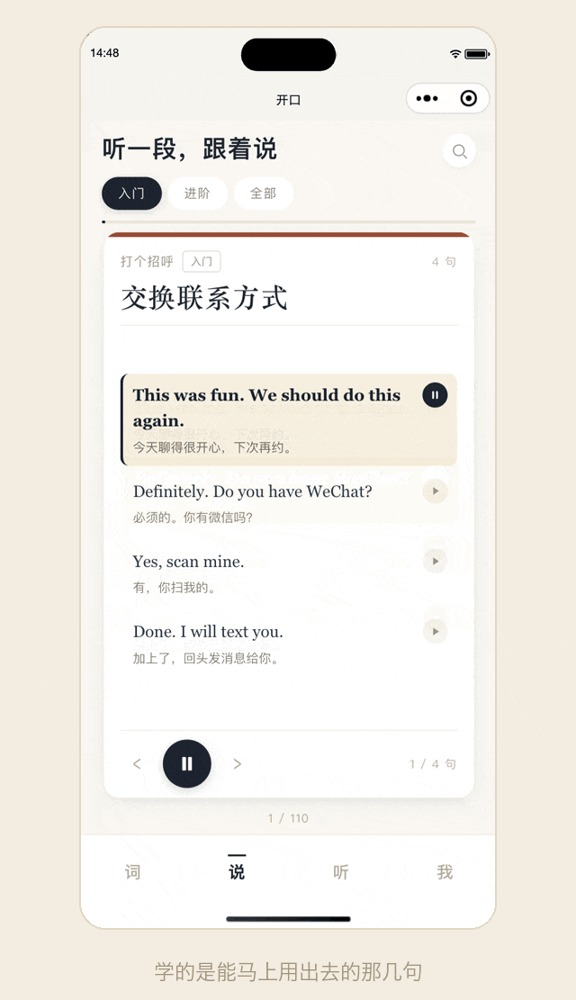
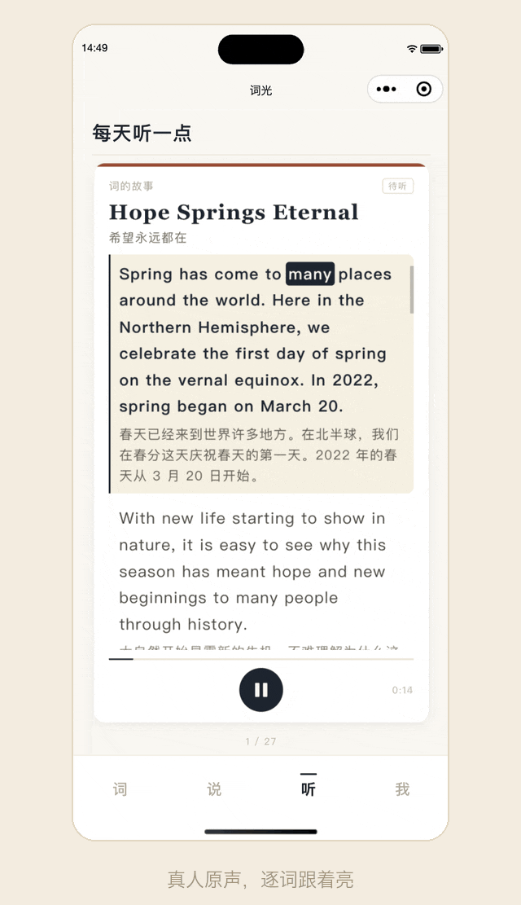
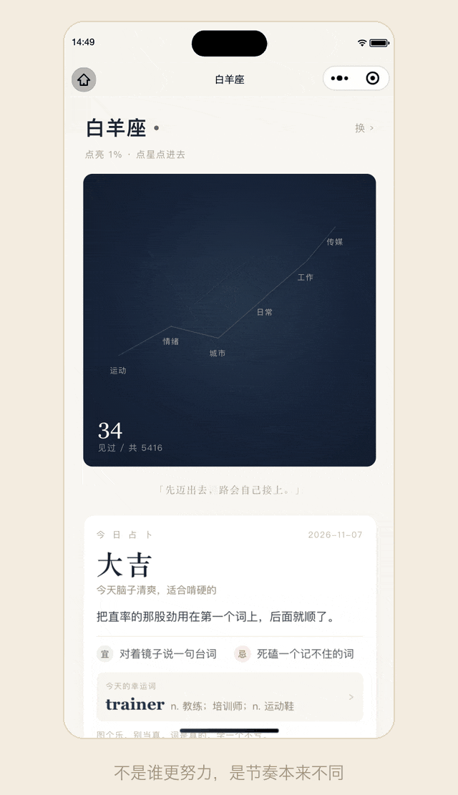

# 我用 AI 做了个背单词小程序「词光Light」
> 💡 备注属性未写入，可能是备注属性名称或者类型被修改了，建议将字段类型设置为 rich_text，可以在小程序-操作-修改文章数据库页面进行调整
> 💡 原文链接:[https://mp.weixin.qq.com/s?__biz=MzcxMDUwMzAyNg==&mid=2247483853&idx=1&sn=f3cf07bdb20260a7324e54036daae08b&chksm=f415bff0f881a9c495893d928a537466f7804769ec7c094d000c3363123eaac23a316694792b#rd](https://mp.weixin.qq.com/s?__biz=MzcxMDUwMzAyNg%3D%3D&mid=2247483853&idx=1&sn=f3cf07bdb20260a7324e54036daae08b&chksm=f415bff0f881a9c495893d928a537466f7804769ec7c094d000c3363123eaac23a316694792b#rd)
WORDLIGHT
**我用 AI 做了个背单词小程序，
现在每天只想多滑两张卡**
词光Light · 一个关于「懒」的产品实验
等咖啡的两分钟，地铁上的一站路，手总会先摸向手机。
刷短视频，两分钟后是快乐，也是空的。背单词呢——打开 App、选词书、定计划、看见「第 3 天 / 21 天」……还没开始，就已经被「开始」劝退了。
所以我做了**词光Light**。它把背单词收成一个动作：**滑一下**。

— 左右滑一下，就是一次判断 —
01**先说初衷：我只是懒**
我不是没努力过。买过课，下过三个背单词 App，抄完过一整本单词本。无一例外，全停在第二周。
后来想明白了：**坚持不下去，多半不是毅力问题，是「开始学习」这个动作太重。**
词光所有设计都围绕这一句：把「学英语」降级成「滑两下」。
1打开就是今天的卡，不用选词书、不用定计划、不用打卡
2一屏一张卡，左滑「面生」，右滑「认得」，一个词一次判断
3音标、例句、发音都在卡上，翻到就自动念——手停着，耳朵也在学
你甚至不必决定「今天学不学」。想到了，滑两个词；滑着滑着，一分钟过去，八九个词进了脑子。
像刷短视频一样顺手，但滑完，是真的留下点东西。
把「开始学习」这件事，
做得比打开手机还轻。
02**滑走的词，会自己回来**
懒人学法的第二个前提：**复习不能靠自觉。**
词光按遗忘曲线安排重逢——滑过的词，会在第 1、2、4、7、15 天重新混进卡堆。记牢的拉长见面间隔，没记牢的第二天就回来，卡上还带一枚「复习」角标。
不用建计划，不用算日子。你只管滑，重复这件事交给它。

— 记不住的，才值得再见一次 —
03**说：先学会能马上用出去的那几句**
认识词，不等于开得了口。
小程序里放了两百多段**日常对话**：点咖啡、问路、结账、看医生、第一次见面破冰。每段自动逐句播放，跟着听、跟着念，划一下进下一段。
都是生活里真会发生的话。学完这些，点单、问路、聊两句天气，不至于卡在嘴边。

— 学的是能马上用出去的那几句 —
04**听：每天一篇，把耳朵泡熟**
还内置了 **VOA 慢速英语**，22 篇，真人原声，一天一篇。
最趁手的是逐词高亮：读到哪个词，哪个词就亮起来，点任意词能单独听发音。不必一句句暂停查词，跟着读几遍，语感自己就长出来了。
对懒人来说，这是「挂着耳机就算学习」的合法形态。

— 真人原声，逐词跟着亮 —
05**星座：学几个、学什么，都替你想好了**
这是我最偏爱的一点小心思：**十二星座，十二种学习节奏。**
白羊座行动派，一天十五六个新词，快问快答，靠见面次数取胜；金牛座慢一点，一天七八个，多拼两遍，宁可少也要记牢。词量、难度、练法，全跟着星座走。
后来我又加了一层更没道理的东西：**每天的运势。**
每个星座每天摇一卦——大吉、吉、平、缓、养。抽到大吉，那天多给几张卡；抽到「养」，就少几张，翻两眼收工。所以白羊今天可能是十八个，明天十一个；金牛今天六个，明天十个。计划不用你定，日子替你安排。
同一天、同一个星座，永远是同一卦；换个星座，卦就变了。没联网，纯本地算，就图个乐。卡堆下面会有一行小字，写着今天是哪一卦、为什么是这么多个——省得你以为是程序出了 bug。
更隐蔽的是，**连学哪些词都不同**。每个星座有一组「本命话题」：白羊的卡堆里，运动、城市、情绪的词反复出现；金牛则更多是日常、自然、艺术。不是你去找词，是适合你的词，顺着性格来找你。
当然，这不是心理学。它只是把「每天学多少、先学什么」这种没人愿意做的设置，变成一次轻松的身份选择——选完，就不用再想了。

— 不是谁更努力，是节奏本来不同 —
06**AI 是合伙人，不是作者**
整个小程序我一个人做，AI 是唯一的合伙人。
脏活累活都归它：写界面、清洗五千多个词条的数据、把两百多段对话和 22 篇 VOA 的原文与音频对齐、画图标、陪我把交互改了几十版。一个人做不完的工程量，这次真的做完了。
但「做什么、长什么样、哪些东西坚决不做」，还是得人拿主意。**AI 负责把想法变成产品，我负责让它值得被做出来。**
THE END
**最后**
词光Light 即将上线
| 5416常用词 · A1–B2 | 200+段日常对话 | 22篇 VOA 原声 |
不登录也能用，没有广告，一个网络请求都不发。
学习记录只存在你自己的手机里。
想换手机、想跟人比比，再登微信。登录之后进度会同步，也能看到自己排第几——这榜单没什么压力，滑多少算多少。
微信搜索「**词光Light**」，或者扫码：

— 微信扫码 · 今天先滑 8 个词 —
今天，先滑 8 个词试试。
one word a day, lit.
designed by skylake
