# 我用 WorkBuddy 做了一个错题学习工作台，免费分享给你
> 💡 备注属性未写入，可能是备注属性名称或者类型被修改了，建议将字段类型设置为 rich_text，可以在小程序-操作-修改文章数据库页面进行调整
> 💡 原文链接:[https://mp.weixin.qq.com/s?__biz=Mzk0MTYyMTI3OQ==&mid=2247486122&idx=1&sn=8965dea9a1be18325c5f05d25556a3e4&chksm=c3f8143357d1d72c21df81a708ad6bb7f6068f72d578f2c28a0094dcd31ff819baf186550730#rd](https://mp.weixin.qq.com/s?__biz=Mzk0MTYyMTI3OQ%3D%3D&mid=2247486122&idx=1&sn=8965dea9a1be18325c5f05d25556a3e4&chksm=c3f8143357d1d72c21df81a708ad6bb7f6068f72d578f2c28a0094dcd31ff819baf186550730#rd)
Hi，我是小宇
我做了一个本地错题学习工作台，叫 **「拾光自习室」**
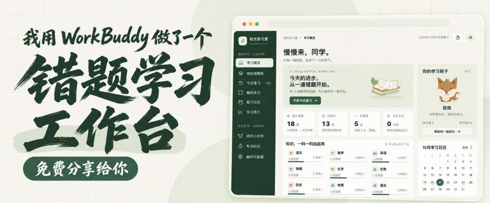
**它把错题整理、复习安排、随机练习、学习统计放在了一起**
还加了专注计时和一只陪着学习的小狐狸
**错题工作台双击就能用，不需要安装、不需要注册，断网也能打开**
目前支持语文、数学、英语、物理、化学、生物、历史、地理八个科目
**一共有九个页面，免费分享，获取方式，我放到了评论区**
下面带大家简单看一下这个工作台
**01｜学习概览：打开就知道今天该学什么**
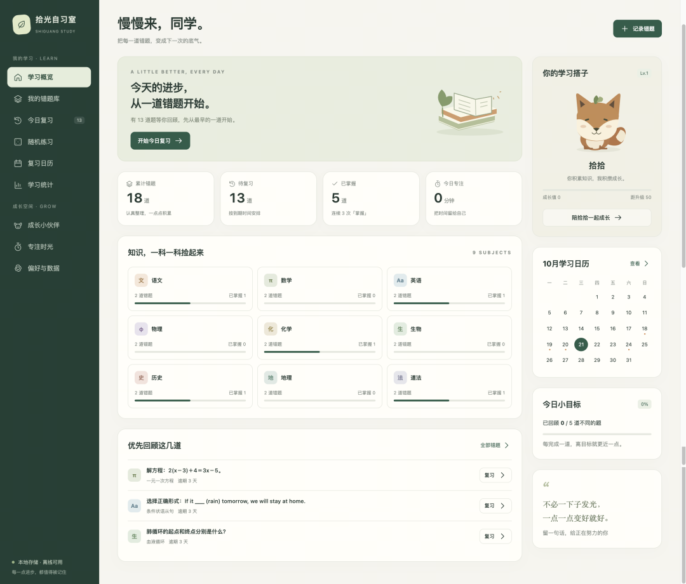
首页可以看到累计收录了多少道错题、还有多少道需要复习、已经掌握了多少，以及今天的专注时长
八个科目分别有自己的入口，点击某一科，就能进入对应的错题列表
右边还放了学习日历、每日目标和小狐狸的成长进度。想直接开始学习，点击 **「开始今日复习」**，就会按到期时间安排题目
**02｜我的错题库：把题目、答案和错因放在一起**
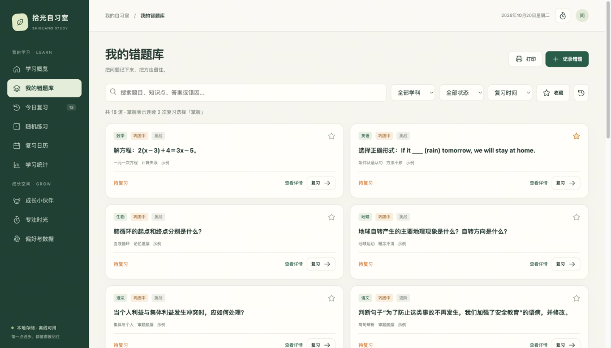
**这是平时整理错题用得最多的页面**
点击 **「记录错题」**，可以填写题目、参考答案、解题过程、错因和知识点，也能附上题目图片，设置难度和下次复习日期
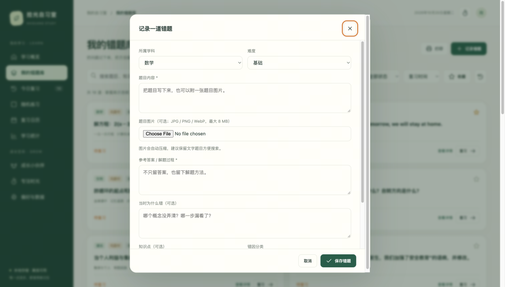
比如一道数学题做错了，除了记下正确答案，还可以写清楚：“移项时忘记变号”“去括号时漏乘了一项”。以后复习时，就能知道自己当时卡在哪里
题目多了之后，可以按学科、掌握状态、收藏筛选，也能直接搜索题目、答案或知识点。需要纸质练习，还可以把筛选后的错题打印出来
**03｜今日复习：做完之后，安排下一次回顾**
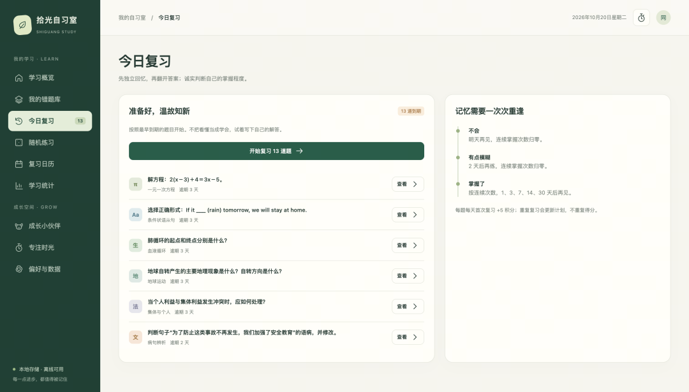
这个页面会集中显示已经到期、需要复习的题目
进入复习后，先看题目，可以写下自己的解答，再点击查看参考答案和之前记录的错因
对照之后，根据实际情况选择：
- **还不会**：安排到明天再复习。
- **有点模糊**：安排到两天后巩固。
- **掌握了**：根据连续掌握次数，依次安排到 1、3、7、14、30 天后复习。
连续三次选择“掌握了”的题目，会进入已掌握状态。之后如果又觉得模糊，也会重新安排巩固
这样，每道题都有自己的复习日期，打开工作台就能找到当天的任务
**04｜随机练习：从自己的错题里抽一组题**
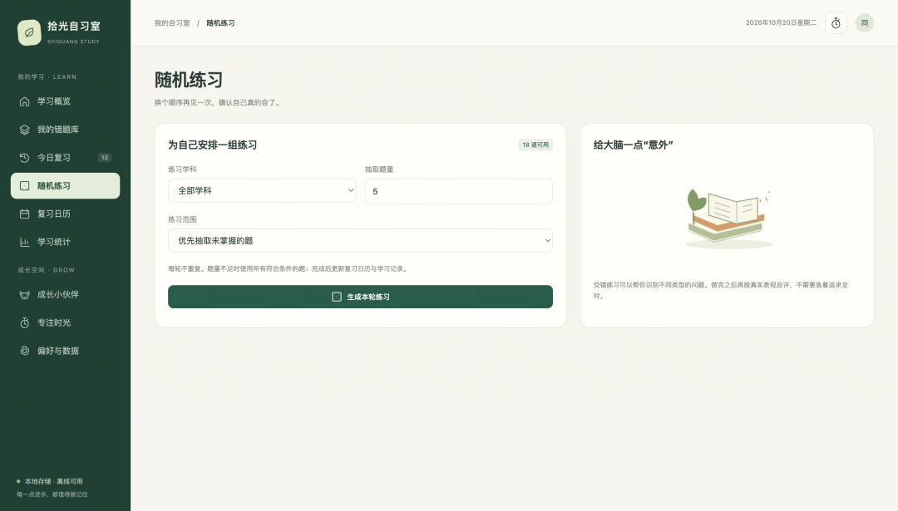
想检查一下最近整理的题目是否真的会做，可以打开 **「随机练习」**。
选择学科、题量和练习范围，就能生成一轮练习。可以优先抽取未掌握的题，也可以只练收藏题、到期题，或者从全部错题中随机抽取
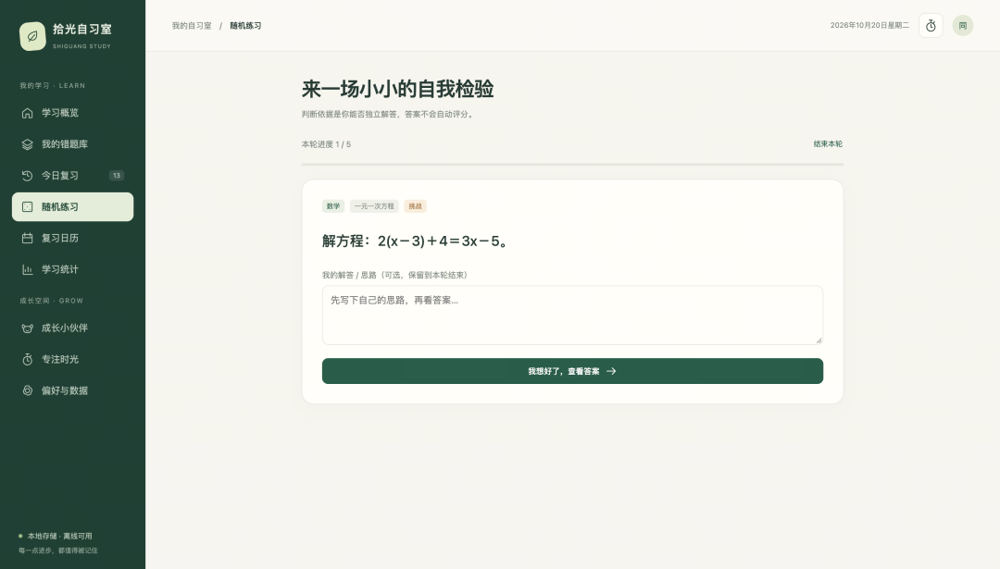
同一轮里不会重复出题。如果符合条件的题目不足设定数量，就使用当前可用的题目
练习结束后，会显示这轮有多少道掌握了、多少道还模糊、多少道不会，同时更新复习安排和学习记录
**05｜复习日历：把学习安排放到具体日期里**
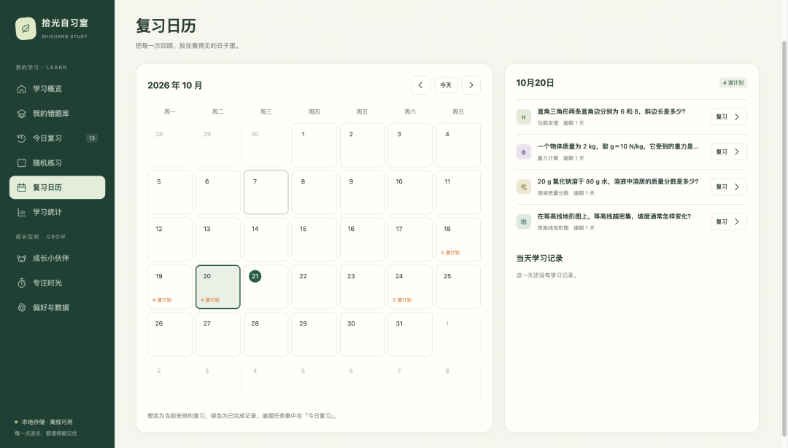
复习日历用来查看每天安排了哪些题，以及当天留下了哪些学习记录。
点击某一天，旁边就会显示对应的题目和记录，也可以从这里直接进入复习。
整理题目时手动设置的复习日期，以及完成复习后重新安排的日期，都会体现在日历里。已经逾期的任务，也会集中出现在“今日复习”中。
**06｜学习统计：看看题目主要错在哪里**
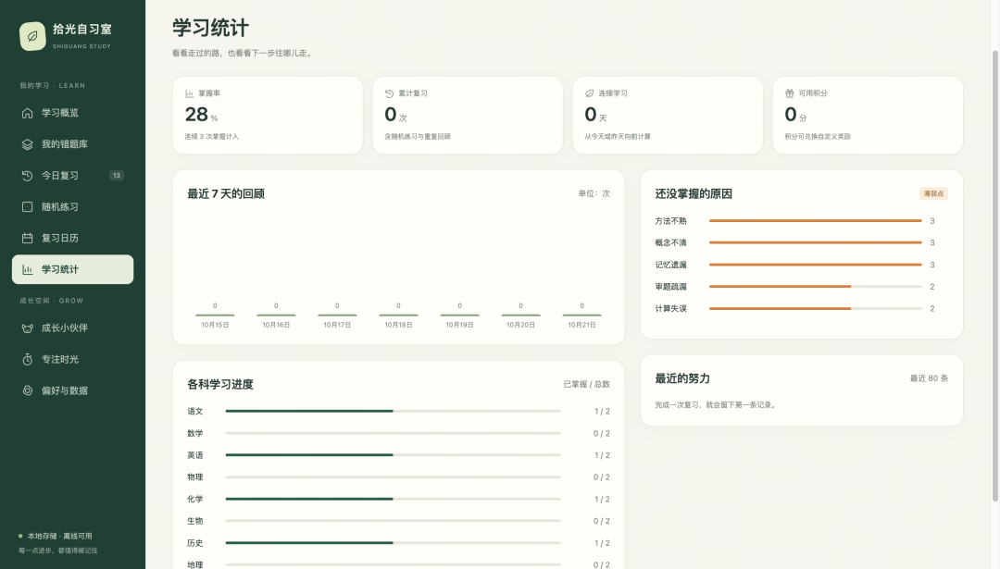
这一页可以看到掌握率、累计复习次数、连续学习天数，以及最近七天的复习情况。
各科也有单独的进度，方便查看每一科收录了多少题、已经掌握了多少题。
我还加了一个 **错因统计**，把尚未掌握的题目按“概念不清、审题疏漏、计算失误、方法不熟、记忆遗漏”等分类展示。
如果某一类错因比较集中，后面复习时就有了更具体的方向。比如总是计算失误，就可以回看自己的计算步骤；如果集中在概念不清，就需要重新梳理相关知识。
**07｜成长小伙伴：学习的时候，也攒一点小奖励**
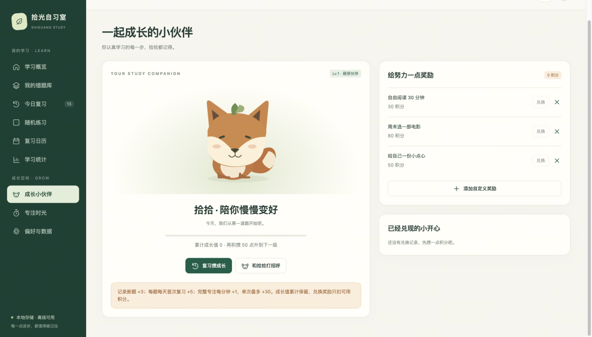
工作台里住着一只小狐狸，叫 **「拾拾」**
记录新错题、完成复习、完成专注计时，都能积累积分和成长值。成长值增加，小狐狸的等级也会跟着提升。
积分则可以用来兑换自己设定的奖励，比如看一部电影、自由阅读半小时，或者给自己准备一份小点心。奖励内容和所需积分，都可以自己设置。
兑换后会留下记录，扣除可用积分，但不会减少已经积累的成长值。
同一道题当天重复复习，也不会重复领取积分。
**08｜专注时光：给学习留一段完整的时间**
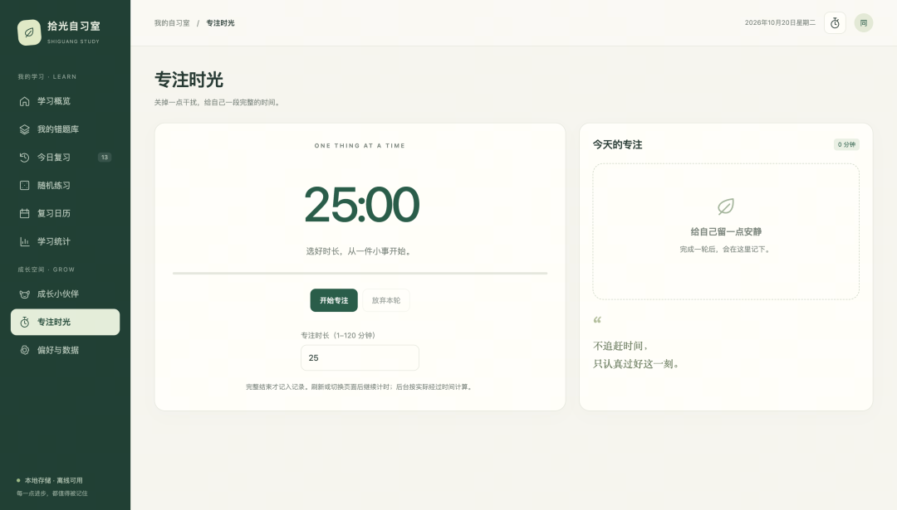
这个页面是一个专注计时器，可以设置 **1—120 分钟**的学习时长。
开始后支持暂停和继续，刷新页面或者切换到工作台的其他页面，计时也能接着走。
只有完整完成的一轮，才会计入专注记录；如果中途选择放弃，这一轮就不会计入。
当天完成了哪些专注记录、累计专注了多少分钟，都能在这里看到，首页也会同步显示今天的专注时长。
**09｜偏好与数据：按自己的习惯设置，把记录保管好**
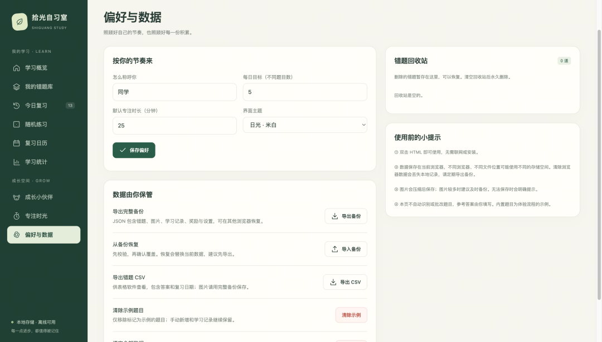
称呼、每日学习目标、默认专注时长，在这里都可以在这里修改
同时我还准备了两种主题：米白色的“日光”和深绿色的“夜读”
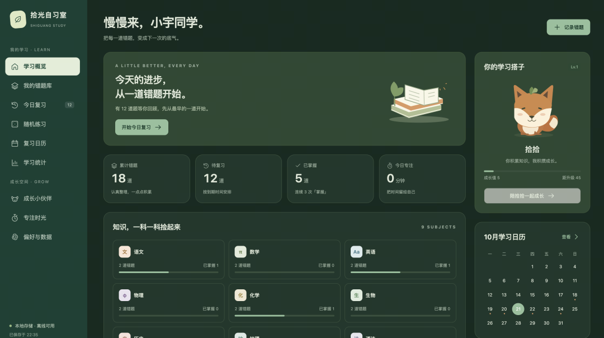
误删的错题可以到回收站恢复
另外，如果你想导出数据，我也准备了两种数据导出方式：
- **完整备份**：包含错题、图片、学习记录、奖励和偏好，可以导入恢复。
- **CSV 表格**：方便用表格软件查看题目和答案，不包含图片
另外，有一点需要你注意：当前的**学习数据保存在当前浏览器中**
**当你换电脑、换浏览器、移动文件，或者清理浏览器数据之前，记得导出完整备份，到了新的使用环境，再导入备份，就能继续使用之前整理的内容**
以上，我是小宇，感谢你看到这里，喜欢的话，可以给我个三连
**最近有很多粉丝私信我问我一些操作，**
**感兴趣的朋友可以关注我！**
我们下期见！
