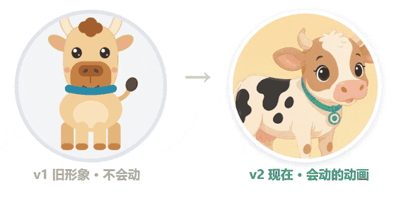

# 我用AI做的背单词小程序，养了头真的会哭的牛
> 💡 备注属性未写入，可能是备注属性名称或者类型被修改了，建议将字段类型设置为 rich_text，可以在小程序-操作-修改文章数据库页面进行调整
> 💡 原文链接:[https://mp.weixin.qq.com/s?__biz=MzI2NzEzNDQxNQ==&mid=2648936781&idx=1&sn=7860e5beb78a2742cfb71dcd8e46f5fc&chksm=f387867c7620cd60bc006cdb8804edda2a1ccd9c5df5751a9e3f5bdfb5ea4b8ab55b5a5588e0#rd](https://mp.weixin.qq.com/s?__biz=MzI2NzEzNDQxNQ%3D%3D&mid=2648936781&idx=1&sn=7860e5beb78a2742cfb71dcd8e46f5fc&chksm=f387867c7620cd60bc006cdb8804edda2a1ccd9c5df5751a9e3f5bdfb5ea4b8ab55b5a5588e0#rd)
一个不会写代码的工程师爸爸，把哄孩子背单词这件事，也交给了 AI
| **🌟 先关注 + 设为星标**关注「**用AI提升办公效率**」，私信发送关键词 **AI接管**，免费领《AI 办公自动化实战清单》长图。 |
上个月写过这个背单词小程序（文末有链接），之后我基本没闲着——孩子天天用，反馈就天天来。这次一口气上了两个大件：一只会生病的牛，和能整句读的例句。照例把过程和坑都交代清楚。
### 一、先说这头牛：为什么往学习工具里塞宠物
起因说出来有点丢人：孩子背单词全靠催，催三遍动一动。
暑假孩子抱着游戏不放，我盯着看明白一件事——不是不爱学，是游戏里喂一只羊都有即时反馈，背十个单词啥也没有。那行，就把反馈做进背单词里。于是就有了「牛来」。
老读者应该记得它上一版的样子——第一版形象是我用代码一块块画出来的矢量小牛，省体积是真省，可爱是真谈不上，而且是一张一动不动的静图。这次先给它做了个形象升级：

形象升级 v1 → v2：从代码简笔画，到绘本风 + 全套动画
形象换完还不够，得让牛「活」过来：背够了原地蹦跳，断了两天摇着头冒爱心，断了五天挂着眼泪发抖。下面这张是实拍动图，小程序里就是这么动的：

实拍动图 · 同一头牛的三种心情：背够了 / 断了两天 / 断了五天
规则很简单：每天背够当天的量，就算把牛喂饱。喂没喂饱，全写在牛脸上：
| **孩子的表现** | **牛来的样子** |
| 当天背够 | 精神满满，还会「哞——」打招呼 |
| 隔 1 天没背 | 耷拉着，没精神 |
| 隔 2 天 | 摇着头冒爱心：「想你了」 |
| 隔 3 天起 | 开始生病，头上贴退热贴 |
| 隔 5 天以上 | 眼泪一串一串掉 |
数字上有两个讲究：**第一天 5 个就算喂饱**；断一天欠账加 5 个，最多欠到 15 个——任务量得在孩子跳一跳够得着的范围里，压垮了就全完了。
| **设计取舍**这牛**永远不会死**，心情再差也有下限。惩罚要轻，孩子肯回来就行——真把牛养死了，孩子直接弃坑，前面全白搭。 |
### 二、例句能整句读了——上线第一天就被投诉「太快」
1.15.0 给每个例句旁边加了小喇叭，点一下整句读出来。孩子不用再一个词一个词往外蹦。
结果孩子真机一试，第一天就打回：**单词都认识，连成句子就听不清，读太快了。**
排查下来挺有意思：发音接口本身压根没有「语速」这个参数，快慢是人家定死的。最后是在播放这一层动手脚——给例句单独开了一条 **0.8 倍速**的音频通道，单词朗读还是原速（单词本来就短，放慢反而拖沓）。
这个改动在 1.15.1 上，孩子现在用着，反馈是「能听清了」。
| 💡 **复盘一句**：给孩子做东西和给大人做不一样。大人觉得「还行」，孩子直接说「听不懂」。验收必须真机、必须让孩子自己上手，大人替不了。 |
### 三、现在的完整家底
| **功能** | **说明** |
| 词书 | 24 本课本词书，小学 / 初中 / 高中主流教材版本都齐了 |
| 复习 | 答错的词按记忆曲线自动安排复习 |
| 拼写 | 自建键盘，能拼 don't、ice-cream 这种带标点的 |
| 例句点读 | 整句朗读，0.8 倍速（新） |
| 宠物「牛来」 | 形象全新升级：绘本风 + 动画，背够才喂得饱，断了会想你、会掉眼泪 |
全部**免费、无广告**。长按识别下面的小程序码就能用，或者在微信里搜「52背单词」：

长按识别 · 免费背课本单词
有想加的功能，评论区直接说——这小程序本来就是照着孩子的反馈一点点长出来的。
| **❤️ 觉得有用，点个「推荐」**在手机微信里打开文章，一直拉到最底部，点**右下角那颗红爱心「推荐」**，这篇就会进你好友的「看一看 · 朋友推荐」。不用自己转发，好友的推荐流会替你把文章带出去。 |
| **📣 两件事，花你 10 秒钟**① 拉到最底部点「❤️推荐」 ② 关注「用AI提升办公效率」不错过下一篇 |
| **🎁 关注福利**关注「用AI提升办公效率」，私信发送关键词 **AI接管**，免费领《AI 办公自动化实战清单》——都是我自己跑通了的活儿，照抄就能用。 |
| **往期 · 阅读 443**[我用AI做的背单词小程序，从1本书扩到19本、31222个词](https://mp.weixin.qq.com/s?__biz=MzI2NzEzNDQxNQ%3D%3D&mid=2648936604&idx=1&sn=c0de893aec4dd19582ee229c888d6533&scene=21#wechat_redirect) |   | **往期 · 阅读 311**[我给儿子做了个背单词小程序，正式上线了：1772个词、40关、免费无广告](https://mp.weixin.qq.com/s?__biz=MzI2NzEzNDQxNQ%3D%3D&mid=2648936552&idx=1&sn=4793d9d7c9bfd74f8000716c30c785d2&scene=21#wechat_redirect) |
| **关注「用AI提升办公效率」**实操实录 · 每篇都能照抄 |
