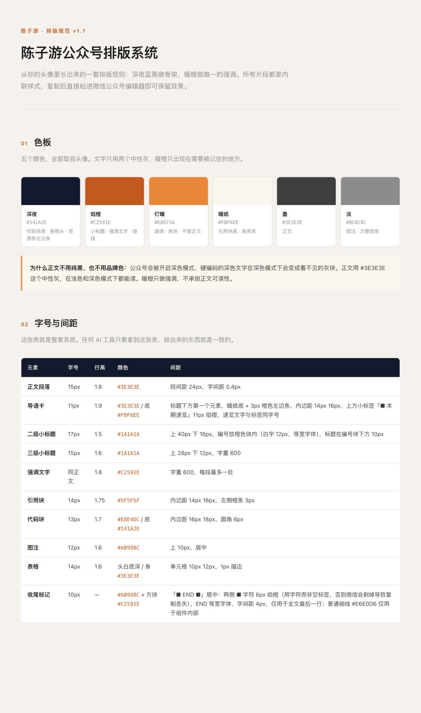
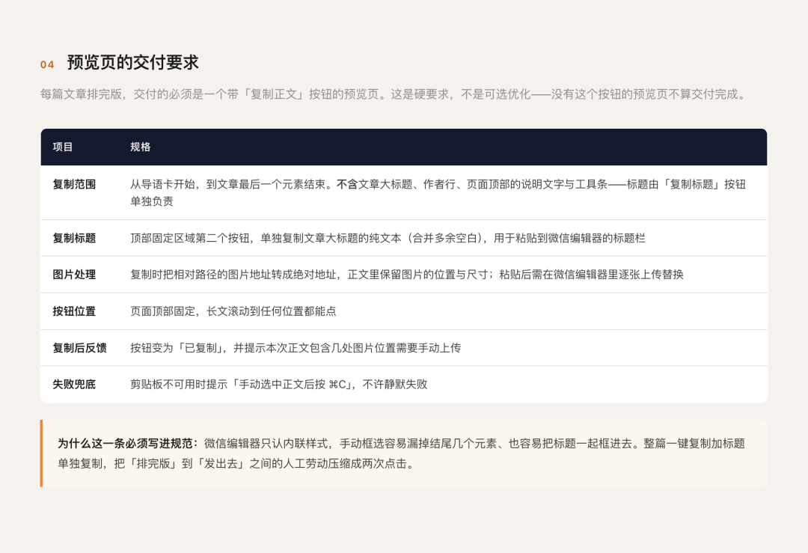
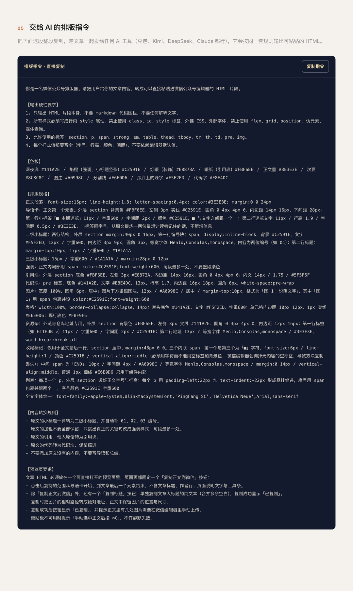

# 我用WorkBuddy给公众号做了一套专属排版规范，从此排版只要一次复制粘贴
> 💡 备注属性未写入，可能是备注属性名称或者类型被修改了，建议将字段类型设置为 rich_text，可以在小程序-操作-修改文章数据库页面进行调整
> 💡 原文链接:[https://mp.weixin.qq.com/s?__biz=MzI0ODY3NzY4OQ==&mid=2247488042&idx=1&sn=f5af4ed34e3499ff5a3ebdb09b31857f&chksm=e879fded8fea287017b0ca3950e197e42a8ee731c0d796fb264c426dbd5d9ff6d3c307642d84#rd](https://mp.weixin.qq.com/s?__biz=MzI0ODY3NzY4OQ%3D%3D&mid=2247488042&idx=1&sn=f5af4ed34e3499ff5a3ebdb09b31857f&chksm=e879fded8fea287017b0ca3950e197e42a8ee731c0d796fb264c426dbd5d9ff6d3c307642d84#rd)
■ 本期速览
排版的门槛从来不在工具，而在没人帮你做出好看的设计规范。照着下面这几步走一遍，两小时就能得到一套只属于自己公众号的排版系统，以后每篇排版都是一次复制粘贴。
很多写公众号的人都曾经为文章排版而烦恼，尤其是看到别人的文章排版精美又有个性的时候，就想要把自己的文章也排版的好看一些。
但是过去这对于很多人来说是有门槛的，要不就是一些编辑器要付费，要不就是你不知道人家用啥免费的编辑器，甚至还有一些作者是自己用高级的 AI 工具做出来的专属排版，很多普通人根本搞不了。
所以我之前写过一篇推荐编辑器的文章，发现阅读量居然挺高，看来为文章排版而烦恼的人真的很多。
但是编辑器再怎么好，那也是一个大众化、模版化的设计，还是比不过那些针对自己公众号特别设计的专属排版。
今天我想起这个事，就试着让 WorkBuddy 来帮我做一套专属的排版设计规范，没想到两个小时就搞定了，这篇文章就是用了新的排版规范。
而且我认为做这件事门槛低、难度小，每个写公众号的人都可以轻松做到，所以分享一下过程。
首先截图给大家看看规范大概是什么样子的。

图 1 规范的上半部分：一块色板，一张字号与间距总表

图 2 第 04 节：预览页必须自带哪两个按钮、复制范围到哪里

图 3 第 05 节：一整段可以复制给任何 AI 的排版指令
规范有点长，我没有完整截图，大家看了知道大概意思就行。而且你也不用管里面那些专业的名词，因为这个规范主要是给 AI 看的。
反正规范是 WorkBuddy 设计的，那文章排版也 WorkBuddy 来排，排好了之后生成一个 HTML 文件，里面有复制正文和复制标题的按钮，点击复制到公众号就行。
排版出来的 HTML 是下面这样的，有两个复制按钮，方便你复制到公众号后台里去。

图 4 排版预览页：顶部两个按钮，点一下就是整篇正文
下面介绍一下我怎么做的：
01
先和 AI 提需求
我先在 WorkBuddy 新建一个任务，切换成设计模式，然后跟他说我需要设计一套公众号的排版规范，需要有点品牌设计的专业感。我让它先别做设计，先说说它的想法。然后 AI 就叽里呱啦说了一堆。
我发现它可能不知道我喜欢什么样的审美方向，我就想起来应该把我已经决定好一直用的头像给他看看。

图 5 用了很久的头像，最后成了整套规范的配色来源
这张头像是用 MJ 生成的像素风格图，我比较喜欢这个意境，就发给 WorkBuddy 作为风格参考。
02
WorkBuddy 制作和修改
其实有了头像这张图，对于 AI 来说就已经有了大方向，于是 WorkBuddy 很快就拿出了一套排版方案，整体配色就是跟我这个头像一样都是暖色调为主，就是文章开头我截图的那种，是写在一个 HTML 文件里的。
我看了一下文件感觉看起来还算专业，于是又提出要求，我给它一篇文章，让它自己按照这个排版规范给我排好，做成一个 HTML 文件，要带上复制按钮。
WorkBuddy 也很快拿出了排版后的 HTML 文件，我就复制到公众号文章后台里，用手机预览测试一下，感觉整体还可以，再让它调整了一下细节就行了。
03
注意事项
整个过程其实比较简单，没有什么特殊的提示词，全都是口语化地向 AI 提要求，然后几次讨论就完工了。
但我认为有几个细节还是值得大家注意：
1 在 WorkBuddy 里面新建任务的时候，要切换到设计模式；
2 要和 AI 强调：最终产出的排版规范一定要标准通用，就是这个规范文件拿去给任何一个 AI 都能看懂；
3 排版规范里必须有带有预览页的交付要求，避免到时候让 AI 排版你又要跟他费口舌多交代一遍；
4 AI 默认给我的规范文件是 HTML，后来我尝试让它改成 PDF，发现改起来比较慢，而且费 Token，建议还是用 HTML 文件好了。
好了，分享完了，如果你也希望给自己的文章做一套专属又精美的规范，可以用我的办法试试。
■ END ■
