# 我竟然见到了最疯狂的GitHub项目！
> 💡 备注属性未写入，可能是备注属性名称或者类型被修改了，建议将字段类型设置为 rich_text，可以在小程序-操作-修改文章数据库页面进行调整
> 💡 原文链接:[https://mp.weixin.qq.com/s?__biz=MzAxOTc0NzExNg==&mid=2665553364&idx=1&sn=77d9edb97b7677297d63bb5c0c8345ac&chksm=811494ea090a032fe34958074d54f20df1e283f6b00c042792b182d4a511182c437f7a876002#rd](https://mp.weixin.qq.com/s?__biz=MzAxOTc0NzExNg%3D%3D&mid=2665553364&idx=1&sn=77d9edb97b7677297d63bb5c0c8345ac&chksm=811494ea090a032fe34958074d54f20df1e283f6b00c042792b182d4a511182c437f7a876002#rd)
刚刚在 GitHub 上看到一个项目，名字简单粗暴，毫不掩饰自己的野心：The Everything Project。
它的目标是用 JavaScript / TypeScript 从零开始，把全世界用得着、用不起、买不起的软件，统统重新写一遍，然后全免费开源。
我看了一下，这个项目的始作俑者我在之前的文章中讲过，就是Puter:
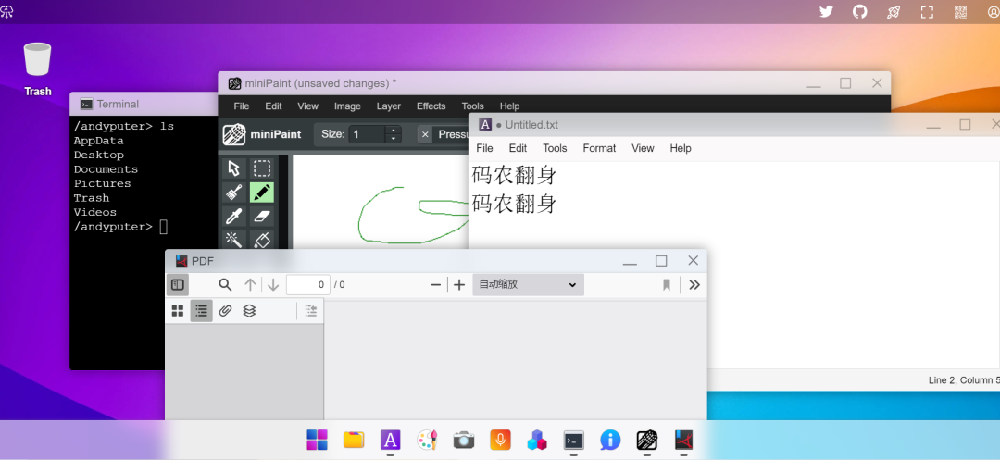
Puter 原本是一个云端桌面，打开浏览器就能用。
它的界面有点像 Windows 或 macOS，里面集成了命令行、记事本、画图、PDF 查看器、小游戏、录音机、录像机……
界面设计得非常干净，看起来赏心悦目。
这个云端桌面曾经相当火爆，4 个月内就获得了 25 万用户，GitHub Star 高达 44.1K。
不过，只有一些简单的应用，显然还满足不了用户的需求。
于是 Puter 团队决定干一件更疯狂的事情：把那些昂贵的商业软件，逐个用 Web 技术重新实现，并且开源！
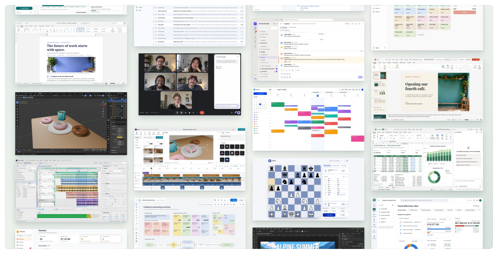
打开它的仓库目录（我的妈啊，还是单体仓库！），看到这些应用列表，我的头轰的一下就大了，这些家伙们真是敢想敢干啊：
办公套件： 微软 Word、Excel、PowerPoint、Notion、Airtable……
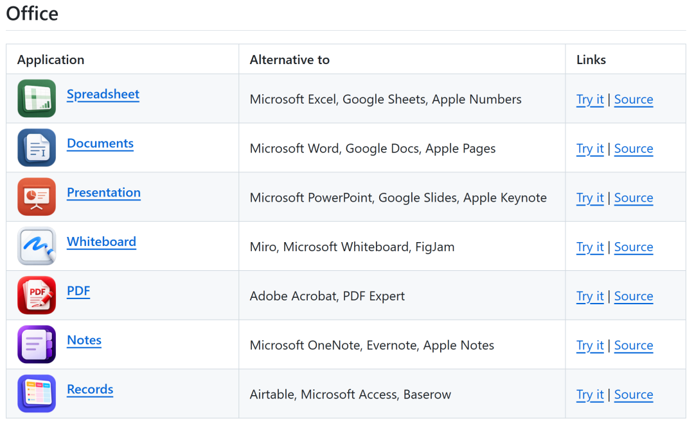
设计与创意： Adobe Premiere（视频剪辑）、Illustrator（矢量绘图）、Photoshop、Final Cut Pro、CapCut……
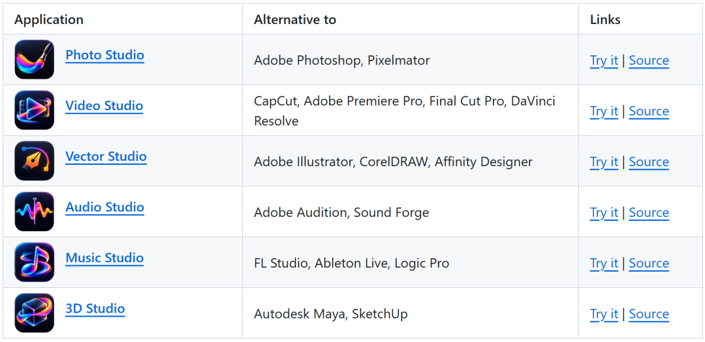
工程与专业工具： 甚至包括 AutoCAD、SolidWorks、Altium Designer（电路板设计）！
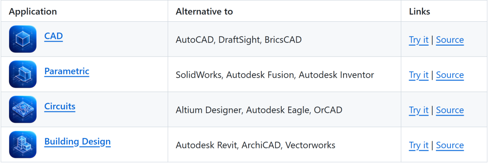
财务与生产力： QuickBooks、Toggl Track、Typeform……
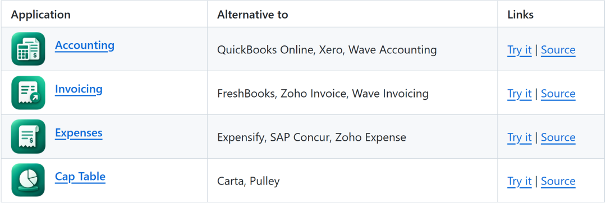
游戏娱乐： 接龙、国际象棋、数独
……
整个项目已经列出了 50 多款应用，我随手打开了几个应用，你别说，做得还真是像模像样。
这是“Word” :
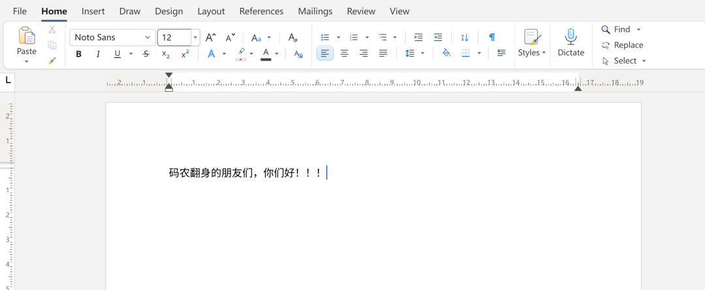
这是“Excel” :

这是 “PPT”:
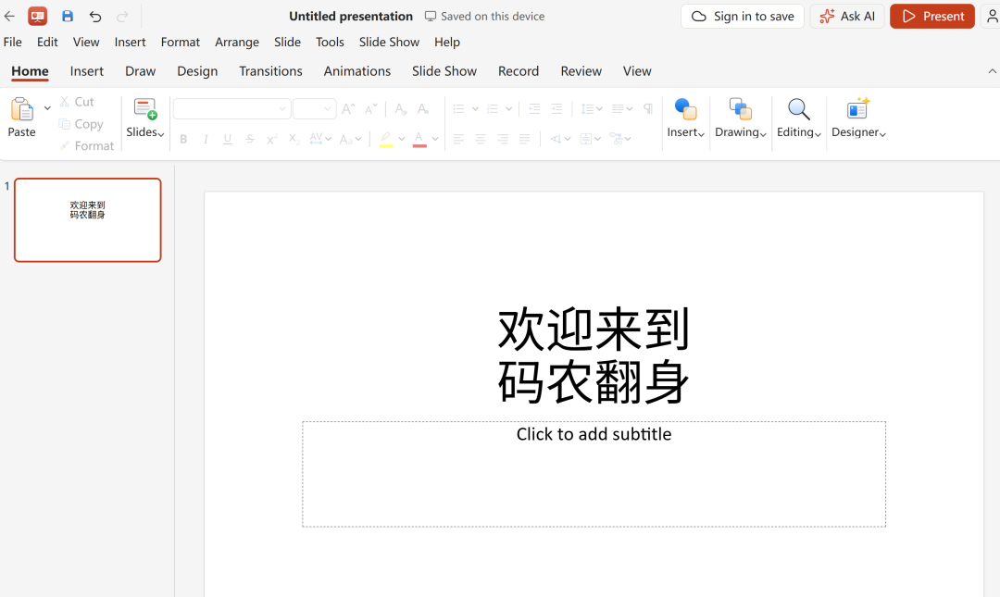
这是“Photoshop” :

这是“CAD”:
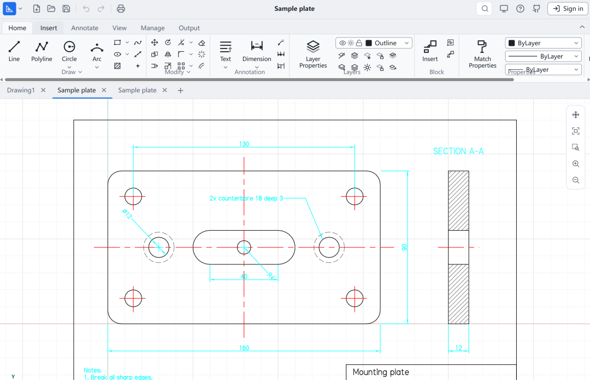
这是“Postman”:
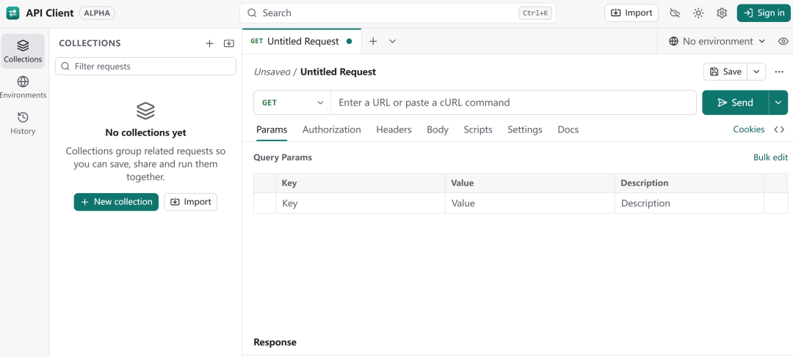
是的，这个项目把“Postman”也实现了，这正是他们开始这个项目的初衷：
天下苦 SaaS 订阅费久矣，大家别买 Adobe 和 Microsoft 365 之类的订阅了，自己直接部署这一套就完了。
初次看到这些项目，确实挺震撼的，现在的Web技术和浏览器性能居然已经强大到如此地步，都能在浏览器里跑 3D CAD 和音视频渲染了。
这不由得让我想到那句话：任何可以用 JavaScript 写的应用，最终都会被用 JavaScript 写出来。
但是冷静下来一想，像 Word、Excel 、AutoCAD、Photoshop 这种积攒了行业三四十年底层数学算法、和无数边缘乱码兼容的庞然大物，靠一个团队加开源社区，拿 JS 能砸出来？
一位熟悉电子设计自动化（EDA）的用户，专门测试了 Puter 的 Circuits，他的评价特别尖锐：它看起来像一个 EDA 软件，闻起来也像一个 EDA 软件，但它根本算不上真正的 EDA 软件。
这句话虽然有点刻薄，却点出了一个关键问题：做出一个看起来像某款软件的 Web 应用，和真正替代这款软件，中间还隔着一条很长的路。
The Everything Project 中的很多应用，基本功能已经初步具备。个人体验一下、做做 Demo，可能已经够用了。
但如果想把它们当成真正的生产力工具，恐怕还得谨慎一些。
毕竟，列表里的每一款软件，都是重量级选手。它们需要持续打磨、修复 Bug、补齐功能，还要不断适应用户千奇百怪的需求。
Puter 团队能长期维护这么多应用吗？
更有意思的是，他们把办公软件、财务软件、影音工具、工程软件、游戏……统统塞进了一个单体仓库。
这种做法真的合适吗？
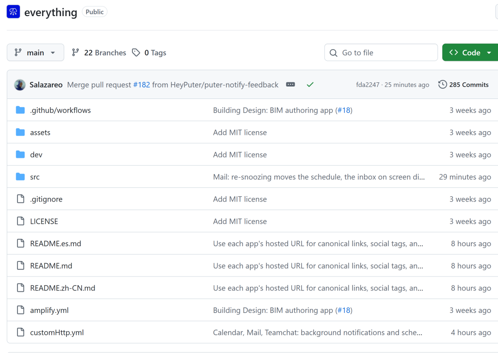
我觉得 Puter 团队并不是在做慈善，这些看似疯狂地免费项目，实际上是为他们的核心产品PuterOS（云操作系统） 进**行超级引流**。
仓库里这 50 多个 Web 应用，可以自己部署在本地运行，它们大部分内置了 Puter.js SDK，用户在云端直接体验时，数据默认保存在 Puter 的云端存储中。
Puter 免费给用户提供 25MB 的空间，但如果处理大项目（比如视频剪辑、工程 CAD），空间很快不够用，用户需要付费扩容（如 10 美元/100GB）。
这也是他们倡导的云服务模式：软件本身是免费的，但如果你用我们的云来存数据，我们就赚存储和云算力的钱。
过去，开发一款复杂软件，需要庞大的团队、漫长的周期，以及大量的资金投入。
如今，一个10人左右的小团队，在AI的辅助下，竟然开发了 50 多款像模像样的重量级应用，虽然功能还有待补全，但已经非常让人震撼了。
联想到之前 REA 的火爆，人工软件开发，真的走到尽头了。
