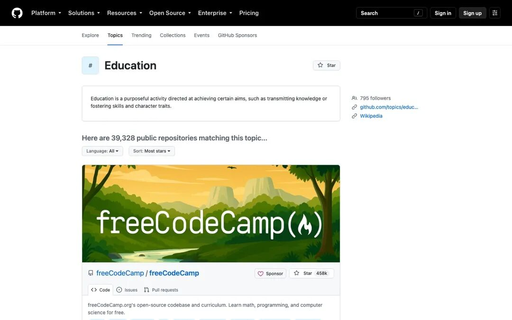
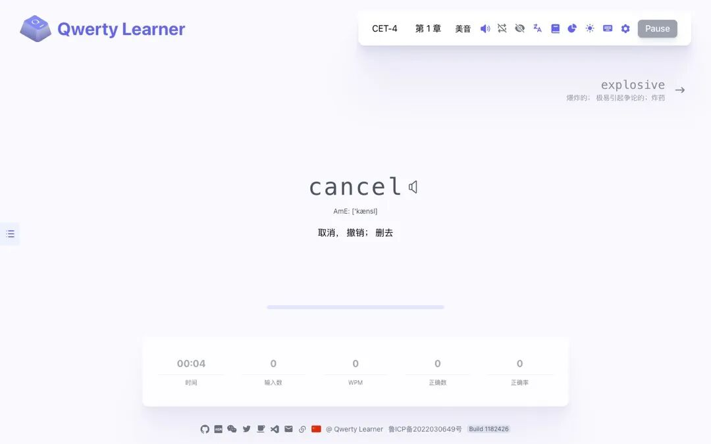

# 我翻遍 GitHub，筛出 25 个教育类开源项目：从清华爆款到 45 万星经典
> 💡 备注属性未写入，可能是备注属性名称或者类型被修改了，建议将字段类型设置为 rich_text，可以在小程序-操作-修改文章数据库页面进行调整
> 💡 原文链接:[https://mp.weixin.qq.com/s?__biz=MjM5MzI4MzUwMA==&mid=2456083508&idx=1&sn=728b6510ef1048edf049c239eb05ea44&chksm=b010e08775ffae00de1ac72c5f45b2fe54a201cee0db9314c6a56efe35b69f1cd34eb1bdf1d8#rd](https://mp.weixin.qq.com/s?__biz=MjM5MzI4MzUwMA%3D%3D&mid=2456083508&idx=1&sn=728b6510ef1048edf049c239eb05ea44&chksm=b010e08775ffae00de1ac72c5f45b2fe54a201cee0db9314c6a56efe35b69f1cd34eb1bdf1d8#rd)
这是「GitHub 教育宝藏」系列第 1 篇，一共 4 篇。建议先收藏，后面三篇会一个个展开讲。
先说个很多人没意识到的事：GitHub 早就不只是程序员放代码的地方了。
哈佛把机器学习课程的教材整套挂了上去，连实验和教师用的材料都给了；清华的 AI 课堂项目开源五个月涨了三万星；还有能背单词的打字软件、每周免费更新的《经济学人》……全都在上面，全都要多少钱？零。
麻烦的地方在于量太大。光是打着 education 标签的仓库就有三万九千多个，里面大量是玩具、弃坑项目和课程作业。真正的宝贝，得自己捞。
前阵子我把 GitHub 官方话题榜、trending 榜，还有中外十几篇测评文章都翻了一遍，交叉比对之后留下 25 个项目，分成四类。这篇先上全景图，后面三篇每类细讲。

GitHub education 话题下已有 39,328 个仓库
#### 一、AI 家教：今年最热的一批项目全在这
**OpenMAIC**（清华，30k+ Star）——输入任何一个主题，几秒钟生成一间完整的课堂：有 AI 老师讲课，有 AI 助教答疑，还有两个性格不同的 AI 同学陪聊。上过联合国教科文组织的展示。
**DeepTutor**（港大，42k Star）——一个不肯直接给答案的家教。你问它题，它反问你思路，卡在哪一步就在哪一步搭梯子。
**Mr.-Ranedeer-AI-Tutor**（29.6k Star）——严格说它不是软件，是一段 Prompt。粘给 ChatGPT，它就变成能调深度、调语气的私人导师。
**learn-claude-code**（78.9k Star）——17 节课，从零教你搭一个 AI Agent 的运行环境。今年涨得最猛的中文教育项目。
#### 二、语言学习：程序员的浪漫
**qwerty-learner**（23.5k Star）——背单词和练打字二合一。每个单词必须完整敲出来，敲错退回来重敲。370 多个词库，从四六级到 GRE 到程序员常用的 API。
**Anki**（32k Star）——间隔重复记忆的开山鼻祖，按遗忘曲线安排复习。医学生和考研党的老朋友了。
**earthworm**（11.1k Star）——不背单词表，靠连词造句学英语，把语法结构在手上练熟。
**awesome-english-ebooks**（38.3k Star）——每周更新《经济学人》《纽约客》《大西洋月刊》，免费下载。
#### 三、教学平台：把 Udemy 装进自己服务器
**Moodle**——2002 年发布至今，全球 3 亿多用户在用，2000 多个插件。商业 LMS 一年收几万块的功能，它免费。
**frappe/lms**——更年轻的替代品，官网口号很直白："A better Moodle"。小团队半天就能上线课程网站。
**Kolibri**——给没有网络的学校做的。一台树莓派就能跑，装满了就是个离线数字图书馆。
#### 四、学科教育：几个传世经典

hello-algo：《Hello 算法》在线教程，动画图解配可运行代码
**freeCodeCamp**（458k Star）——全球最大的免费编程学习平台，从零基础到发认证，全免费。
**hello-algo**（131k Star）——动画图解数据结构与算法，示例代码支持 12 种语言，一键运行。刷题前先过一遍，比硬啃教材舒服太多。
**Manim**（41.7k Star）——3Blue1Brown 数学视频背后的引擎。数学老师用它做课件，科普作者用它做视频。
**cs249r_book**（29.1k Star）——哈佛机器学习系统课程的全套开源教材，四卷本。

qwerty-learner 的练习界面：单词、音标、释义、速度统计同屏
#### 为什么是现在？
两年前推荐 GitHub 给普通人，多半会吃闭门羹——项目是好项目，可"克隆仓库、装依赖、配环境"这一套就把人劝退了，收藏了也只能吃灰。
现在不一样了。看到想用的项目，把链接丢给 AI，它能带着你一步步跑起来。开源教育这道门，头一回对不会写代码的人也开了。
再加上商业教育软件越卖越贵——Canvas 云托管小型机构起步一年一万五，开源版只花一台服务器的钱——这笔账不难算。
#### 后面三篇的安排
第 2 篇拆 AI 家教：我把 OpenMAIC 和 DeepTutor 都实际试了，说说它们到底靠不靠谱。第 3 篇是语言学习专题，给英语学习者搭一套全开源、零成本的组合。第 4 篇面向老师和机构：怎么零订阅费搭自己的课程网站。
觉得有用的话，点个赞和在看——说实话，这是这种费时间整理的系列能更新下去的唯一动力。下篇见。
本文由WorkBuddy协助撰写
