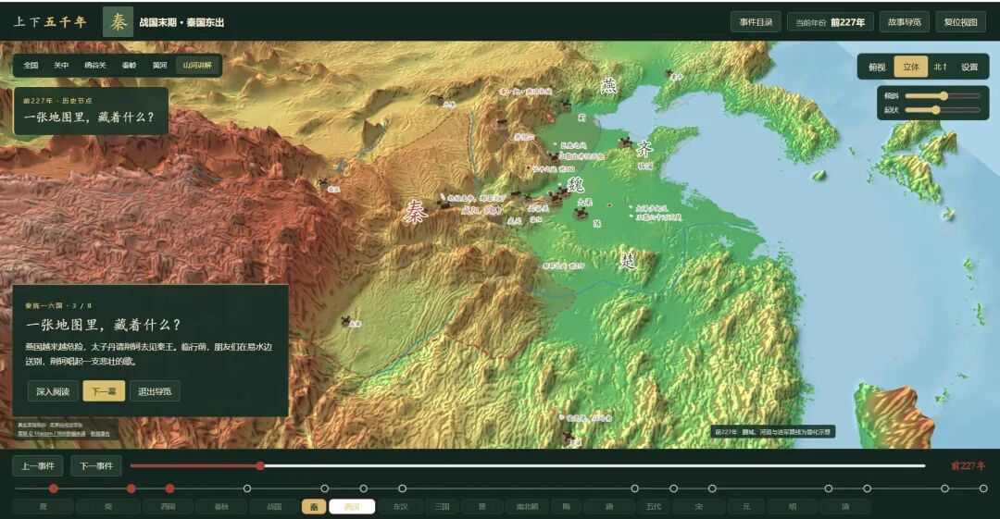
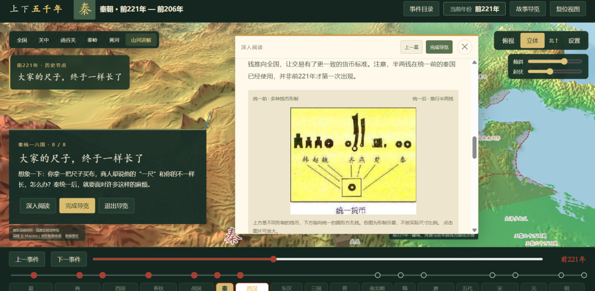
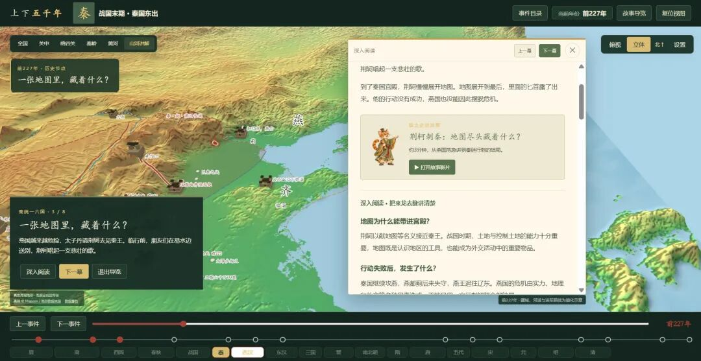
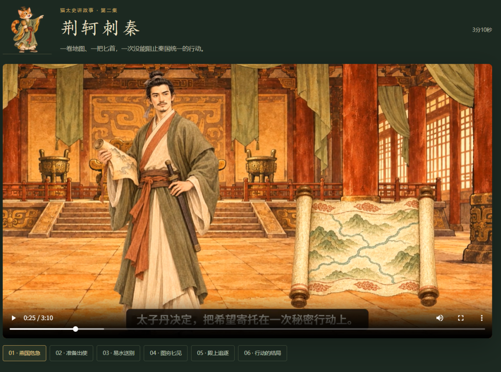

# 我重做了中国历史互动教学游戏，这些知识点全讲透了
> 💡 备注属性未写入，可能是备注属性名称或者类型被修改了，建议将字段类型设置为 rich_text，可以在小程序-操作-修改文章数据库页面进行调整
> 原文链接:[https://mp.weixin.qq.com/s/tAE6ryqke9Z82EwPsBifyA](https://mp.weixin.qq.com/s/tAE6ryqke9Z82EwPsBifyA)
之前，我给娃做了一个中国历史互动教学游戏。把朝代、地图、人物和故事放在一起，让他顺着时间轴，看看历史是怎么一步步发生的。[和娃一起，把上下五千年做成了一张"会动"的地图](https://mp.weixin.qq.com/s?__biz=MzA3NTIzMzA5NQ%3D%3D&mid=2247484416&idx=1&sn=cd9504f95ae87988784b6c4773d6391d&scene=21#wechat_redirect)
最近我用Codex重新做了一遍，效果有很大提升，主要动了三块：地图、展示界面，还有几个故事视频。

### 一、地图：从"看位置"到"看地形"
整个界面都重绘了，感觉相比之前更美观了。山川、平原按照海拔都有不同的颜色显示。
我还加了几个快捷视角：全国、关中、函谷关、秦岭、黄河，以及一步步带着看的"山河讲解"。不用一上来就在地图里乱找，可以先带着问题看，再点开解释。
这样一来，地图就不只是告诉孩子"在哪里"，也能帮他理解一些"为什么"。
### 二、界面：让故事读得下去
界面也重新理了一遍。地图留了更大的展示空间，事件目录可以按需展开。选中一个事件，既能定位到地图对应位置，也能用"上一事件、下一事件"接着往下翻。
点开详情，先看故事，再补背景、人物、器物和相关成语；有的地方还配了诗词和思考问题——希望娃看完，能再多问一句。
比如秦统一六国，不能只停在"最后都变成秦朝的颜色"。统一之后，各地文字写法不一样、钱币形制不一样，怎么办？所以我又补上了统一文字、统一钱币和度量衡的深入阅读，还加了文字和钱币的对照图，能点开放大看。

有些容易讲得太简单的地方，也多补了一层：秦统一文字，不是突然发明了汉字；半两钱在统一前秦国就已经在用了；今天常见的砖石长城，也不能直接等同于秦长城。这些细节不要求娃一次记住，但我希望他继续点下去时，能找到更完整的解释。
### 三、视频：统一美术，把故事讲完整

几个故事视频，这轮也重做了一遍。目前整理好的三段：《荆轲刺秦》约 3 分 10 秒、《陈胜吴广起义》约 3 分 34 秒、《破釜沉舟》约 2 分 52 秒。
这轮一个重点是统一美术素材。我定了国风水粉绘本的方向，把荆轲、嬴政、项羽、陈胜、吴广的形象固定下来，人物卡和视频用同一套立绘；陈胜、吴广也各自建了独立的人物记录。器物也单独整理了：督亢地图、荆轲匕首、鱼腹书、秦王长剑，都能对应到具体故事；鱼肠剑和荆轲匕首也分开建档，免得混在一起。

《破釜沉舟》里项羽出场的几个镜头，也换成了统一后的人物形象。这里有个很实际的问题：网页上换了人物图，已经生成的视频不会跟着变，相关镜头得重新渲染。
内容上，也希望把故事讲完整。《陈胜吴广起义》除了大雨受阻、发动起义，还接着讲了队伍壮大、分路进军、内部矛盾和后来的挫折，不再讲到"揭竿而起"就收尾。视频入口现在直接放在对应的故事卡里，每段保留六个章节，可以按章节跳转回看。
### 目前还是只做了秦，如果你也有兴趣，可以私聊发你体验。
