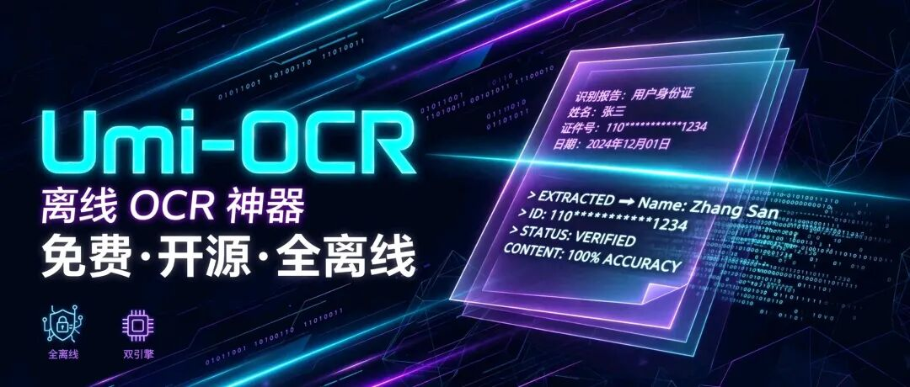
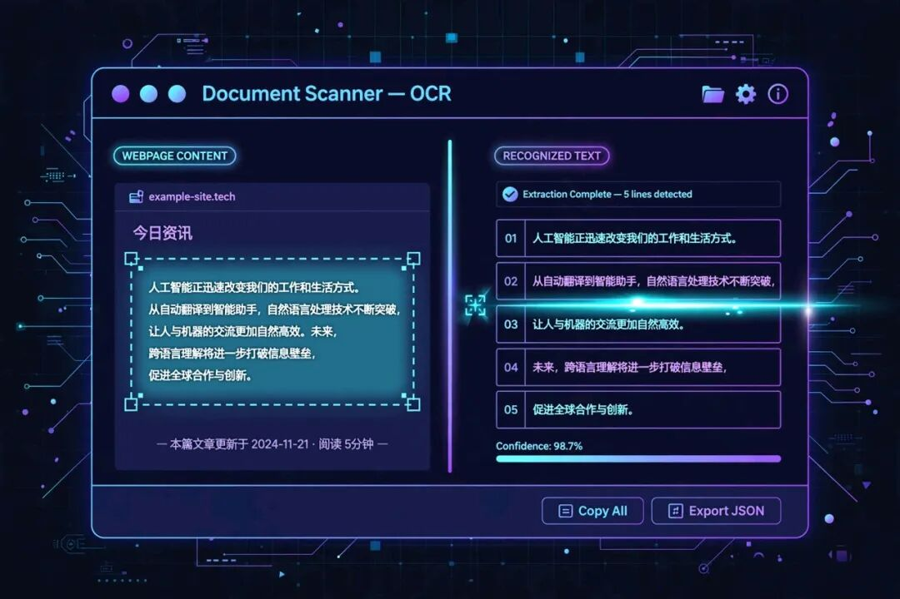
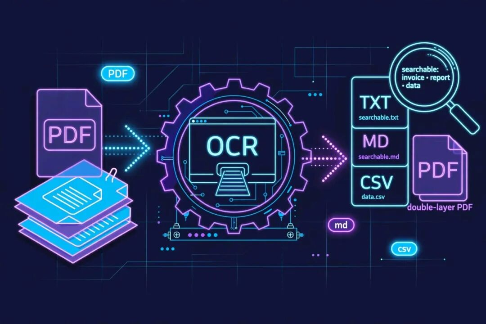
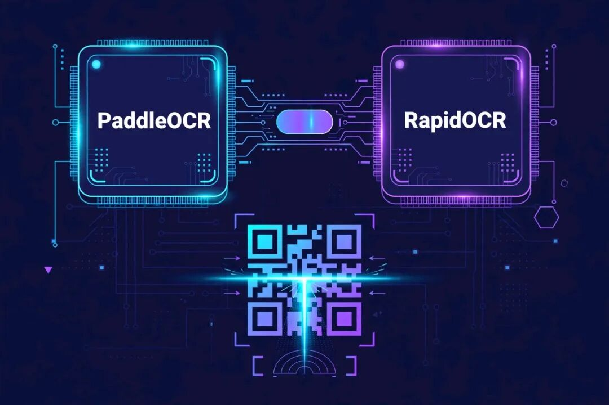

# 截图里的字抠不出来？这个 4.8 万 Star 的国产免费 OCR，全离线一把梭
> 💡 备注属性未写入，可能是备注属性名称或者类型被修改了，建议将字段类型设置为 rich_text，可以在小程序-操作-修改文章数据库页面进行调整
> 💡 原文链接:[https://mp.weixin.qq.com/s?__biz=MzUxMjQxNTk0MQ==&mid=2247487675&idx=1&sn=d1d075b88d2df7438c8b942c15af45d0&chksm=f8840f8790308614a0dbe49af2d1c82034d96f96feb8c28ce39289bb49ae620a4c6b6bca52c8#rd](https://mp.weixin.qq.com/s?__biz=MzUxMjQxNTk0MQ%3D%3D&mid=2247487675&idx=1&sn=d1d075b88d2df7438c8b942c15af45d0&chksm=f8840f8790308614a0dbe49af2d1c82034d96f96feb8c28ce39289bb49ae620a4c6b6bca52c8#rd)
会议纪要的截图发群里，你想引用其中两行字——只能对着屏幕逐字敲；客户甩来一份扫描版 PDF 合同，你想 Ctrl+F 搜个关键词——搜不出来；报销要录发票上的信息，一张张照片看得眼花。你是不是也这么干过？
最近刨到个国产开源工具 **Umi-OCR**，专治这种"看得见、摸不着"的文字：截图一框就转文字，扫描 PDF 直接变成可搜索 PDF，还能批量处理、扫二维码，全程在本机跑、不联网。GitHub 上已经 **4.8 万 Star**，MIT 协议免费开源，解压即用。今天整理一下，它到底好在哪、怎么用、有哪些坑。

---
### 一、截图一框，文字即取
这是用得最多的场景：按快捷键呼出截图选区，框住屏幕上的任何文字，松手——文字就出现在右侧面板里，一键复制。
网页上不能复制的文字、视频里的字幕、软件界面里的报错信息、图片里的表格，统统适用。识别结果支持**分段排版**，不会糊成一团；还能**忽略区域**（比如把水印框掉不识别）。

### 二、批量 + 文档：扫描 PDF 变成"可搜索 PDF"
截图是单点作战，Umi-OCR 的批量模式是火力覆盖：
- **批量 OCR**：把几十张图片往里一拖，一次全识别完，结果导出 **txt / md / csv / jsonl**，发票、票据这种直接进表格
- **文档识别**：支持 **pdf / xps / epub / mobi / fb2 / cbz**，最香的是能输出**双层可搜索 PDF**——原扫描件长什么样还是什么样，但 Ctrl+F 能搜了、文字能复制了。档案室、法务、财务狂喜
- 二维码：屏幕上扫码、批量扫码都行，还能反向生成二维码

### 三、双引擎：PaddleOCR 和 RapidOCR 随手切
Umi-OCR 把识别引擎做成了可插拔插件，官方同时维护两个：
- **PaddleOCR**（百度飞桨出品）：精度高、中文识别强，包体约 128MB
- **RapidOCR**：轻量快速、内存占用低，包体约 98.5MB，老机器友好
下载时 Release 页两个版本分开提供，软件里一键切换。哪个顺手用哪个，不用纠结。

### 四、全离线：敏感资料也敢用
这是它和各种"在线 OCR 网站"最大的区别：**识别全程在本机跑，不上传任何数据**。
合同、身份证、病历、内部文件——这些你敢往网页版 OCR 里传吗？Umi-OCR 断网照样工作，隐私这关天然过关。对公司电脑有合规要求的朋友，这个特性值千金。
### 五、极客彩蛋：命令行 + HTTP 接口
除了图形界面，它还带 **命令行调用**和 **HTTP 接口**：写个脚本就能把 OCR 接进自己的工作流，比如定时扫某个文件夹、把识别结果推到数据库。玩自动化的朋友可以折腾一下。
### 六、和常见方案对比，一目了然
|  | **Umi-OCR** | **QQ / 微信截图 OCR** | **商业云 OCR（如各大厂 API）** |
| 价格 | **免费开源（MIT）** | 免费 | 按量付费 |
| 离线识别 | ✅ 全程本机 | ✅ | ❌ 必须联网上传 |
| 批量处理 | ✅ | ❌ | ✅ |
| 文档/双层 PDF | ✅ | ❌ | ✅ |
| 二维码 | ✅ 识别 + 生成 | 仅识别 | ✅ |
| 输出格式 | txt / md / csv / jsonl / 可搜索 PDF | 仅复制文本 | API 返回 |
| 平台 | Windows / Linux | 全平台 | 全平台 |
一句话：QQ/微信够"随手"，但只能应付单张截图；商业云 OCR 功能全，但要花钱还要上传数据。Umi-OCR 是**免费 + 离线 + 批量**三者兼得的那个。
### 七、怎么装（附两个避坑）
- **常规安装**：去 GitHub Releases 下对应版本（Paddle 版 128MB / Rapid 版 98.5MB），解压即用，不用安装、不用管理员权限
- **国内镜像**：蓝奏云 / SourceForge 也有官方同步的包
- **命令行玩家**：`scoop install extras/umi-ocr`（或 `extras/umi-ocr-paddle`）
⚠️ **避坑 1：没有 Mac 版**。官方 Issue 里明确确认过，Release 页只有 Windows（Win7 x64 及以上）和 Linux 包，Mac 用户先别折腾了。
⚠️ **避坑 2：Paddle 版挑 CPU**。官方 Release 页用粗体警告：奔腾 / 赛扬 / 凌动这类低端 CPU 跑 Paddle 版会报 `0xc0000142` 或 `OCR init fail`。遇到直接换 **Rapid 版**——兼容性好、内存占用还低。
### 一句话总结
**适合**：经常要从截图、扫描件里抠文字的人，对隐私敏感、不想把文件传上网的人，需要批量处理发票/档案/电子书的人。**不适合**：Mac 用户（暂无版本）；只在手机上偶尔识个图的人，手机自带 OCR 更顺手。
- GitHub：github.com/hiroi-sora/Umi-OCR
- 最新版：v2.1.5（"Umi-OCR 三周年"）

## 摘要

（待补充）

## 我的笔记

（待补充）
