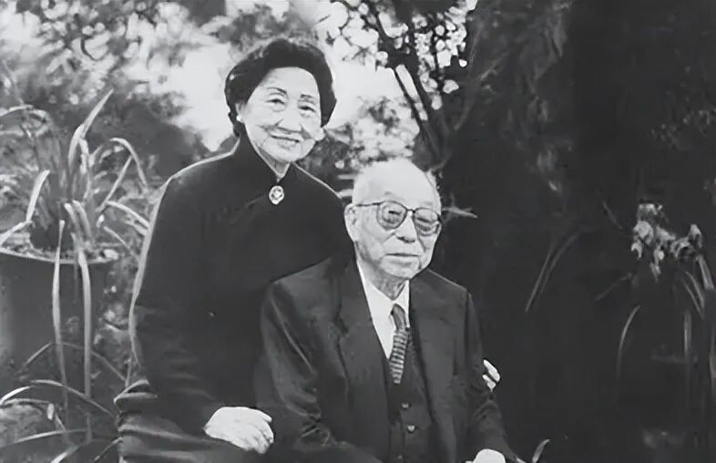

# 戳中软肋！张学良亲口说他最痛恨这两首诗
> 💡 备注属性未写入，可能是备注属性名称或者类型被修改了，建议将字段类型设置为 rich_text，可以在小程序-操作-修改文章数据库页面进行调整
> 💡 原文链接:[https://mp.weixin.qq.com/s?__biz=MzAxNDQ0MTI0Nw==&mid=2247500957&idx=1&sn=4eb9e8c4f6cfee920b06d3632bb2e58e&chksm=9a9c5860016f6d698330114359e5efa02c980b18223d26957b73c690642cf413dc6e0f0d2247#rd](https://mp.weixin.qq.com/s?__biz=MzAxNDQ0MTI0Nw%3D%3D&mid=2247500957&idx=1&sn=4eb9e8c4f6cfee920b06d3632bb2e58e&chksm=9a9c5860016f6d698330114359e5efa02c980b18223d26957b73c690642cf413dc6e0f0d2247#rd)
1931年，日本帝国主义入侵东北，张学良率领东北军不放一枪一炮，退守关内，将东北广阔富饶的大片国土拱手让给日本侵略者，国人泪满山河。当时**广西大学校长马君武**仿照李商隐“北齐”体，于1931年冬写了两首《哀沈阳》，发表于上海《时事新报》，轰动一时。张学良曾经说过他最痛恨这两首诗，为什么？因为这两首诗既令他愤懑，又令他无地自容。
## 第1首 近现代马君武的《哀沈阳》其一
**赵四风流朱五狂，**
**翩翩蝴蝶最当行。**
**温柔乡是英雄冢，**
**那管东师入沈阳。**
## 第2首 近现代马君武的《哀沈阳》其二
**告急军书夜半来，**
**开场弦管又相催，**
**沈阳已陷休回顾，**
**更抱佳人舞几回。**
诗中“赵四风流”中的赵四就是民国时期著名的“赵四小姐”，本名赵一荻，她年轻时与张学良相识，不顾张学良原配夫人和舆论，陪伴张学良度过几十春秋，最终于1964年7月4日，和张学良在台北结婚。

“朱五狂”中的朱五是朱启钤的五女朱湄筠，当年号称“北洋名媛”，她思想比较开放，张学良和朱湄筠曾否认有所瓜葛。
“翩翩蝴蝶”指的是民国一代名伶，演员胡蝶，她曾主演中国第一部蜡盘配音片《歌女红牡丹》。这句诗隐含之意是倭寇侵略沈阳城时，张学良与胡蝶翩翩共舞，不顾军国大事。胡蝶曾公开否认她和张学良之间有关系。PS：九一八事变当晚，少帅在北平看戏是事实，至于平日里去跳舞，也是免不了的。原诗是“蝴蝶”，并不是“胡蝶”，但指向型已经非常明显了。胡蝶本人为避嫌，也确实在上海《申报》两次登报声明，公开澄清此事。
“那管东师入沈阳”中的东师指日本帝国主义侵略者，这句诗写实，直击当事人要害。
作者此诗讽刺张学良沉迷于温柔富贵乡，不放一枪一炮，把东北拱手让给日本，令敌人长驱直入，直逼中原。
## 
第2首和上一首有异曲同工之妙，日寇犯境，东北军拱手让土，沈阳撤守，锦州撤防，东北作为首道屏障，张学良自毁长城，日军迅速攻打中国全境，这是国耻，也是国难。张学良本人对这两首诗非常有意见，非常不满，自称这是他最痛恨的两首诗。马君武这两首诗写得好，其实是仿照晚唐著名诗人李商隐的讽刺诗《北齐》二首。
唐朝李商隐的《北齐》二首其一
**一笑相倾国便亡，**
**何劳荆棘始堪伤。**
**小怜玉体横陈夜，**
**已报周师入晋阳。**
唐朝李商隐的《北齐》二首其二
**巧笑知堪敌万几，**
**倾城最在著戎衣。**
**晋阳已陷休回顾，**
**更请君王猎一围。**
这是李商隐很精彩的两首咏史诗，讽刺北齐后主高纬宠幸冯淑妃，荒淫亡国。《哀沈阳》与之可谓同出一辙。
当今网友又写了两首诗，不知少帅泉下有知又会作何感想？
**纨绔子弟号学良，五毒美名天下扬。**
**一朝梦碎九一八，从此未敢归故乡。**
**东北少帅不学良，温柔故乡梦一场。**
**耄耋不思返故土，死后银两捐西洋。**
