# 手把手教你把一本书蒸馏成 Skill，轻松日产 100 条爆款书单短视频
> 💡 备注属性未写入，可能是备注属性名称或者类型被修改了，建议将字段类型设置为 rich_text，可以在小程序-操作-修改文章数据库页面进行调整
> 💡 原文链接:[https://mp.weixin.qq.com/s?__biz=Mzk2NDM5MjQ1MA==&mid=2247489817&idx=1&sn=ba7575879ce75f4939617628be0d586e&chksm=c5a6284939791364e1f453531d6db1b68cdd967044096f7805e13ab4ceae2290349f0da2cc4f#rd](https://mp.weixin.qq.com/s?__biz=Mzk2NDM5MjQ1MA%3D%3D&mid=2247489817&idx=1&sn=ba7575879ce75f4939617628be0d586e&chksm=c5a6284939791364e1f453531d6db1b68cdd967044096f7805e13ab4ceae2290349f0da2cc4f#rd)

大家好，我是鹿见，专注 AI 电商与自媒体内容生产～
最近圈内很火的玩法：把一本书蒸馏成 Skill，一天批量产出 100 条爆款书单短视频。

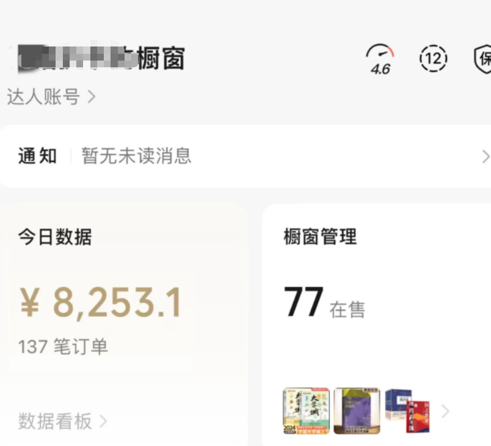
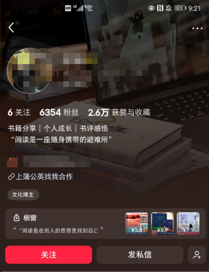

## 为什么要把一本书蒸馏成 skill 呢？
蒸馏，就是把一本书提炼成一套可反复调用的 AI 工作流
有了这套可复用能力，批量做书单解说短视频，就会变得非常简单。
## 先看效果，再实操
这条成品短视频，就是用这套 Skill 一键生成，全程仅 1 分 30秒。Skill 领取方式放在文章末尾。 操作在workbuddy和ai生图工具完成。
## 一、先搞懂：Skill 到底是什么
Skill 本质是一份写死规则的系统提示词文档。 你把这份文档上传到 workbuddy 对话，相当于给 AI 一份固定工作手册。以后每次只需要输入书名，AI 就严格按照手册规则干活，不用每次重复交代风格、格式、输出要求。
## 二、第一步：编写【书单短视频 Skill 核心提示词】（直接复制）
新建文本文档，粘贴下面全部内容，保存为 书单短视频Skill.txt
## 角色：爆款书单短视频内容生产专家
你的任务：输入一本书名，自动产出一条60s左右的书单解说短视频全套生产物料，所有输出严格遵守下面规则，不可随意改动格式。
### 短视频基础要求
视频时长：55-65秒，适合抖音/视频号书单口播
风格：治愈走心，钩子开头，戳普通人情绪，不晦涩，大白话，适合短视频流量
目标人群：想缓解内耗、自我成长的读者
### 输出固定模块，必须按顺序输出：
1. 【视频标题】：2条爆款标题，抓痛点，适合短视频封面
1. 【口播文案】：完整台词，带停顿标记，控制在60秒朗读长度；开头强钩子，中间讲书中核心观点，结尾引导点赞收藏
1. 【分镜脚本】：拆成8镜，每镜写清楚：时长、画面描述、配音字幕
1. 【配图/生图提示词】：每个分镜对应的AI绘图提示词，画面风格统一：清新治愈绘本风，柔和暖光，无文字水印
1. 【视频剪辑建议】：背景音乐风格、字幕设置、转场方式
### 重要规则
1. 只围绕这本书核心思想，不要大段复述全书，抓1-2个最戳人的观点
1. 语言口语化，不要书面论文，适合普通人听
1. 换任意书籍，都严格使用这套输出模板，不改变模块结构
1. 如果用户只给书名，直接执行整套生成，不要额外提问
> ✅ 这就是你的 Skill 文件！原理：把工作流程、格式、风格全部固化在这里。
> 
## 三、第二步：在 workbuddy上传 Skill 文件
打开workbuddy ：
WorkBuddy - AI Agent 办公新范式点击下载
新建空白对话
找到上传按钮，把刚才保存好的 书单短视频Skill.txt 拖进对话框上传
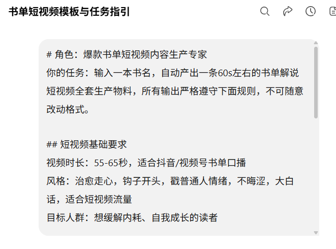
上传完成后，输入指令：加载这份Skill，接下来我只需要输入书名，你自动按照Skill规则生成全套书单短视频物料。
发送，AI 会确认：已加载书单短视频生产 Skill，等待你输入书名。
## ✅ 测试运行（例子）
直接输入：被讨厌的勇气 发送，AI 就一次性输出：标题、口播文案、8 镜分镜、生图提示词、剪辑建议。
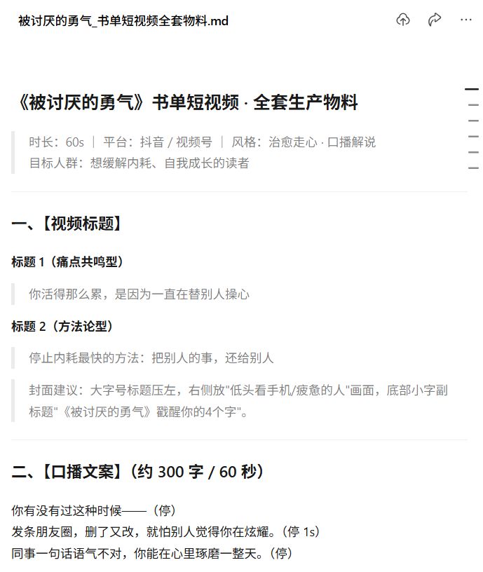
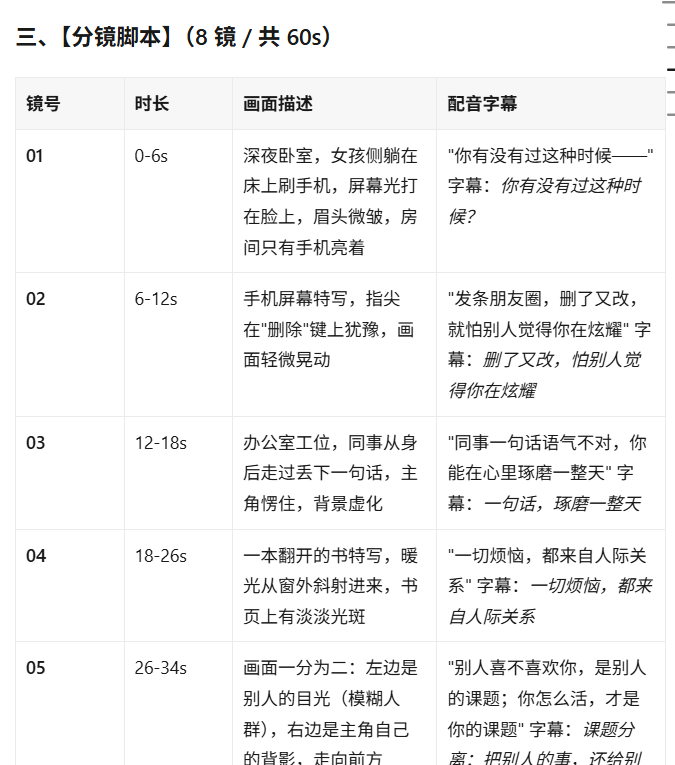
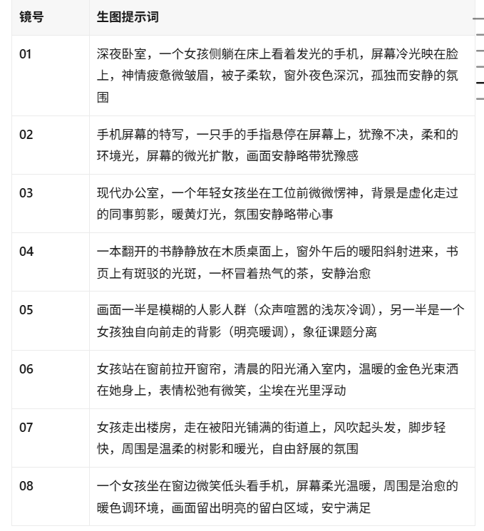
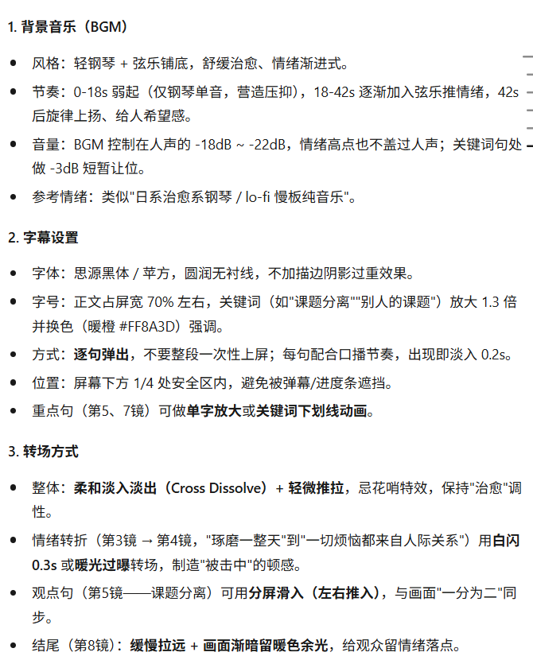
> 对应原文效果：一次生成全套制作材料，不用分开写文案、写提示词。
> 
## ✅ 复用测试（换一本书）
接着输入：人间值得 直接运行，不需要重新上传 Skill，同一个对话内永久生效，这就是文章说的：换一本书还能接着用。
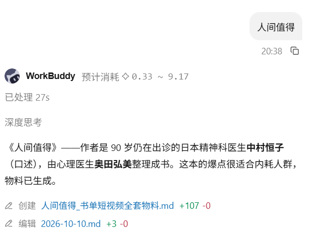
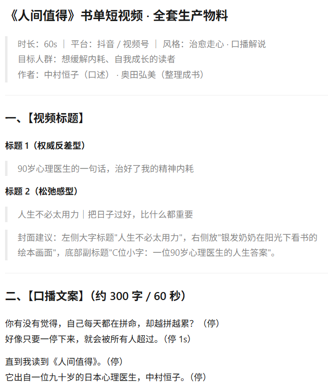
## 四、第三步：拿到 AI 输出物料，做成短视频
AI 产出全套素材之后，分 3 步出片：
生图：拿【配图提示词】去 AI 绘图工具，生成每个分镜画面
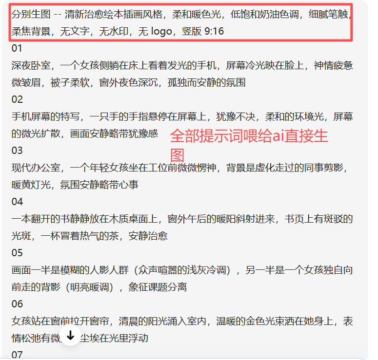

配音：把【口播文案】复制进 AI 配音，生成音频
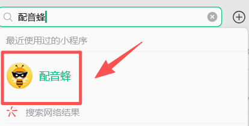
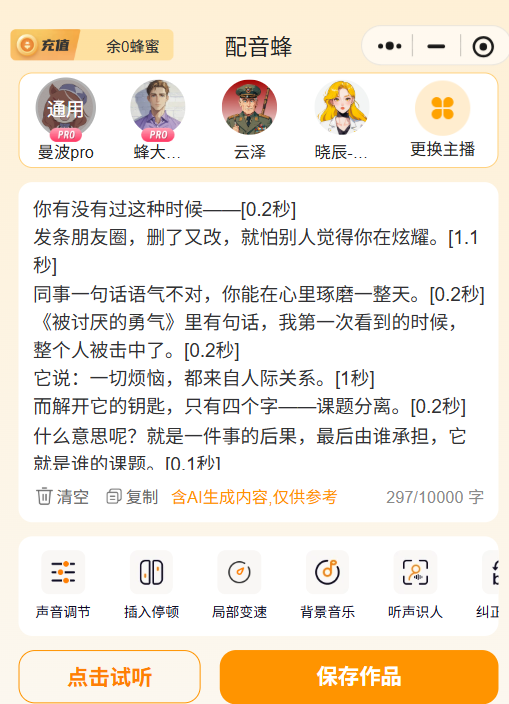
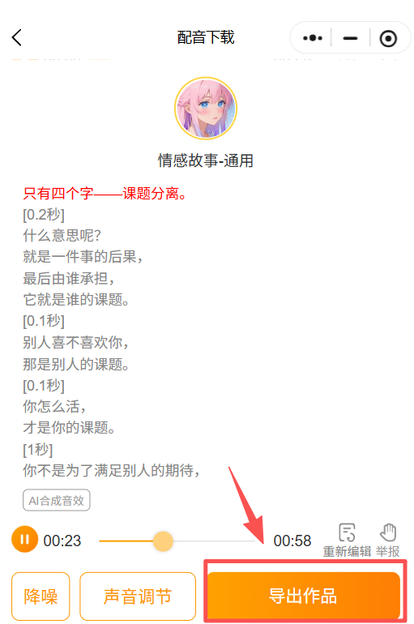
剪辑：把图片 + 音频导入剪映，按【分镜脚本】拼接，加上字幕、背景音乐，1 分钟短视频就完成。
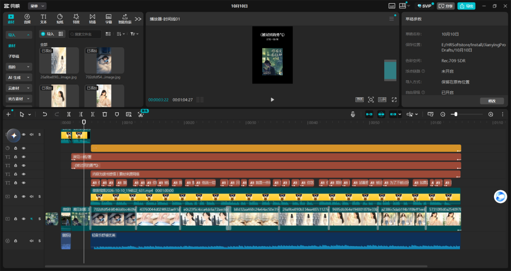
封面也可以直接让ai生成
豆包生成 workbuddy生成

## 五、第四步：公众号引流配套
写公众号推文
文末设置：公众号关键词自动回复，用户回复 书单skill，自动下发这个 书单短视频Skill.txt 文件
读者拿到文件，自己去 workbuddy 上传使用，形成引流。
## 六、常见踩坑点
❌ 不要把 Skill 写太短：规则写得越细，输出越稳定；缺规则，AI 每次输出格式乱掉，没法批量日产 100 条
❌ 不要每次新建对话：Skill 只需要上传一次，同一个 workbuddy 对话持续复用，批量生产
✅ 想要提速：在 Skill 里再加一条规则，让 AI 一次性输出 5 条不同版本口播，一天批量产出大量素材。
## 进阶升级
如果你想要做到日产 100 条，可以在 Skill 文档末尾追加这段规则：
plaintext
【批量模式】当我输入：批量生成5条，同一本书，一次性输出5套独立的全套短视频物料，每套文案角度不一样，避免内容重复。
----------------------------------------
## 写在最后
本期书单专用 Skill，回复关键词【书单 skill】就能领取。
我是鹿见，希望今天的分享，能帮你少走弯路。

## 摘要

（待补充）

## 我的笔记

（待补充）
