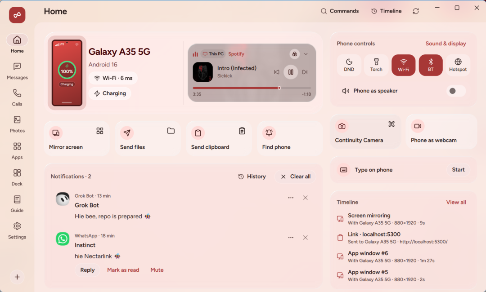
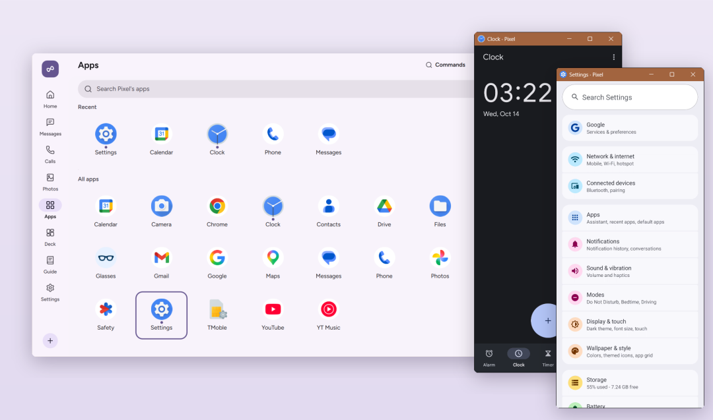

# 手机完全打通电脑就是这么简单
> 💡 备注属性未写入，可能是备注属性名称或者类型被修改了，建议将字段类型设置为 rich_text，可以在小程序-操作-修改文章数据库页面进行调整
> 💡 原文链接:[https://mp.weixin.qq.com/s?__biz=MzIwNTc3OTAxOA==&mid=2247499543&idx=1&sn=2cc1226f5d25703a136551ec1e3ada45&chksm=96efcf4ebe5c6d3eafcdb348723f49626a37ee2c85af9b9877e0bd500867ae3c7f4388f5696a#rd](https://mp.weixin.qq.com/s?__biz=MzIwNTc3OTAxOA%3D%3D&mid=2247499543&idx=1&sn=2cc1226f5d25703a136551ec1e3ada45&chksm=96efcf4ebe5c6d3eafcdb348723f49626a37ee2c85af9b9877e0bd500867ae3c7f4388f5696a#rd)
如果你打算在 Windows 上把手机用起来，只装一个软件是不够的。
通知和短信要靠 Phone Link，剪贴板要靠 KDE Connect，传文件得另外再开一个 LocalSend，等到要投屏，又得回头折腾 scrcpy。
于是你要做三套配对、放行三套防火墙规则、设三个开机自启，用久了会怀疑自己到底是用户，还是这屋里的网管。

NectarLink 的作者就是被这些事烦出来的。他在 README 里写得很直白，说自己一直在 Phone Link、KDE Connect 和 LocalSend 之间来回切换，索性就动手写一个什么都能干的。
它的定位用一句话就能说完：一部手机、一台电脑，两边装同一个 app，走本地直连，端到端加密，不需要账号，也不经过云端。
电脑这一头要求 Windows 10 2004 以上或者 Windows 11，Linux 支持的是 Ubuntu 24.04、Debian 13、Fedora 40 这一批，手机上至少得是 Android 8.0，目前最新的稳定版是 0.1.5。
#### 值钱的其实是那一份 core
它的功能确实不少，比如回复通知、收发短信、接打电话、共用剪贴板、双向传文件、看相册、镜像屏幕、把手机上的 app 单独开成一个窗口，还能让手机临时当摄像头、当麦克风、当 Stream Deck。
多到你在 README 里得往下滚很久才看得完。

不过我并不觉得这些功能最值钱。
这类工具最容易死掉的原因，往往跟功能多少没有关系，问题多半出在两端对不上。
电脑端和手机端各写一套协议，各自往下演进，只要某一次改动了字段编码，用户那边就开始连不上、消息错位，文件传到一半就断掉。
用过 KDE Connect 的老用户应该都有这种感觉。
NectarLink 的做法是把协议、配对、会话、信任库、能力矩阵这些东西全塞进一个 Rust crate 里，电脑端和 Android 端跑的就是同一份代码，两边只是分别用 cxx-qt 和 UniFFI 在外面包了一层接口。
作者自己在项目计划里写得很清楚，之所以让两端跑同一份协议代码，就是为了避开不同实现之间对不上的问题。
这话什么意思呢？说白了就是：两个人对账，各自记自己的一本账，到了月底必然要吵一架。
同一份协议如果由两边分别去写，最后的结果就是谁都不敢先升级。
传输层这部分他也顺便做对了。它用 iroh 跑 QUIC，走 TLS 1.3，双方靠配对时交换的设备密钥互相认证，设备身份用的是 Ed25519。
因为压根没有账号系统，所以登录过期、异地验证那一堆麻烦事也就跟着没有了。
#### 三条连接路径，最有意思的是走 USB 那一段
同一套协议提供了三条连接路径：在局域网里先靠 mDNS 发现设备，然后直接连 QUIC；插上线就走 USB；人要是到了外地，就走可选的中继。
USB 这一条挺有意思。它并不去启动 adb.exe，而是自己照着 ADB 主机协议连到 `127.0.0.1:5037`，跟着设备的状态走，把 `adb forward` 配好，然后在 TCP 上面套一层自己的隧道头，再把 QUIC 的 UDP 报文塞进去传输。
说白了，当系统不让 UDP 直接走的时候，就换个盒子继续往下送，加密和拥塞控制一样都没少。
#### 不过先别急着装，账得这么算
项目现在才走到 0.1.5，仓库是 2026 年 10 月才建的，到今天大概 4500 星、60 多个还没处理的 issue，干活的主力基本就是作者一个人（他在 README 里自称 Bee）。
这样体量的个人项目，功能写得再花哨，稳定性和推进速度都得你自己去验。
安装这一步就会先给你来点强度。Windows 的安装包没有做代码签名，第一次运行大概率会被 SmartScreen 拦一下，你得点更多信息，再点仍要运行。
Android 那边在印度等地会被 Play Protect 直接挡住，连仍然安装的按钮都不给你，只能临时把扫描关掉，或者用 `adb install` 从电脑上装。
用 Linux 的人还得接受一条：设备私钥目前在 Linux 上没有任何平台级保护，就是一个权限为 `0600` 的文件，官方核心代码自己都会在日志里打一句 `device key is stored without platform protection`。
而 Windows 走 DPAPI，Android 走 Keystore，macOS 走 Keychain，到了 Linux 就只剩下这一句警告。
这话听着好像不严重，但意思很实在：只要谁能读到你家那台 Linux 电脑上的文件，他也就拿到了这台设备的身份。
### 写在最后
NectarLink 的野心比做一个更漂亮的 Phone Link 要大，它想把 Windows 连手机这条链路上散落各处的工具收进同一个壳里，再用一份共享的 core 把版本地狱堵住。
这种思路比单纯堆功能值钱得多。
但 0.1.5 终究只是 0.1.5。你把它装到主力机上，就得接受它某天晚上给你表演连接失败、镜像卡一下、某个开关的行为不太对。
想稳妥的话，可以先拿一台闲置的 Windows 笔记本加一台备用安卓机跑上两周，再决定要不要往生产环境里搬。
工具可以一次装全，信任却要一点点长出来。
**https://github.com/thtbee/nectarlink**
**END**
**往期推荐**
- [清华团队把课堂做的遥遥领先了](https://mp.weixin.qq.com/s?__biz=MzIwNTc3OTAxOA%3D%3D&mid=2247499205&idx=1&sn=bdaaffd7276c331542271de68ba691a0&scene=21#wechat_redirect)
- [也许真的可以让AI操作任何软件了](https://mp.weixin.qq.com/s?__biz=MzIwNTc3OTAxOA%3D%3D&mid=2247499202&idx=1&sn=a20cad998ed8bbbec3cc805697a71d95&scene=21#wechat_redirect)
- [AI 写前端终于不会乱来了](https://mp.weixin.qq.com/s?__biz=MzIwNTc3OTAxOA%3D%3D&mid=2247499166&idx=1&sn=7fb5f380ff4eb15412ade559af74b78a&scene=21#wechat_redirect)
- [架构图终于有他该有的样子了](https://mp.weixin.qq.com/s?__biz=MzIwNTc3OTAxOA%3D%3D&mid=2247499136&idx=1&sn=2795d221c2df3fbc98165d97a1505a20&scene=21#wechat_redirect)
- [261 种手绘风格应该足够你用了](https://mp.weixin.qq.com/s?__biz=MzIwNTc3OTAxOA%3D%3D&mid=2247499079&idx=1&sn=58318984465353400a528f1e84d61da8&scene=21#wechat_redirect)
- [你的代码敢不敢让它审一遍？](https://mp.weixin.qq.com/s?__biz=MzIwNTc3OTAxOA%3D%3D&mid=2247499078&idx=1&sn=957598d456cb946a421e44ec0b319014&scene=21#wechat_redirect)
