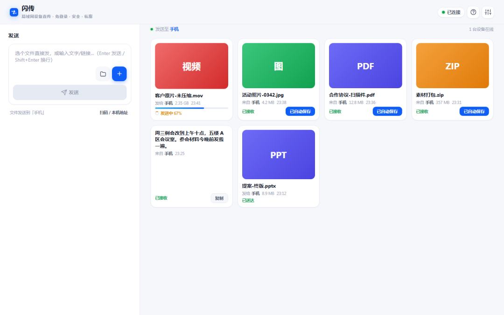

# 手机电脑互传文件，我早就不用微信传输助手了
> 💡 备注属性未写入，可能是备注属性名称或者类型被修改了，建议将字段类型设置为 rich_text，可以在小程序-操作-修改文章数据库页面进行调整
> 💡 原文链接:[https://mp.weixin.qq.com/s?__biz=MzYyMjQ0NTM5Nw==&mid=2247483795&idx=1&sn=9b9c760d75cc2547f07a94aa175abd2a&chksm=fec5d859085d321bddcc6c4f763bcc881714b14c98d5656930884aa2433735b00eb083541963#rd](https://mp.weixin.qq.com/s?__biz=MzYyMjQ0NTM5Nw%3D%3D&mid=2247483795&idx=1&sn=9b9c760d75cc2547f07a94aa175abd2a&chksm=fec5d859085d321bddcc6c4f763bcc881714b14c98d5656930884aa2433735b00eb083541963#rd)
同一个 Wi-Fi 下的两台设备传文件，绕不开下面这几种：
**微信文件传输助手**，手机传电脑最顺手，但照片视频压画质，稍大点的文件传着传着就断。
**网络共享文件夹： **如果是两台电脑互传，用过的都知道，windows的网络共享经常容易出问题卡死或连接不上。
**网盘**，能传大文件，得先上传再下载，两头都得等，不充会员限速限到怀疑人生。
**数据线**，速度最快，得找到线、插上、选「传输文件」模式，手机跟电脑一个 Android 一个 iPhone 还未必通用。
**隔空投送**，好用，前提是双方都是苹果设备，跨平台直接歇菜。
这几种方式都卡在一个地方：要么折腾，要么压缩，要么限速，要么只认自家设备。闪传把这些全绕开了，就一个网址：**send.aimcp.ren**。
打开网址就自动配对，拖文件即传
两边浏览器打开这个网址，同一个 Wi-Fi 下设备自动互相看见，拖文件进去，完事。
没有 App，没有账号，没有扫码下载的套娃，也不用先关注公众号。输码、配对、确认这些步骤一概没有。想少打几个字，任意一端调出二维码，另一端扫一下即可。

二维码自动弹出，手机扫一下就进
拖拽、选文件、传文字，松手即发
文件夹拖进去，层级原样保留。传输进度压在卡片上，断线明确显示失败并可一键重试，不用猜。
接收端默认自动保存到系统下载目录，没有保存弹窗；图片视频带缩略图可预览，文字点击即复制。电脑上是宽屏双栏，左发右收，文件排成卡片，最新在前。

宽屏双栏，左边发送右边接收

手机端，底部一行完成输入和选文件
数据点对点直传，不经过任何第三方
这是它和微信传输助手、网盘最本质的区别。服务器只负责让两台设备互相找到，找到之后数据就在设备之间点对点直传，不经过服务器，也不经过任何第三方。文件内容服务器全程没接触过，加上免登录、无注册，连收集信息的入口都没有。
两台设备需在同一个 Wi-Fi 或同一网络出口下。跨网络它不做——那是需要中转服务的工具的活。
工具免费，无广告。此刻手机和电脑连着同一个 Wi-Fi，就花三十秒试一次。
**https://send.aimcp.ren**

## 摘要

（待补充）

## 我的笔记

（待补充）
