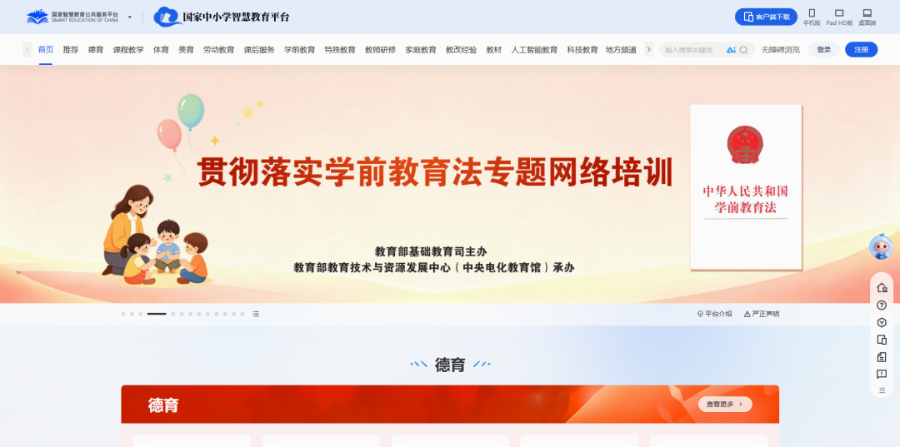
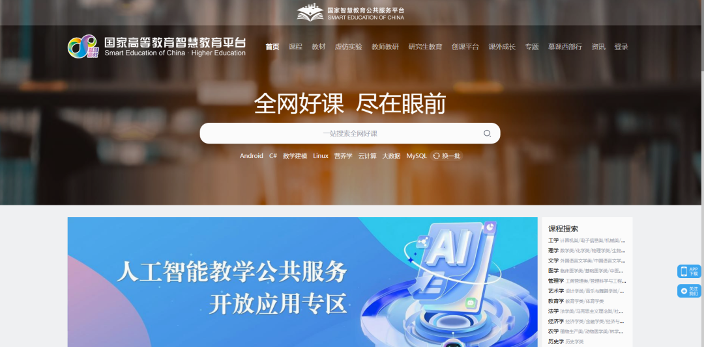
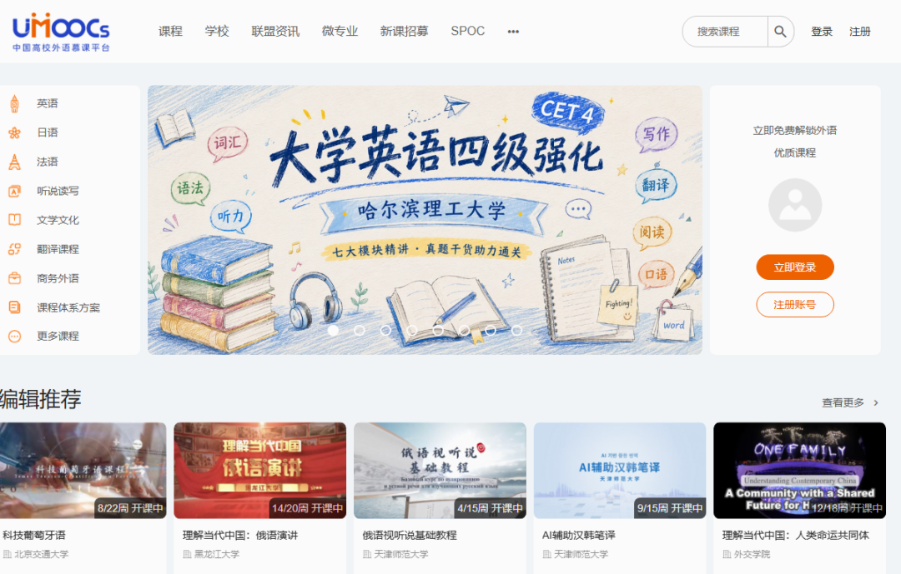
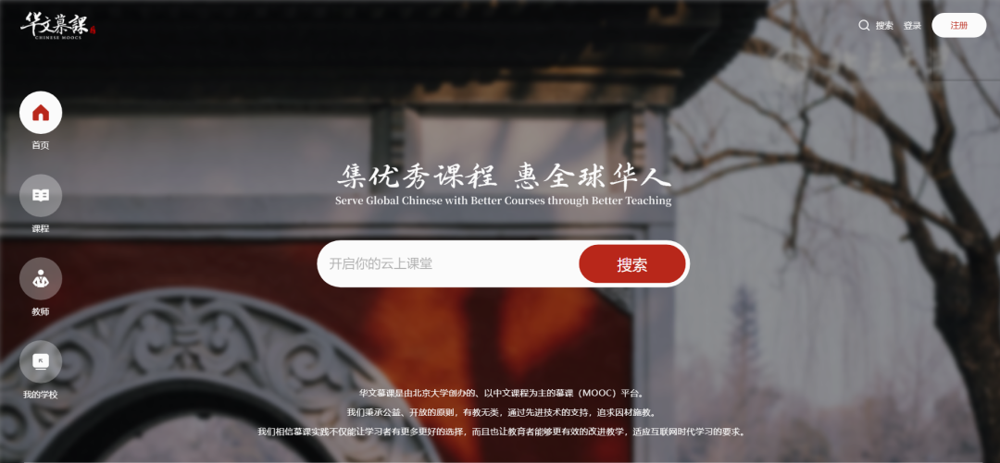
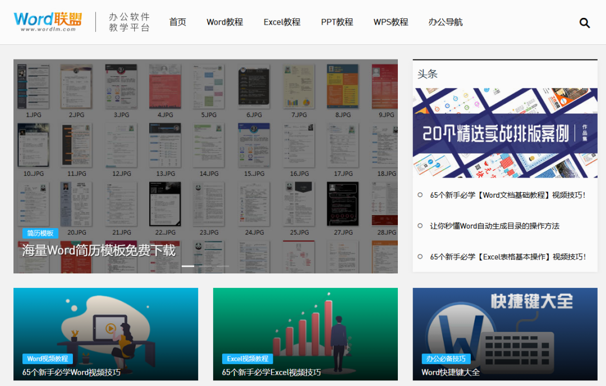
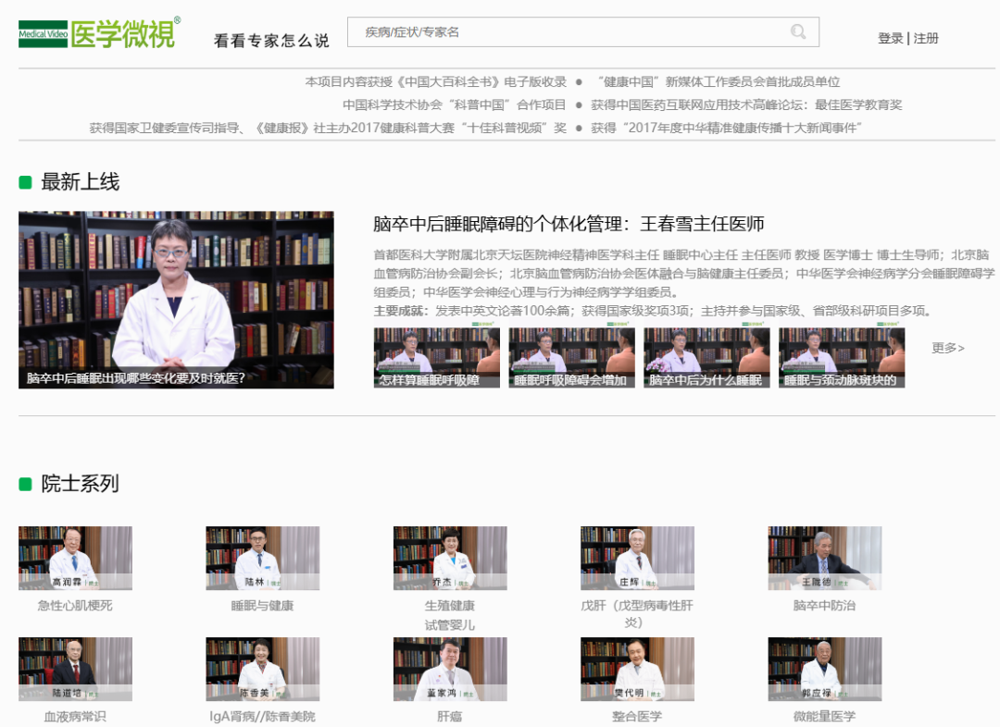
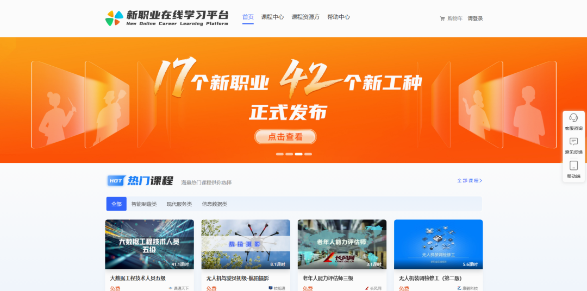
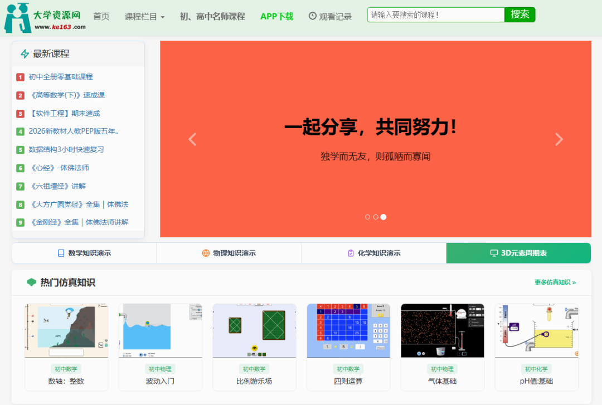

# 打开这8个学习网站后，我把付费课全退了
> 💡 备注属性未写入，可能是备注属性名称或者类型被修改了，建议将字段类型设置为 rich_text，可以在小程序-操作-修改文章数据库页面进行调整
> 💡 原文链接:[https://mp.weixin.qq.com/s?__biz=MzA3NDU2Njc4Nw==&mid=2652234780&idx=1&sn=169f1b86f89f78e62870ad3234e52437&chksm=85c7adcccc549faf992f105c85c6137228dffc2b28bd7d0cb7cb7138ce9672a49ac64cd67148#rd](https://mp.weixin.qq.com/s?__biz=MzA3NDU2Njc4Nw%3D%3D&mid=2652234780&idx=1&sn=169f1b86f89f78e62870ad3234e52437&chksm=85c7adcccc549faf992f105c85c6137228dffc2b28bd7d0cb7cb7138ce9672a49ac64cd67148#rd)
说实话，我一开始也不信"免费能有多好"。
这几年各种课程平台、学习APP，动不动就是会员制、训练营、限时优惠，交钱之前说得天花乱坠，交完发现一半时间在听老师吹自己。
直到把这八个网站一个个用下来，我才发现，真正的好东西早就摆在那儿，只是没人告诉你。
**一、国家中小学智慧教育平台**
**网址：https://basic.smartedu.cn/**
**教育部官方出品**，小学到高中的全科内容都在里面。
按"年级—学科—单元"点进去，每个知识点都是一节5到15分钟的微课，讲得清楚，也不废话。
**全程没有广告，没有充值弹窗，纯公益。**
家长辅导作业不用再东拼西凑，老师备课也能直接拿来用。这种官方出手的东西，扎实程度往往比外面不少付费课还高。

**二、国家高等教育智慧教育平台**
**网址：https://higher.smartedu.cn/**
中小学版有，高等教育版也有，**这个平台汇集的是全国高校的优质在线课程。**
本科的专业课、公共课基本都能在这儿找到对应资源，可以按学校、按专业、按课程名去搜。
大学生如果只是想补齐某一门课的短板，真没必要一上来就报班，先来这儿翻一遍再说。

**三、中国高校外语慕课平台**
**网址：https://moocs.unipus.cn/**
**外语学习的专门平台**，英语、日语、法语、德语、俄语、韩语、西班牙语、阿拉伯语、意大利语、泰语，语种开得很全。
课程多由北京外国语大学、同济大学这些高校的老师来讲，从口语、语法到翻译、听力都有，课程大多免费。
想学二外、想练口语、想备四六级和雅思，都能捞到能用的课。外面一节外教一对一的钱，够你在这儿把课学很久了。

**四、华文慕课**
**网址：http://www.chinesemooc.org/**
北京大学创办的慕课平台，主打中文授课的课程。
**公益、开放，注册就能学，没什么花里胡哨的收费套路。**
课程由高校老师主讲，视频、课件、讨论区都做得规规矩矩。
想蹭一蹭名校课堂，又不想被各种学习APP的会员拦住，这个站很合适。

**五、Word联盟**
**网址：http://www.wordlm.com/**
**专门教办公软件的网站**，Word、Excel、PPT、WPS，一个不落。
图文教程、视频教程都有，还能顺手拿一堆模板，简历模板、表格模板直接网盘下载。
做PPT没思路、Excel函数不会用、论文排版头大，来这儿搜一下基本都能解决。
职场人再为"Office进阶课"花钱，属实有点亏。

**六、医学微视**
**网址：https://www.mvyxws.cn/**
**一个医学科普视频网站，讲的是正经的医学知识。**
每个疾病、每个症状都由三甲医院的专家甚至院士出镜讲解，内容获《中国大百科全书》电子版收录，也是"科普中国"的合作项目。
想搞懂自己的身体，或者家里人有点小毛病想先了解清楚，看这个比在搜索结果里被各种软广吓唬强太多。健康科普这种钱，真没必要花。

**七、国家新职业在线学习平台**
**网址：https://xzy.mohrss.gov.cn/**
**由人社部中国就业培训技术指导中心牵头做的平台，专讲新职业。**
物联网安装调试员、工业机器人系统操作员、电子竞技运营师、数字化管理师、人工智能，这些新兴岗位的课程上面都有，绝大多数免费。
想转行、想给技能加点新东西，又不知道从何学起的，先来这儿看看官方认定的新职业长什么样。

**八、大学资源网**
**网址：https://www.ke163.com/**
**大学阶段的免费自学视频站，路子很杂但很全。**
大学课程、考研、外语、资格考试、计算机、职业培训、医学视频，门类铺得特别开。
适合那种"先看看有没有，再决定要不要花钱报班"的人，很多科目的入门内容在这儿就能搞定。
界面朴素、内容质量参差是实话，但胜在免费，先用它筛一遍需求，再决定往哪投入。

**写在最后**
这八个网站，多数有官方背景，少数是做了十几年的老站，共同点是内容免费、更新稳定、没有套路。
**真正想学东西的时候你会发现，贵的从来不是知识，而是你把时间花在了哪里。**
**收藏下来，今天先打开一个，比什么都强。**
**您可能还喜欢:**
[国家偷偷给你开了9个免费图书馆，很多人一个都没点开过](https://mp.weixin.qq.com/s?__biz=MzA3NDU2Njc4Nw%3D%3D&mid=2652234767&idx=1&sn=27f007c08aa4ddf80b86b520e4c9fe98&scene=21#wechat_redirect)
[8个免费刷题网站，第3个是真的香!](https://mp.weixin.qq.com/s?__biz=MzA3NDU2Njc4Nw%3D%3D&mid=2652234703&idx=1&sn=18df9ed3ee5f72cb361cee3feaaa2f49&scene=21#wechat_redirect)
[这10个优质英语学习网站，竟然全免费!(亲测可用,附中文指南)](https://mp.weixin.qq.com/s?__biz=MzA3NDU2Njc4Nw%3D%3D&mid=2652234672&idx=1&sn=b81b0c71bd6aa1830881496bef47abf0&scene=21#wechat_redirect)
[8个出类拔萃学习网站，免费的就是香！](https://mp.weixin.qq.com/s?__biz=MzA3NDU2Njc4Nw%3D%3D&mid=2652234679&idx=1&sn=9fdc2b221da1bee8e7b110ab7b6bccf9&scene=21#wechat_redirect)
#免费学习网站 #学习网站 #自我提升 #大学生 #知识分享
