# 批量下载抖音视频（保姆级）
> 💡 备注属性未写入，可能是备注属性名称或者类型被修改了，建议将字段类型设置为 rich_text，可以在小程序-操作-修改文章数据库页面进行调整
> 💡 原文链接:[https://mp.weixin.qq.com/s?__biz=MzA5NDQ3ODI2OQ==&mid=2459205352&idx=1&sn=828d64fe0375ff32170702f663993767&chksm=86aee483a93bd97c59de6cb51f377817460fb61b66fe44b8dd515635d58ef18caa55517a15f1#rd](https://mp.weixin.qq.com/s?__biz=MzA5NDQ3ODI2OQ%3D%3D&mid=2459205352&idx=1&sn=828d64fe0375ff32170702f663993767&chksm=86aee483a93bd97c59de6cb51f377817460fb61b66fe44b8dd515635d58ef18caa55517a15f1#rd)
**本方法仅用于个人学习研究，禁止分发、商用、冒充原博主，遵守平台规则与著作权法。**
具备如下功能：
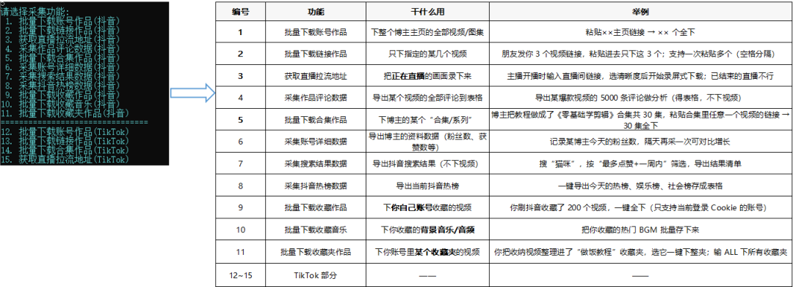
**详细步骤**
**一、下载安装工具**
1、下载DouK-Downloader（原名 TikTokDownloader）
https://ghfast.top/https://github.com/JoeanAmier/TikTokDownloader/releases/download/5.8/DouK-Downloader_V5.8_Windows_X64.zip
2、在D盘新建文件夹 D:\tools\TikTokDownloader，把 zip 解压进去
注：可以是其他磁盘，保证**空间够大**就行；路径需要用**纯英文**，就是创建的文件夹需要是英文的
**二、首次运行**
1、双击 DouK-Downloader.exe，弹出黑色命令行窗口。这是正常界面，不是卡住。
2、出现"请选择语言"时，**输入 1 按 回车**（简体中文）。
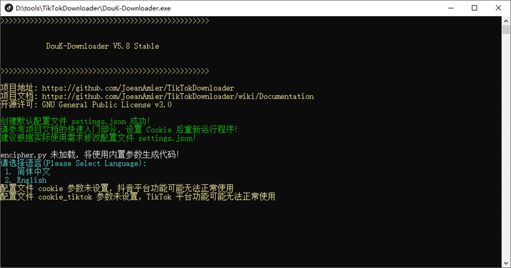
3、首次使用会显示免责声明，按提示**输入 Y 按回车**同意
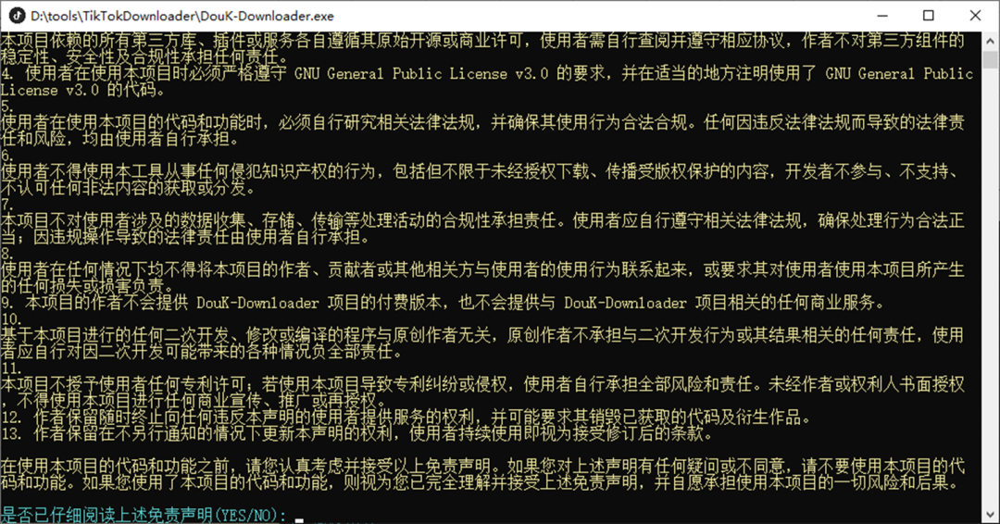
4、进入主功能菜单。
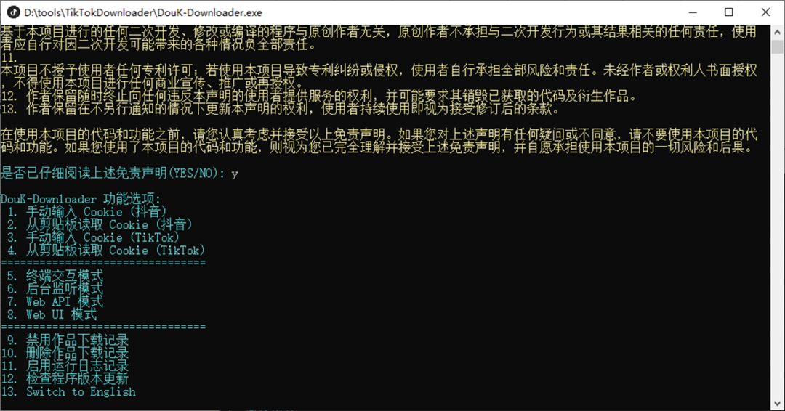
**三、写入 Cookie（最关键的一步，只需一次）**
**第 1 步**：从浏览器复制 Cookie
1、用 Edge（或 Chrome）打开 www.douyin.com，点右上角"登录"，手机扫码登录。
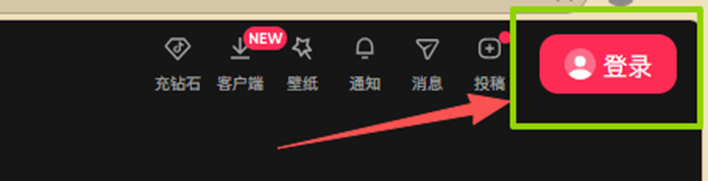
2、打开开发人员工具：在网页上点一下，按 **F12**（笔记本可能要 **Fn + F12**），或 **Ctrl + Shift + I**。
【**F12 没反应？**① 确认刚才点击的是浏览器网页而不是别的窗口；② 保底方法：Edge 右上角「…」→「更多工具」→「开发人员工具」，一定能打开。】
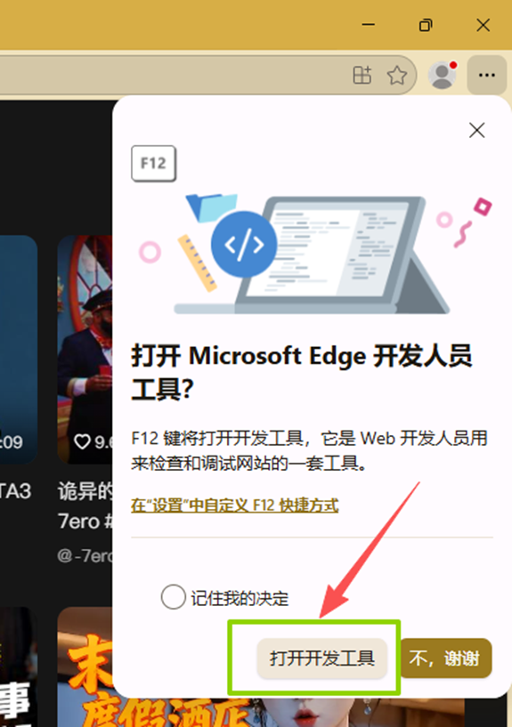
3、点面板顶部「**网络**」（**Network**）标签，按 **F5**（或**fn+F5**） 刷新抖音页面，出现请求列表。
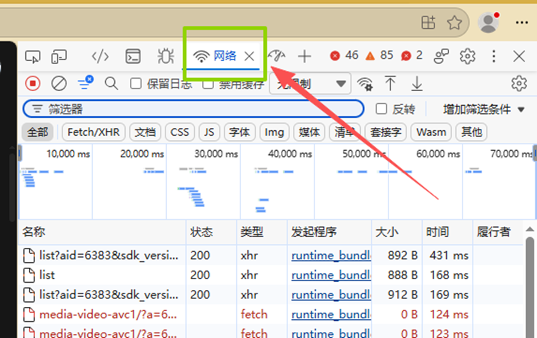
4、点列表**最上面第一条**（名称可能显示 jingxuan、www.douyin.com 或一串字母——浏览器只显示网址后半段，不会出现以 www.douyin.com 开头的一行，这是正常的）。
判断标准：**右边「类型」列是 document（文档）的那条**。点它后右侧出现详情面板。
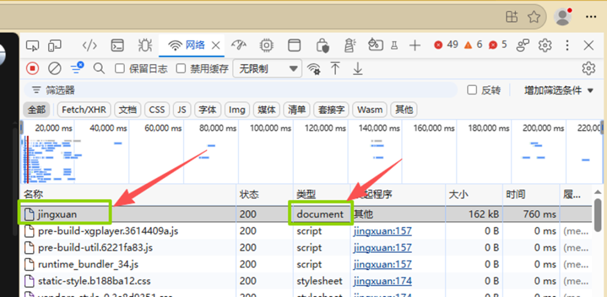
5、详情面板顶部选「**标头**」（**Headers**），往下滚动找到「**请求标头**」（**Request headers**）（可能要点开折叠箭头），**定位到 Cookie**: 一行。
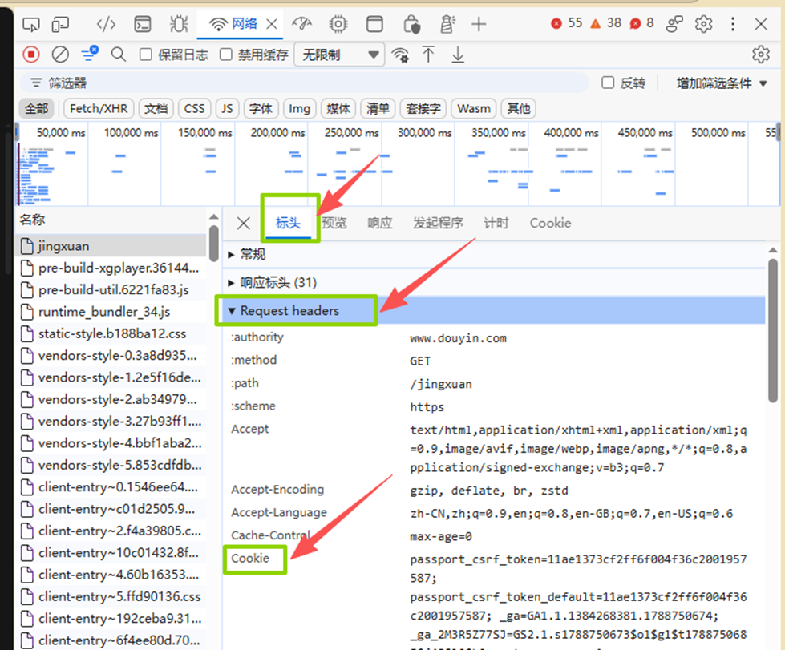
6、把 Cookie: 后面的一整串内容**全部复制**（很长）
注：**推荐在 Cookie 行上右键** → **复制值**，不容易漏。
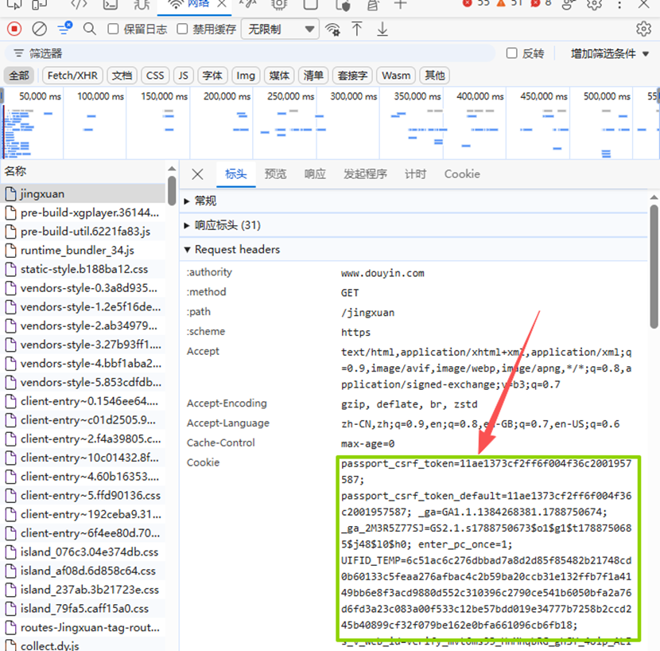
**第 2 步：粘贴进程序**
1、回到黑框，主菜单**输入 2**（从剪贴板读取 Cookie（抖音））→** 回车**。
2、程序自动检测剪贴板，提示有效即成功。
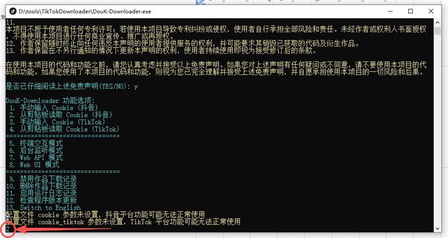
2、**Cookie 会保存下来持续有效（几周到几个月）**。哪天下不动了，重复本章重新复制写入即可，不用重装。
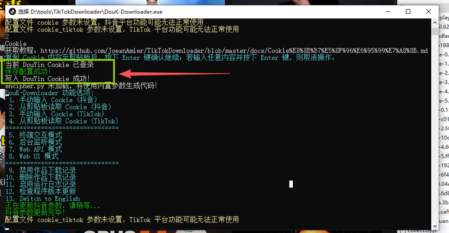
**四、首次批量下载**
1、主菜单**输入 5**（终端交互模式）→ **回车**。"
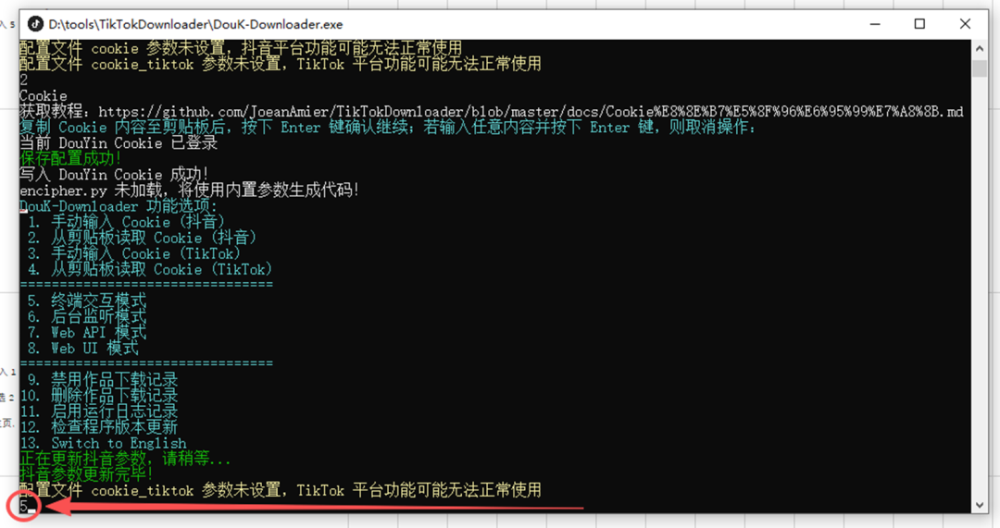
2、请选择采集功能**输入 1**（批量下载账号作品）→ **回车**。
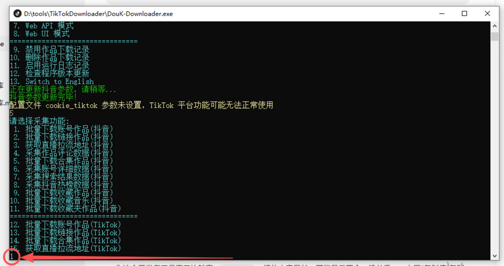
3、请选择账号链接来源**选 2**（手动输入待采集的账号链接）→ **回车**。
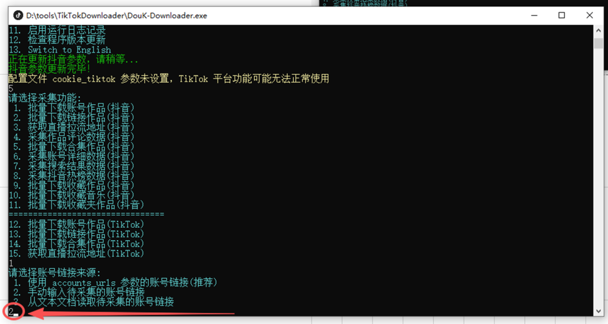
4、在浏览器**打开目标博主主页**，**复制地址栏**全部内容，粘贴进黑框回车：（**如果有红框部分，建议把它删掉，只保留核心部分再粘贴给程序**，如下图！因为这部分是你当时正在看某个具体视频时复制的地址）

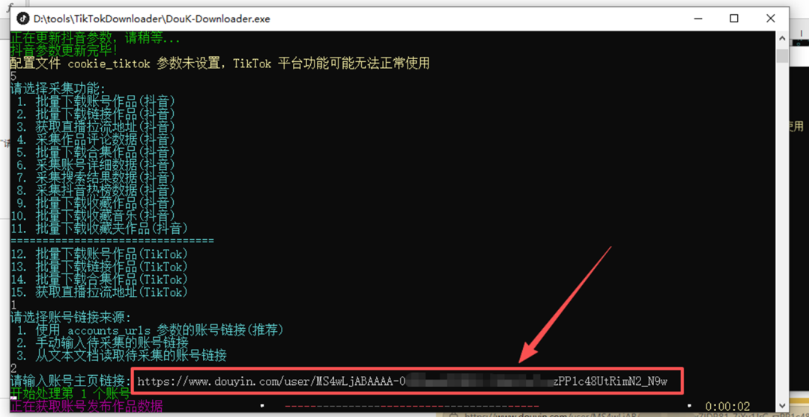
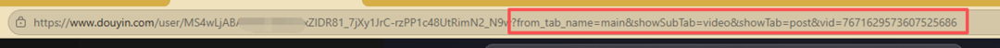
5、程序显示"共获取到 N 个作品"后自动逐个下载，全部完成后自动回到菜单。
**五、视频在哪**
全部保存在程序目录的 Volume 文件夹里，按博主自动分类。
注：如需其他下载方式，见文章开头，自行探索即可。
