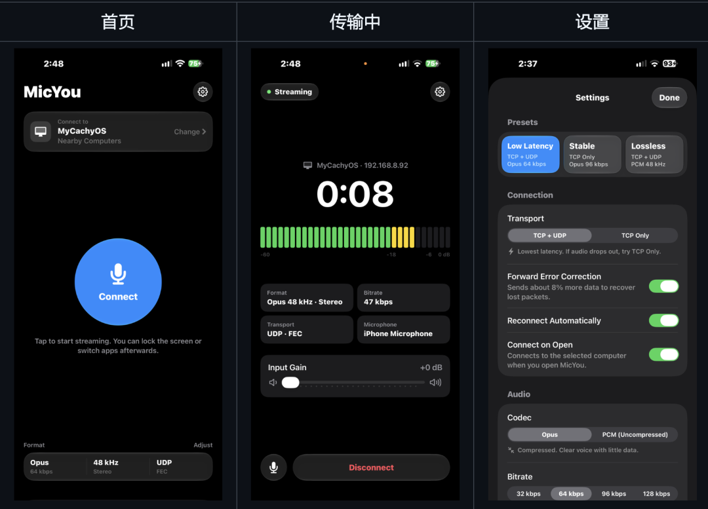

# 把 iPhone 或 iPad 变成电脑麦克风的工具，通过 Wi-Fi 或 USB 线传到电脑
> 💡 备注属性未写入，可能是备注属性名称或者类型被修改了，建议将字段类型设置为 rich_text，可以在小程序-操作-修改文章数据库页面进行调整
> 💡 原文链接:[https://mp.weixin.qq.com/s?__biz=Mzg2MjY1NDIzNg==&mid=2247502329&idx=1&sn=b785361fc5faf529e6db599f8e33ca4a&chksm=cfc71388e16d9dcdfd255f064145ece25d9c94488c039d23367df9eaee1f8d61447af9ffb365#rd](https://mp.weixin.qq.com/s?__biz=Mzg2MjY1NDIzNg%3D%3D&mid=2247502329&idx=1&sn=b785361fc5faf529e6db599f8e33ca4a&chksm=cfc71388e16d9dcdfd255f064145ece25d9c94488c039d23367df9eaee1f8d61447af9ffb365#rd)
MicYou-iOS
> “
> 一个把 iPhone 或 iPad 变成电脑麦克风的工具。手机录的声音通过 Wi-Fi 或 USB 线传到电脑，电脑端装个配套软件就能在聊天、直播、录音这些场景里直接用。
> 
Github地址
**https://github.com/MicYou-Dev/MicYou-iOS**

功能特性
- 找电脑不用手动输 IP，局域网内自动搜索，也支持手动填地址和 USB 有线连接
- 传输走 TCP+UDP，延迟压得比较低；网络差的时候可以切纯 TCP 或者开前向纠错
- 编码支持 Opus 和 16 位 PCM，采样率有 48/44.1/16 kHz 三档，单声道立体声都能选
- 自带三档预设：低延迟、稳定、无损，一键切换不用自己调参数
- 输入增益最高加到 24 dB，有限幅器防炸麦；可以开系统自带的人声处理（回声消除、降噪）
- 麦克风来源随便换：手机底部、前置、后置，或者插耳机、USB 麦、蓝牙麦，传输中途也能切
- 实时显示电脑测的延迟和丢包率
- 双向同步静音，支持按住说话；断了自动重连，最多试 6 次，后台录音不停
- 可以设置打开 App 自动连；有黑屏模式，屏幕亮着但几乎不耗电
- 锁屏和后台能持续传，锁屏界面和灵动岛直接看状态、静音或断开
- 支持快捷指令和 micyou:// 开头的 URL 调用
- 首次用有欢迎页和操作引导，关于页能导出日志、检查更新
- 简中、繁中、英文三种界面
使用方式
系统要求 iOS 18.0 以上，去 GitHub Releases 下 ipa 文件。完整版用 AltStore、SideStore、Sideloadly 或 xtool 签名安装；LiveContainer 用户下专用版，但实时活动和灵动岛用不了。电脑端去 MicYou Releases 下对应版本。
用的时候：电脑端开 Wi-Fi 模式，手机电脑同个局域网；手机 App 点顶部电脑卡片，从附近列表选你的电脑，搜不到就手动输 IP 或者 USB 连。点连接，给麦克风和本地网络权限，然后就能锁屏或切后台了。电脑上的软件把输入设备选成 MicYou 虚拟麦克风即可。注意只能在 App 前台时开始录音，开始之后才能退后台。

## 摘要

（待补充）

## 我的笔记

（待补充）
