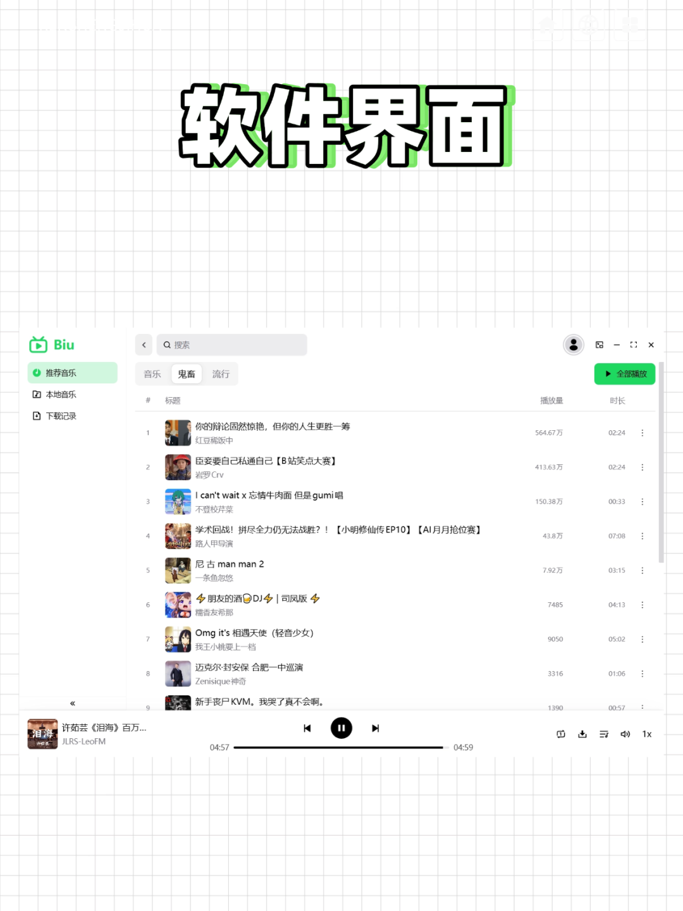
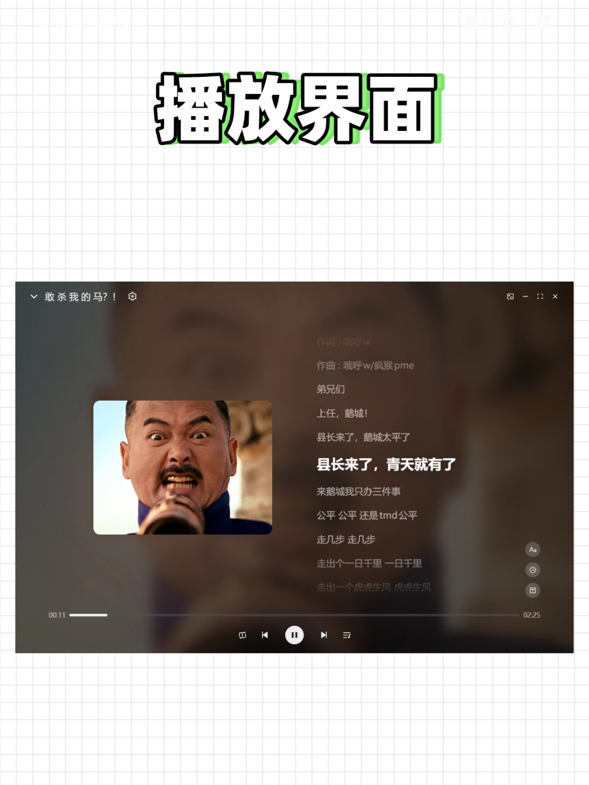
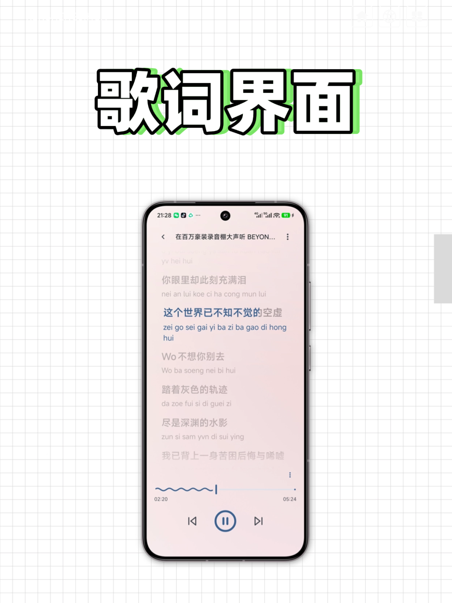

# 把B站曲库做成音乐软件，手机和电脑都可以用，全网音乐免费听！
> 💡 备注属性未写入，可能是备注属性名称或者类型被修改了，建议将字段类型设置为 rich_text，可以在小程序-操作-修改文章数据库页面进行调整
> 💡 原文链接:[https://mp.weixin.qq.com/s?__biz=MzYyNDgwNzQwMg==&mid=2247485335&idx=1&sn=1ea50ef2d925dafc435d592427167328&chksm=f1273b65939a042307afb1bfc55517086dcee4d495c799af1bf3928b153ceafc6901787fa98e#rd](https://mp.weixin.qq.com/s?__biz=MzYyNDgwNzQwMg%3D%3D&mid=2247485335&idx=1&sn=1ea50ef2d925dafc435d592427167328&chksm=f1273b65939a042307afb1bfc55517086dcee4d495c799af1bf3928b153ceafc6901787fa98e#rd)
把B站当做听歌软件应该不是什么小众爱好吧，想要音质好的有百万豪装录音棚版本，想要画质好的有高清修复版本，甚至有像索尼这样的正版音乐公司下场，把B站当做云盘，疯狂投稿。

于是就有不少开发者基于B站公开接口开发音乐软件，Biu和BBPlayer就是其中的代表，电脑的话可以用Biu，手机的话可以BBPlayer。
## Biu
Biu是一款优秀的电脑音乐播放器，开源跨平台，Windows，macOS，Linux都可安装。

Biu开箱即用，可以直接搜索自己想听的音乐。不知道听什么？侧边栏第一栏就是推荐音乐，分类里甚至有鬼畜这一项。
如果鬼畜音频有在网易云上传的话，甚至能匹配到歌词。

如果登录B站账号，还能获取收藏夹、稍后再看、历史记录等信息，可以把一次性批量下载收藏夹的视频，所以你也可以把Biu当做一个B站视频下载器去用。
Biu会优先拉取更高码率音频流（如无损 Flac，192K/Hi-Res），保证你的最佳听歌体验。
**Biu的下载地址：**
**https://pan.quark.cn/s/e0d6fe18193f**
**开源地址：https://github.com/wood3n/biu**
## BBPlayer
BBPlayer有点像我之前介绍过的哔哔音乐，名字很相似，界面也同样简洁美观，但是在软件的完成度方面要好很多。

跟Biu一样，不登录也能通过搜索来查找和播放歌曲，登录之后可以播放收藏夹的内容。
如果你习惯在别的音乐app听歌，BBPlayer也支持导入网易云音乐和QQ音乐这些软件的外部歌单，导入后会自动匹配B站的视频并保存为播放列表。
BBPlayer支持自动匹配歌词（酷狗音乐/ QQ 音乐/网易云音乐 ），给你完整的听歌体验。

BBPlayer还可以下载歌曲到本地，方便离线播放。
**BBPlayer下载地址：**
**https://pan.quark.cn/s/92d61209580d**
**开源地址：https://github.com/bbplayer-app/BBPlayer**
