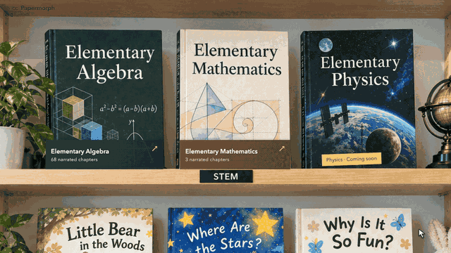
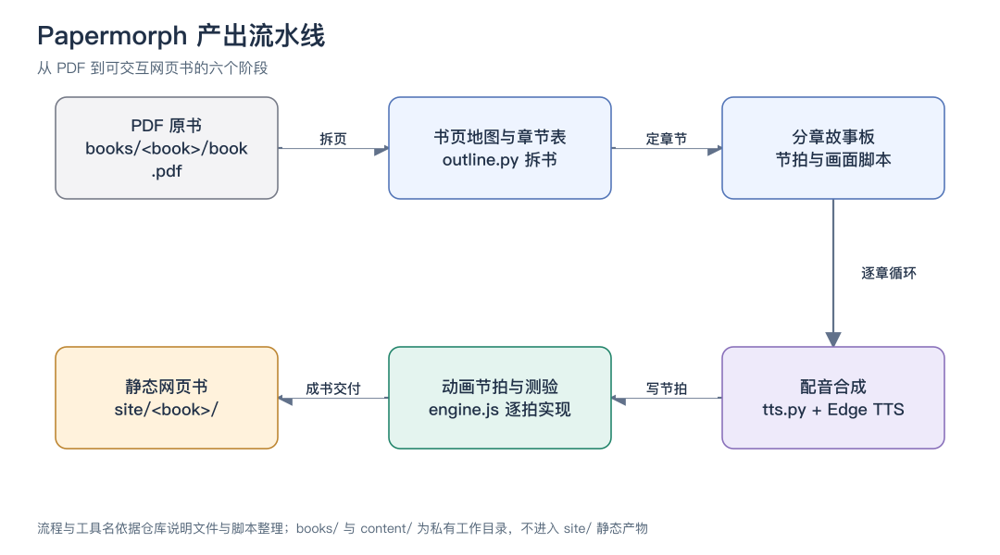
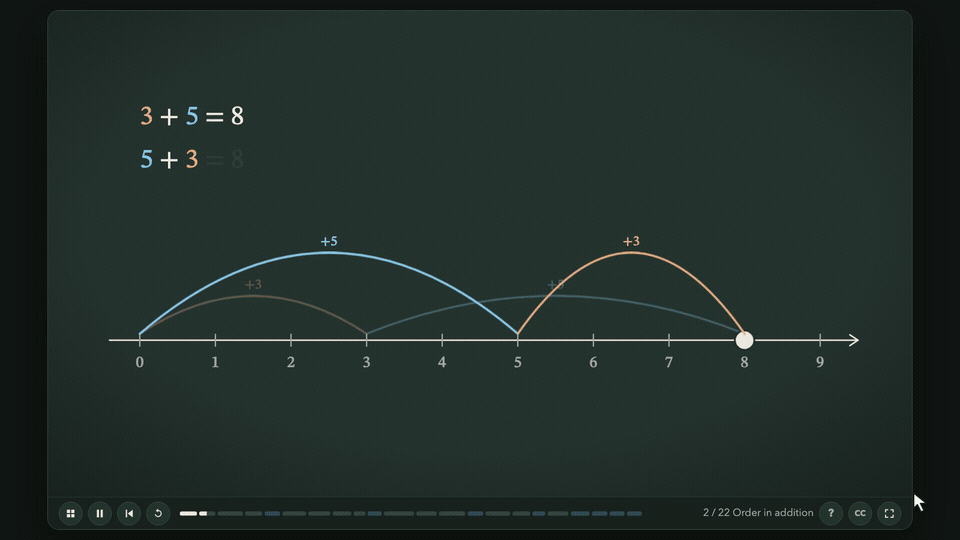

# 把一本 PDF 变成会动、会讲、能答题的网页书：Papermorph 值得一试
> 💡 备注属性未写入，可能是备注属性名称或者类型被修改了，建议将字段类型设置为 rich_text，可以在小程序-操作-修改文章数据库页面进行调整
> 💡 原文链接:[https://mp.weixin.qq.com/s?__biz=MzY5MTAxODQ1MQ==&mid=2247490211&idx=1&sn=2c9b4ad7520a6b87781f43e8fafb7675&chksm=f59dd50ab7cb0ecd8765661cf29be42d186b072dd2fc57d660bfcefe199d5115391ea047a83f#rd](https://mp.weixin.qq.com/s?__biz=MzY5MTAxODQ1MQ%3D%3D&mid=2247490211&idx=1&sn=2c9b4ad7520a6b87781f43e8fafb7675&chksm=f59dd50ab7cb0ecd8765661cf29be42d186b072dd2fc57d660bfcefe199d5115391ea047a83f#rd)
Papermorph 是一个开源的 AI 技能，输入一本 PDF 教材，产出一本会动、会讲、能答题的静态网页书：每章一个动画舞台，配音逐词驱动画面，随堂测验直接嵌在图里。本文依据仓库说明与源码，梳理它的产出流水线、安装依赖、逐章制作路径，以及现阶段的真实边界。
**解决什么**
拿一本教材自学，痛点从来不是没有内容，而是内容不动：公式印在纸上，推理过程看不见，例题做错了也没人告诉你错在哪一步。视频课好一些，能听能看，但没法互动——你无法暂停在「这一步为什么消去这项」上让画面重新演一遍，更没法顺手做两道题验证自己懂了。
Papermorph 接的就是这一段。它是一个运行在 Claude 里的技能，定位写得很直接：把参考 PDF 变成动画的、有旁白的、可交互的网页书。每一章是一个 1600×900 的 SVG 动画舞台加播放控件，「节拍」把配音片段和定时动作配对——配音讲到哪个词，画面就变到哪一步；随堂小测和章末练习也在画面里完成，答案直接作用在图上。仓库自带的演示动图展示了一条完整的体验链：木质书架摆着做好的书，点开一章是黑板风格的动画讲解，中途弹出判断题让你作答。
项目信息很简单：作者 DozenTwelve，MIT 许可证，2026 年 10 月 3 日建仓，截至 2026 年 10 月 6 日星标 409、复刻 48，主力语言标注为 HTML——这和它的产物形态一致：产出就是纯静态网页。官方维护了一个线上书架展示成品，也可以把仓库克隆下来在本地起个静态服务体验全部示例。
仓库首页给了一句六步流水线，值得先记住：PDF 进，书计划、分章故事板、配音、动画与测验，网页书出。后面的实操部分会展开这条线怎么走。
**核心能力**
**•** 动画即论证：技能说明里反复强调一条原则——画面变化本身是论证而不是装饰，重排、拆分、平衡、计数、比较，每一拍都回答「为什么这一步成立」。故事板阶段就要写清楚：眼睛该看哪里、什么在变、哪句话触发哪个动作。
**•** 词级配音联动：旁白写成 JSON，在每个关键词前插标记，页面动画等那个词开口才播放。配音由脚本调 Edge TTS 合成，每拍一个音频文件，同时产出时长、标记时间点和逐句字幕，字幕可开关。
**•** 画面里答题：内置六类题型——单选、填空（接受分数与带分数）、多行分类判断、在数轴上点位置、点表达式里的项、拖拽分类到集合图。答题卡尽量贴着被问的对象摆放，答错给针对该错误的提示，答对可以触发一段庆祝动画。记分卡统计全章首次作答成绩，回头重做不影响已记录的首答。
**•** 书架与进度：产出目录里有封面、目录和逐章课程页，从封面进目录、从目录进章节、从章节一键返回。阅读进度存在浏览器里，下次打开接着上次的节拍继续。
**•** 交付前自检：两个检查脚本，一个批量截取每章开头与结尾帧拼成对照图并收集控制台报错，一个专门查「配音已经开口、画面还空着」的开场空白，默认空一秒以上报警。

演示动图：书架、动画课与随堂测验的完整流程
**环境与安装**
先说门槛：这个技能目前只支持 Opus 5.5 模型，官方说明里写明暂时没有图像模型、多语言支持和背景音乐。依赖清单有四样——Python 的 uv 工具、ffmpeg（拆书和量音频时长都要用）、Edge TTS 的联网访问、Playwright 的 Chromium（按官方说明安装，供交付检查截帧使用）。
安装一条命令，在项目目录里执行：
npx skills add DozenTwelve/Papermorph --skill papermorph --agent claude-code
装好后，在 Claude Code 里用斜杠命令发起任务，官方给的调用格式是把诉求一次说清：
/papermorph 把 /路径/book.pdf 做成动画交互网页书。
目标读者：[你的读者画像]。
先做一章英文内容供审阅。
「先做一章供审阅」这句值得保留：技能的工作方式本来就是逐章推进、第一章定调，一次只审一章再往下走，比整本一把梭要稳得多。
**实操主路径：跑通第一章**
从 PDF 到第一章成品的完整路径：
**1.** 发起请求后进入登记阶段：定书名缩写，建工作目录，从模板生成 BOOK.md，记录读者、语气、主语言、范围和素材方案。缺的决策（比如读者是谁）会一次性问齐，并给默认值，不会挤牙膏式追问。
**2.** 拆书：跑拆书脚本读 PDF 的书签树，先不加参数看树形，再用章节所在层级重跑，生成页码地图。地图里每一章有起止页，书前书后内容自动归入前言、后记两个区。
**3.** 没有书签的扫描版怎么办：先用预览模式渲染前十二页看目录，再手写页码地图。脚本会拒绝有缝隙或重叠的地图，每章抽取文本层（扫描版文本层为空，需要按页渲染图来看），页图按 PDF 页序命名而不是印刷页码。
**4.** 列章节表：通读各章开头的文本，建一张「编号、标题、单元、预计分钟数、状态」的表，把配色和候选的重复视觉模型记进约定文件，和用户确认后再动手。
**5.** 初始化站点：复制引擎、封面目录模板和章节骨架到产出目录，选定配音音色和界面语言。
**6.** 做第一章，走完整个章节循环：读该章文本层、写故事板、写旁白并合成配音、按故事板实现每一拍的动画、跑交付检查、登记进目录。第一章的样式约定会沉淀进约定文件，后面所有章节照此执行。
本地预览也是一条命令：
python3 -m http.server 8765 -d site
浏览器打开对应端口就能看到书架。注意音频播放必须走 HTTP 访问，直接双击打开文件听不到配音。
**另外两条值得跟做的路径**
第一条：批量产余下章节。技能对上下文管理有明确设计——第一章留在主对话里做，之后的每章启用一个全新的子代理顺序执行，简报里带章号、路径和已批准的约定，子代理干完返回文件清单、检查结果和勘误，由主对话负责登记。这个设计是针对长书上下文膨胀的：每章干活时只读自己需要的那份参考资料，不背全书的包袱。你要做的是每章交付后过目、提意见，等全部章节就绪后补齐封面文案和单元小插画。
第二条：先体验再上手。线上书架可以直接翻阅官方做好的成品书，代数书有几十个带配音的章节，是感受「节拍」节奏最直接的样本；把仓库克隆到本地起服务，同样能离线翻全部示例。看完对节奏有体感了，再决定拿自己的哪本 PDF 试刀。假如你想给做完的书加第二语言，官方路径是等整本书定稿后再加：保持节拍和题目的标识不变，新增对应语言的旁白文件和音频目录，切换行为先和用户约定。
**关键实现**

拆书环节值得单说。脚本用 PyMuPDF 读书签，单元标题取自章节上一层书签，单元扉页并进该单元第一章的首页范围；书签缺失时退回手工地图。抽页脚本默认 150 dpi 渲染页图，临时文件先写后改名，不会留下半张图；重跑不覆盖已有图片，除非显式加参数。这些细节决定了「中途断了重跑」是安全的。按约定，源 PDF、抽页和抽取的文本全部留在私有工作目录，不进版本库，也不进静态产物。
配音环节的工程处理相当细致。合成时从语音服务拿词级边界，缓存存在旁白文件旁边；只重新合成文本或音色变化过的节拍，改标记位置只会重算时间戳、不重烧音频。写文件全部走原子替换，某个节拍失败不会弄丢已完成节拍的缓存——失败后重跑同一条命令，已合成的节拍直接复用。

动画引擎一层，每个可动画元素带一个状态对象：位置、缩放、旋转、透明度、描边进度、属性与颜色，全部由时间线驱动。调色板固定若干语义色，同一章里同色同义。引擎内置了一批数学教学助手——数轴、代数块、分数行、天平、坐标面、面积网格、骰子硬币转盘——第一本书是代数，所以助手偏数学；换学科就自己在章节里写新助手，被第二章复用时提升为共享助手。跳转到任意节拍会重建场景再即时回放，因此每一拍必须写成确定性的：对象创建和补间都走时间线，输入只来自章节数据和已保存的状态。
交付检查利用了地址栏参数：带节拍号和时间戳的地址能打开一帧冻结画面，检查脚本据此批量截图、拼对照图、收集控制台报错；开场空白检查则逐拍扫描画面可见元素数量，配音开始后画面空置超过阈值就报出来。
播放器交互也值得一说。空格播放暂停，左右方向键切换节拍，Home 重开本章，C 开关字幕，F 进全屏，问号呼出快捷键帮助；每类题型的每个动作都有键盘等价操作，鼠标拖拽之外键盘用户不会被挡在门外。还有一处容易踩的坑：阅读进度的存储键由书的目录路径推导而来，引擎和封面共用同一个键，改书名或挪目录前要想清楚老读者的进度会丢。
**边界与代价**
几个动手前要想清楚的点。第一，模型锁定：目前只有 Opus 5.5 能驱动它，技能对模型的排版与节奏把控要求很高，换弱模型的效果没有官方背书。第二，依赖链不短：uv、ffmpeg、联网的语音合成、无头浏览器，缺一样交付检查就走不完。第三，学科偏向：引擎助手从代数书沉淀而来，语文、历史这类以叙述为主的科目要用它，等于自己趟一条新路；官方路线图里的图画书和人文纪录片方向也还在计划中。第四，产出是静态文件夹，书架的对外发布和托管是另外的任务，技能不管部署。第五，版权要自己把关：技能要求重述讲解、例题和插图，源文件留在私有目录，但改编的边界终究是使用者自己的责任。
**可以怎么开始**
建议的顺序：先去官方线上书架把成品书翻一章，感受节拍和测验的节奏；再把仓库克隆到本地跑示例，确认自己的网络能访问语音合成服务；然后在常用项目目录里装好技能，挑一本页数适中、书签完整的 PDF，只做第一章试水。第一章交付后认真提意见——配色、节奏、题型都会沉淀为整本书的约定，这个反馈回路的质量直接决定后面每一章的成色。想深究实现，仓库里的技能说明和写作、引擎、站点、检查四份参考文档就是全部资料，写得克制而具体。
#开源项目# #动画课程# #配音交互# #网页书# #教育工具#
